# Database Schema ERD Report

## Models Overview
### `User`
- **branchGrants** (`BranchGrant[]`)
- **id** (`String`)
- **email** (`String`)
- **fullName** (`String`)
- **passwordHash** (`String`)
- **role** (`String`)
- **roleDefinition** (`Role`): Reference to `Role`
- **permissions** (`Json?`)
- **avatarUrl** (`String?`)
- **signatureUrl** (`String?`)
- **phone** (`String?`)
- **department** (`String?`)
- **departmentId** (`String?`)
- **departmentRecord** (`Department?`): Reference to `Department`
- **managerId** (`String?`)
- **manager** (`User?`): Reference to `User`
- **subordinates** (`User[]`): Reference to `User`
- **isActive** (`Boolean`)
- **lastLoginAt** (`DateTime?`)
- **mfaEnabled** (`Boolean`)
- **mfaSecretEncrypted** (`String?`)
- **mfaPendingSecretEncrypted** (`String?`)
- **mfaPendingExpiresAt** (`DateTime?`)
- **mfaLastStep** (`BigInt?`)
- **recoveryCodes** (`MfaRecoveryCode[]`)
- **resetToken** (`String?`)
- **resetExpiresAt** (`DateTime?`)
- **createdAt** (`DateTime`)
- **updatedAt** (`DateTime`)
- **assignedDeals** (`CrmDeal[]`)
- **assignedInquiries** (`Inquiry[]`)
- **inquiryNotes** (`InquiryNote[]`)
- **invoicesCreated** (`Invoice[]`)
- **paymentsCreated** (`Payment[]`)
- **expensesCreated** (`Expense[]`)
- **calendarEvents** (`CalendarEvent[]`)
- **activities** (`ActivityLog[]`)
- **notifications** (`Notification[]`)
- **attachments** (`Attachment[]`)
- **uploads** (`UploadObject[]`)
- **sessions** (`Session[]`)
- **contractsCreated** (`Contract[]`)
- **generatedDocuments** (`GeneratedDocument[]`)
- **companyDocuments** (`CompanyDocument[]`)
- **emailJobs** (`EmailJob[]`)
- **momsCreated** (`MinuteOfMeeting[]`): Reference to `MinuteOfMeeting`
- **momsApproved** (`MinuteOfMeeting[]`): Reference to `MinuteOfMeeting`
- **expenseClaims** (`ExpenseClaim[]`): Reference to `ExpenseClaim`
- **expenseClaimsScheduled** (`ExpenseClaim[]`): Reference to `ExpenseClaim`
- **expenseClaimsPaid** (`ExpenseClaim[]`): Reference to `ExpenseClaim`
- **discountLimitPercent** (`Decimal?`)
- **commissionRatePercent** (`Decimal?`)
- **quotationsOwned** (`Quotation[]`): Reference to `Quotation`
- **invoicesOwned** (`Invoice[]`): Reference to `Invoice`
- **attributionChangesFrom** (`SalesAttributionChange[]`): Reference to `SalesAttributionChange`
- **attributionChangesTo** (`SalesAttributionChange[]`): Reference to `SalesAttributionChange`
- **attributionChangesMade** (`SalesAttributionChange[]`): Reference to `SalesAttributionChange`
- **commissionPayouts** (`CommissionPayout[]`): Reference to `CommissionPayout`
- **commissionPayoutsRecorded** (`CommissionPayout[]`): Reference to `CommissionPayout`
- **supportReimbursementsRecorded** (`SupportReimbursement[]`): Reference to `SupportReimbursement`
- **signatureChanges** (`SignatureChange[]`): Reference to `SignatureChange`
- **signatureChangesReviewed** (`SignatureChange[]`): Reference to `SignatureChange`
- **quotationsSigned** (`Quotation[]`): Reference to `Quotation`
- **invoicesSigned** (`Invoice[]`): Reference to `Invoice`
- **receiptsSigned** (`Payment[]`): Reference to `Payment`
- **authChallenges** (`AuthChallenge[]`)
- **quotations** (`Quotation[]`): Reference to `Quotation`
- **communicationThreads** (`CommunicationThread[]`)
- **archivedAt** (`DateTime?`)
- **archivedById** (`String?`)
- **suspendedAt** (`DateTime?`)
- **suspendedById** (`String?`)
- **suspensionReason** (`String?`)
- **profileChangesRequested** (`ProfileChangeRequest[]`): Reference to `ProfileChangeRequest`
- **profileChangesManaged** (`ProfileChangeRequest[]`): Reference to `ProfileChangeRequest`
- **profileChangesForUser** (`ProfileChangeRequest[]`): Reference to `ProfileChangeRequest`
- **approvalRequestsCreated** (`ApprovalRequest[]`): Reference to `ApprovalRequest`
- **approvalDecisionsGiven** (`ApprovalDecision[]`): Reference to `ApprovalDecision`
- **requestAssignmentsReceived** (`RequestAssignment[]`): Reference to `RequestAssignment`
- **requestAssignmentsGiven** (`RequestAssignment[]`): Reference to `RequestAssignment`
- **requestCommentsAuthored** (`RequestComment[]`): Reference to `RequestComment`
- **requestEventsAuthored** (`RequestEvent[]`): Reference to `RequestEvent`
- **employee** (`Employee?`): Reference to `Employee`
- **socialPlansAssigned** (`SocialContentPlan[]`): Reference to `SocialContentPlan`
- **socialPlansCreated** (`SocialContentPlan[]`): Reference to `SocialContentPlan`
- **accountChanges** (`AccountChangeRequest[]`): Reference to `AccountChangeRequest`
- **accountChangesFiled** (`AccountChangeRequest[]`): Reference to `AccountChangeRequest`
- **clientSignaturesCreated** (`ClientSignature[]`): Reference to `ClientSignature`
- **calendarFeed** (`CalendarFeedToken?`)
- **announcementReceipts** (`AnnouncementReceipt[]`)
- **cmsArticles** (`CmsArticle[]`): Reference to `CmsArticle`
- **dashboardLayout** (`DashboardLayout?`)
- **cashierSessions** (`CashierSession[]`): Reference to `CashierSession`
- **openedShifts** (`RetailShift[]`): Reference to `RetailShift`
- **closedShifts** (`RetailShift[]`): Reference to `RetailShift`
- **retailClosings** (`RetailClosing[]`): Reference to `RetailClosing`
- **paymentCollections** (`PaymentCollection[]`): Reference to `PaymentCollection`
- **attributedCommissions** (`CommissionSnapshot[]`): Reference to `CommissionSnapshot`

### `CompanySetting`
- **id** (`String`)
- **singleton** (`Int`)
- **companyNameEn** (`String`)
- **companyNameAr** (`String`)
- **crNumber** (`String?`)
- **vatId** (`String?`)
- **vatEnabled** (`Boolean`)
- **vatPercentage** (`Decimal`)
- **vatCertificateUrl** (`String?`)
- **defaultCurrency** (`String`)
- **currencyDecimals** (`Int`)
- **addressEn** (`String?`)
- **addressAr** (`String?`)
- **phone** (`String?`)
- **whatsappPhone** (`String?`)
- **email** (`String?`)
- **website** (`String?`)
- **instagramUrl** (`String?`)
- **linkedinUrl** (`String?`)
- **youtubeUrl** (`String?`)
- **bankName** (`String?`)
- **bankIban** (`String?`)
- **bankAccountNumber** (`String?`)
- **bankSwift** (`String?`)
- **timeZone** (`String?`)
- **logoUrl** (`String?`)
- **darkLogoUrl** (`String?`)
- **fullLogoUrl** (`String?`)
- **darkFullLogoUrl** (`String?`)
- **iconUrl** (`String?`)
- **darkIconUrl** (`String?`)
- **documentHeaderUrl** (`String?`)
- **documentFooterUrl** (`String?`)
- **stampUrl** (`String?`)
- **signatureUrl** (`String?`)
- **paymentTermsDays** (`Int`)
- **invoicePrefix** (`String`)
- **invoiceNextNumber** (`Int`)
- **receiptPrefix** (`String`)
- **receiptNextNumber** (`Int`)
- **ceoNameEn** (`String?`)
- **ceoNameAr** (`String?`)
- **ceoTitleEn** (`String?`)
- **ceoTitleAr** (`String?`)
- **ceoQuoteEn** (`String?`)
- **ceoQuoteAr** (`String?`)
- **missionEn** (`String?`)
- **missionAr** (`String?`)
- **visionEn** (`String?`)
- **visionAr** (`String?`)
- **aboutTextEn** (`String?`)
- **aboutTextAr** (`String?`)
- **termsEn** (`String?`)
- **termsAr** (`String?`)
- **rulesEn** (`String?`)
- **rulesAr** (`String?`)
- **updatedAt** (`DateTime`)
- **defaultDiscountLimitPercent** (`Decimal`)
- **quotationsAlwaysNeedApproval** (`Boolean`)
- **theme** (`Json?`)
- **setupCompletedAt** (`DateTime?`)
- **contentLanguages** (`String[]`)
- **primaryLanguage** (`String`)
- **businessActivity** (`String?`)
- **taglineEn** (`String?`)
- **taglineAr** (`String?`)
- **foundedYear** (`Int?`)
- **city** (`String?`)
- **country** (`String?`)
- **mapUrl** (`String?`)
- **websiteDomain** (`String?`)
- **adminDomain** (`String?`)

### `CompanyAsset`
- **id** (`String`)
- **assetKey** (`String`)
- **title** (`String`)
- **fileUrl** (`String`)
- **mimeType** (`String?`)
- **fileSize** (`Int?`)
- **updatedAt** (`DateTime`)
- **createdAt** (`DateTime`)

### `HeroBanner`
- **id** (`String`)
- **titleEn** (`String`)
- **titleAr** (`String`)
- **subtitleEn** (`String?`)
- **subtitleAr** (`String?`)
- **mediaType** (`String`)
- **mediaUrl** (`String`)
- **posterUrl** (`String?`)
- **displayOrder** (`Int`)
- **isActive** (`Boolean`)
- **ctaLabelEn** (`String?`)
- **ctaLabelAr** (`String?`)
- **ctaLink** (`String?`)
- **createdAt** (`DateTime`)
- **isSample** (`Boolean`)

### `PortfolioCategory`
- **id** (`String`)
- **slug** (`String`)
- **nameEn** (`String`)
- **nameAr** (`String`)
- **displayOrder** (`Int`)
- **items** (`PortfolioItem[]`)

### `PortfolioItem`
- **id** (`String`)
- **categoryId** (`String?`)
- **category** (`PortfolioCategory?`): Reference to `PortfolioCategory`
- **slug** (`String`)
- **titleEn** (`String`)
- **titleAr** (`String`)
- **clientName** (`String?`)
- **year** (`Int?`)
- **subtitleEn** (`String?`)
- **subtitleAr** (`String?`)
- **price** (`Decimal?`)
- **priceNoteEn** (`String?`)
- **priceNoteAr** (`String?`)
- **location** (`String?`)
- **externalUrl** (`String?`)

### `ClientLogo`
- **id** (`String`)
- **name** (`String`)
- **logoUrl** (`String`)
- **websiteUrl** (`String?`)
- **isDarkLogo** (`Boolean`)
- **displayOrder** (`Int`)
- **isActive** (`Boolean`)

### `StudioEquipment`
- **id** (`String`)
- **category** (`String`)
- **nameEn** (`String`)
- **nameAr** (`String`)
- **brand** (`String?`)
- **dailyRateBhd** (`Decimal?`)
- **quantity** (`Int`)
- **specification** (`String?`)
- **descriptionEn** (`String?`)
- **descriptionAr** (`String?`)
- **imageUrl** (`String?`)
- **displayOrder** (`Int`)
- **createdAt** (`DateTime`)

### `Inquiry`
- **id** (`String`)
- **name** (`String`)
- **email** (`String`)
- **emailNorm** (`String?`)
- **phone** (`String?`)
- **phoneE164** (`String?`)
- **companyName** (`String?`)
- **serviceType** (`String?`)
- **budgetRange** (`String?`)
- **timeline** (`String?`)
- **message** (`String`)
- **status** (`String`)
- **locale** (`String`)
- **source** (`String`)
- **customerId** (`String?`)
- **customer** (`CrmContact?`): Reference to `CrmContact`
- **intent** (`String`)
- **reference** (`String`)
- **submissionKey** (`String?`)
- **requestHash** (`String?`)
- **serviceIds** (`String[]`)
- **projectReference** (`String?`)
- **location** (`String?`)
- **assignedToId** (`String?`)
- **assignedTo** (`User?`): Reference to `User`
- **team** (`String?`)
- **workflowStatus** (`String`)
- **customAssignments** (`Json?`)

### `InquiryNote`
- **id** (`String`)
- **inquiryId** (`String`)
- **inquiry** (`Inquiry`): Reference to `Inquiry`
- **authorId** (`String`)
- **author** (`User`): Reference to `User`
- **body** (`String`)
- **createdAt** (`DateTime`)

### `WebsiteContent`
- **id** (`String`)
- **draft** (`Json`)
- **published** (`Json?`)
- **previous** (`Json?`)
- **revision** (`Int`)
- **publishedAt** (`DateTime?`)
- **updatedAt** (`DateTime`)

### `CmsPage`
- **id** (`String`)
- **slug** (`String`)
- **pageType** (`String`)
- **titleEn** (`String`)
- **titleAr** (`String`)
- **seoTitleEn** (`String?`)
- **seoTitleAr** (`String?`)
- **seoDescriptionEn** (`String?`)
- **seoDescriptionAr** (`String?`)

### `CmsArticle`
- **id** (`String`)
- **slug** (`String`)
- **titleEn** (`String`)
- **titleAr** (`String`)
- **excerptEn** (`String?`)
- **excerptAr** (`String?`)
- **bodyEn** (`Json?`)
- **bodyAr** (`Json?`)
- **bodyHtmlEn** (`String?`)
- **bodyHtmlAr** (`String?`)
- **coverUrl** (`String?`)
- **category** (`String`)
- **tags** (`String[]`)
- **authorId** (`String?`)
- **author** (`User?`): Reference to `User`
- **authorName** (`String?`)
- **status** (`String`)
- **publishAt** (`DateTime?`)
- **featured** (`Boolean`)
- **seoTitleEn** (`String?`)
- **seoTitleAr** (`String?`)
- **seoDescriptionEn** (`String?`)
- **seoDescriptionAr** (`String?`)
- **createdAt** (`DateTime`)
- **updatedAt** (`DateTime`)
- **isSample** (`Boolean`)

### `CrmContact`
- **id** (`String`)
- **firstName** (`String`)
- **lastName** (`String?`)
- **email** (`String?`)
- **emailNorm** (`String?`)
- **phone** (`String?`)
- **phoneE164** (`String?`)
- **companyName** (`String?`)
- **vatNumber** (`String?`)
- **jobTitle** (`String?`)
- **contactType** (`String`)
- **clientKind** (`String`)
- **companyOrigin** (`String?`)
- **companyNameAr** (`String?`)
- **legalForm** (`String?`)
- **crNumber** (`String?`)
- **crExpiryDate** (`DateTime?`)
- **registrationNumber** (`String?`)
- **registrationCountry** (`String?`)
- **governmentType** (`String?`)
- **supplierNumber** (`String?`)
- **requiresPurchaseOrder** (`Boolean`)
- **nationality** (`String?`)
- **industry** (`String?`)
- **website** (`String?`)
- **preferredLanguage** (`String?`)
- **paymentTermsDays** (`Int?`)
- **addressCountry** (`String?`)
- **addressCity** (`String?`)
- **addressArea** (`String?`)
- **addressBlock** (`String?`)
- **addressRoad** (`String?`)
- **addressBuilding** (`String?`)
- **addressUnit** (`String?`)
- **addressLine** (`String?`)
- **addressState** (`String?`)
- **addressPostalCode** (`String?`)
- **addressPoBox** (`String?`)
- **contactPersons** (`ClientContactPerson[]`)
- **notes** (`String?`)
- **deals** (`CrmDeal[]`)
- **inquiries** (`Inquiry[]`)
- **contracts** (`Contract[]`)
- **invoices** (`Invoice[]`)
- **reviews** (`Review[]`)
- **minutesOfMeetings** (`MinuteOfMeeting[]`)
- **expenses** (`Expense[]`)
- **createdAt** (`DateTime`)
- **updatedAt** (`DateTime`)
- **quotations** (`Quotation[]`)
- **communicationThreads** (`CommunicationThread[]`)
- **supplierLeadTimeDays** (`Int?`)
- **supplierPaymentTermsDays** (`Int?`)
- **purchaseOrders** (`PurchaseOrder[]`)
- **rfqQuotes** (`RfqQuote[]`)
- **supplierBills** (`SupplierBill[]`)
- **customer** (`Customer?`)

### `ClientContactPerson`
- **id** (`String`)
- **contactId** (`String`)
- **contact** (`CrmContact`): Reference to `CrmContact`
- **fullName** (`String`)
- **position** (`String?`)
- **department** (`String?`)
- **email** (`String?`)
- **phone** (`String?`)
- **isPrimary** (`Boolean`)
- **notes** (`String?`)
- **displayOrder** (`Int`)
- **createdAt** (`DateTime`)
- **updatedAt** (`DateTime`)

### `CrmDeal`
- **id** (`String`)
- **contactId** (`String?`)
- **contact** (`CrmContact?`): Reference to `CrmContact`
- **sourceInquiryId** (`String?`)
- **sourceInquiry** (`Inquiry?`): Reference to `Inquiry`
- **title** (`String`)
- **dealStage** (`String`)
- **dealValue** (`Decimal`)
- **currency** (`String`)
- **probability** (`Int`)
- **expectedCloseDate** (`DateTime?`)
- **shootDate** (`DateTime?`)
- **lostReason** (`String?`)
- **assignedTo** (`String?`)
- **assignee** (`User?`): Reference to `User`
- **notes** (`String?`)
- **invoices** (`Invoice[]`)
- **expenses** (`Expense[]`)
- **calendarEvents** (`CalendarEvent[]`)
- **contracts** (`Contract[]`)
- **minutesOfMeetings** (`MinuteOfMeeting[]`)
- **createdAt** (`DateTime`)
- **updatedAt** (`DateTime`)
- **expenseClaims** (`ExpenseClaim[]`)
- **quotations** (`Quotation[]`)

### `DealPipelineStage`
- **id** (`String`)
- **nameEn** (`String?`)
- **nameAr** (`String?`)
- **sortOrder** (`Int`)
- **probability** (`Int`)
- **kind** (`String`)
- **color** (`String?`)
- **isSystem** (`Boolean`)
- **isActive** (`Boolean`)
- **createdAt** (`DateTime`)
- **updatedAt** (`DateTime`)

### `Invoice`
- **id** (`String`)
- **dealId** (`String?`)
- **deal** (`CrmDeal?`): Reference to `CrmDeal`
- **invoiceNumber** (`String`)
- **clientId** (`String?`)
- **client** (`CrmContact?`): Reference to `CrmContact`
- **issueDate** (`DateTime`)
- **dueDate** (`DateTime`)
- **subtotal** (`Decimal`)
- **vatEnabled** (`Boolean`)
- **vatPercentage** (`Decimal`)
- **vatAmount** (`Decimal`)
- **otherTaxAmount** (`Decimal`)
- **taxes** (`DocumentTax[]`)
- **discountType** (`String`)
- **discountValue** (`Decimal`)
- **discountAmount** (`Decimal`)
- **totalAmount** (`Decimal`)
- **currency** (`String`)
- **language** (`String`)
- **status** (`String`)
- **approvalStatus** (`String`)
- **approvalRevision** (`Int`)
- **contentHash** (`String?`)
- **pdfStoragePath** (`String?`)
- **deliveryChannel** (`String?`)
- **deliveredAt** (`DateTime?`)
- **notesEn** (`String?`)
- **notesAr** (`String?`)
- **createdById** (`String?`)
- **createdBy** (`User?`): Reference to `User`
- **lineItems** (`InvoiceLineItem[]`)
- **payments** (`Payment[]`)
- **allocations** (`PaymentAllocation[]`)
- **createdAt** (`DateTime`)
- **updatedAt** (`DateTime`)
- **expenseClaims** (`ExpenseClaim[]`)
- **salesOwnerId** (`String?`)
- **salesOwner** (`User?`): Reference to `User`
- **signedById** (`String?`)
- **signedBy** (`User?`): Reference to `User`
- **signedAt** (`DateTime?`)
- **signerSignatureUrl** (`String?`)
- **quotation** (`Quotation?`)
- **communicationMessages** (`CommunicationMessage[]`)

### `InvoiceLineItem`
- **id** (`String`)
- **invoiceId** (`String`)
- **invoice** (`Invoice`): Reference to `Invoice`
- **serviceId** (`String?`)
- **service** (`Service?`): Reference to `Service`
- **descriptionEn** (`String`)
- **descriptionAr** (`String?`)
- **quantity** (`Decimal`)
- **unitPrice** (`Decimal`)
- **lineTotal** (`Decimal`)
- **displayOrder** (`Int`)

### `Payment`
- **id** (`String`)
- **invoiceId** (`String`)
- **invoice** (`Invoice`): Reference to `Invoice`
- **receiptNumber** (`String`)
- **paymentDate** (`DateTime`)
- **amount** (`Decimal`)
- **currency** (`String`)
- **paymentMethod** (`String`)
- **referenceNumber** (`String?`)
- **notes** (`String?`)
- **receiptPdfPath** (`String?`)
- **notificationChannel** (`String?`)
- **notificationSent** (`Boolean`)
- **createdById** (`String?`)
- **createdBy** (`User?`): Reference to `User`
- **allocations** (`PaymentAllocation[]`)
- **settlement** (`BankSettlement?`)
- **createdAt** (`DateTime`)
- **signedById** (`String?`)
- **signedBy** (`User?`): Reference to `User`
- **signedAt** (`DateTime?`)
- **signerSignatureUrl** (`String?`)

### `ExpenseCategory`
- **id** (`String`)
- **slug** (`String`)
- **nameEn** (`String`)
- **nameAr** (`String`)
- **color** (`String`)
- **displayOrder** (`Int`)
- **kind** (`String`)
- **isSystem** (`Boolean`)
- **isActive** (`Boolean`)
- **expenses** (`Expense[]`)
- **claims** (`ExpenseClaim[]`)
- **recurringExpenses** (`RecurringExpense[]`)

### `Expense`
- **id** (`String`)
- **categoryId** (`String?`)
- **category** (`ExpenseCategory?`): Reference to `ExpenseCategory`
- **dealId** (`String?`)
- **deal** (`CrmDeal?`): Reference to `CrmDeal`
- **clientId** (`String?`)
- **client** (`CrmContact?`): Reference to `CrmContact`
- **scope** (`String`)
- **paymentMethod** (`String?`)
- **descriptionEn** (`String`)
- **descriptionAr** (`String?`)
- **amount** (`Decimal`)
- **netAmount** (`Decimal`)
- **inputVatAmount** (`Decimal`)
- **isVatRecoverable** (`Boolean`)
- **taxInvoiceNumber** (`String?`)
- **currency** (`String`)
- **expenseDate** (`DateTime`)
- **vendorName** (`String?`)
- **receiptUrl** (`String?`)
- **isBillable** (`Boolean`)
- **isRecurring** (`Boolean`)
- **recurrenceInterval** (`String?`)
- **notes** (`String?`)
- **status** (`String`)
- **reviewNotes** (`String?`)
- **createdById** (`String?`)
- **createdBy** (`User?`): Reference to `User`
- **createdAt** (`DateTime`)
- **claim** (`ExpenseClaim?`)
- **commissionPayout** (`CommissionPayout?`)
- **recurringExpenseId** (`String?`)
- **recurringExpense** (`RecurringExpense?`): Reference to `RecurringExpense`

### `CalendarEvent`
- **id** (`String`)
- **title** (`String`)
- **titleAr** (`String?`)
- **description** (`String?`)
- **startDate** (`DateTime`)
- **endDate** (`DateTime`)
- **allDay** (`Boolean`)
- **location** (`String?`)
- **color** (`String?`)
- **eventType** (`String`)
- **dealId** (`String?`)
- **deal** (`CrmDeal?`): Reference to `CrmDeal`
- **createdById** (`String?`)
- **createdBy** (`User?`): Reference to `User`
- **googleEventId** (`String?`)
- **googleCalendarId** (`String?`)
- **recurrence** (`String?`)
- **reminders** (`Json?`)
- **attendees** (`Json?`)
- **visibility** (`String`)
- **audienceUserIds** (`String[]`)
- **audienceDepartmentIds** (`String[]`)
- **audienceRoles** (`String[]`)
- **createdAt** (`DateTime`)
- **updatedAt** (`DateTime`)
- **expenseClaims** (`ExpenseClaim[]`)

### `ActivityLog`
- **id** (`String`)
- **userId** (`String`)
- **user** (`User`): Reference to `User`
- **action** (`String`)
- **entityType** (`String`)
- **entityId** (`String?`)
- **details** (`Json?`)
- **diffPayload** (`Json?`)

### `Notification`
- **id** (`String`)
- **userId** (`String`)
- **user** (`User`): Reference to `User`
- **title** (`String`)
- **message** (`String`)
- **type** (`String`)
- **entityType** (`String?`)
- **entityId** (`String?`)
- **messageKey** (`String?`)
- **messageParams** (`Json?`)
- **actionUrl** (`String?`)
- **eventKey** (`String?`)
- **isRead** (`Boolean`)
- **hiddenAt** (`DateTime?`)
- **createdAt** (`DateTime`)

### `Tag`
- **id** (`String`)
- **name** (`String`)
- **nameAr** (`String?`)
- **color** (`String`)
- **entityType** (`String`)
- **createdAt** (`DateTime`)

### `Attachment`
- **id** (`String`)
- **fileName** (`String`)
- **fileUrl** (`String`)
- **fileSize** (`Int?`)
- **mimeType** (`String?`)
- **entityType** (`String`)
- **entityId** (`String`)
- **uploadedById** (`String?`)
- **uploadedBy** (`User?`): Reference to `User`
- **createdAt** (`DateTime`)

### `Permission`
- **id** (`String`)
- **role** (`String`)
- **roleDefinition** (`Role`): Reference to `Role`
- **resource** (`String`)
- **action** (`String`)
- **allowed** (`Boolean`)
- **createdAt** (`DateTime`)

### `Session`
- **id** (`String`)
- **userId** (`String`)
- **user** (`User`): Reference to `User`
- **token** (`String`)
- **ipAddress** (`String?`)
- **userAgent** (`String?`)
- **expiresAt** (`DateTime`)
- **createdAt** (`DateTime`)

### `DocumentTemplate`
- **id** (`String`)
- **slug** (`String`)
- **nameEn** (`String`)
- **nameAr** (`String?`)
- **category** (`String`)
- **bodyHtml** (`String?`)
- **bodyJson** (`Json?`)
- **version** (`Int`)
- **isActive** (`Boolean`)
- **contracts** (`Contract[]`)
- **createdAt** (`DateTime`)
- **updatedAt** (`DateTime`)

### `Contract`
- **id** (`String`)
- **contractNumber** (`String`)
- **dealId** (`String?`)
- **deal** (`CrmDeal?`): Reference to `CrmDeal`
- **contactId** (`String?`)
- **contact** (`CrmContact?`): Reference to `CrmContact`
- **templateId** (`String?`)
- **template** (`DocumentTemplate?`): Reference to `DocumentTemplate`
- **titleEn** (`String`)
- **titleAr** (`String?`)
- **bodyHtml** (`String?`)
- **status** (`String`)
- **signatureHash** (`String?`)
- **signedAt** (`DateTime?`)
- **validFrom** (`DateTime?`)
- **validUntil** (`DateTime?`)
- **pdfStoragePath** (`String?`)
- **metadata** (`Json?`)
- **createdById** (`String?`)
- **createdBy** (`User?`): Reference to `User`
- **createdAt** (`DateTime`)
- **updatedAt** (`DateTime`)

### `MinuteOfMeeting`
- **emailJobs** (`EmailJob[]`)
- **id** (`String`)
- **momNumber** (`String`)
- **title** (`String`)
- **titleAr** (`String?`)
- **meetingDate** (`DateTime`)
- **startTime** (`String?`)
- **endTime** (`String?`)
- **location** (`String?`)
- **dealId** (`String?`)
- **deal** (`CrmDeal?`): Reference to `CrmDeal`
- **clientId** (`String?`)
- **client** (`CrmContact?`): Reference to `CrmContact`
- **attendees** (`Json`)

### `GeneratedDocument`
- **id** (`String`)
- **documentType** (`String`)
- **sourceEntityType** (`String`)
- **sourceEntityId** (`String`)
- **fileName** (`String`)
- **storagePath** (`String`)
- **fileSize** (`Int?`)
- **checksum** (`String?`)
- **generatedById** (`String?`)
- **generatedBy** (`User?`): Reference to `User`
- **createdAt** (`DateTime`)

### `CompanyDocument`
- **id** (`String`)
- **titleEn** (`String`)
- **titleAr** (`String?`)
- **category** (`String`)
- **documentNumber** (`String?`)
- **fileUrl** (`String`)
- **fileSize** (`Int?`)
- **mimeType** (`String?`)
- **validFrom** (`DateTime?`)
- **validUntil** (`DateTime?`)
- **notes** (`String?`)
- **uploadedById** (`String?`)
- **uploadedBy** (`User?`): Reference to `User`
- **createdAt** (`DateTime`)
- **updatedAt** (`DateTime`)

### `Service`
- **id** (`String`)
- **code** (`String?`)
- **nameEn** (`String`)
- **nameAr** (`String`)
- **category** (`String`)
- **descriptionEn** (`String?`)
- **descriptionAr** (`String?`)
- **unit** (`String`)
- **defaultRate** (`Decimal`)
- **isActive** (`Boolean`)
- **displayOrder** (`Int`)
- **isPublic** (`Boolean`)
- **imageUrl** (`String?`)
- **lineItems** (`InvoiceLineItem[]`)
- **createdAt** (`DateTime`)
- **updatedAt** (`DateTime`)
- **isSample** (`Boolean`)

### `SocialLink`
- **id** (`String`)
- **platform** (`String`)
- **url** (`String`)
- **icon** (`String?`)
- **isActive** (`Boolean`)
- **displayOrder** (`Int`)
- **createdAt** (`DateTime`)
- **updatedAt** (`DateTime`)

### `Role`
- **users** (`User[]`)
- **permissions** (`Permission[]`)
- **id** (`String`)
- **nameEn** (`String`)
- **nameAr** (`String`)
- **isSystem** (`Boolean`)
- **createdAt** (`DateTime`)

### `RoleDataScope`
- **role** (`String`)
- **area** (`String`)
- **scope** (`String`)

### `FeatureToggle`
- **id** (`String`)
- **moduleKey** (`String`)
- **isEnabled** (`Boolean`)
- **nameEn** (`String`)
- **nameAr** (`String`)
- **description** (`String?`)

### `Review`
- **id** (`String`)
- **clientId** (`String?`)
- **client** (`CrmContact?`): Reference to `CrmContact`
- **originalLocale** (`String?`)
- **submissionKey** (`String?`)
- **requestHash** (`String?`)
- **authorEn** (`String`)
- **authorAr** (`String`)
- **companyEn** (`String?`)
- **companyAr** (`String?`)
- **quoteEn** (`String`)
- **quoteAr** (`String`)
- **rating** (`Int`)
- **isApproved** (`Boolean`)
- **sortOrder** (`Int`)
- **year** (`String`)
- **createdAt** (`DateTime`)

### `Faq`
- **id** (`String`)
- **questionEn** (`String`)
- **questionAr** (`String`)
- **answerEn** (`String`)
- **answerAr** (`String`)
- **category** (`String`)
- **isPublished** (`Boolean`)
- **sortOrder** (`Int`)
- **createdAt** (`DateTime`)
- **isSample** (`Boolean`)

### `Statistic`
- **id** (`String`)
- **value** (`String`)
- **labelEn** (`String`)
- **labelAr** (`String`)
- **subLabelEn** (`String?`)
- **subLabelAr** (`String?`)
- **icon** (`String?`)
- **sortOrder** (`Int`)
- **source** (`String`)
- **preset** (`String?`)
- **presetParam** (`Int?`)
- **roundTo** (`Int?`)
- **suffix** (`String?`)
- **isSample** (`Boolean`)

### `RevalidationJob`
- **id** (`String`)
- **eventKey** (`String`)
- **payload** (`Json`)
- **status** (`String`)
- **attempts** (`Int`)
- **nextAttemptAt** (`DateTime`)
- **lastError** (`String?`)
- **deliveredAt** (`DateTime?`)
- **createdAt** (`DateTime`)

### `UploadObject`
- **id** (`String`)
- **fileUrl** (`String`)
- **ownerId** (`String`)
- **owner** (`User`): Reference to `User`
- **fileName** (`String`)
- **fileSize** (`Int`)
- **mimeType** (`String`)
- **isPublic** (`Boolean`)
- **claimedAt** (`DateTime?`)
- **expiresAt** (`DateTime`)
- **createdAt** (`DateTime`)

### `AbuseWindow`
- **key** (`String`)
- **count** (`Int`)
- **expiresAt** (`DateTime`)

### `MfaRecoveryCode`
- **id** (`String`)
- **userId** (`String`)
- **user** (`User`): Reference to `User`
- **codeHash** (`String`)
- **usedAt** (`DateTime?`)

### `EmailJob`
- **id** (`String`)
- **eventKey** (`String`)
- **momId** (`String?`)
- **mom** (`MinuteOfMeeting?`): Reference to `MinuteOfMeeting`
- **createdById** (`String?`)
- **createdBy** (`User?`): Reference to `User`
- **recipient** (`String`)
- **subject** (`String`)
- **html** (`String`)
- **attachmentName** (`String`)
- **attachment** (`Bytes`)
- **status** (`String`)
- **attempts** (`Int`)
- **nextAttemptAt** (`DateTime`)
- **providerId** (`String?`)
- **lastError** (`String?`)
- **acceptedAt** (`DateTime?`)
- **createdAt** (`DateTime`)

### `IntegrationSetting`
- **provider** (`String`)
- **isActive** (`Boolean`)
- **credentials** (`String?`)
- **config** (`Json?`)
- **syncLeaseToken** (`String?`)
- **syncLeaseUntil** (`DateTime?`)
- **healthStatus** (`String`)
- **lastCheckedAt** (`DateTime?`)
- **lastError** (`String?`)
- **accountName** (`String?`)
- **lastSyncedAt** (`DateTime?`)
- **updatedAt** (`DateTime`)
- **updatedById** (`String?`)

### `SocialInsightSnapshot`
- **id** (`String`)
- **platform** (`String`)
- **sourceProvider** (`String`)
- **sourceAccountId** (`String`)
- **periodDays** (`Int`)
- **periodStart** (`DateTime`)
- **periodEnd** (`DateTime`)
- **timeZone** (`String`)
- **metrics** (`Json`)
- **nativeMetrics** (`Json`)
- **recordedAt** (`DateTime`)

### `AuthChallenge`
- **id** (`String`)
- **userId** (`String?`)
- **user** (`User?`): Reference to `User`
- **email** (`String`)
- **type** (`String`)
- **codeHash** (`String`)
- **expiresAt** (`DateTime`)
- **attempts** (`Int`)
- **createdAt** (`DateTime`)

### `Quotation`
- **id** (`String`)
- **quotationNumber** (`String`)
- **revision** (`Int`)
- **dealId** (`String?`)
- **deal** (`CrmDeal?`): Reference to `CrmDeal`
- **clientId** (`String?`)
- **client** (`CrmContact?`): Reference to `CrmContact`
- **inquiryId** (`String?`)
- **inquiry** (`Inquiry?`): Reference to `Inquiry`
- **invoiceId** (`String?`)
- **invoice** (`Invoice?`): Reference to `Invoice`
- **issueDate** (`DateTime`)
- **validUntilDate** (`DateTime`)
- **subtotal** (`Decimal`)
- **vatEnabled** (`Boolean`)
- **vatPercentage** (`Decimal`)
- **vatAmount** (`Decimal`)
- **otherTaxAmount** (`Decimal`)
- **taxes** (`DocumentTax[]`)
- **discountType** (`String`)
- **discountValue** (`Decimal`)
- **discountAmount** (`Decimal`)
- **totalAmount** (`Decimal`)
- **currency** (`String`)
- **language** (`String`)
- **status** (`String`)
- **acceptanceEvidence** (`String?`)
- **approvalRevision** (`Int`)
- **contentHash** (`String?`)
- **rawRate** (`Decimal?`)
- **fxMarginPercent** (`Decimal`)
- **effectiveRate** (`Decimal?`)
- **pdfStoragePath** (`String?`)
- **deliveryChannel** (`String?`)
- **deliveredAt** (`DateTime?`)
- **termsEn** (`String?`)
- **termsAr** (`String?`)
- **createdById** (`String?`)
- **createdBy** (`User?`): Reference to `User`
- **lineItems** (`QuotationLineItem[]`)
- **createdAt** (`DateTime`)
- **updatedAt** (`DateTime`)
- **salesOwnerId** (`String?`)
- **salesOwner** (`User?`): Reference to `User`
- **signedById** (`String?`)
- **signedBy** (`User?`): Reference to `User`
- **signedAt** (`DateTime?`)
- **signerSignatureUrl** (`String?`)
- **communicationMessages** (`CommunicationMessage[]`)

### `QuotationLineItem`
- **id** (`String`)
- **quotationId** (`String`)
- **quotation** (`Quotation`): Reference to `Quotation`
- **descriptionEn** (`String`)
- **descriptionAr** (`String?`)
- **quantity** (`Decimal`)
- **unitPrice** (`Decimal`)
- **lineTotal** (`Decimal`)
- **orderIndex** (`Int`)

### `CommunicationThread`
- **id** (`String`)
- **subject** (`String`)
- **status** (`String`)
- **contactId** (`String?`)
- **contact** (`CrmContact?`): Reference to `CrmContact`
- **inquiryId** (`String?`)
- **inquiry** (`Inquiry?`): Reference to `Inquiry`
- **assignedTo** (`String?`)
- **assignee** (`User?`): Reference to `User`
- **messages** (`CommunicationMessage[]`)
- **createdAt** (`DateTime`)
- **updatedAt** (`DateTime`)

### `CommunicationMessage`
- **id** (`String`)
- **threadId** (`String?`)
- **thread** (`CommunicationThread?`): Reference to `CommunicationThread`
- **messageId** (`String?`)
- **inReplyTo** (`String?`)
- **direction** (`String`)
- **fromEmail** (`String`)
- **toEmail** (`String`)
- **subject** (`String`)
- **bodyText** (`String?`)
- **bodyHtml** (`String?`)
- **status** (`String`)
- **deliveryLog** (`Json?`)
- **invoiceId** (`String?`)
- **invoice** (`Invoice?`): Reference to `Invoice`
- **quotationId** (`String?`)
- **quotation** (`Quotation?`): Reference to `Quotation`
- **attachments** (`MessageAttachment[]`)
- **createdAt** (`DateTime`)
- **updatedAt** (`DateTime`)

### `MessageAttachment`
- **id** (`String`)
- **messageId** (`String`)
- **message** (`CommunicationMessage`): Reference to `CommunicationMessage`
- **filename** (`String`)
- **contentType** (`String`)
- **size** (`Int`)
- **storagePath** (`String`)
- **isQuarantined** (`Boolean`)
- **createdAt** (`DateTime`)

### `SocialPost`
- **id** (`String`)
- **platform** (`String`)
- **externalId** (`String`)
- **sourceProvider** (`String?`)
- **sourceAccountId** (`String?`)
- **snapshots** (`SocialPostSnapshot[]`)
- **caption** (`String?`)
- **mediaType** (`String?`)
- **permalink** (`String?`)
- **thumbnailUrl** (`String?`)
- **publishedAt** (`DateTime`)
- **likes** (`Float?`)
- **comments** (`Float?`)
- **shares** (`Float?`)
- **views** (`Float?`)
- **reach** (`Float?`)
- **saves** (`Float?`)
- **fetchedAt** (`DateTime`)
- **createdAt** (`DateTime`)

### `SocialPostSnapshot`
- **id** (`String`)
- **postId** (`String`)
- **post** (`SocialPost`): Reference to `SocialPost`
- **sourceAccountId** (`String`)
- **recordedAt** (`DateTime`)
- **counters** (`Json`)

### `SocialContentPlan`
- **id** (`String`)
- **title** (`String`)
- **caption** (`String?`)
- **platforms** (`String[]`)
- **mediaUrl** (`String?`)
- **scheduledFor** (`DateTime?`)
- **status** (`String`)
- **publishedUrl** (`String?`)
- **assigneeId** (`String?`)
- **assignee** (`User?`): Reference to `User`
- **createdById** (`String`)
- **createdBy** (`User`): Reference to `User`
- **createdAt** (`DateTime`)
- **updatedAt** (`DateTime`)

### `SocialMetric`
- **id** (`String`)
- **platform** (`String`)
- **metricType** (`String`)
- **value** (`Float`)
- **sourceProvider** (`String?`)
- **sourceAccountId** (`String?`)
- **recordedAt** (`DateTime`)
- **isStale** (`Boolean`)
- **errorStatus** (`String?`)
- **createdAt** (`DateTime`)

### `ProfileChangeRequest`
- **id** (`String`)
- **userId** (`String`)
- **user** (`User`): Reference to `User`
- **requestedById** (`String`)
- **requestedBy** (`User`): Reference to `User`
- **managerId** (`String?`)
- **manager** (`User?`): Reference to `User`
- **status** (`String`)
- **oldValues** (`Json`)
- **newValues** (`Json`)
- **reviewedAt** (`DateTime?`)
- **reviewNotes** (`String?`)
- **createdAt** (`DateTime`)
- **updatedAt** (`DateTime`)

### `ApprovalRequest`
- **id** (`String`)
- **targetType** (`String`)
- **targetId** (`String`)
- **revision** (`Int`)
- **contentHash** (`String`)
- **status** (`String`)
- **requestedById** (`String`)
- **requestedBy** (`User`): Reference to `User`
- **policySnapshot** (`Json`)
- **diffPayload** (`Json?`)
- **discountReason** (`String?`)
- **decisions** (`ApprovalDecision[]`)
- **policyId** (`String?`)
- **policy** (`ApprovalPolicy?`): Reference to `ApprovalPolicy`
- **currentStep** (`Int`)
- **approverIds** (`String[]`)
- **selfApproved** (`Boolean`)

### `ApprovalDecision`
- **id** (`String`)
- **approvalRequestId** (`String`)
- **approvalRequest** (`ApprovalRequest`): Reference to `ApprovalRequest`
- **decision** (`String`)
- **decidedById** (`String`)
- **decidedBy** (`User`): Reference to `User`
- **reason** (`String?`)
- **step** (`Int`)
- **signatureData** (`String?`)
- **decidedAt** (`DateTime`)

### `ApprovalPolicy`
- **id** (`String`)
- **targetType** (`String`)
- **enabled** (`Boolean`)
- **allowSelfApproval** (`Boolean`)
- **autoApproveRoles** (`String[]`)
- **reminderAfterHours** (`Int?`)
- **steps** (`ApprovalPolicyStep[]`)
- **requests** (`ApprovalRequest[]`)
- **createdAt** (`DateTime`)
- **updatedAt** (`DateTime`)

### `ApprovalPolicyStep`
- **id** (`String`)
- **policyId** (`String`)
- **policy** (`ApprovalPolicy`): Reference to `ApprovalPolicy`
- **order** (`Int`)
- **approverMode** (`String`)
- **roleKey** (`String?`)
- **userId** (`String?`)
- **permission** (`String?`)
- **minAmount** (`Decimal?`)
- **minDays** (`Decimal?`)
- **minDiscountPercent** (`Decimal?`)
- **escalateAfterHours** (`Int?`)
- **escalateMode** (`String?`)
- **escalateRoleKey** (`String?`)
- **escalateUserId** (`String?`)

### `ReferenceSequence`
- **id** (`String`)
- **prefix** (`String`)
- **year** (`Int`)
- **lastNumber** (`Int`)
- **updatedAt** (`DateTime`)

### `RequestEvent`
- **id** (`String`)
- **inquiryId** (`String`)
- **inquiry** (`Inquiry`): Reference to `Inquiry`
- **actorId** (`String?`)
- **actor** (`User?`): Reference to `User`
- **eventType** (`String`)
- **details** (`Json`)
- **createdAt** (`DateTime`)

### `RequestAssignment`
- **id** (`String`)
- **inquiryId** (`String`)
- **inquiry** (`Inquiry`): Reference to `Inquiry`
- **assignedToId** (`String`)
- **assignedTo** (`User`): Reference to `User`
- **assignedById** (`String`)
- **assignedBy** (`User`): Reference to `User`
- **team** (`String?`)
- **reason** (`String?`)
- **active** (`Boolean`)
- **createdAt** (`DateTime`)

### `RequestComment`
- **id** (`String`)
- **inquiryId** (`String`)
- **inquiry** (`Inquiry`): Reference to `Inquiry`
- **authorId** (`String`)
- **author** (`User`): Reference to `User`
- **body** (`String`)
- **isClientVisible** (`Boolean`)
- **channel** (`String?`)
- **attachments** (`Json?`)
- **createdAt** (`DateTime`)
- **updatedAt** (`DateTime`)

### `ExchangeRateSnapshot`
- **id** (`String`)
- **baseCurrency** (`String`)
- **quoteCurrency** (`String`)
- **rate** (`Decimal`)
- **effectiveDate** (`DateTime`)
- **fetchedAt** (`DateTime`)
- **provider** (`String`)
- **sourceEvidence** (`String?`)
- **createdAt** (`DateTime`)

### `DocumentFx`
- **id** (`String`)
- **documentType** (`String`)
- **documentId** (`String`)
- **baseAmount** (`Decimal`)
- **targetAmount** (`Decimal`)
- **rawRate** (`Decimal`)
- **marginPercent** (`Decimal`)
- **effectiveRate** (`Decimal`)
- **rateSnapshotId** (`String?`)
- **createdAt** (`DateTime`)

### `PaymentAllocation`
- **id** (`String`)
- **paymentId** (`String`)
- **payment** (`Payment`): Reference to `Payment`
- **invoiceId** (`String`)
- **invoice** (`Invoice`): Reference to `Invoice`
- **allocatedAmount** (`Decimal`)
- **currency** (`String`)
- **allocatedAt** (`DateTime`)

### `BankSettlement`
- **id** (`String`)
- **paymentId** (`String`)
- **payment** (`Payment`): Reference to `Payment`
- **settlementDate** (`DateTime`)
- **receivedAmount** (`Decimal`)
- **receivedCurrency** (`String`)
- **settledAmountBhd** (`Decimal`)
- **bankFeeBhd** (`Decimal`)
- **fxGainLossBhd** (`Decimal`)
- **bankReference** (`String?`)
- **status** (`String`)
- **createdAt** (`DateTime`)

### `Department`
- **id** (`String`)
- **code** (`String`)
- **nameEn** (`String`)
- **nameAr** (`String`)
- **catalogueKey** (`String?`)
- **parentId** (`String?`)
- **parent** (`Department?`): Reference to `Department`
- **children** (`Department[]`): Reference to `Department`
- **managerId** (`String?`)
- **deputyId** (`String?`)
- **costCentre** (`String?`)
- **sortOrder** (`Int`)
- **isActive** (`Boolean`)
- **employees** (`Employee[]`)
- **users** (`User[]`): Reference to `User`
- **createdAt** (`DateTime`)
- **updatedAt** (`DateTime`)

### `Employee`
- **id** (`String`)
- **employeeNumber** (`String`)
- **userId** (`String?`)
- **user** (`User?`): Reference to `User`
- **departmentId** (`String?`)
- **department** (`Department?`): Reference to `Department`
- **firstNameEn** (`String`)
- **lastNameEn** (`String`)
- **firstNameAr** (`String`)
- **lastNameAr** (`String`)
- **email** (`String?`)
- **phone** (`String?`)
- **cprNumber** (`String?`)
- **cprExpiryDate** (`DateTime?`)
- **nationality** (`String?`)
- **dateOfBirth** (`DateTime?`)
- **gender** (`String?`)
- **passportNumber** (`String?`)
- **passportCountry** (`String?`)
- **passportExpiryDate** (`DateTime?`)
- **credentials** (`EmployeeCredential[]`)
- **recurringPay** (`EmployeeRecurringPay[]`)
- **assetsHeld** (`Asset[]`): Reference to `Asset`
- **assetHandovers** (`AssetHandover[]`)
- **workHandovers** (`EmployeeHandover[]`)
- **jobTitleEn** (`String`)
- **jobTitleAr** (`String`)
- **hireDate** (`DateTime`)
- **status** (`String`)
- **leaveBalanceDays** (`Decimal`)
- **salaryDocuments** (`SalaryDocument[]`)
- **employmentRecords** (`EmploymentRecord[]`)
- **leaveRequests** (`LeaveRequest[]`)
- **leaveAdjustments** (`LeaveAdjustment[]`)
- **attendanceEntries** (`AttendanceEntry[]`)
- **payrollItems** (`PayrollItem[]`)
- **payslips** (`Payslip[]`)
- **createdAt** (`DateTime`)
- **updatedAt** (`DateTime`)
- **supportReimbursements** (`SupportReimbursement[]`)
- **gosiRecords** (`EmployeeGosiRecord[]`)
- **supports** (`EmployeeSupport[]`)
- **finalSettlements** (`FinalSettlement[]`)
- **officialLetters** (`OfficialLetter[]`)
- **deliveries** (`Shipment[]`): Reference to `Shipment`
- **routeSheets** (`RouteSheet[]`): Reference to `RouteSheet`
- **codSettlements** (`CodSettlement[]`): Reference to `CodSettlement`

### `EmploymentRecord`
- **id** (`String`)
- **employeeId** (`String`)
- **employee** (`Employee`): Reference to `Employee`
- **contractType** (`String`)
- **basicSalary** (`Decimal`)
- **housingAllowance** (`Decimal`)
- **transportAllowance** (`Decimal`)
- **otherAllowances** (`Decimal`)
- **payrollSettings** (`Json?`)
- **effectiveFrom** (`DateTime`)
- **effectiveTo** (`DateTime?`)
- **isCurrent** (`Boolean`)
- **createdAt** (`DateTime`)

### `LeaveType`
- **id** (`String`)
- **code** (`String`)
- **nameEn** (`String`)
- **nameAr** (`String`)
- **daysAllowedPerYear** (`Decimal`)
- **isPaid** (`Boolean`)
- **payPercent** (`Int`)

### `LeaveAdjustment`
- **id** (`String`)
- **employeeId** (`String`)
- **employee** (`Employee`): Reference to `Employee`
- **leaveTypeId** (`String`)
- **leaveType** (`LeaveType`): Reference to `LeaveType`
- **year** (`Int`)
- **days** (`Decimal`)
- **reason** (`String`)
- **createdById** (`String`)
- **createdAt** (`DateTime`)

### `HrPolicy`
- **visaExemptCountries** (`String[]`)
- **id** (`String`)
- **salaryTiming** (`String`)
- **payDay** (`Int`)
- **attendanceCutoffDay** (`Int?`)
- **weekendDays** (`Int[]`)
- **workdayHours** (`Decimal`)
- **workdayStart** (`String`)
- **dailyRateBasis** (`String`)
- **deductionBase** (`String`)
- **overtimeBase** (`String`)
- **overtimeRate** (`Decimal`)
- **overtimeNightRate** (`Decimal`)
- **overtimeRestDayRate** (`Decimal`)
- **overtimeHolidayRate** (`Decimal`)
- **lateGraceMinutes** (`Int`)
- **deductLateness** (`Boolean`)
- **unmarkedDays** (`String`)
- **prorateJoiners** (`Boolean`)
- **commissionInPayroll** (`Boolean`)
- **gratuityRules** (`Json`)

### `PublicHoliday`
- **id** (`String`)
- **date** (`DateTime`)
- **nameEn** (`String`)
- **nameAr** (`String`)

### `ShiftType`
- **id** (`String`)
- **code** (`String`)
- **nameEn** (`String`)
- **nameAr** (`String`)
- **allowanceMode** (`String`)
- **allowanceValue** (`Decimal`)
- **isActive** (`Boolean`)
- **attendance** (`AttendanceEntry[]`)

### `LeaveRequest`
- **id** (`String`)
- **employeeId** (`String`)
- **employee** (`Employee`): Reference to `Employee`
- **leaveTypeId** (`String`)
- **leaveType** (`LeaveType`): Reference to `LeaveType`
- **startDate** (`DateTime`)
- **endDate** (`DateTime`)
- **fullDay** (`Boolean`)
- **hours** (`Decimal?`)
- **dayPortion** (`String`)
- **days** (`Decimal`)
- **attachmentUrl** (`String?`)
- **status** (`String`)
- **reason** (`String`)
- **approvedById** (`String?`)
- **approvedAt** (`DateTime?`)
- **reviewNotes** (`String?`)
- **createdAt** (`DateTime`)
- **updatedAt** (`DateTime`)

### `AttendanceEntry`
- **id** (`String`)
- **employeeId** (`String`)
- **employee** (`Employee`): Reference to `Employee`
- **date** (`DateTime`)
- **checkIn** (`DateTime?`)
- **checkOut** (`DateTime?`)
- **status** (`String`)
- **lateMinutes** (`Int`)
- **overtimeMinutes** (`Int`)
- **overtimeNightMinutes** (`Int`)
- **overtimeRestDayMinutes** (`Int`)
- **overtimeHolidayMinutes** (`Int`)
- **shiftTypeId** (`String?`)
- **shiftType** (`ShiftType?`): Reference to `ShiftType`
- **source** (`String`)
- **recordedById** (`String?`)
- **notes** (`String?`)
- **createdAt** (`DateTime`)
- **updatedAt** (`DateTime`)

### `BenefitPlan`
- **id** (`String`)
- **code** (`String`)
- **nameEn** (`String`)
- **nameAr** (`String`)
- **coverageDetails** (`String?`)
- **employerContribution** (`Decimal`)
- **employeeContribution** (`Decimal`)
- **createdAt** (`DateTime`)

### `PayrollRun`
- **id** (`String`)
- **month** (`Int`)
- **year** (`Int`)
- **periodStart** (`DateTime`)
- **periodEnd** (`DateTime`)
- **attendanceStart** (`DateTime?`)
- **attendanceEnd** (`DateTime?`)
- **payDate** (`DateTime?`)
- **status** (`String`)
- **totalGross** (`Decimal`)
- **totalDeductions** (`Decimal`)
- **totalNet** (`Decimal`)
- **totalEmployerCost** (`Decimal`)
- **approvedById** (`String?`)
- **approvedAt** (`DateTime?`)
- **paidAt** (`DateTime?`)
- **items** (`PayrollItem[]`)
- **createdAt** (`DateTime`)
- **updatedAt** (`DateTime`)

### `PayrollItem`
- **id** (`String`)
- **payrollRunId** (`String`)
- **payrollRun** (`PayrollRun`): Reference to `PayrollRun`
- **employeeId** (`String`)
- **employee** (`Employee`): Reference to `Employee`
- **basicSalary** (`Decimal`)
- **housingAllowance** (`Decimal`)
- **transportAllowance** (`Decimal`)
- **otherAllowances** (`Decimal`)
- **grossSalary** (`Decimal`)
- **gosiEmployee** (`Decimal`)
- **gosiEmployer** (`Decimal`)
- **externalSupport** (`Decimal`)
- **calculationSnapshot** (`Json?`)
- **otherDeductions** (`Decimal`)
- **bonus** (`Decimal`)
- **overtimePay** (`Decimal`)
- **shiftAllowance** (`Decimal`)
- **commission** (`Decimal`)
- **absenceDeduction** (`Decimal`)
- **leaveDeduction** (`Decimal`)
- **latenessDeduction** (`Decimal`)
- **attendanceSummary** (`Json?`)
- **adjustmentNote** (`String?`)
- **editedById** (`String?`)
- **editedAt** (`DateTime?`)
- **netSalary** (`Decimal`)
- **paymentStatus** (`String`)
- **paidAt** (`DateTime?`)
- **paidById** (`String?`)
- **paymentMethod** (`String?`)
- **paymentReference** (`String?`)
- **payslip** (`Payslip?`)
- **commissionPayout** (`CommissionPayout?`)
- **lines** (`PayrollItemLine[]`)
- **createdAt** (`DateTime`)

### `Payslip`
- **id** (`String`)
- **payrollItemId** (`String`)
- **payrollItem** (`PayrollItem`): Reference to `PayrollItem`
- **employeeId** (`String`)
- **employee** (`Employee`): Reference to `Employee`
- **month** (`Int`)
- **year** (`Int`)
- **storagePath** (`String?`)
- **issuedAt** (`DateTime`)

### `SalaryDocument`
- **id** (`String`)
- **employeeId** (`String`)
- **employee** (`Employee`): Reference to `Employee`
- **kind** (`String`)
- **months** (`Json`)
- **languages** (`String[]`)
- **status** (`String`)
- **requestedById** (`String`)
- **reviewedById** (`String?`)
- **reviewNotes** (`String?`)
- **snapshot** (`Json?`)
- **createdAt** (`DateTime`)
- **issuedAt** (`DateTime?`)
- **updatedAt** (`DateTime`)

### `ExpenseClaim`
- **id** (`String`)
- **claimNumber** (`String`)
- **claimantId** (`String`)
- **claimant** (`User`): Reference to `User`
- **amount** (`Decimal`)
- **currency** (`String`)
- **expenseDate** (`DateTime`)
- **reason** (`String`)
- **categoryId** (`String?`)
- **category** (`ExpenseCategory?`): Reference to `ExpenseCategory`
- **dealId** (`String?`)
- **deal** (`CrmDeal?`): Reference to `CrmDeal`
- **invoiceId** (`String?`)
- **invoice** (`Invoice?`): Reference to `Invoice`
- **calendarEventId** (`String?`)
- **calendarEvent** (`CalendarEvent?`): Reference to `CalendarEvent`
- **receiptUrl** (`String`)
- **status** (`String`)
- **reviewNotes** (`String?`)
- **scheduledAt** (`DateTime?`)
- **scheduledForDate** (`DateTime?`)
- **scheduledById** (`String?`)
- **scheduledBy** (`User?`): Reference to `User`
- **paidAt** (`DateTime?`)
- **paidById** (`String?`)
- **paidBy** (`User?`): Reference to `User`
- **paymentMethod** (`String?`)
- **paymentReference** (`String?`)
- **expenseId** (`String?`)
- **expense** (`Expense?`): Reference to `Expense`
- **createdAt** (`DateTime`)
- **updatedAt** (`DateTime`)

### `SalesAttributionChange`
- **id** (`String`)
- **entityType** (`String`)
- **entityId** (`String`)
- **fromUserId** (`String?`)
- **fromUser** (`User?`): Reference to `User`
- **toUserId** (`String`)
- **toUser** (`User`): Reference to `User`
- **changedById** (`String`)
- **changedBy** (`User`): Reference to `User`
- **reason** (`String?`)
- **createdAt** (`DateTime`)

### `CommissionPayout`
- **id** (`String`)
- **userId** (`String`)
- **user** (`User`): Reference to `User`
- **periodMonth** (`String`)
- **basisAmount** (`Decimal`)
- **ratePercent** (`Decimal`)
- **amount** (`Decimal`)
- **currency** (`String`)
- **expenseId** (`String?`)
- **expense** (`Expense?`): Reference to `Expense`
- **payrollItemId** (`String?`)
- **payrollItem** (`PayrollItem?`): Reference to `PayrollItem`
- **recordedById** (`String`)
- **recordedBy** (`User`): Reference to `User`
- **createdAt** (`DateTime`)

### `SupportReimbursement`
- **id** (`String`)
- **employeeId** (`String`)
- **employee** (`Employee`): Reference to `Employee`
- **provider** (`String`)
- **periodStart** (`String`)
- **periodEnd** (`String`)
- **claimedAmount** (`Decimal`)
- **receivedAmount** (`Decimal`)
- **receivedOn** (`DateTime`)
- **reference** (`String?`)
- **recordedById** (`String`)
- **recordedBy** (`User`): Reference to `User`
- **createdAt** (`DateTime`)

### `AccountChangeRequest`
- **id** (`String`)
- **userId** (`String`)
- **user** (`User`): Reference to `User`
- **requestedById** (`String`)
- **requestedBy** (`User`): Reference to `User`
- **changes** (`Json`)
- **before** (`Json`)
- **reason** (`String?`)
- **status** (`String`)
- **decidedById** (`String?`)
- **reviewNotes** (`String?`)
- **decidedAt** (`DateTime?`)
- **createdAt** (`DateTime`)

### `SignatureChange`
- **id** (`String`)
- **userId** (`String`)
- **user** (`User`): Reference to `User`
- **signatureUrl** (`String`)
- **previousUrl** (`String?`)
- **status** (`String`)
- **reviewedById** (`String?`)
- **reviewedBy** (`User?`): Reference to `User`
- **reviewNotes** (`String?`)
- **decidedAt** (`DateTime?`)
- **createdAt** (`DateTime`)

### `ClientSignature`
- **id** (`String`)
- **documentType** (`String`)
- **documentId** (`String`)
- **method** (`String`)
- **status** (`String`)
- **tokenHash** (`String?`)
- **expiresAt** (`DateTime?`)
- **recipientEmail** (`String?`)
- **signerName** (`String?`)
- **signerTitle** (`String?`)
- **signatureData** (`String?`)
- **signedFileUrl** (`String?`)
- **termsText** (`String?`)
- **termsAccepted** (`Boolean`)
- **documentHash** (`String?`)
- **signedIp** (`String?`)
- **signedUserAgent** (`String?`)
- **signedAt** (`DateTime?`)
- **viewedAt** (`DateTime?`)
- **revokedAt** (`DateTime?`)
- **createdById** (`String`)
- **createdBy** (`User`): Reference to `User`
- **createdAt** (`DateTime`)

### `TaxRate`
- **id** (`String`)
- **code** (`String`)
- **nameEn** (`String`)
- **nameAr** (`String`)
- **ratePercent** (`Decimal`)
- **registrationNumber** (`String?`)
- **certificateUrl** (`String?`)
- **certificateValidUntil** (`DateTime?`)
- **appliesToInvoices** (`Boolean`)
- **appliesToQuotations** (`Boolean`)
- **isActive** (`Boolean`)
- **displayOrder** (`Int`)
- **documentTaxes** (`DocumentTax[]`)
- **createdAt** (`DateTime`)
- **updatedAt** (`DateTime`)

### `DocumentTax`
- **id** (`String`)
- **invoiceId** (`String?`)
- **invoice** (`Invoice?`): Reference to `Invoice`
- **quotationId** (`String?`)
- **quotation** (`Quotation?`): Reference to `Quotation`
- **taxRateId** (`String?`)
- **taxRate** (`TaxRate?`): Reference to `TaxRate`
- **code** (`String`)
- **nameEn** (`String`)
- **nameAr** (`String`)
- **ratePercent** (`Decimal`)
- **registrationNumber** (`String?`)
- **amount** (`Decimal`)
- **displayOrder** (`Int`)

### `EmployeeCredential`
- **id** (`String`)
- **employeeId** (`String`)
- **employee** (`Employee`): Reference to `Employee`
- **kind** (`String`)
- **visaType** (`String?`)
- **label** (`String?`)
- **number** (`String?`)
- **issuingCountry** (`String?`)
- **issueDate** (`DateTime?`)
- **expiryDate** (`DateTime?`)
- **sponsor** (`String?`)
- **costAmount** (`Decimal?`)
- **costCurrency** (`String`)
- **costFrequency** (`String?`)
- **costTermMonths** (`Int?`)
- **paidBy** (`String`)
- **fileUrl** (`String?`)
- **notes** (`String?`)
- **createdAt** (`DateTime`)
- **updatedAt** (`DateTime`)

### `PayrollItemLine`
- **id** (`String`)
- **payrollItemId** (`String`)
- **payrollItem** (`PayrollItem`): Reference to `PayrollItem`
- **kind** (`String`)
- **category** (`String`)
- **label** (`String`)
- **amount** (`Decimal`)
- **note** (`String?`)
- **source** (`String`)
- **recurringId** (`String?`)
- **displayOrder** (`Int`)
- **createdById** (`String?`)
- **createdAt** (`DateTime`)

### `EmployeeRecurringPay`
- **id** (`String`)
- **employeeId** (`String`)
- **employee** (`Employee`): Reference to `Employee`
- **kind** (`String`)
- **category** (`String`)
- **label** (`String`)
- **amount** (`Decimal`)
- **startMonth** (`String`)
- **endMonth** (`String?`)
- **isActive** (`Boolean`)
- **note** (`String?`)
- **createdAt** (`DateTime`)
- **updatedAt** (`DateTime`)

### `RecurringExpense`
- **id** (`String`)
- **titleEn** (`String`)
- **titleAr** (`String?`)
- **categoryId** (`String?`)
- **category** (`ExpenseCategory?`): Reference to `ExpenseCategory`
- **vendorName** (`String?`)
- **reference** (`String?`)
- **amount** (`Decimal`)
- **inputVatAmount** (`Decimal`)
- **isVatRecoverable** (`Boolean`)
- **currency** (`String`)
- **paymentMethod** (`String?`)
- **frequency** (`String`)
- **startDate** (`DateTime`)
- **endDate** (`DateTime?`)
- **nextDueDate** (`DateTime`)
- **autoRecord** (`Boolean`)
- **remindDaysBefore** (`Int`)
- **isActive** (`Boolean`)
- **notes** (`String?`)
- **createdById** (`String?`)
- **lastRecordedAt** (`DateTime?`)
- **expenses** (`Expense[]`)
- **createdAt** (`DateTime`)
- **updatedAt** (`DateTime`)

### `AssetCategory`
- **id** (`String`)
- **code** (`String`)
- **nameEn** (`String`)
- **nameAr** (`String`)

### `Asset`
- **id** (`String`)
- **assetTag** (`String`)
- **categoryId** (`String`)
- **category** (`AssetCategory`): Reference to `AssetCategory`
- **name** (`String`)
- **brand** (`String?`)
- **model** (`String?`)
- **serialNumber** (`String?`)
- **purchaseDate** (`DateTime?`)
- **purchaseCost** (`Decimal?`)
- **currency** (`String`)
- **supplier** (`String?`)
- **invoiceReference** (`String?`)
- **warrantyUntil** (`DateTime?`)
- **condition** (`String`)
- **status** (`String`)
- **specs** (`Json`)

### `AssetHandover`
- **id** (`String`)
- **reference** (`String`)
- **assetId** (`String`)
- **asset** (`Asset`): Reference to `Asset`
- **employeeId** (`String`)
- **employee** (`Employee`): Reference to `Employee`
- **kind** (`String`)
- **status** (`String`)
- **handoverDate** (`DateTime`)
- **condition** (`String`)

### `EmployeeHandover`
- **id** (`String`)
- **reference** (`String`)
- **employeeId** (`String`)
- **employee** (`Employee`): Reference to `Employee`
- **kind** (`String`)
- **leaveRequestId** (`String?`)
- **effectiveDate** (`DateTime`)
- **returnDate** (`DateTime?`)
- **reason** (`String?`)
- **status** (`String`)
- **casesMode** (`String`)
- **delegateUserId** (`String?`)
- **teamUserIds** (`String[]`)

### `EmployeeHandoverCase`
- **id** (`String`)
- **handoverId** (`String`)
- **handover** (`EmployeeHandover`): Reference to `EmployeeHandover`
- **caseType** (`String`)
- **caseId** (`String`)
- **label** (`String`)
- **toUserId** (`String?`)
- **status** (`String`)
- **reassignedAt** (`DateTime?`)
- **createdAt** (`DateTime`)

### `SignaturePolicy`
- **documentType** (`String`)
- **mode** (`String`)
- **updatedById** (`String?`)
- **updatedAt** (`DateTime`)

### `SignatureRequest`
- **id** (`String`)
- **documentType** (`String`)
- **documentId** (`String`)
- **tokenHash** (`String`)
- **status** (`String`)
- **expiresAt** (`DateTime`)
- **recipientEmail** (`String?`)
- **recipientPhone** (`String?`)
- **signerName** (`String?`)
- **signatureData** (`String?`)
- **signedAt** (`DateTime?`)
- **signedIp** (`String?`)
- **signedUserAgent** (`String?`)
- **viewedAt** (`DateTime?`)
- **revokedAt** (`DateTime?`)
- **createdById** (`String`)
- **createdAt** (`DateTime`)

### `GosiSettings`
- **nationalityCategories** (`Json`)

### `GosiComponent`
- **id** (`String`)
- **code** (`String`)
- **nameEn** (`String`)
- **nameAr** (`String`)
- **appliesTo** (`String[]`)
- **employeePercent** (`Decimal`)
- **employerPercent** (`Decimal`)

### `EmployeeGosiRecord`
- **id** (`String`)
- **employeeId** (`String`)
- **employee** (`Employee`): Reference to `Employee`
- **category** (`String`)
- **registrationNumber** (`String?`)
- **registeredWage** (`Decimal?`)

### `SupportProgram`
- **id** (`String`)
- **code** (`String`)
- **nameEn** (`String`)
- **nameAr** (`String`)
- **provider** (`String`)
- **claimPeriodMonths** (`Int`)
- **prorate** (`Boolean`)
- **isActive** (`Boolean`)
- **notes** (`String?`)
- **rules** (`SupportProgramRule[]`)
- **enrolments** (`EmployeeSupport[]`)
- **createdAt** (`DateTime`)
- **updatedAt** (`DateTime`)

### `SupportProgramRule`
- **id** (`String`)
- **programId** (`String`)
- **program** (`SupportProgram`): Reference to `SupportProgram`
- **effectiveFrom** (`DateTime`)
- **effectiveTo** (`DateTime?`)
- **wageBasis** (`String`)

### `EmployeeSupport`
- **id** (`String`)
- **employeeId** (`String`)
- **employee** (`Employee`): Reference to `Employee`
- **programId** (`String`)
- **program** (`SupportProgram`): Reference to `SupportProgram`
- **status** (`String`)
- **qualification** (`String?`)
- **applicationRef** (`String?`)
- **appliedOn** (`DateTime?`)
- **decidedOn** (`DateTime?`)
- **startMonth** (`String`)
- **endMonth** (`String?`)
- **approvedPercent** (`Decimal?`)
- **approvedAmount** (`Decimal?`)
- **monthlyCap** (`Decimal?`)
- **notes** (`String?`)
- **createdById** (`String?`)
- **events** (`EmployeeSupportEvent[]`)
- **createdAt** (`DateTime`)
- **updatedAt** (`DateTime`)

### `EmployeeSupportEvent`
- **id** (`String`)
- **supportId** (`String`)
- **support** (`EmployeeSupport`): Reference to `EmployeeSupport`
- **action** (`String`)
- **details** (`Json?`)
- **actorId** (`String?`)
- **createdAt** (`DateTime`)

### `FinalSettlement`
- **id** (`String`)
- **reference** (`String`)
- **employeeId** (`String`)
- **employee** (`Employee`): Reference to `Employee`
- **handoverId** (`String?`)
- **reason** (`String`)
- **lastWorkingDay** (`DateTime`)
- **status** (`String`)
- **currency** (`String`)
- **totalAdditions** (`Decimal`)
- **totalDeductions** (`Decimal`)
- **netAmount** (`Decimal`)
- **employerContributions** (`Decimal`)
- **calculation** (`Json`)

### `FinalSettlementLine`
- **id** (`String`)
- **settlementId** (`String`)
- **settlement** (`FinalSettlement`): Reference to `FinalSettlement`
- **kind** (`String`)
- **category** (`String`)
- **labelEn** (`String`)
- **labelAr** (`String`)
- **amount** (`Decimal`)
- **source** (`String`)
- **details** (`Json?`)
- **displayOrder** (`Int`)

### `CalendarFeedToken`
- **id** (`String`)
- **userId** (`String`)
- **user** (`User`): Reference to `User`
- **tokenHash** (`String`)
- **layers** (`String[]`)
- **lastUsedAt** (`DateTime?`)
- **createdAt** (`DateTime`)

### `CommunicationSettings`
- **id** (`String`)
- **managersAnnounceToTeam** (`Boolean`)
- **updatedById** (`String?`)
- **updatedAt** (`DateTime`)

### `Announcement`
- **id** (`String`)
- **reference** (`String`)
- **titleEn** (`String`)
- **titleAr** (`String`)
- **bodyEn** (`String`)
- **bodyAr** (`String`)
- **category** (`String`)
- **priority** (`String`)
- **audience** (`String`)
- **audienceDepartmentIds** (`String[]`)
- **audienceRoles** (`String[]`)
- **audienceUserIds** (`String[]`)
- **official** (`Boolean`)
- **requiresAcknowledgement** (`Boolean`)
- **pinned** (`Boolean`)
- **status** (`String`)
- **publishAt** (`DateTime?`)
- **expiresAt** (`DateTime?`)
- **publishedAt** (`DateTime?`)
- **createdById** (`String`)
- **signedById** (`String?`)
- **signatureUrl** (`String?`)
- **signedAt** (`DateTime?`)
- **decisionNotes** (`String?`)
- **receipts** (`AnnouncementReceipt[]`)
- **createdAt** (`DateTime`)
- **updatedAt** (`DateTime`)

### `AnnouncementReceipt`
- **announcementId** (`String`)
- **announcement** (`Announcement`): Reference to `Announcement`
- **userId** (`String`)
- **user** (`User`): Reference to `User`
- **readAt** (`DateTime?`)
- **acknowledgedAt** (`DateTime?`)
- **hiddenAt** (`DateTime?`)

### `LetterTemplate`
- **id** (`String`)
- **key** (`String`)
- **nameEn** (`String`)
- **nameAr** (`String`)
- **subjectEn** (`String`)
- **subjectAr** (`String`)
- **bodyEn** (`String`)
- **bodyAr** (`String`)
- **aboutEmployee** (`Boolean`)
- **isActive** (`Boolean`)
- **displayOrder** (`Int`)
- **letters** (`OfficialLetter[]`)
- **createdAt** (`DateTime`)
- **updatedAt** (`DateTime`)

### `OfficialLetter`
- **id** (`String`)
- **reference** (`String`)
- **templateId** (`String?`)
- **template** (`LetterTemplate?`): Reference to `LetterTemplate`
- **employeeId** (`String?`)
- **employee** (`Employee?`): Reference to `Employee`
- **languages** (`String[]`)
- **recipientName** (`String?`)
- **recipientTitle** (`String?`)
- **recipientOrganization** (`String?`)
- **recipientAddress** (`String?`)
- **subjectEn** (`String`)
- **subjectAr** (`String`)
- **bodyEn** (`String`)
- **bodyAr** (`String`)
- **letterDate** (`DateTime`)
- **classification** (`String`)
- **showSignature** (`Boolean`)
- **showStamp** (`Boolean`)
- **status** (`String`)
- **createdById** (`String`)
- **signerId** (`String?`)
- **signatureUrl** (`String?`)
- **signedAt** (`DateTime?`)
- **verificationCode** (`String`)
- **decisionNotes** (`String?`)
- **createdAt** (`DateTime`)
- **updatedAt** (`DateTime`)

### `ProductCategory`
- **id** (`String`)
- **nameEn** (`String`)
- **nameAr** (`String`)
- **parentId** (`String?`)
- **parent** (`ProductCategory?`): Reference to `ProductCategory`
- **children** (`ProductCategory[]`): Reference to `ProductCategory`
- **sortOrder** (`Int`)
- **isActive** (`Boolean`)
- **products** (`Product[]`)
- **createdAt** (`DateTime`)
- **updatedAt** (`DateTime`)

### `Product`
- **packagingUnits** (`ProductPackagingUnit[]`)
- **stockSerials** (`StockSerial[]`)
- **serialGenerations** (`SerialGeneration[]`)
- **id** (`String`)
- **sku** (`String`)
- **barcode** (`String?`)
- **nameEn** (`String`)
- **nameAr** (`String`)
- **descriptionEn** (`String?`)
- **descriptionAr** (`String?`)
- **categoryId** (`String?`)
- **category** (`ProductCategory?`): Reference to `ProductCategory`
- **brand** (`String?`)
- **unit** (`String`)
- **cost** (`Decimal`)
- **price** (`Decimal`)
- **vatExempt** (`Boolean`)
- **imageUrls** (`String[]`)

### `ProductVariant`
- **id** (`String`)
- **productId** (`String`)
- **product** (`Product`): Reference to `Product`
- **sku** (`String`)
- **barcode** (`String?`)
- **optionValues** (`String[]`)
- **price** (`Decimal?`)
- **cost** (`Decimal?`)
- **isActive** (`Boolean`)
- **sortOrder** (`Int`)
- **createdAt** (`DateTime`)
- **updatedAt** (`DateTime`)

### `Warehouse`
- **branchId** (`String?`)
- **branch** (`Branch?`): Reference to `Branch`
- **id** (`String`)
- **code** (`String`)
- **nameEn** (`String`)
- **nameAr** (`String`)
- **address** (`String?`)
- **isActive** (`Boolean`)
- **isDefault** (`Boolean`)
- **sortOrder** (`Int`)
- **locations** (`StockLocation[]`)
- **counts** (`StockCount[]`)
- **purchaseOrders** (`PurchaseOrder[]`)
- **createdAt** (`DateTime`)
- **updatedAt** (`DateTime`)

### `StockLocation`
- **serials** (`StockSerial[]`)
- **packages** (`StockPackage[]`)
- **generations** (`SerialGeneration[]`)
- **id** (`String`)
- **warehouseId** (`String`)
- **warehouse** (`Warehouse`): Reference to `Warehouse`
- **code** (`String`)
- **name** (`String?`)
- **isActive** (`Boolean`)
- **levels** (`StockLevel[]`)
- **movements** (`StockMovement[]`)
- **allocationsFrom** (`StockAllocation[]`): Reference to `StockAllocation`
- **allocationsInTransit** (`StockAllocation[]`): Reference to `StockAllocation`
- **allocationsTo** (`StockAllocation[]`): Reference to `StockAllocation`
- **createdAt** (`DateTime`)

### `StockItem`
- **id** (`String`)
- **productId** (`String`)
- **variantKey** (`String`)
- **averageCost** (`Decimal`)
- **reorderPoint** (`Decimal?`)
- **reorderQuantity** (`Decimal?`)
- **lowAlertedAt** (`DateTime?`)
- **updatedAt** (`DateTime`)

### `StockBatch`
- **id** (`String`)
- **productId** (`String`)
- **variantKey** (`String`)
- **batchNumber** (`String`)
- **expiryDate** (`DateTime?`)
- **createdAt** (`DateTime`)

### `StockLevel`
- **id** (`String`)
- **productId** (`String`)
- **variantKey** (`String`)
- **locationId** (`String`)
- **location** (`StockLocation`): Reference to `StockLocation`
- **batchKey** (`String`)
- **onHand** (`Decimal`)
- **reserved** (`Decimal`)
- **updatedAt** (`DateTime`)

### `StockMovement`
- **id** (`String`)
- **type** (`String`)
- **productId** (`String`)
- **variantKey** (`String`)
- **locationId** (`String`)
- **location** (`StockLocation`): Reference to `StockLocation`
- **batchKey** (`String`)
- **quantity** (`Decimal`)
- **unitCost** (`Decimal`)
- **sourceType** (`String`)
- **sourceId** (`String?`)
- **transferId** (`String?`)
- **reason** (`String?`)
- **note** (`String?`)
- **createdById** (`String?`)
- **createdAt** (`DateTime`)

### `StockCount`
- **id** (`String`)
- **number** (`String`)
- **warehouseId** (`String`)
- **warehouse** (`Warehouse`): Reference to `Warehouse`
- **scope** (`String`)
- **status** (`String`)
- **note** (`String?`)
- **createdById** (`String?`)
- **submittedAt** (`DateTime?`)
- **approvedById** (`String?`)
- **approvedAt** (`DateTime?`)
- **lines** (`StockCountLine[]`)
- **createdAt** (`DateTime`)
- **updatedAt** (`DateTime`)

### `StockCountLine`
- **id** (`String`)
- **countId** (`String`)
- **count** (`StockCount`): Reference to `StockCount`
- **productId** (`String`)
- **variantKey** (`String`)
- **locationId** (`String`)
- **batchKey** (`String`)
- **expected** (`Decimal`)
- **counted** (`Decimal?`)
- **note** (`String?`)

### `PurchaseRequisition`
- **id** (`String`)
- **number** (`String`)
- **requestedById** (`String`)
- **departmentId** (`String?`)
- **status** (`String`)
- **neededBy** (`DateTime?`)
- **note** (`String?`)
- **decisionNote** (`String?`)
- **estimatedTotal** (`Decimal`)
- **lines** (`PurchaseRequisitionLine[]`)
- **rfqs** (`Rfq[]`)
- **purchaseOrders** (`PurchaseOrder[]`)
- **createdAt** (`DateTime`)
- **updatedAt** (`DateTime`)

### `PurchaseRequisitionLine`
- **id** (`String`)
- **requisitionId** (`String`)
- **requisition** (`PurchaseRequisition`): Reference to `PurchaseRequisition`
- **productId** (`String?`)
- **variantKey** (`String`)
- **description** (`String`)
- **quantity** (`Decimal`)
- **estimatedUnitCost** (`Decimal?`)
- **sortOrder** (`Int`)

### `Rfq`
- **id** (`String`)
- **number** (`String`)
- **requisitionId** (`String?`)
- **requisition** (`PurchaseRequisition?`): Reference to `PurchaseRequisition`
- **title** (`String`)
- **status** (`String`)
- **dueDate** (`DateTime?`)
- **note** (`String?`)
- **createdById** (`String?`)
- **lines** (`RfqLine[]`)
- **quotes** (`RfqQuote[]`)
- **purchaseOrders** (`PurchaseOrder[]`)
- **createdAt** (`DateTime`)
- **updatedAt** (`DateTime`)

### `RfqLine`
- **id** (`String`)
- **rfqId** (`String`)
- **rfq** (`Rfq`): Reference to `Rfq`
- **productId** (`String?`)
- **variantKey** (`String`)
- **description** (`String`)
- **quantity** (`Decimal`)
- **sortOrder** (`Int`)
- **quotes** (`RfqQuote[]`)

### `RfqQuote`
- **id** (`String`)
- **rfqId** (`String`)
- **rfq** (`Rfq`): Reference to `Rfq`
- **lineId** (`String`)
- **line** (`RfqLine`): Reference to `RfqLine`
- **supplierId** (`String`)
- **supplier** (`CrmContact`): Reference to `CrmContact`
- **unitPrice** (`Decimal`)
- **leadTimeDays** (`Int?`)
- **note** (`String?`)
- **selected** (`Boolean`)
- **createdAt** (`DateTime`)

### `PurchaseOrder`
- **id** (`String`)
- **number** (`String`)
- **supplierId** (`String`)
- **supplier** (`CrmContact`): Reference to `CrmContact`
- **status** (`String`)
- **orderDate** (`DateTime`)
- **expectedDate** (`DateTime?`)
- **warehouseId** (`String?`)
- **warehouse** (`Warehouse?`): Reference to `Warehouse`
- **requisitionId** (`String?`)
- **requisition** (`PurchaseRequisition?`): Reference to `PurchaseRequisition`
- **rfqId** (`String?`)
- **rfq** (`Rfq?`): Reference to `Rfq`
- **note** (`String?`)
- **terms** (`String?`)
- **vatEnabled** (`Boolean`)
- **vatPercentage** (`Decimal`)
- **subtotal** (`Decimal`)
- **vatAmount** (`Decimal`)
- **total** (`Decimal`)
- **sentAt** (`DateTime?`)
- **sentVia** (`String?`)
- **createdById** (`String?`)
- **approvedById** (`String?`)
- **approvedAt** (`DateTime?`)
- **lines** (`PurchaseOrderLine[]`)
- **receipts** (`GoodsReceipt[]`)
- **bills** (`SupplierBill[]`)
- **createdAt** (`DateTime`)
- **updatedAt** (`DateTime`)

### `PurchaseOrderLine`
- **id** (`String`)
- **purchaseOrderId** (`String`)
- **purchaseOrder** (`PurchaseOrder`): Reference to `PurchaseOrder`
- **productId** (`String?`)
- **variantKey** (`String`)
- **description** (`String`)
- **quantity** (`Decimal`)
- **unitPrice** (`Decimal`)
- **receivedQuantity** (`Decimal`)
- **rejectedQuantity** (`Decimal`)
- **billedQuantity** (`Decimal`)
- **sortOrder** (`Int`)
- **receiptLines** (`GoodsReceiptLine[]`)
- **billLines** (`SupplierBillLine[]`)

### `GoodsReceipt`
- **id** (`String`)
- **number** (`String`)
- **purchaseOrderId** (`String`)
- **purchaseOrder** (`PurchaseOrder`): Reference to `PurchaseOrder`
- **locationId** (`String`)
- **receivedById** (`String?`)
- **receivedAt** (`DateTime`)
- **note** (`String?`)
- **lines** (`GoodsReceiptLine[]`)
- **createdAt** (`DateTime`)

### `GoodsReceiptLine`
- **id** (`String`)
- **receiptId** (`String`)
- **receipt** (`GoodsReceipt`): Reference to `GoodsReceipt`
- **orderLineId** (`String`)
- **orderLine** (`PurchaseOrderLine`): Reference to `PurchaseOrderLine`
- **quantity** (`Decimal`)
- **rejectedQuantity** (`Decimal`)
- **rejectReason** (`String?`)
- **batchNumber** (`String?`)
- **expiryDate** (`DateTime?`)

### `SupplierBill`
- **id** (`String`)
- **number** (`String`)
- **supplierRef** (`String?`)
- **supplierId** (`String`)
- **supplier** (`CrmContact`): Reference to `CrmContact`
- **purchaseOrderId** (`String?`)
- **purchaseOrder** (`PurchaseOrder?`): Reference to `PurchaseOrder`
- **billDate** (`DateTime`)
- **dueDate** (`DateTime?`)
- **status** (`String`)
- **subtotal** (`Decimal`)
- **vatAmount** (`Decimal`)
- **total** (`Decimal`)
- **amountPaid** (`Decimal`)
- **expenseId** (`String?`)
- **overrideReason** (`String?`)
- **attachmentUrl** (`String?`)
- **note** (`String?`)
- **createdById** (`String?`)
- **approvedById** (`String?`)
- **approvedAt** (`DateTime?`)
- **lines** (`SupplierBillLine[]`)
- **payments** (`SupplierPayment[]`)
- **createdAt** (`DateTime`)
- **updatedAt** (`DateTime`)

### `SupplierBillLine`
- **id** (`String`)
- **billId** (`String`)
- **bill** (`SupplierBill`): Reference to `SupplierBill`
- **orderLineId** (`String?`)
- **orderLine** (`PurchaseOrderLine?`): Reference to `PurchaseOrderLine`
- **description** (`String`)
- **quantity** (`Decimal`)
- **unitPrice** (`Decimal`)
- **sortOrder** (`Int`)

### `SupplierPayment`
- **id** (`String`)
- **billId** (`String`)
- **bill** (`SupplierBill`): Reference to `SupplierBill`
- **amount** (`Decimal`)
- **paidOn** (`DateTime`)
- **method** (`String`)
- **reference** (`String?`)
- **createdById** (`String?`)
- **createdAt** (`DateTime`)

### `Customer`
- **id** (`String`)
- **email** (`String`)
- **name** (`String`)
- **phone** (`String?`)
- **passwordHash** (`String?`)
- **emailVerifiedAt** (`DateTime?`)
- **locale** (`String`)
- **googleSub** (`String?`)
- **appleSub** (`String?`)
- **marketingOptIn** (`Boolean`)
- **crmContactId** (`String?`)
- **crmContact** (`CrmContact?`): Reference to `CrmContact`
- **sessions** (`CustomerSession[]`)
- **addresses** (`CustomerAddress[]`)
- **wishlist** (`WishlistItem[]`)
- **orders** (`SalesOrder[]`)
- **createdAt** (`DateTime`)
- **updatedAt** (`DateTime`)

### `CustomerSession`
- **id** (`String`)
- **customerId** (`String`)
- **customer** (`Customer`): Reference to `Customer`
- **tokenHash** (`String`)
- **expiresAt** (`DateTime`)
- **userAgent** (`String?`)
- **createdAt** (`DateTime`)

### `CustomerAddress`
- **id** (`String`)
- **customerId** (`String`)
- **customer** (`Customer`): Reference to `Customer`
- **label** (`String?`)
- **name** (`String`)
- **phone** (`String`)
- **line1** (`String`)
- **line2** (`String?`)
- **area** (`String?`)
- **city** (`String`)
- **country** (`String`)
- **postalCode** (`String?`)
- **isDefault** (`Boolean`)
- **createdAt** (`DateTime`)

### `CustomerAuthCode`
- **id** (`String`)
- **email** (`String`)
- **codeHash** (`String`)
- **attempts** (`Int`)
- **expiresAt** (`DateTime`)
- **usedAt** (`DateTime?`)
- **createdAt** (`DateTime`)

### `WishlistItem`
- **id** (`String`)
- **customerId** (`String`)
- **customer** (`Customer`): Reference to `Customer`
- **catalogueItemId** (`String`)
- **catalogueItem** (`PortfolioItem`): Reference to `PortfolioItem`
- **createdAt** (`DateTime`)

### `StoreSettings`
- **id** (`String`)
- **guestCheckout** (`Boolean`)
- **deliveryEnabled** (`Boolean`)
- **deliveryFee** (`Decimal`)
- **freeDeliveryOver** (`Decimal?`)
- **pickupEnabled** (`Boolean`)
- **codEnabled** (`Boolean`)
- **bankTransferEnabled** (`Boolean`)
- **bankInstructionsEn** (`String?`)
- **bankInstructionsAr** (`String?`)
- **orderNotifyEmail** (`String?`)
- **paymentGateway** (`String?`)
- **updatedAt** (`DateTime`)

### `PaymentAttempt`
- **id** (`String`)
- **orderId** (`String`)
- **order** (`SalesOrder`): Reference to `SalesOrder`
- **gateway** (`String`)
- **sessionId** (`String?`)
- **gatewayPaymentId** (`String?`)
- **amount** (`Decimal`)
- **currency** (`String`)
- **status** (`String`)
- **testMode** (`Boolean`)
- **paymentId** (`String?`)
- **amountRefunded** (`Decimal`)
- **failureReason** (`String?`)
- **createdAt** (`DateTime`)
- **paidAt** (`DateTime?`)
- **updatedAt** (`DateTime`)

### `PaymentWebhookEvent`
- **gateway** (`String`)
- **eventId** (`String`)
- **attemptId** (`String?`)
- **receivedAt** (`DateTime`)

### `Coupon`
- **id** (`String`)
- **code** (`String`)
- **kind** (`String`)
- **value** (`Decimal`)
- **minOrder** (`Decimal?`)
- **startsAt** (`DateTime?`)
- **endsAt** (`DateTime?`)
- **maxUses** (`Int?`)
- **usedCount** (`Int`)
- **isActive** (`Boolean`)
- **createdAt** (`DateTime`)

### `SalesOrder`
- **id** (`String`)
- **number** (`String`)
- **customerId** (`String?`)
- **customer** (`Customer?`): Reference to `Customer`
- **contactId** (`String?`)
- **email** (`String?`)
- **name** (`String`)
- **phone** (`String?`)
- **channel** (`String`)
- **status** (`String`)
- **paymentStatus** (`String`)
- **paymentMethod** (`String`)
- **fulfilment** (`String`)
- **shippingAddress** (`Json?`)
- **subtotal** (`Decimal`)
- **discountAmount** (`Decimal`)
- **couponCode** (`String?`)
- **vatAmount** (`Decimal`)
- **deliveryFee** (`Decimal`)
- **total** (`Decimal`)
- **amountPaid** (`Decimal`)
- **amountRefunded** (`Decimal`)
- **currency** (`String`)
- **locale** (`String`)
- **note** (`String?`)
- **warehouseId** (`String?`)
- **invoiceId** (`String?`)
- **createdById** (`String?`)
- **placedAt** (`DateTime`)
- **paidAt** (`DateTime?`)
- **shippedAt** (`DateTime?`)
- **deliveredAt** (`DateTime?`)
- **cancelledAt** (`DateTime?`)
- **lines** (`SalesOrderLine[]`)
- **events** (`SalesOrderEvent[]`)
- **paymentAttempts** (`PaymentAttempt[]`)
- **shipments** (`Shipment[]`)
- **inquiries** (`Inquiry[]`)
- **utmCampaign** (`String?`)
- **utmSource** (`String?`)
- **utmMedium** (`String?`)
- **updatedAt** (`DateTime`)

### `SalesOrderLine`
- **id** (`String`)
- **orderId** (`String`)
- **order** (`SalesOrder`): Reference to `SalesOrder`
- **productId** (`String`)
- **variantKey** (`String`)
- **sku** (`String`)
- **description** (`String`)
- **quantity** (`Decimal`)
- **unitPrice** (`Decimal`)
- **vatExempt** (`Boolean`)
- **lineTotal** (`Decimal`)
- **locationId** (`String?`)
- **returnedQuantity** (`Decimal`)
- **sortOrder** (`Int`)

### `SalesOrderEvent`
- **id** (`String`)
- **orderId** (`String`)
- **order** (`SalesOrder`): Reference to `SalesOrder`
- **kind** (`String`)
- **status** (`String?`)
- **note** (`String?`)
- **amount** (`Decimal?`)
- **byId** (`String?`)
- **createdAt** (`DateTime`)

### `DeliverySettings`
- **id** (`String`)
- **mode** (`String`)
- **slaHours** (`Int`)
- **timeZone** (`String?`)
- **slotDays** (`Int`)
- **leadMinutes** (`Int`)
- **requireSlot** (`Boolean`)
- **updatedAt** (`DateTime`)

### `DeliveryZone`
- **id** (`String`)
- **nameEn** (`String`)
- **nameAr** (`String`)
- **areas** (`String[]`)
- **fee** (`Decimal`)
- **minOrder** (`Decimal?`)
- **freeOver** (`Decimal?`)
- **isActive** (`Boolean`)
- **sortOrder** (`Int`)
- **slots** (`DeliverySlot[]`)
- **shipments** (`Shipment[]`)
- **createdAt** (`DateTime`)
- **updatedAt** (`DateTime`)

### `DeliverySlot`
- **id** (`String`)
- **zoneId** (`String?`)
- **zone** (`DeliveryZone?`): Reference to `DeliveryZone`
- **weekday** (`Int`)
- **start** (`String`)
- **end** (`String`)
- **capacity** (`Int?`)
- **isActive** (`Boolean`)
- **createdAt** (`DateTime`)

### `Shipment`
- **id** (`String`)
- **number** (`String`)
- **orderId** (`String`)
- **order** (`SalesOrder`): Reference to `SalesOrder`
- **status** (`String`)
- **method** (`String`)
- **zoneId** (`String?`)
- **zone** (`DeliveryZone?`): Reference to `DeliveryZone`
- **slotId** (`String?`)
- **slotDate** (`DateTime?`)
- **slotStart** (`String?`)
- **slotEnd** (`String?`)
- **promisedBy** (`DateTime`)
- **recipientName** (`String`)
- **recipientPhone** (`String`)
- **address** (`Json`)
- **codAmount** (`Decimal`)
- **codCollected** (`Decimal`)
- **trackingToken** (`String`)
- **attempts** (`Int`)
- **failureReason** (`String?`)
- **outAt** (`DateTime?`)
- **deliveredAt** (`DateTime?`)
- **driverId** (`String?`)
- **driver** (`Employee?`): Reference to `Employee`
- **vehicleId** (`String?`)
- **vehicle** (`Vehicle?`): Reference to `Vehicle`
- **routeSheetId** (`String?`)
- **routeSheet** (`RouteSheet?`): Reference to `RouteSheet`
- **routeStop** (`Int?`)
- **proofPhotoUrl** (`String?`)
- **proofSignature** (`String?`)
- **codSettlementId** (`String?`)
- **codSettlement** (`CodSettlement?`): Reference to `CodSettlement`
- **agencyId** (`String?`)
- **agency** (`CourierAgency?`): Reference to `CourierAgency`
- **trackingNumber** (`String?`)
- **courierBookingAgencyId** (`String?`)
- **courierBookingStatus** (`String?`)
- **courierBookingStartedAt** (`DateTime?`)
- **labelUrl** (`String?`)
- **agencyFee** (`Decimal?`)
- **agencyInvoiceId** (`String?`)
- **agencyInvoice** (`AgencyInvoice?`): Reference to `AgencyInvoice`
- **trackedAt** (`DateTime?`)
- **events** (`ShipmentEvent[]`)
- **createdAt** (`DateTime`)
- **updatedAt** (`DateTime`)

### `ShipmentEvent`
- **id** (`String`)
- **shipmentId** (`String`)
- **shipment** (`Shipment`): Reference to `Shipment`
- **status** (`String`)
- **reason** (`String?`)
- **note** (`String?`)
- **byId** (`String?`)
- **at** (`DateTime`)

### `Vehicle`
- **id** (`String`)
- **plate** (`String`)
- **name** (`String`)
- **kind** (`String`)
- **notes** (`String?`)
- **isActive** (`Boolean`)
- **shipments** (`Shipment[]`)
- **routeSheets** (`RouteSheet[]`)
- **createdAt** (`DateTime`)
- **updatedAt** (`DateTime`)

### `RouteSheet`
- **id** (`String`)
- **number** (`String`)
- **date** (`DateTime`)
- **driverId** (`String`)
- **driver** (`Employee`): Reference to `Employee`
- **vehicleId** (`String?`)
- **vehicle** (`Vehicle?`): Reference to `Vehicle`
- **status** (`String`)
- **note** (`String?`)
- **createdById** (`String?`)
- **shipments** (`Shipment[]`)
- **createdAt** (`DateTime`)
- **updatedAt** (`DateTime`)

### `CodSettlement`
- **id** (`String`)
- **number** (`String`)
- **driverId** (`String?`)
- **driver** (`Employee?`): Reference to `Employee`
- **agencyId** (`String?`)
- **agency** (`CourierAgency?`): Reference to `CourierAgency`
- **expected** (`Decimal`)
- **received** (`Decimal`)
- **note** (`String?`)
- **settledById** (`String?`)
- **settledAt** (`DateTime`)
- **shipments** (`Shipment[]`)

### `CourierAgency`
- **id** (`String`)
- **name** (`String`)
- **kind** (`String`)

### `AgencyInvoice`
- **id** (`String`)
- **agencyId** (`String`)
- **agency** (`CourierAgency`): Reference to `CourierAgency`
- **reference** (`String`)
- **invoiceDate** (`DateTime`)
- **amount** (`Decimal`)
- **expenseId** (`String?`)
- **createdById** (`String?`)
- **shipments** (`Shipment[]`)
- **createdAt** (`DateTime`)

### `Project`
- **id** (`String`)
- **code** (`String`)
- **name** (`String`)
- **description** (`String?`)
- **status** (`String`)
- **departmentId** (`String?`)
- **ownerId** (`String?`)
- **color** (`String`)
- **startDate** (`DateTime?`)
- **dueDate** (`DateTime?`)
- **createdById** (`String?`)
- **tasks** (`Task[]`)
- **createdAt** (`DateTime`)
- **updatedAt** (`DateTime`)

### `Task`
- **id** (`String`)
- **number** (`String`)
- **title** (`String`)
- **description** (`String?`)
- **projectId** (`String?`)
- **project** (`Project?`): Reference to `Project`
- **status** (`String`)
- **priority** (`String`)
- **assigneeId** (`String?`)
- **departmentId** (`String?`)
- **startDate** (`DateTime?`)
- **dueDate** (`DateTime?`)
- **sortOrder** (`Int`)
- **linkType** (`String?`)
- **linkId** (`String?`)
- **createdById** (`String?`)
- **completedAt** (`DateTime?`)
- **remindedAt** (`DateTime?`)
- **comments** (`TaskComment[]`)
- **createdAt** (`DateTime`)
- **updatedAt** (`DateTime`)

### `TaskComment`
- **id** (`String`)
- **taskId** (`String`)
- **task** (`Task`): Reference to `Task`
- **authorId** (`String?`)
- **body** (`String`)
- **createdAt** (`DateTime`)

### `ServiceSettings`
- **id** (`String`)
- **slaUrgentHours** (`Int`)
- **slaHighHours** (`Int`)
- **slaNormalHours** (`Int`)
- **updatedAt** (`DateTime`)

### `CannedReply`
- **id** (`String`)
- **title** (`String`)
- **bodyEn** (`String`)
- **bodyAr** (`String`)
- **isActive** (`Boolean`)
- **sortOrder** (`Int`)
- **createdAt** (`DateTime`)
- **updatedAt** (`DateTime`)

### `Campaign`
- **id** (`String`)
- **code** (`String`)
- **name** (`String`)
- **channel** (`String`)
- **status** (`String`)
- **startDate** (`DateTime?`)
- **endDate** (`DateTime?`)
- **budget** (`Decimal`)
- **spend** (`Decimal`)
- **utmCampaign** (`String`)
- **couponCode** (`String?`)
- **notes** (`String?`)
- **ownerId** (`String?`)
- **createdById** (`String?`)
- **broadcasts** (`Broadcast[]`)
- **createdAt** (`DateTime`)
- **updatedAt** (`DateTime`)

### `CustomerSegment`
- **id** (`String`)
- **name** (`String`)

### `Broadcast`
- **id** (`String`)
- **name** (`String`)
- **segmentId** (`String?`)
- **segment** (`CustomerSegment?`): Reference to `CustomerSegment`
- **campaignId** (`String?`)
- **campaign** (`Campaign?`): Reference to `Campaign`
- **subjectEn** (`String`)
- **subjectAr** (`String`)
- **bodyEn** (`String`)
- **bodyAr** (`String`)
- **status** (`String`)
- **createdById** (`String?`)
- **queuedAt** (`DateTime?`)
- **sentAt** (`DateTime?`)
- **recipients** (`BroadcastRecipient[]`)
- **createdAt** (`DateTime`)
- **updatedAt** (`DateTime`)

### `BroadcastRecipient`
- **id** (`String`)
- **broadcastId** (`String`)
- **broadcast** (`Broadcast`): Reference to `Broadcast`
- **customerId** (`String`)
- **email** (`String`)
- **locale** (`String`)
- **status** (`String`)
- **error** (`String?`)
- **sentAt** (`DateTime?`)

### `MediaContact`
- **id** (`String`)
- **name** (`String`)
- **outlet** (`String`)
- **role** (`String?`)
- **beat** (`String?`)
- **email** (`String?`)
- **phone** (`String?`)
- **notes** (`String?`)
- **isActive** (`Boolean`)
- **createdAt** (`DateTime`)
- **updatedAt** (`DateTime`)

### `MediaCoverage`
- **id** (`String`)
- **title** (`String`)
- **outlet** (`String`)
- **url** (`String?`)
- **publishedOn** (`DateTime`)
- **reach** (`Int?`)
- **sentiment** (`String`)
- **articleId** (`String?`)
- **notes** (`String?`)
- **createdById** (`String?`)
- **createdAt** (`DateTime`)

### `LegalMatter`
- **id** (`String`)
- **number** (`String`)
- **title** (`String`)
- **kind** (`String`)
- **status** (`String`)
- **counterparty** (`String?`)
- **reference** (`String?`)
- **nextDate** (`DateTime?`)
- **assigneeId** (`String?`)
- **amountAtStake** (`Decimal?`)
- **description** (`String?`)
- **outcome** (`String?`)
- **createdById** (`String?`)
- **closedAt** (`DateTime?`)
- **remindedFor** (`DateTime?`)
- **events** (`LegalMatterEvent[]`)
- **createdAt** (`DateTime`)
- **updatedAt** (`DateTime`)

### `LegalMatterEvent`
- **id** (`String`)
- **matterId** (`String`)
- **matter** (`LegalMatter`): Reference to `LegalMatter`
- **kind** (`String`)
- **body** (`String`)
- **byId** (`String?`)
- **at** (`DateTime`)

### `ReportSchedule`
- **id** (`String`)
- **reportKey** (`String`)
- **frequency** (`String`)
- **format** (`String`)
- **recipients** (`String[]`)
- **locale** (`String`)
- **compare** (`Boolean`)
- **ownerId** (`String`)
- **isActive** (`Boolean`)
- **nextRunAt** (`DateTime`)
- **lastSentAt** (`DateTime?`)
- **lastError** (`String?`)
- **createdAt** (`DateTime`)
- **updatedAt** (`DateTime`)

### `DashboardLayout`
- **userId** (`String`)
- **user** (`User`): Reference to `User`

### `Branch`
- **id** (`String`)
- **code** (`String`)
- **name** (`String`)
- **timeZone** (`String`)
- **businessDayStart** (`Int`)
- **isActive** (`Boolean`)
- **revision** (`Int`)
- **createdAt** (`DateTime`)
- **updatedAt** (`DateTime`)
- **warehouses** (`Warehouse[]`)
- **grants** (`BranchGrant[]`)
- **registers** (`RetailRegister[]`)
- **shifts** (`RetailShift[]`)
- **closings** (`RetailClosing[]`)
- **paymentMethods** (`PaymentMethodConfig[]`)
- **collections** (`PaymentCollection[]`)
- **regions** (`StoreRegion[]`)

### `BranchGrant`
- **user** (`User`): Reference to `User`
- **id** (`String`)
- **branchId** (`String`)
- **branch** (`Branch`): Reference to `Branch`
- **userId** (`String`)
- **canManage** (`Boolean`)

### `ProductPackagingUnit`
- **product** (`Product`): Reference to `Product`
- **id** (`String`)
- **productId** (`String`)
- **code** (`String`)
- **name** (`String`)
- **baseUnits** (`Decimal`)
- **indivisible** (`Boolean`)
- **barcode** (`String?`)
- **revision** (`Int`)
- **isActive** (`Boolean`)
- **createdAt** (`DateTime`)

### `StockSerial`
- **product** (`Product`): Reference to `Product`
- **location** (`StockLocation?`): Reference to `StockLocation`
- **id** (`String`)
- **code** (`String`)
- **productId** (`String`)
- **variantKey** (`String`)
- **batchKey** (`String`)
- **locationId** (`String?`)
- **manufacturerSerial** (`String?`)
- **manufacturerScope** (`String?`)
- **status** (`String`)
- **packageId** (`String?`)
- **package** (`StockPackage?`): Reference to `StockPackage`
- **generationId** (`String`)
- **generation** (`SerialGeneration`): Reference to `SerialGeneration`
- **revision** (`Int`)
- **createdAt** (`DateTime`)
- **updatedAt** (`DateTime`)

### `SerialGeneration`
- **product** (`Product`): Reference to `Product`
- **location** (`StockLocation`): Reference to `StockLocation`
- **id** (`String`)
- **idempotencyKey** (`String`)
- **requestHash** (`String`)
- **productId** (`String`)
- **variantKey** (`String`)
- **batchKey** (`String`)
- **locationId** (`String`)
- **quantity** (`Int`)
- **createdById** (`String`)
- **createdAt** (`DateTime`)
- **serials** (`StockSerial[]`)

### `StockPackage`
- **location** (`StockLocation`): Reference to `StockLocation`
- **id** (`String`)
- **code** (`String`)
- **kind** (`String`)
- **locationId** (`String`)
- **parentId** (`String?`)
- **parent** (`StockPackage?`): Reference to `StockPackage`
- **children** (`StockPackage[]`): Reference to `StockPackage`
- **status** (`String`)
- **sealNumber** (`String?`)
- **revision** (`Int`)
- **createdById** (`String`)
- **createdAt** (`DateTime`)
- **serials** (`StockSerial[]`)
- **contents** (`PackageContent[]`)

### `PackageContent`
- **id** (`String`)
- **packageId** (`String`)
- **package** (`StockPackage`): Reference to `StockPackage`
- **productId** (`String`)
- **variantKey** (`String`)
- **batchKey** (`String`)
- **quantity** (`Decimal`)

### `StockTraceEvent`
- **id** (`String`)
- **entityType** (`String`)
- **entityId** (`String`)
- **revision** (`Int`)
- **action** (`String`)
- **actorId** (`String`)
- **details** (`Json`)
- **createdAt** (`DateTime`)

### `LabelPrintJob`
- **id** (`String`)
- **idempotencyKey** (`String`)
- **requestHash** (`String`)
- **template** (`Json`)
- **labels** (`Json`)
- **status** (`String`)
- **originalJobId** (`String?`)
- **createdById** (`String`)
- **confirmedById** (`String?`)
- **confirmedAt** (`DateTime?`)
- **createdAt** (`DateTime`)

### `AccountingAccount`
- **id** (`String`)
- **code** (`String`)
- **name** (`String`)
- **kind** (`String`)
- **isActive** (`Boolean`)
- **lines** (`JournalLine[]`)

### `AccountingPeriod`
- **id** (`String`)
- **name** (`String`)
- **startsOn** (`DateTime`)
- **endsOn** (`DateTime`)
- **status** (`String`)
- **closedById** (`String?`)
- **closedAt** (`DateTime?`)
- **entries** (`JournalEntry[]`)

### `JournalEntry`
- **id** (`String`)
- **sourceKey** (`String`)
- **requestHash** (`String`)
- **periodId** (`String`)
- **period** (`AccountingPeriod`): Reference to `AccountingPeriod`
- **postingDate** (`DateTime`)
- **currency** (`String`)
- **memo** (`String`)
- **branchId** (`String?`)
- **reversalOfId** (`String?`)
- **reversalOf** (`JournalEntry?`): Reference to `JournalEntry`
- **reversal** (`JournalEntry?`): Reference to `JournalEntry`
- **createdById** (`String`)
- **createdAt** (`DateTime`)
- **lines** (`JournalLine[]`)

### `JournalLine`
- **id** (`String`)
- **entryId** (`String`)
- **entry** (`JournalEntry`): Reference to `JournalEntry`
- **accountId** (`String`)
- **account** (`AccountingAccount`): Reference to `AccountingAccount`
- **debit** (`Decimal`)
- **credit** (`Decimal`)
- **memo** (`String?`)

### `StockAllocation`
- **id** (`String`)
- **number** (`String`)
- **kind** (`String`)
- **sourceLocationId** (`String`)
- **sourceLocation** (`StockLocation`): Reference to `StockLocation`
- **transitLocationId** (`String`)
- **transitLocation** (`StockLocation`): Reference to `StockLocation`
- **destinationLocationId** (`String`)
- **destinationLocation** (`StockLocation`): Reference to `StockLocation`
- **status** (`String`)
- **revision** (`Int`)
- **createdById** (`String`)
- **approvedById** (`String?`)
- **carrierId** (`String?`)
- **createdAt** (`DateTime`)
- **updatedAt** (`DateTime`)
- **lines** (`StockAllocationLine[]`)
- **acknowledgments** (`StockAcknowledgment[]`)

### `StockAllocationLine`
- **id** (`String`)
- **allocationId** (`String`)
- **allocation** (`StockAllocation`): Reference to `StockAllocation`
- **productId** (`String`)
- **variantKey** (`String`)
- **batchKey** (`String`)
- **requested** (`Decimal`)
- **dispatched** (`Decimal`)
- **received** (`Decimal`)
- **rejected** (`Decimal`)
- **unitSnapshot** (`Json`)
- **serialIds** (`String[]`)

### `StockAcknowledgment`
- **id** (`String`)
- **allocationId** (`String`)
- **allocation** (`StockAllocation`): Reference to `StockAllocation`
- **revision** (`Int`)
- **stage** (`String`)
- **actorId** (`String`)
- **signerName** (`String`)
- **statement** (`String`)
- **manifest** (`Json`)
- **manifestHash** (`String`)
- **signature** (`String`)
- **createdAt** (`DateTime`)

### `RetailRegister`
- **id** (`String`)
- **branchId** (`String`)
- **branch** (`Branch`): Reference to `Branch`
- **code** (`String`)
- **name** (`String`)
- **isActive** (`Boolean`)
- **revision** (`Int`)
- **createdAt** (`DateTime`)
- **updatedAt** (`DateTime`)
- **drawers** (`CashDrawer[]`)
- **sessions** (`CashierSession[]`)

### `CashDrawer`
- **id** (`String`)
- **registerId** (`String`)
- **register** (`RetailRegister`): Reference to `RetailRegister`
- **code** (`String`)
- **name** (`String`)
- **currency** (`String`)
- **openingFloat** (`Decimal`)
- **currentBalance** (`Decimal`)
- **isActive** (`Boolean`)
- **revision** (`Int`)
- **createdAt** (`DateTime`)
- **updatedAt** (`DateTime`)
- **sessions** (`CashierSession[]`)

### `CashierSession`
- **id** (`String`)
- **registerId** (`String`)
- **register** (`RetailRegister`): Reference to `RetailRegister`
- **drawerId** (`String`)
- **drawer** (`CashDrawer`): Reference to `CashDrawer`
- **cashierId** (`String`)
- **cashier** (`User`): Reference to `User`
- **shiftId** (`String?`)
- **shift** (`RetailShift?`): Reference to `RetailShift`
- **openedAt** (`DateTime`)
- **closedAt** (`DateTime?`)
- **openingFloat** (`Decimal`)
- **closingFloat** (`Decimal?`)
- **expectedCash** (`Decimal`)
- **actualCash** (`Decimal`)
- **cashDifference** (`Decimal`)
- **totalSales** (`Decimal`)
- **totalReturns** (`Decimal`)
- **status** (`String`)
- **note** (`String?`)
- **revision** (`Int`)
- **createdAt** (`DateTime`)
- **updatedAt** (`DateTime`)
- **collections** (`PaymentCollection[]`)

### `RetailShift`
- **id** (`String`)
- **branchId** (`String`)
- **branch** (`Branch`): Reference to `Branch`
- **shiftNumber** (`String`)
- **openedById** (`String`)
- **openedBy** (`User`): Reference to `User`
- **closedById** (`String?`)
- **closedBy** (`User?`): Reference to `User`
- **openedAt** (`DateTime`)
- **closedAt** (`DateTime?`)
- **status** (`String`)
- **revision** (`Int`)
- **sessions** (`CashierSession[]`)

### `RetailClosing`
- **id** (`String`)
- **branchId** (`String`)
- **branch** (`Branch`): Reference to `Branch`
- **level** (`String`)
- **targetId** (`String`)
- **businessDate** (`DateTime`)
- **closedAt** (`DateTime`)
- **closedById** (`String`)
- **closedBy** (`User`): Reference to `User`
- **totalSales** (`Decimal`)
- **totalReturns** (`Decimal`)
- **totalCash** (`Decimal`)
- **totalCard** (`Decimal`)
- **totalOther** (`Decimal`)
- **cashVariance** (`Decimal`)
- **snapshot** (`Json`)
- **signature** (`String?`)
- **journalId** (`String?`)
- **status** (`String`)
- **revision** (`Int`)

### `PaymentMethodConfig`
- **id** (`String`)
- **branchId** (`String`)
- **branch** (`Branch`): Reference to `Branch`
- **code** (`String`)
- **nameEn** (`String`)
- **nameAr** (`String`)
- **isEnabled** (`Boolean`)
- **allowChange** (`Boolean`)
- **requiresReference** (`Boolean`)
- **surchargeRate** (`Decimal`)
- **sortOrder** (`Int`)
- **createdAt** (`DateTime`)
- **updatedAt** (`DateTime`)

### `PaymentCollection`
- **id** (`String`)
- **number** (`String`)
- **branchId** (`String`)
- **branch** (`Branch`): Reference to `Branch`
- **sessionId** (`String?`)
- **session** (`CashierSession?`): Reference to `CashierSession`
- **orderId** (`String?`)
- **invoiceId** (`String?`)
- **amount** (`Decimal`)
- **currency** (`String`)
- **methodCode** (`String`)
- **referenceNumber** (`String?`)
- **evidence** (`Json?`)
- **status** (`String`)
- **collectedById** (`String`)
- **collectedBy** (`User`): Reference to `User`
- **collectedAt** (`DateTime`)

### `CommissionRule`
- **id** (`String`)
- **code** (`String`)
- **name** (`String`)
- **rate** (`Decimal`)
- **effectiveFrom** (`DateTime`)
- **effectiveTo** (`DateTime?`)
- **version** (`Int`)
- **isActive** (`Boolean`)
- **createdAt** (`DateTime`)
- **snapshots** (`CommissionSnapshot[]`)

### `CommissionSnapshot`
- **id** (`String`)
- **orderId** (`String`)
- **orderLineId** (`String?`)
- **attributedUserId** (`String`)
- **attributedUser** (`User`): Reference to `User`
- **ruleId** (`String`)
- **rule** (`CommissionRule`): Reference to `CommissionRule`
- **ruleVersion** (`Int`)
- **ruleRate** (`Decimal`)
- **basisAmount** (`Decimal`)
- **commissionAmount** (`Decimal`)
- **currency** (`String`)
- **status** (`String`)
- **reversalOfId** (`String?`)
- **reversalOf** (`CommissionSnapshot?`): Reference to `CommissionSnapshot`
- **reversal** (`CommissionSnapshot?`): Reference to `CommissionSnapshot`
- **calculationDetails** (`Json`)
- **earnedAt** (`DateTime`)
- **createdById** (`String`)

### `StoreRegion`
- **id** (`String`)
- **code** (`String`)
- **nameEn** (`String`)
- **nameAr** (`String`)
- **currency** (`String`)
- **defaultLanguage** (`String`)
- **branchId** (`String`)
- **branch** (`Branch`): Reference to `Branch`
- **isEnabled** (`Boolean`)
- **priceMultiplier** (`Decimal`)
- **settings** (`Json`)

## Entity Relationships

```mermaid
erDiagram
  User ||--o| Role : "roleDefinition"
  User ||--o| Department : "departmentRecord"
  User ||--o{ MinuteOfMeeting : "momsCreated"
  User ||--o{ MinuteOfMeeting : "momsApproved"
  User ||--o{ ExpenseClaim : "expenseClaims"
  User ||--o{ ExpenseClaim : "expenseClaimsScheduled"
  User ||--o{ ExpenseClaim : "expenseClaimsPaid"
  User ||--o{ Quotation : "quotationsOwned"
  User ||--o{ Invoice : "invoicesOwned"
  User ||--o{ SalesAttributionChange : "attributionChangesFrom"
  User ||--o{ SalesAttributionChange : "attributionChangesTo"
  User ||--o{ SalesAttributionChange : "attributionChangesMade"
  User ||--o{ CommissionPayout : "commissionPayouts"
  User ||--o{ CommissionPayout : "commissionPayoutsRecorded"
  User ||--o{ SupportReimbursement : "supportReimbursementsRecorded"
  User ||--o{ SignatureChange : "signatureChanges"
  User ||--o{ SignatureChange : "signatureChangesReviewed"
  User ||--o{ Quotation : "quotationsSigned"
  User ||--o{ Invoice : "invoicesSigned"
  User ||--o{ Payment : "receiptsSigned"
  User ||--o{ Quotation : "quotations"
  User ||--o{ ProfileChangeRequest : "profileChangesRequested"
  User ||--o{ ProfileChangeRequest : "profileChangesManaged"
  User ||--o{ ProfileChangeRequest : "profileChangesForUser"
  User ||--o{ ApprovalRequest : "approvalRequestsCreated"
  User ||--o{ ApprovalDecision : "approvalDecisionsGiven"
  User ||--o{ RequestAssignment : "requestAssignmentsReceived"
  User ||--o{ RequestAssignment : "requestAssignmentsGiven"
  User ||--o{ RequestComment : "requestCommentsAuthored"
  User ||--o{ RequestEvent : "requestEventsAuthored"
  User ||--o| Employee : "employee"
  User ||--o{ SocialContentPlan : "socialPlansAssigned"
  User ||--o{ SocialContentPlan : "socialPlansCreated"
  User ||--o{ AccountChangeRequest : "accountChanges"
  User ||--o{ AccountChangeRequest : "accountChangesFiled"
  User ||--o{ ClientSignature : "clientSignaturesCreated"
  User ||--o{ CmsArticle : "cmsArticles"
  User ||--o{ CashierSession : "cashierSessions"
  User ||--o{ RetailShift : "openedShifts"
  User ||--o{ RetailShift : "closedShifts"
  User ||--o{ RetailClosing : "retailClosings"
  User ||--o{ PaymentCollection : "paymentCollections"
  User ||--o{ CommissionSnapshot : "attributedCommissions"
  PortfolioItem ||--o| PortfolioCategory : "category"
  Inquiry ||--o| CrmContact : "customer"
  Inquiry ||--o| User : "assignedTo"
  InquiryNote ||--o| Inquiry : "inquiry"
  InquiryNote ||--o| User : "author"
  CmsArticle ||--o| User : "author"
  ClientContactPerson ||--o| CrmContact : "contact"
  CrmDeal ||--o| CrmContact : "contact"
  CrmDeal ||--o| Inquiry : "sourceInquiry"
  CrmDeal ||--o| User : "assignee"
  Invoice ||--o| CrmDeal : "deal"
  Invoice ||--o| CrmContact : "client"
  Invoice ||--o| User : "createdBy"
  Invoice ||--o| User : "salesOwner"
  Invoice ||--o| User : "signedBy"
  InvoiceLineItem ||--o| Invoice : "invoice"
  InvoiceLineItem ||--o| Service : "service"
  Payment ||--o| Invoice : "invoice"
  Payment ||--o| User : "createdBy"
  Payment ||--o| User : "signedBy"
  Expense ||--o| ExpenseCategory : "category"
  Expense ||--o| CrmDeal : "deal"
  Expense ||--o| CrmContact : "client"
  Expense ||--o| User : "createdBy"
  Expense ||--o| RecurringExpense : "recurringExpense"
  CalendarEvent ||--o| CrmDeal : "deal"
  CalendarEvent ||--o| User : "createdBy"
  ActivityLog ||--o| User : "user"
  Notification ||--o| User : "user"
  Attachment ||--o| User : "uploadedBy"
  Permission ||--o| Role : "roleDefinition"
  Session ||--o| User : "user"
  Contract ||--o| CrmDeal : "deal"
  Contract ||--o| CrmContact : "contact"
  Contract ||--o| DocumentTemplate : "template"
  Contract ||--o| User : "createdBy"
  MinuteOfMeeting ||--o| CrmDeal : "deal"
  MinuteOfMeeting ||--o| CrmContact : "client"
  GeneratedDocument ||--o| User : "generatedBy"
  CompanyDocument ||--o| User : "uploadedBy"
  Review ||--o| CrmContact : "client"
  UploadObject ||--o| User : "owner"
  MfaRecoveryCode ||--o| User : "user"
  EmailJob ||--o| MinuteOfMeeting : "mom"
  EmailJob ||--o| User : "createdBy"
  AuthChallenge ||--o| User : "user"
  Quotation ||--o| CrmDeal : "deal"
  Quotation ||--o| CrmContact : "client"
  Quotation ||--o| Inquiry : "inquiry"
  Quotation ||--o| Invoice : "invoice"
  Quotation ||--o| User : "createdBy"
  Quotation ||--o| User : "salesOwner"
  Quotation ||--o| User : "signedBy"
  QuotationLineItem ||--o| Quotation : "quotation"
  CommunicationThread ||--o| CrmContact : "contact"
  CommunicationThread ||--o| Inquiry : "inquiry"
  CommunicationThread ||--o| User : "assignee"
  CommunicationMessage ||--o| CommunicationThread : "thread"
  CommunicationMessage ||--o| Invoice : "invoice"
  CommunicationMessage ||--o| Quotation : "quotation"
  MessageAttachment ||--o| CommunicationMessage : "message"
  SocialPostSnapshot ||--o| SocialPost : "post"
  SocialContentPlan ||--o| User : "assignee"
  SocialContentPlan ||--o| User : "createdBy"
  ProfileChangeRequest ||--o| User : "user"
  ProfileChangeRequest ||--o| User : "requestedBy"
  ProfileChangeRequest ||--o| User : "manager"
  ApprovalRequest ||--o| User : "requestedBy"
  ApprovalRequest ||--o| ApprovalPolicy : "policy"
  ApprovalDecision ||--o| ApprovalRequest : "approvalRequest"
  ApprovalDecision ||--o| User : "decidedBy"
  ApprovalPolicyStep ||--o| ApprovalPolicy : "policy"
  RequestEvent ||--o| Inquiry : "inquiry"
  RequestEvent ||--o| User : "actor"
  RequestAssignment ||--o| Inquiry : "inquiry"
  RequestAssignment ||--o| User : "assignedTo"
  RequestAssignment ||--o| User : "assignedBy"
  RequestComment ||--o| Inquiry : "inquiry"
  RequestComment ||--o| User : "author"
  PaymentAllocation ||--o| Payment : "payment"
  PaymentAllocation ||--o| Invoice : "invoice"
  BankSettlement ||--o| Payment : "payment"
  Department ||--o{ User : "users"
  Employee ||--o| User : "user"
  Employee ||--o| Department : "department"
  Employee ||--o{ Asset : "assetsHeld"
  Employee ||--o{ Shipment : "deliveries"
  Employee ||--o{ RouteSheet : "routeSheets"
  Employee ||--o{ CodSettlement : "codSettlements"
  EmploymentRecord ||--o| Employee : "employee"
  LeaveAdjustment ||--o| Employee : "employee"
  LeaveAdjustment ||--o| LeaveType : "leaveType"
  LeaveRequest ||--o| Employee : "employee"
  LeaveRequest ||--o| LeaveType : "leaveType"
  AttendanceEntry ||--o| Employee : "employee"
  AttendanceEntry ||--o| ShiftType : "shiftType"
  PayrollItem ||--o| PayrollRun : "payrollRun"
  PayrollItem ||--o| Employee : "employee"
  Payslip ||--o| PayrollItem : "payrollItem"
  Payslip ||--o| Employee : "employee"
  SalaryDocument ||--o| Employee : "employee"
  ExpenseClaim ||--o| User : "claimant"
  ExpenseClaim ||--o| ExpenseCategory : "category"
  ExpenseClaim ||--o| CrmDeal : "deal"
  ExpenseClaim ||--o| Invoice : "invoice"
  ExpenseClaim ||--o| CalendarEvent : "calendarEvent"
  ExpenseClaim ||--o| User : "scheduledBy"
  ExpenseClaim ||--o| User : "paidBy"
  ExpenseClaim ||--o| Expense : "expense"
  SalesAttributionChange ||--o| User : "fromUser"
  SalesAttributionChange ||--o| User : "toUser"
  SalesAttributionChange ||--o| User : "changedBy"
  CommissionPayout ||--o| User : "user"
  CommissionPayout ||--o| Expense : "expense"
  CommissionPayout ||--o| PayrollItem : "payrollItem"
  CommissionPayout ||--o| User : "recordedBy"
  SupportReimbursement ||--o| Employee : "employee"
  SupportReimbursement ||--o| User : "recordedBy"
  AccountChangeRequest ||--o| User : "user"
  AccountChangeRequest ||--o| User : "requestedBy"
  SignatureChange ||--o| User : "user"
  SignatureChange ||--o| User : "reviewedBy"
  ClientSignature ||--o| User : "createdBy"
  DocumentTax ||--o| Invoice : "invoice"
  DocumentTax ||--o| Quotation : "quotation"
  DocumentTax ||--o| TaxRate : "taxRate"
  EmployeeCredential ||--o| Employee : "employee"
  PayrollItemLine ||--o| PayrollItem : "payrollItem"
  EmployeeRecurringPay ||--o| Employee : "employee"
  RecurringExpense ||--o| ExpenseCategory : "category"
  Asset ||--o| AssetCategory : "category"
  AssetHandover ||--o| Asset : "asset"
  AssetHandover ||--o| Employee : "employee"
  EmployeeHandover ||--o| Employee : "employee"
  EmployeeHandoverCase ||--o| EmployeeHandover : "handover"
  EmployeeGosiRecord ||--o| Employee : "employee"
  SupportProgramRule ||--o| SupportProgram : "program"
  EmployeeSupport ||--o| Employee : "employee"
  EmployeeSupport ||--o| SupportProgram : "program"
  EmployeeSupportEvent ||--o| EmployeeSupport : "support"
  FinalSettlement ||--o| Employee : "employee"
  FinalSettlementLine ||--o| FinalSettlement : "settlement"
  CalendarFeedToken ||--o| User : "user"
  AnnouncementReceipt ||--o| Announcement : "announcement"
  AnnouncementReceipt ||--o| User : "user"
  OfficialLetter ||--o| LetterTemplate : "template"
  OfficialLetter ||--o| Employee : "employee"
  Product ||--o| ProductCategory : "category"
  ProductVariant ||--o| Product : "product"
  Warehouse ||--o| Branch : "branch"
  StockLocation ||--o| Warehouse : "warehouse"
  StockLocation ||--o{ StockAllocation : "allocationsFrom"
  StockLocation ||--o{ StockAllocation : "allocationsInTransit"
  StockLocation ||--o{ StockAllocation : "allocationsTo"
  StockLevel ||--o| StockLocation : "location"
  StockMovement ||--o| StockLocation : "location"
  StockCount ||--o| Warehouse : "warehouse"
  StockCountLine ||--o| StockCount : "count"
  PurchaseRequisitionLine ||--o| PurchaseRequisition : "requisition"
  Rfq ||--o| PurchaseRequisition : "requisition"
  RfqLine ||--o| Rfq : "rfq"
  RfqQuote ||--o| Rfq : "rfq"
  RfqQuote ||--o| RfqLine : "line"
  RfqQuote ||--o| CrmContact : "supplier"
  PurchaseOrder ||--o| CrmContact : "supplier"
  PurchaseOrder ||--o| Warehouse : "warehouse"
  PurchaseOrder ||--o| PurchaseRequisition : "requisition"
  PurchaseOrder ||--o| Rfq : "rfq"
  PurchaseOrderLine ||--o| PurchaseOrder : "purchaseOrder"
  GoodsReceipt ||--o| PurchaseOrder : "purchaseOrder"
  GoodsReceiptLine ||--o| GoodsReceipt : "receipt"
  GoodsReceiptLine ||--o| PurchaseOrderLine : "orderLine"
  SupplierBill ||--o| CrmContact : "supplier"
  SupplierBill ||--o| PurchaseOrder : "purchaseOrder"
  SupplierBillLine ||--o| SupplierBill : "bill"
  SupplierBillLine ||--o| PurchaseOrderLine : "orderLine"
  SupplierPayment ||--o| SupplierBill : "bill"
  Customer ||--o| CrmContact : "crmContact"
  CustomerSession ||--o| Customer : "customer"
  CustomerAddress ||--o| Customer : "customer"
  WishlistItem ||--o| Customer : "customer"
  WishlistItem ||--o| PortfolioItem : "catalogueItem"
  PaymentAttempt ||--o| SalesOrder : "order"
  SalesOrder ||--o| Customer : "customer"
  SalesOrderLine ||--o| SalesOrder : "order"
  SalesOrderEvent ||--o| SalesOrder : "order"
  DeliverySlot ||--o| DeliveryZone : "zone"
  Shipment ||--o| SalesOrder : "order"
  Shipment ||--o| DeliveryZone : "zone"
  Shipment ||--o| Employee : "driver"
  Shipment ||--o| Vehicle : "vehicle"
  Shipment ||--o| RouteSheet : "routeSheet"
  Shipment ||--o| CodSettlement : "codSettlement"
  Shipment ||--o| CourierAgency : "agency"
  Shipment ||--o| AgencyInvoice : "agencyInvoice"
  ShipmentEvent ||--o| Shipment : "shipment"
  RouteSheet ||--o| Employee : "driver"
  RouteSheet ||--o| Vehicle : "vehicle"
  CodSettlement ||--o| Employee : "driver"
  CodSettlement ||--o| CourierAgency : "agency"
  AgencyInvoice ||--o| CourierAgency : "agency"
  Task ||--o| Project : "project"
  TaskComment ||--o| Task : "task"
  Broadcast ||--o| CustomerSegment : "segment"
  Broadcast ||--o| Campaign : "campaign"
  BroadcastRecipient ||--o| Broadcast : "broadcast"
  LegalMatterEvent ||--o| LegalMatter : "matter"
  DashboardLayout ||--o| User : "user"
  BranchGrant ||--o| User : "user"
  BranchGrant ||--o| Branch : "branch"
  ProductPackagingUnit ||--o| Product : "product"
  StockSerial ||--o| Product : "product"
  StockSerial ||--o| StockLocation : "location"
  StockSerial ||--o| StockPackage : "package"
  StockSerial ||--o| SerialGeneration : "generation"
  SerialGeneration ||--o| Product : "product"
  SerialGeneration ||--o| StockLocation : "location"
  StockPackage ||--o| StockLocation : "location"
  PackageContent ||--o| StockPackage : "package"
  JournalEntry ||--o| AccountingPeriod : "period"
  JournalLine ||--o| JournalEntry : "entry"
  JournalLine ||--o| AccountingAccount : "account"
  StockAllocation ||--o| StockLocation : "sourceLocation"
  StockAllocation ||--o| StockLocation : "transitLocation"
  StockAllocation ||--o| StockLocation : "destinationLocation"
  StockAllocationLine ||--o| StockAllocation : "allocation"
  StockAcknowledgment ||--o| StockAllocation : "allocation"
  RetailRegister ||--o| Branch : "branch"
  CashDrawer ||--o| RetailRegister : "register"
  CashierSession ||--o| RetailRegister : "register"
  CashierSession ||--o| CashDrawer : "drawer"
  CashierSession ||--o| User : "cashier"
  CashierSession ||--o| RetailShift : "shift"
  RetailShift ||--o| Branch : "branch"
  RetailShift ||--o| User : "openedBy"
  RetailShift ||--o| User : "closedBy"
  RetailClosing ||--o| Branch : "branch"
  RetailClosing ||--o| User : "closedBy"
  PaymentMethodConfig ||--o| Branch : "branch"
  PaymentCollection ||--o| Branch : "branch"
  PaymentCollection ||--o| CashierSession : "session"
  PaymentCollection ||--o| User : "collectedBy"
  CommissionSnapshot ||--o| User : "attributedUser"
  CommissionSnapshot ||--o| CommissionRule : "rule"
  StoreRegion ||--o| Branch : "branch"
```
