# Enterprise Business Platform

A white-label, bilingual (**English & Arabic / RTL**) enterprise business platform, IT operations desk, and e-commerce storefront.

The system is architected around **four decoupled Next.js 16 frontend applications** and **16 domain-scoped Go microservices**, fronted by a single API Gateway and connected asynchronously via PostgreSQL's **Transactional Outbox** and **NATS JetStream**.

---

## 🧭 Table of Contents

- [Key Capabilities](#-key-capabilities)
- [System Architecture](#-system-architecture)
- [Ports, Services & Browser UIs](#-ports-services--browser-uis)
- [The 16 Microservices](#️-the-16-microservices)
- [Repository Structure](#-repository-structure)
- [Quick Start](#-quick-start)
- [Essential CLI Commands (`./run.sh`)](#️-essential-cli-commands-runsh)
- [Testing & Quality Assurance](#-testing--quality-assurance)
- [Complete Documentation Index](#-complete-documentation-index)

---

## ✨ Key Capabilities

- **Four Purpose-Built Frontends**: Public website (`web`), Enterprise Business OS (`admin`), IT Operations & Setup Desk (`it`), and E-Commerce Storefront (`store`).
- **16 Isolated Go Microservices**: Each service owns a dedicated PostgreSQL 17 schema and database role (`svc_<service>`) with zero cross-schema SQL joins.
- **Tri-Realm Security**: Separate Staff, IT, and Customer authentication realms powered by Ed25519 JWT/JWKS, Argon2id password hashing, TOTP MFA, and AES-256-GCM secret encryption.
- **Event-Driven & Reliable**: Transactional Outbox relays publish domain events to NATS JetStream (`EVENTS` stream), while River handles background jobs.
- **White-Label & Seeded**: Ships with a clean empty bootstrap (`seeds/bootstrap/`) for the IT Setup Wizard, plus 25 standalone company seed packages under `seeds/`.
- **Full Observability Stack**: Pre-wired OpenTelemetry tracing (OTel Collector + Tempo), structured JSON logging (Alloy + Loki), Prometheus metrics, and Grafana dashboards.

---

## 🚀 System Architecture

```mermaid
flowchart LR
    %% Frontends
    subgraph Frontends["Frontend Apps (Next.js 16)"]
        direction TB
        Web["Web (Port 3000)"]:::app
        Admin["Admin (Port 3001)"]:::app
        IT["IT Desk (Port 3002)"]:::app
        Store["Store (Port 3003)"]:::app
    end

    %% Gateway
    Gateway["API Gateway (Port 8080)"]:::gateway

    %% Microservices
    subgraph Microservices["16 Go Microservices"]
        direction TB
        M_Gateway["Gateway"]
        M_Identity["Identity"]
        M_System["System"]
        M_Files["Files"]
        M_Notify["Notify"]
        M_Realtime["Realtime"]
        M_Audit["Audit"]
        M_ITSM["ITSM"]
        M_CMS["CMS"]
        M_Sales["Sales & CRM"]
        M_Finance["Finance"]
        M_Workflow["Workflow"]
        M_HR["HR & Payroll"]
        M_Inventory["Inventory"]
        M_Commerce["Commerce"]
        M_Delivery["Delivery"]
    end

    %% Infra
    subgraph Data["Infrastructure"]
        direction TB
        PG["PostgreSQL 17 + PgBouncer"]
        Valkey["Valkey (Redis)"]
        NATS["NATS JetStream"]
        S3["SeaweedFS S3"]
    end

    Frontends -- HTTP/REST --> Gateway
    Gateway -- Proxies --> Microservices
    Microservices -- SQL --> PG
    Microservices -- Cache/Rate Limit --> Valkey
    Microservices -- Events --> NATS
    Microservices -- Blobs --> S3

    classDef app fill:#F9F9F9,stroke:#0070F3,stroke-width:2px;
    classDef gateway fill:#FFF8E1,stroke:#E91E63,stroke-width:2px;
```



---

## 🌐 Ports, Services & Browser UIs

All Docker Compose services bind strictly to `127.0.0.1`. Run `./run.sh urls` at any time to display active local URLs.

### Browser-Accessible Applications & Developer UIs

| Service | Browser URL | Host Port | Profile | Purpose & Access Notes |
| :--- | :--- | :--- | :--- | :--- |
| **Web App** | `http://localhost:3000` | `3000` | Default | Public website & customer portal (`/en`, `/ar`) |
| **Admin System** | `http://localhost:3001` | `3001` | Default | Enterprise business OS (`/setup` on fresh bootstrap) |
| **IT Dashboard** | `http://localhost:3002` | `3002` | Default | IT operations, service health, and infrastructure desk |
| **Storefront** | `http://localhost:3003` | `3003` | Default | Bilingual e-commerce storefront (`/en`, `/ar`) |
| **Mailpit UI** | `http://localhost:8025` | `8025` | Default | Local email inbox viewer (catches all dev SMTP emails) |
| **WhatsApp Sandbox** | `http://localhost:8095` | `8095` | Default | Local WhatsApp Cloud API mock & sent message log |
| **pgAdmin** | `http://localhost:5050` | `5050` | Default | PostgreSQL web UI (`PGADMIN_DEFAULT_EMAIL` / `PGADMIN_DEFAULT_PASSWORD`) |
| **NATS Monitor** | `http://127.0.0.1:8222` | `8222` | Default | NATS JetStream HTTP monitoring dashboard |
| **Grafana** | `http://localhost:3300` | `3300` | `observability` | Metrics, Loki logs & Tempo traces (`admin` / `GRAFANA_ADMIN_PASSWORD`) |
| **Prometheus** | `http://localhost:9099` | `9099` | `observability` | Prometheus metrics store & PromQL query UI |

> **Tip:** Start the observability UIs (Grafana & Prometheus) with `./run.sh services observability` (or `docker compose --profile observability up -d`).

### API, Infrastructure & Telemetry Ports

| Service | Address / Endpoint | Host Port | Container Port | Profile | Purpose |
| :--- | :--- | :--- | :--- | :--- | :--- |
| **API Gateway** | `http://127.0.0.1:8080` | `8080` | `8080` | Default | Single public HTTP/REST reverse proxy entry point |
| **Identity API** | `http://127.0.0.1:8082` | `8082` | `8080` | Default | Direct tri-realm authentication & JWKS endpoint |
| **PostgreSQL 17** | `127.0.0.1:5432` | `5432` | `5432` | Default | Primary database cluster (`DATABASE_DIRECT_URL` / migrations) |
| **PgBouncer** | `127.0.0.1:6432` | `6432` | `6432` | Default | Transaction-mode connection pooler (`DATABASE_URL`) |
| **Valkey (Redis)** | `127.0.0.1:6379` | `6379` | `6379` | Default | Rate limiting counters, sessions, and presence cache |
| **SeaweedFS S3** | `http://127.0.0.1:8333` | `8333` | `8333` | Default | S3-compatible object storage (`public-assets`, `private-assets`) |
| **NATS JetStream** | `nats://127.0.0.1:4222` | `4222` | `4222` | Default | Asynchronous event broker (`EVENTS` stream) |
| **Mailpit SMTP** | `127.0.0.1:1025` | `1025` | `1025` | Default | Local SMTP server for development email dispatch |
| **OTel Collector** | `http://127.0.0.1:4318` | `4318` | `4318` | `observability` | OpenTelemetry OTLP/HTTP trace receiver |

### Internal & Background Containers (No Host Port)

- **Initialization & Migrations**: `db-roles` (creates per-service DB logins), `*-migrate` (15 Goose schema migrators).
- **Background Workers**: `files-worker`, `itsm-worker`, `audit-worker`, `notify-worker`, `identity-worker`.
- **Observability Collectors (`--profile observability`)**: `loki` (log aggregation), `tempo` (distributed tracing), `alloy` (Docker container log & metric collector).
- **Scheduled Backups (`--profile backup`)**: `pg-backup` (periodic `pg_dump` snapshots to `backups/`).

---

## 🏗️ The 16 Microservices

Every microservice exposes `/livez`, `/readyz`, and `/metrics` on internal container port `9090`, mapped to `127.0.0.1:9080–9095` on the host for local health checks and Prometheus scraping.

| Microservice | Core Domain & Purpose | Database Schema | Admin / Health Port |
| :--- | :--- | :--- | :--- |
| **Gateway** | Routing, token verification, rate limits, and session probes. | *(Proxy)* | `9080` |
| **Files** | S3-compatible asset storage, metadata tracking, and access policies. | `files` | `9081` |
| **Identity** | Tri-realm authentication (Staff, IT, Customer), JWT JWKS, and MFA. | `identity` | `9082` |
| **ITSM** | IT helpdesk ticketing, SLA policy tracking, and asset handovers. | `itsm` | `9083` |
| **System** | Global company settings, dynamic theming assets, and document sequences. | `system` | `9084` |
| **Audit** | Immutable, append-only security ledger for all platform events. | `audit` | `9085` |
| **Notify** | Multi-channel message dispatch (Email, WhatsApp) and user inboxes. | `notify` | `9086` |
| **Realtime** | Server-Sent Events (SSE) tracking user online presence and focus windows. | `realtime` | `9087` |
| **CMS** | Dynamic block pages, localized articles, FAQs, and published snapshots. | `cms` | `9088` |
| **Commerce** | E-commerce storefront logic, customers, orders, coupons, and POS shifts. | `commerce` | `9089` |
| **Delivery** | Logistics, driver vehicle routes, delivery timeslots, and courier dispatch. | `delivery` | `9090` |
| **Finance** | Invoices, quotations, payments, expense claims, and bank settlements. | `finance` | `9091` |
| **HR** | Employee profiles, hierarchical departments, leave, attendance, and payroll. | `hr` | `9092` |
| **Inventory** | Warehouses, batches, real-time stock levels, variants, and stock counts. | `inventory` | `9093` |
| **Sales** | B2B CRM tracking deals, pipelines, contacts, and outreach campaigns. | `sales` | `9094` |
| **Workflow** | Approval chains, e-signatures, official corporate letters, and tasks. | `workflow` | `9095` |

---

## 💻 Repository Structure

```text
apps/
  admin/        Next.js enterprise admin system (port 3001)
  it/           Next.js IT operational dashboard (port 3002)
  store/        Next.js e-commerce storefront (port 3003)
  web/          Next.js public website and customer portal (port 3000)
backend/
  services/     16 Go microservices (gateway, identity, system, files, notify, ...)
  pkg/          Shared Go libraries (httpx, outbox, authn, db, catalog, telemetry, logx)
  contracts/    Canonical event schemas, catalog definitions, and test fixtures
  deploy/       Observability configs, PgBouncer config, and Helm charts
seeds/          Clean bootstrap (`bootstrap/`) and 25 standalone company seed packages
docs/           Platform & backend guides, runbooks, and database ERD (`docs/ERD.md`)
scripts/        Automation scripts for DB reset, seeding, env checks, and audits
run.sh          Master CLI orchestrator (interactive menu + subcommands)
```

---

## 🛠️ Quick Start

**Prerequisites:** **Node.js 22+**, **Go 1.25+**, and **Docker & Docker Compose v2.20+**.

### 1. Bootstrap Everything (Recommended)
```bash
./run.sh setup
```
Generates `.env` and cryptographic secrets, installs dependencies, compiles Go binaries, starts the Docker Compose stack, runs all 15 service migrations, and initializes a clean database for the IT Setup Wizard.

### 2. Initialize or Seed the Database
```bash
./run.sh db bootstrap              # Clean empty database (default)
./run.sh company list              # List all 25 available company seed slugs
./run.sh db seed zayed-group       # Load multi-business suite (web + store enabled)
./run.sh db seed ishoot            # Load media production studio (store disabled)
```

### 3. Run Apps & Observability
```bash
./run.sh dev                       # Start local Next.js dev servers (3000–3003)
./run.sh services observability    # Start Grafana (3300), Prometheus (9099), Loki, Tempo, Alloy, OTel
./run.sh urls                      # Print all local URLs and ports
```

---

## ⚙️ Essential CLI Commands (`./run.sh`)

Run `./run.sh` with no arguments for the interactive menu, or see the full **[CLI Command Guide](docs/CLI_GUIDE.md)** for every subcommand and flag.

| Category | Common Commands |
| :--- | :--- |
| **Diagnostics** | `./run.sh doctor`, `./run.sh urls`, `./run.sh backend health` |
| **Environment** | `./run.sh env init`, `./run.sh env sync`, `./run.sh env secrets`, `./run.sh env check` |
| **Containers** | `./run.sh services up`, `./run.sh services down`, `./run.sh services status`, `./run.sh services observability` |
| **Frontends** | `./run.sh dev [all\|web\|admin\|it\|store]`, `./run.sh apps up [app]` |
| **Database** | `./run.sh db migrate`, `./run.sh db status`, `./run.sh db reset`, `./run.sh db seed <company>`, `./run.sh db psql` |
| **Rebuild** | `./run.sh rebuild all`, `./run.sh rebuild apps`, `./run.sh rebuild services`, `./run.sh rebuild single <name>` |

---

## 🧪 Testing & Quality Assurance

```bash
./run.sh check                     # Lint, TypeScript check, and unit tests across all apps + Go backend
./run.sh test                      # Run all unit tests
./run.sh test e2e                  # Run Playwright E2E browser tests
./run.sh test race                 # Run Go race detector
./run.sh audit                     # Run 5-pillar architecture & security audit
```

---

## 📚 Complete Documentation Index

### Platform Guides (`docs/`)

| Document | Path | Description |
| :--- | :--- | :--- |
| **Getting Started** | [docs/GETTING_STARTED.md](docs/GETTING_STARTED.md) | Prerequisites, step-by-step installation, setup modes, and daily tasks |
| **CLI Guide (`run.sh`)** | [docs/CLI_GUIDE.md](docs/CLI_GUIDE.md) | Complete command, flag, and subcommand reference for `./run.sh` |
| **Architecture** | [docs/ARCHITECTURE.md](docs/ARCHITECTURE.md) | System topology, frontend/backend decoupling, and data flow |
| **Database Guide** | [docs/DATABASE.md](docs/DATABASE.md) | Schema-per-service ownership, PgBouncer, migrations, and seeding |
| **Database ERD** | [docs/ERD.md](docs/ERD.md) | Mermaid entity-relationship diagrams and column-level table reference |
| **API Reference** | [docs/API_REFERENCE.md](docs/API_REFERENCE.md) | Gateway REST API catalog and OpenAPI overview |
| **Features** | [docs/FEATURES.md](docs/FEATURES.md) | Platform feature matrix across all business and IT modules |
| **Module Inventory** | [docs/MODULE_INVENTORY.md](docs/MODULE_INVENTORY.md) | Complete inventory of platform modules and feature toggles |
| **Integrations** | [docs/INTEGRATIONS.md](docs/INTEGRATIONS.md) | Payment gateways, SMTP email, WhatsApp, and external webhooks |
| **Localization** | [docs/LOCALIZATION.md](docs/LOCALIZATION.md) | Bilingual (English / Arabic) i18n and RTL architecture |
| **Security** | [docs/SECURITY.md](docs/SECURITY.md) | Tri-realm authentication, JWT/JWKS, MFA, and encryption |
| **Operations Runbook** | [docs/OPERATIONS.md](docs/OPERATIONS.md) | Environment variables, port mapping, cron, DNS, and deployment |
| **Testing Strategy** | [docs/TESTING.md](docs/TESTING.md) | Unit, integration, and Playwright E2E testing workflows |
| **CI/CD & Infra Testing** | [docs/CICD_TESTING_GUIDE.md](docs/CICD_TESTING_GUIDE.md) | GitHub Actions, Kubernetes/Helm, and Terraform testing guide |
| **Admin Material Design** | [docs/ADMIN_MATERIAL_DESIGN.md](docs/ADMIN_MATERIAL_DESIGN.md) | Admin UI Material Design guidelines and patterns |

### Backend & Microservice Documentation (`docs/backend/` & `backend/`)

| Document | Path | Description |
| :--- | :--- | :--- |
| **Backend Docs Index** | [docs/backend/README.md](docs/backend/README.md) | Index of backend architecture, config, and operational runbooks |
| **Backend Architecture** | [docs/backend/ARCHITECTURE.md](docs/backend/ARCHITECTURE.md) | Go microservice boundaries, outbox pattern, and NATS JetStream |
| **Services Directory** | [docs/backend/SERVICES.md](docs/backend/SERVICES.md) | Directory of all 16 Go microservices, schemas, and endpoints |
| **Backend Config** | [docs/backend/CONFIG.md](docs/backend/CONFIG.md) | Generated environment configuration reference for all services |
| **Backend Security** | [docs/backend/SECURITY.md](docs/backend/SECURITY.md) | Ed25519 JWTs, Argon2id, TOTP MFA, and AES-256-GCM |
| **Backend Operations** | [docs/backend/OPERATIONS.md](docs/backend/OPERATIONS.md) | Docker stack, PgBouncer, IT recovery, and Helm deployment |
| **Observability** | [docs/backend/OBSERVABILITY.md](docs/backend/OBSERVABILITY.md) | Loki logs, Prometheus metrics, Tempo traces, and Grafana |
| **Backend Engineering** | [backend/README.md](backend/README.md) | Go codebase layout, `pkg/` libraries, and conventions |
| **Event Contracts** | [backend/contracts/events/README.md](backend/contracts/events/README.md) | Canonical NATS JetStream event schemas and versioning |

### Microservice READMEs (`backend/services/`)

| Service | Documentation | Service | Documentation |
| :--- | :--- | :--- | :--- |
| **audit** | [backend/services/audit/README.md](backend/services/audit/README.md) | **hr** | [backend/services/hr/README.md](backend/services/hr/README.md) |
| **cms** | [backend/services/cms/README.md](backend/services/cms/README.md) | **identity** | [backend/services/identity/README.md](backend/services/identity/README.md) |
| **commerce** | [backend/services/commerce/README.md](backend/services/commerce/README.md) | **inventory** | [backend/services/inventory/README.md](backend/services/inventory/README.md) |
| **delivery** | [backend/services/delivery/README.md](backend/services/delivery/README.md) | **itsm** | [backend/services/itsm/README.md](backend/services/itsm/README.md) |
| **files** | [backend/services/files/README.md](backend/services/files/README.md) | **notify** | [backend/services/notify/README.md](backend/services/notify/README.md) |
| **finance** | [backend/services/finance/README.md](backend/services/finance/README.md) | **realtime** | [backend/services/realtime/README.md](backend/services/realtime/README.md) |
| **gateway** | [backend/services/gateway/README.md](backend/services/gateway/README.md) | **sales** | [backend/services/sales/README.md](backend/services/sales/README.md) |
| **system** | [backend/services/system/README.md](backend/services/system/README.md) | **workflow** | [backend/services/workflow/README.md](backend/services/workflow/README.md) |

### Frontend App Guides (`apps/`)

| Application | README | Agent Guide |
| :--- | :--- | :--- |
| **Admin** | [apps/admin/README.md](apps/admin/README.md) | [apps/admin/AGENTS.md](apps/admin/AGENTS.md) |
| **IT Dashboard** | [apps/it/README.md](apps/it/README.md) | [apps/it/AGENTS.md](apps/it/AGENTS.md) |
| **Web** | [apps/web/README.md](apps/web/README.md) | [apps/web/AGENTS.md](apps/web/AGENTS.md) |
| **Store** | — | [apps/store/AGENTS.md](apps/store/AGENTS.md) |

---

**License:** [MIT](LICENSE)
