# Enterprise Business Platform

A highly advanced, fully integrated enterprise business system, IT operational dashboard, and bilingual public website (Arabic and English) designed for seamless white-label deployment.

The platform is strictly decoupled into **three Next.js frontend applications** and **16 domain-scoped Go microservices**, communicating via an API Gateway and asynchronous NATS JetStream event buses.

---

## 🚀 System Architecture

```mermaid
flowchart LR
    %% Frontends
    subgraph Frontends["Frontend Apps (Next.js 16)"]
        direction TB
        Web["Web (Port 3000)"]:::app
        Admin["Admin (Port 3001)"]:::app
        IT["IT Desk (Port 3002)"]:::app
    end

    %% Gateway
    Gateway["API Gateway (Port 8080)"]:::gateway

    %% Microservices
    subgraph Microservices["16 Go Microservices"]
        direction TB
        M_Gateway["Gateway"]
        M_Identity["Identity"]
        M_System["System"]
        M_Files["Files"]
        M_Notify["Notify"]
        M_Realtime["Realtime"]
        M_Audit["Audit"]
        M_ITSM["ITSM"]
        M_CMS["CMS"]
        M_Sales["Sales & CRM"]
        M_Finance["Finance"]
        M_Workflow["Workflow"]
        M_HR["HR & Payroll"]
        M_Inventory["Inventory"]
        M_Commerce["Commerce"]
        M_Delivery["Delivery"]
    end

    %% Infra
    subgraph Data["Infrastructure"]
        direction TB
        PG["PostgreSQL 17 (Schema-per-Service)"]
        NATS["NATS JetStream"]
        S3["SeaweedFS S3 Object Storage"]
    end

    Frontends -- HTTP/REST --> Gateway
    Gateway -- Proxies --> Microservices
    Microservices -- SQL --> PG
    Microservices -- Events --> NATS
    Microservices -- Blobs --> S3

    classDef app fill:#F9F9F9,stroke:#0070F3,stroke-width:2px;
    classDef gateway fill:#FFF8E1,stroke:#E91E63,stroke-width:2px;
```



---

## 🏗️ The 16 Microservices

Each backend domain strictly operates in its own isolated PostgreSQL schema under its dedicated database role (`svc_<service>`). Data flows asynchronously via the **Transactional Outbox Pattern** and **OpenAPI REST APIs**.

| Microservice | Core Domain & Purpose | Database Schema |
| :--- | :--- | :--- |
| **Gateway** | Routing, token check, rate limits, and session probes. | *(Proxy)* |
| **Identity** | Tri-realm authentication (Staff, IT, Customer), JWT JWKS, and MFA management. | `identity` |
| **System** | Global company settings, dynamic theming assets, and document sequences. | `system` |
| **Files** | S3-compatible asset storage, metadata tracking, and access policies. | `files` |
| **Notify** | Multi-channel message dispatch (Email, WhatsApp) and user inboxes. | `notify` |
| **Realtime** | Server-Sent Events (SSE) tracking user online presence and focus windows. | `realtime` |
| **Audit** | Immutable, append-only security ledger for all platform events. | `audit` |
| **ITSM** | IT helpdesk ticketing, SLA policy tracking, and resolution comments. | `itsm` |
| **CMS** | Dynamic block pages, localized articles, FAQs, and published state management. | `cms` |
| **Sales** | B2B CRM tracking deals, pipelines, contacts, and outreach campaigns. | `sales` |
| **Finance** | Invoices, quotations, payments, expense claims, and banking settlements. | `finance` |
| **Workflow** | Approval chains, e-signatures, official corporate letters, and tasks. | `workflow` |
| **HR** | Employee profiles, hierarchical departments, leave requests, attendance, and payroll. | `hr` |
| **Inventory** | Warehouses, batches, real-time stock levels, variants, and stock counts. | `inventory` |
| **Commerce** | E-commerce storefront logic, customers, orders, coupons, and retail POS shifts. | `commerce` |
| **Delivery** | Logistics, driver vehicle routes, delivery timeslots, and courier dispatch. | `delivery` |

> 📚 **Deep Dive:** View the [Detailed Architecture Guide](docs/ARCHITECTURE.md) and [Backend Documentation Index](docs/backend/README.md).

---

## 💻 Repository Structure

```text
apps/
  admin/        Next.js admin system (port 3001)
  it/           Next.js IT operational dashboard (port 3002)
  web/          Next.js public website, store and customer accounts (port 3000)
backend/
  services/     16 Go microservices (identity, system, files, notify, realtime, itsm, audit...)
  pkg/          Shared Go libraries (httpx, outbox, authn, db, catalog, telemetry, logx)
contracts/      Canonical event schemas, catalog definitions, and test fixtures
seeds/          Pure SQL seed files for initial deployment
docs/           Guides and architecture documentation
run.sh          Master CLI orchestrator
```

---

## 🛠️ Quick Start

Prerequisites: **Node 22+**, **Go 1.24+**, and **Docker**.

### 1. Setup the Environment
```bash
./run.sh setup
```
*(Generates `.env`, creates secrets, builds Docker images, and sets up PostgreSQL 17, Valkey, and SeaweedFS).*

### 2. Seed the Database
```bash
./run.sh db seed        # Load the default iShoot Cinema dataset
# OR
./run.sh db seed demo   # Load Northwind Studio demo dataset
# OR
./run.sh db bootstrap   # Minimal clean setup to trigger the Setup Wizard
```

### 3. Run the Development Servers
```bash
./run.sh dev
```

Your environment is live at:
- **Web Store:** `http://localhost:3000`
- **Admin System:** `http://localhost:3001`
- **IT Dashboard:** `http://localhost:3002`

---

## 🧪 Testing & Code Quality

Run static checks, unit tests, and Playwright E2E suites:

```bash
# Run unit tests and static checks
./run.sh test

# Run full CI test pipeline (Unit, Database, and E2E)
./run.sh test ci
```

---

**License:** [MIT](LICENSE)
