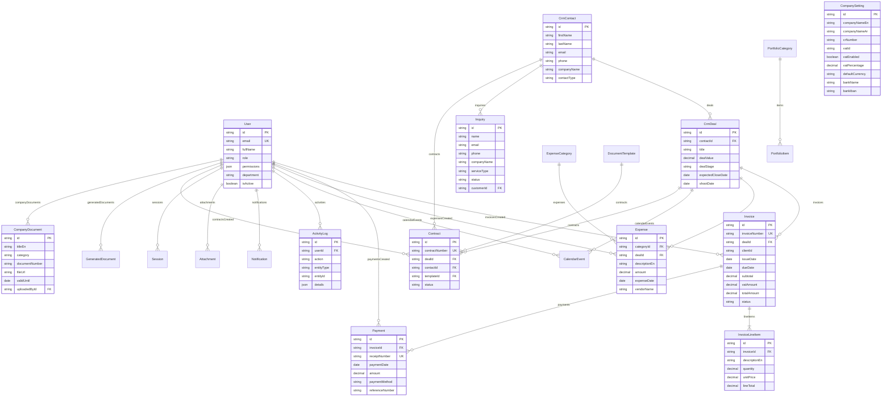

# iShoot Cinema Production Platform — Comprehensive Engineering Guide

Official monorepo codebase for **ishoot.bh** — Cinema Production House based in the Kingdom of Bahrain.

This repository powers both the consumer-facing public web application (`apps/web`) and the full-stack enterprise Admin Dashboard & CRM platform (`apps/admin`), alongside shared monorepo packages for database management, email dispatch, UI components, and localization.

---

## 📐 Monorepo Architecture Overview

Powered by **Turborepo** and **pnpm workspaces**:

```
ishoot.bh/
├── apps/
│   ├── admin/               # Next.js 15 App Router Full-Stack Admin Dashboard & CRM
│   └── web/                 # Next.js 15 App Router Consumer Web Application (Arabic/English)
├── packages/
│   ├── database/            # Prisma ORM, PostgreSQL schema, queries & lead-resolver service
│   ├── email/               # Resend API integration, HTML email & WhatsApp templates
│   ├── ui/                  # Shared UI components, proof uploader, SVG visual analytics
│   ├── locales/             # Multilingual translations (Arabic & English dictionaries)
│   └── config/              # Shared Tailwind CSS & TypeScript configurations
├── docs/                    # Technical documentation & architecture guides
├── docker-compose.yml       # Local PostgreSQL database container configuration
└── skills.md                # Platform UI/UX, Architecture & Financial Standards
```

---

## 🔌 Local Development Ports & Services Reference Matrix

| Service / Application                 | Port / Address | Description                             | Access / URL                                                   |
| :------------------------------------ | :------------- | :-------------------------------------- | :------------------------------------------------------------- |
| **Consumer Web App (`@ishoot/web`)**  | `3000`         | Next.js 15 Consumer Website (EN/AR)     | `http://localhost:3000`                                        |
| **Admin Dashboard (`@ishoot/admin`)** | `3001`         | Enterprise Admin & CRM Platform         | `http://localhost:3001`                                        |
| **PostgreSQL Database**               | `5432`         | PostgreSQL 15 Container (`ishoot_db`)   | `Configured by `DATABASE_URL` in `.env`` |
| **Prisma Studio (DB GUI)**            | `5555`         | Visual Database Editor & Inspection GUI | `http://localhost:5555`                                        |
| **pgAdmin / Database Tools**          | `5432`         | External DB Client Connection Port      | Connection Host: `localhost`, Port: `5432`                     |

---

## 🛠️ Complete Command Line Reference (CLI & Scripts)

### Root Workspace Commands

| Command           | Action / Description                                                             |
| :---------------- | :------------------------------------------------------------------------------- |
| `pnpm dev`        | Launch all applications (`apps/web` & `apps/admin`) concurrently via Turborepo   |
| `pnpm dev:web`    | Start only the consumer web app locally at `http://localhost:3000`               |
| `pnpm dev:admin`  | Start only the full-stack admin dashboard locally at `http://localhost:3001`     |
| `pnpm build`      | Run production build across all applications (`turbo run build --concurrency=1`) |
| `pnpm type-check` | Execute TypeScript compilation checks across all workspace packages              |
| `pnpm lint`       | Run ESLint checks across all apps and packages                                   |
| `pnpm format`     | Auto-format codebase using Prettier (`prettier --write "**/*.{ts,tsx,md,json}"`) |
| `pnpm db:push`    | Sync Prisma schema directly with the PostgreSQL database                         |
| `pnpm db:seed`    | Populate an empty development database with demo records                        |
| `pnpm db:check-integrity` | Audit the database against 43 business rules (totals, statuses, numbering, approvals, HR) |

### Database & Prisma Commands

For paste-safe initialization and local Supabase setup, follow [the DevOps guide](docs/DEVOPS.md). Interactive zsh treats pasted comments as commands unless `setopt interactivecomments` is enabled. Use `pnpm db:bootstrap` for initial accounts/settings; demo seeding requires an empty business database.

```bash
# Generate Prisma Client (after modifying schema.prisma)
pnpm --filter @ishoot/database exec prisma generate

# Launch interactive Prisma Studio database GUI (http://localhost:5555)
pnpm --filter @ishoot/database exec prisma studio

# Direct schema push to target PostgreSQL instance
pnpm db:push

# Execute database seed script
pnpm db:seed

# Force reset database (drop all tables & re-apply schema fresh)
pnpm --filter @ishoot/database exec prisma db push --force-reset

# Create production database migration
pnpm --filter @ishoot/database exec prisma migrate dev --name <migration_name>
```

### Infrastructure & Docker Commands

```bash
# Spin up local PostgreSQL 15 container in background
docker compose up -d

# Stop and remove database container
docker compose down

# View live database logs
docker compose logs -f db

# Enter interactive PostgreSQL shell (psql) inside Docker container
docker exec -it ishoot_db psql -U ishoot -d ishoot_db
```

---

## 💾 Complete Database Management & Operations Guide (CRUD, Migrations & SQL)

### 1. Visual Database Editing (Prisma Studio)

Run `pnpm --filter @ishoot/database exec prisma studio` to launch **Prisma Studio** at `http://localhost:5555`.

- **View Records**: Click on any of the 26 entity models (e.g., `User`, `CRMContact`, `CRMDeal`, `Invoice`, `Payment`).
- **Create Records**: Click **Add record**, fill in attributes, and click **Save 1 change**.
- **Edit Records**: Double-click any field value directly, update, and click **Save 1 change**.
- **Delete Records**: Select the row checkbox, click **Delete 1 record**, and confirm.

### 2. Connecting via pgAdmin / DBeaver / TablePlus

To connect pgAdmin or any PostgreSQL GUI tool to the local database:

- **Host**: `localhost` or `127.0.0.1`
- **Port**: `5432`
- **Database**: `ishoot_db`
- **Username**: `ishoot` (or `postgres` if using host PG)
- **Password**: `ishoot_password`
- **SSL Mode**: `Disable` / `Prefer`

### 3. Modifying Schema & Applying Changes

1. Edit schema definitions in [`packages/database/prisma/schema.prisma`](file:///Users/sayed/Desktop/GitHub/ishoot.bh/packages/database/prisma/schema.prisma).
2. Regenerate TypeScript definitions:
   ```bash
   pnpm --filter @ishoot/database exec prisma generate
   ```
3. Sync changes directly to database:
   ```bash
   pnpm db:push
   ```
4. If you want a completely fresh database state, run:
   ```bash
   pnpm --filter @ishoot/database exec prisma db push --force-reset
   pnpm db:seed
   ```

### 4. Direct CLI Database Management via `psql`

Connect to the database terminal:

```bash
docker exec -it ishoot_db psql -U ishoot -d ishoot_db
```

#### Common SQL CRUD Snippets:

- **List All Tables**:

  ```sql
  \dt
  ```

- **Query / Read Data**:

  ```sql
  SELECT id, full_name, email, contact_type FROM crm_contacts LIMIT 10;
  SELECT id, title, amount, status FROM invoices;
  ```

- **Insert / Create Data**:

  ```sql
  INSERT INTO crm_contacts (id, full_name, email, contact_type, created_at, updated_at)
  VALUES ('cnt_custom1', 'Ali Hassan', 'ali@example.com', 'client', NOW(), NOW());
  ```

- **Update / Edit Data**:

  ```sql
  UPDATE crm_contacts
  SET full_name = 'Ali Hassan Deluxe', updated_at = NOW()
  WHERE id = 'cnt_custom1';
  ```

- **Delete / Remove Data**:

  ```sql
  DELETE FROM crm_contacts WHERE id = 'cnt_custom1';
  ```

- **Truncate / Clear Table Data**:
  ```sql
  TRUNCATE TABLE crm_contacts CASCADE;
  ```

---

## 🔌 Complete API & Server Actions Reference

### 1. Consumer Web Application APIs (`apps/web`)

| Endpoint          | Method | Purpose & Description                                                                                                                                     |
| :---------------- | :----- | :-------------------------------------------------------------------------------------------------------------------------------------------------------- |
| `/api/inquiry`    | `POST` | Processes web brief submissions via `resolveIncomingLead()`. Deduplicates contacts, records `Inquiry`, and dispatches dual client/team emails via Resend. |
| `/api/revalidate` | `POST` | Triggers on-demand ISR revalidation for dynamic static pages.                                                                                             |

#### Web Inquiry Payload Example (`POST /api/inquiry`):

```json
{
  "fullName": "Sayed Ahmed",
  "email": "client@company.com",
  "phone": "+973 3900 0000",
  "company": "Zain Bahrain",
  "services": ["TVC Commercial", "Post-Production"],
  "budget": "5,000 - 10,000 BHD",
  "timeline": "Q4 2026",
  "message": "We require a 30-second cinema commercial shoot.",
  "locale": "ar"
}
```

---

### 2. Admin Dashboard HTTP APIs (`apps/admin`)

| Endpoint                  | Method | Description                                                                      |
| :------------------------ | :----- | :------------------------------------------------------------------------------- |
| `/api/auth/login`         | `POST` | Authenticates admin credentials, sets encrypted JWT cookie.                      |
| `/api/auth/logout`        | `POST` | Revokes session and clears authentication cookies.                               |
| `/api/auth/me`            | `GET`  | Returns currently authenticated user profile & RBAC permissions.                 |
| `/api/documents/[id]/pdf` | `GET`  | Generates and streams isolated A4 printable PDF documents for invoices/receipts. |

---

### 3. Admin Server Actions (`apps/admin/app/actions`)

#### CRM & Lead Management (`actions/crm.ts`)

- `createContactAction(data)` — Provision new client dossier.
- `updateContactAction(id, data)` — Update customer details.
- `deleteContactAction(id)` — Delete customer profile (Safeguarded).
- `createCRMDealAction(data)` — Create commercial deal pipeline.
- `updateDealStageAction(id, stage)` — Advance deal stage in Kanban board.
- `deleteCRMDealAction(id)` — Delete deal record.
- `updateInquiryStatusAction(id, status)` — Qualify or archive lead inquiry.
- `deleteInquiryAction(id)` — Delete lead inquiry.

#### Financial Engine (`actions/finance.ts`)

- `createInvoiceAction(data)` — Generate invoice with line items, VAT, and discounts.
- `updateInvoiceAction(id, data)` — Update mutable invoice details.
- `voidInvoiceAction(id)` — Mark invoice status as `void` with audit log trace.
- `deleteInvoiceAction(id)` — Delete invoice record.
- `createPaymentAction(data)` — Record payment tranche and issue receipt.
- `deletePaymentAction(id)` — Delete payment transaction.
- `createExpenseAction(data)` — Log production expense with vendor receipt attachment.
- `deleteExpenseAction(id)` — Delete expense record.

#### Corporate Legal Repository (`actions/documents.ts`)

- `createCompanyDocumentAction(data)` — Upload company legal asset (CR, VAT, Bylaws).
- `deleteCompanyDocumentAction(id)` — Remove legal document asset.

#### System User Management (`actions/users.ts`)

- `createUserAction(data)` — Provision system user with RBAC role.
- `updateUserAction(id, data)` — Update user profile and permissions.
- `deleteUserAction(id)` — Revoke user account.

#### Company Settings (`actions/settings.ts`)

- `updateCompanySettingsAction(data)` — Update company corporate information, bank details, and VAT percentages.

---

## 🗄️ Database Schema & Entity Relationship Diagram



---

## ⚙️ Environment Variables Setup

Create a `.env` file in the root directory:

```env
# PostgreSQL Database Connection URL
DATABASE_URL="Configured by `DATABASE_URL` in `.env`?schema=public"

# Authentication Security Secrets
JWT_SECRET="super-secret-jwt-key-change-in-production-2026"
REVALIDATION_SECRET="ishoot-revalidate-secret-2026"

# Application Base URLs
WEB_URL="http://localhost:3000"
ADMIN_URL="http://localhost:3001"

# Email Dispatch API Key (Optional: Omit for local console mock dispatch mode)
# RESEND_API_KEY="re_123456789"
```

---

## 🚀 Step-by-Step Local Setup Guide

1. **Clone the repository**:

   ```bash
   git clone https://github.com/sahmedhusain/ishoot.bh.git
   cd ishoot.bh
   ```

2. **Install dependencies**:

   ```bash
   pnpm install
   ```

3. **Configure `.env` and start local Supabase** (Docker must be running):

   Set `SUPER_ADMIN_EMAIL`, a `SUPER_ADMIN_PASSWORD` of at least 12 characters, and the application secrets. This repository includes the local Supabase configuration.

   ```bash
   pnpm dlx supabase start -x studio,postgres-meta,logflare,vector,supavisor,edge-runtime,realtime,imgproxy,mailpit
   pnpm dlx supabase status
   ```

   Copy the local database URL into both `DATABASE_URL` and `DIRECT_URL`. Set the Supabase URLs and keys using the local stack values as described in [the DevOps guide](docs/DEVOPS.md).

4. **Apply migrations and create the initial administrator**:

   ```bash
   pnpm --filter @ishoot/database db:generate
   pnpm exec prisma migrate deploy --schema packages/database/prisma/schema.prisma
   pnpm db:bootstrap
   ```

   Optionally run `pnpm db:seed` on a new, empty development database for demo CMS and business records (≈15 months of history generated through the app's own domain logic; set `SEED_VOLUME=off` for the small fixture set only), then `pnpm db:check-integrity` to confirm every business rule holds. Local demo seeding publishes an initial website snapshot; hosted development seeds leave a draft for admin review.

5. **Start applications in development mode**:
   ```bash
   pnpm dev
   ```
   - Consumer Web App: `http://localhost:3000`
   - Admin Dashboard: `http://localhost:3001`

## Platform audit

The [4 October 2026 audit](docs/audit-2026-10-04/REPORT.md) records implemented fixes, isolated test evidence, performance measurements, open findings and migration rollout constraints. The [system design](docs/audit-2026-10-04/SYSTEM-DESIGN.md) describes the remaining optimization plan. Regenerate the source inventory with `pnpm audit:inventory`.

Current audit follow-up status and deployment requirements are in [FOLLOWUP.md](docs/audit-2026-10-04/FOLLOWUP.md). Publish invalidation is durable; run `pnpm worker:revalidation` as a separately managed process with `DATABASE_URL`, `WEB_URL` and `REVALIDATION_SECRET` configured. Session token hashing requires a coordinated application/migration cutover.
