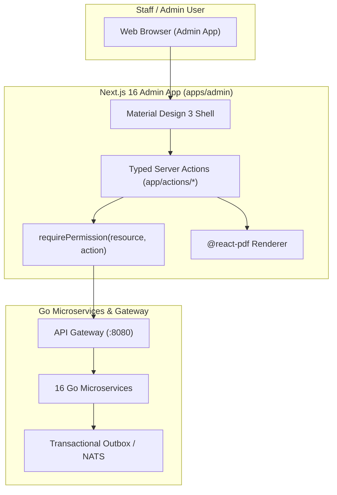

# Admin Application (`apps/admin`)

The internal enterprise business system for staff, managers, and executives. Built with Next.js 16 (App Router), React 19, Material Design 3 styling, and full Arabic/English bilingual support.

---

## 1. Overview & Architecture

`apps/admin` provides operational tools across 15+ business domains. It features a customizable widget dashboard, granular permission gating per action, multi-step approval workflows, bilingual document PDF generation, and real-time Server-Sent Events (SSE) updates.



---

## 2. Business Domains & Features

| Domain | Key Capabilities | Primary Backend Services |
|---|---|---|
| **CRM & Sales** | Client directory, lead inquiries, pipeline deals, stage transitions, quotations, and sales commissions. | `sales`, `finance` |
| **Finance & Accounting** | Invoices, payments, credit notes, operational expenses, employee claims, and bank settlements. | `finance` |
| **Human Resources** | Employee directory, department trees, GOSI social insurance, leave requests, attendance, and payroll runs. | `hr` |
| **Workflow & Approvals** | Multi-step approval policies, digital client signatures, official letter templates, and task management. | `workflow` |
| **Inventory & Warehouses** | Multi-warehouse tracking, stock movements, product variants, batch expiry, and physical stock counts. | `inventory` |
| **Store & Logistics** | Order fulfillment, delivery zones, time slots, vehicle fleet routing, driver cash settlement, and courier APIs. | `commerce`, `delivery` |
| **IT & Support Desk** | Employee IT support ticket submission, SLA response tracking, equipment management, and company archive. | `itsm`, `files` |

---

## 3. Server Action Namespaces & Permissions

`apps/admin` exposes 340+ typed server actions under `app/actions/`. Every action validates input via Zod schemas (`action-schemas.json`) and checks resource permissions before executing.

| Action Namespace | Primary Actions | Permission Required |
|---|---|---|
| `crm.ts` | `createCRMDealAction`, `updateDealStageAction`, `createContactAction` | `deals:write`, `contacts:write` |
| `finance.ts` | `createInvoiceAction`, `createPaymentAction`, `createExpenseAction` | `invoices:write`, `payments:write`, `expenses:write` |
| `payroll.ts` | `generatePayrollRunAction`, `approvePayrollRunAction`, `markPayrollRunPaidAction` | `payroll:create`, `payroll:edit`, `payroll:issue_send` |
| `approvals.ts` | `decideApprovalAction`, `updateApprovalPolicyAction` | Signed-in / `settings:write` |
| `inventory.ts` | `changeStockAction`, `transferStockAction`, `approveStockCountAction` | `inventory:edit`, `inventory:approve` |
| `delivery.ts` | `assignShipmentAction`, `createRouteSheetAction`, `settleCashAction` | `deliveries:assign`, `deliveries:edit` |
| `users.ts` | `createUserAction`, `updateUserRoleAction`, `suspendUserAction` | `users:write` |

---

## 4. Configuration & Environment Variables

| Variable | Required | Default | Description |
|---|---|---|---|
| `NEXT_PUBLIC_ADMIN_URL` | Yes | `http://localhost:3001` | Canonical public URL of the admin application. |
| `API_URL` | Yes | `http://127.0.0.1:8080` | Gateway endpoint for backend microservice calls. |
| `ADMIN_SERVICE_KEY` | Yes | — | Private service signing key for authenticating backend requests. |
| `ENCRYPTION_KEY` | Yes | — | 32-character key for decrypting integration credentials and keys. |
| `MFA_ENCRYPTION_KEY` | Yes | — | Base64-encoded 32-byte key for TOTP secrets encryption. |

---

## 5. Development & Verification Commands

```bash
# Start standalone admin dev server on port 3001
npm run dev

# Perform TypeScript type checking across admin codebase
npm run type-check

# Run unit and schema verification tests
npm test

# Run full Playwright E2E test suite for admin workflows
npm run test:e2e

# Run domain-specific verification suites
npm run check:dashboard    # Dashboard layout and widget integrity checks
npm run check:navigation   # Navigation and permission gate checks
npm run check:approvals    # Multi-step approval engine verification
npm run check:payroll      # Payroll calculation and GOSI rules verification
npm run check:finance      # Financial ledger and invoice accounting checks
npm run check:operations   # Core inventory, sales, and logistics checks
```
