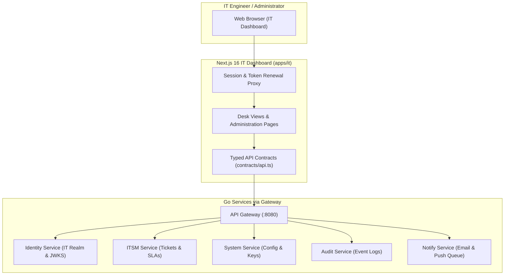

# IT Operational Dashboard (`apps/it`)

The dedicated operational management dashboard for IT administrators and operations engineers. Built with Next.js 16 (App Router), React 19, Tailwind CSS, and strict role-based access control.

---

## 1. Overview & Architecture

`apps/it` allows IT teams to manage system infrastructure, company configurations, active sessions, staff access rights, integration keys, support tickets, and system logs. IT staff sign in using **IT accounts**, an isolated authentication realm in the `identity` service with mandatory TOTP Multi-Factor Authentication (MFA).



---

## 2. Dashboard Pages & Access Control

| Route Path | Permission Key (`contracts/catalog/it-access.json`) | Backend Service Endpoint | Feature Summary |
|---|---|---|---|
| `/` | `tickets:read` | `itsm` `GET /v1/itsm/desk/stats` | Operational overview and active ticket metrics. |
| `/tickets` | `tickets:read` (`edit`, `assign`) | `itsm` `/v1/itsm/desk/tickets` | Support ticket queue, comments, and lifecycle assignments. |
| `/sla` | `ticket_settings:read` (`edit`) | `itsm` `/v1/itsm/desk/sla` | Service Level Agreement response/resolution policies. |
| `/company` | `company:read` (`edit`) | `system` `/v1/system/desk/company` | Main company profiles, registration, and addresses. |
| `/setup` | `setup:execute` | `system` `/v1/system/desk/company/setup` | First-run system wizard and bootstrap execution. |
| `/modules` | `modules:read` (`edit`) | `system` `/v1/system/desk/modules` | Global module activation and feature toggle management. |
| `/integrations` | `integrations:read` (`edit`) | `system` `/v1/system/desk/integrations` | Encrypted integration credentials for gateways and APIs. |
| `/site` | `domains:read`, `site_code:read` | `system` `/v1/system/desk/site` | Public domain setup and site-wide analytics scripts. |
| `/notifications` | `notifications:read` (`execute`) | `notify` `/v1/notify/desk` | Queue management for email, SMS, and WhatsApp dispatch. |
| `/audit` | `audit:read` | `audit` `/v1/audit/desk` | Searchable append-only audit trail for system events. |
| `/it-accounts` | `it_accounts:read` (`create`, `edit`) | `identity` `/v1/identity/desk/it-accounts` | IT realm account creation, role assignments, and MFA resets. |
| `/staff-accounts` | `staff_access:read` (`edit`) | `identity` `/v1/identity/desk/staff` | Staff account directory and access permissions. |
| `/staff-roles` | `staff_access:read` (`edit`) | `identity` `/v1/identity/desk/staff/roles` | System role templates, permission matrices, and data scopes. |
| `/sessions` | `sessions:read` (`delete`) | `identity` `/v1/identity/desk/sessions` | Live session inspection and session family revocation. |
| `/system-health` | `system_health:read` | `system` `/v1/system/desk/operations/health` | Container readiness, database connections, and memory metrics. |
| `/database` | `database:read` | `system` `/v1/system/desk/operations/database` | Schema migration status and table size metrics. |
| `/logs` | `logs:read` | `system` `/v1/system/desk/operations/logs` | Real-time system log stream and error filtering. |
| `/jobs` | `jobs:read` | `system` `/v1/system/desk/operations/jobs` | River background worker job queues and failure retries. |
| `/api-keys` | `api_keys:read` | `system` `/v1/system/desk/operations/api-keys` | Microservice API keys and internal service tokens. |

---

## 3. Authentication & Session Security

1. **Sign-In Flow**: IT sign-in posts credentials to `/v1/identity/it/login` using the application's service key (`IT_SERVICE_KEY`). Identity validates credentials and prompts for a TOTP code or single-use recovery code.
2. **Cookie Security**: Access and refresh tokens are stored in `httpOnly`, `SameSite=Strict` cookies (`Secure` in production environments).
3. **Automatic Renewal**: Middleware automatically refreshes access tokens before expiration (`IT_REFRESH_LEEWAY_SECONDS`).
4. **JWKS Verification**: The API Gateway verifies tokens against identity's live Ed25519 JWKS endpoint.

---

## 4. Development & Testing Commands

```bash
# Start standalone IT dashboard server on port 3002
npm run dev

# Or start via root run script
./run.sh dev it

# Perform TypeScript type checking
npm run type-check

# Run Vitest unit tests
npm test

# Run Playwright E2E journey covering IT login, ticket management, and session revocation
npm run test:e2e

# Run domain-specific verification suites
npm run check:support      # Support claims and HR support checks
npm run check:security     # Security boundaries and access checks
npm run check:deployment   # Deployment environment configuration checks
```
