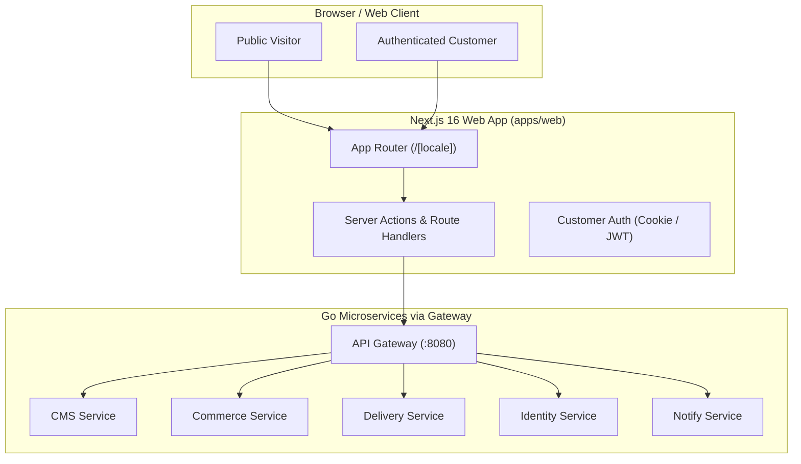

# Web Application (`apps/web`)

The public-facing website, e-commerce storefront, and customer portal for the platform. Built with Next.js 16 (App Router), React 19, Tailwind CSS, and complete bilingual internationalization (`/ar` and `/en`).

---

## 1. Overview & Architecture

`apps/web` serves as the public entry point for customers and visitors. It integrates dynamic CMS content rendering, full e-commerce checkout, payment processing across 7 payment gateways, delivery tracking, and customer account management.



---

## 2. Key Modules & Capabilities

| Module | Features & Capabilities | Backend Service |
|---|---|---|
| **Content & CMS** | Dynamic block-based pages, hero banners, articles, FAQs, testimonials, studio equipment, and partner logos. | `cms`, `system` |
| **Online Store** | Product catalog, variant selectors, category filters, shopping cart, stock validation, and promotional coupon codes. | `commerce`, `inventory` |
| **Checkout & Payments** | Multi-gateway payment handling (Stripe, Tap, PayPal, Checkout.com, PayTabs, Moyasar, HyperPay) with secure return verification. | `commerce`, `finance` |
| **Delivery & Logistics** | Delivery zone lookup, time slot selection, delivery fee calculation, and order shipment tracking by token. | `delivery` |
| **Customer Portal** | Email sign-in, six-digit code OTP auth, Google/Apple OAuth sign-in, profile management, order history, and account deletion. | `identity`, `commerce` |

---

## 3. Web HTTP API Routes

| Endpoint Path | HTTP Method | Access Level | Description |
|---|---|---|---|
| `/api/account/login` | POST | Public | Authenticates customer account with email/password or OTP code. |
| `/api/account/google/callback` | GET | Public | OAuth callback handler for Google Sign-In with PKCE validation. |
| `/api/account/apple/callback` | POST | Public | OAuth callback handler for Apple ID Sign-In. |
| `/api/account/orders/[id]` | GET | Customer | Retrieves customer order details and fulfillment status. |
| `/api/store/checkout` | POST | Public/Customer | Validates cart items, applies coupons, reserves stock, and creates sales orders. |
| `/api/store/payment/return` | GET/POST | Public | Verification endpoint for customer return from payment gateways. |
| `/api/store/payment/webhook/[gateway]` | POST | Webhook | Verified webhook handler for async gateway payment notifications. |
| `/api/inquiry` | POST | Public | Submits lead inquiries and contact form messages into the CRM pipeline. |
| `/api/revalidate` | POST | Secret Key | Triggers ISR page revalidation when CMS content is published. |
| `/api/health` | GET | Public | Healthcheck probe returning application version and installation ID. |

---

## 4. Configuration & Environment Variables

| Variable | Required | Default | Description |
|---|---|---|---|
| `NEXT_PUBLIC_WEB_URL` | Yes | `http://localhost:3000` | Canonical public URL of the web application. |
| `API_URL` | Yes | `http://127.0.0.1:8080` | Server-side URL for the Go API Gateway. |
| `WEB_SERVICE_KEY` | Yes | — | Private service signing key for authenticating backend requests. |
| `REVALIDATION_SECRET` | Yes | — | Shared secret token for ISR revalidation requests from CMS/Admin. |
| `CUSTOMER_AUTH_SECRET` | Yes | — | Encryption key for customer OAuth cookies and payment link HMACs. |

---

## 5. Development & Testing Commands

```bash
# Start standalone web dev server on port 3000
npm run dev

# Perform TypeScript type checking
npm run type-check

# Run unit tests (Vitest)
npm test

# Execute Playwright E2E test suite for web
npm run test:e2e

# Run domain-specific verification scripts
npm run check:website       # Database integrity checks for web content & products
npm run check:website-http  # HTTP route probes and preview verification
```
