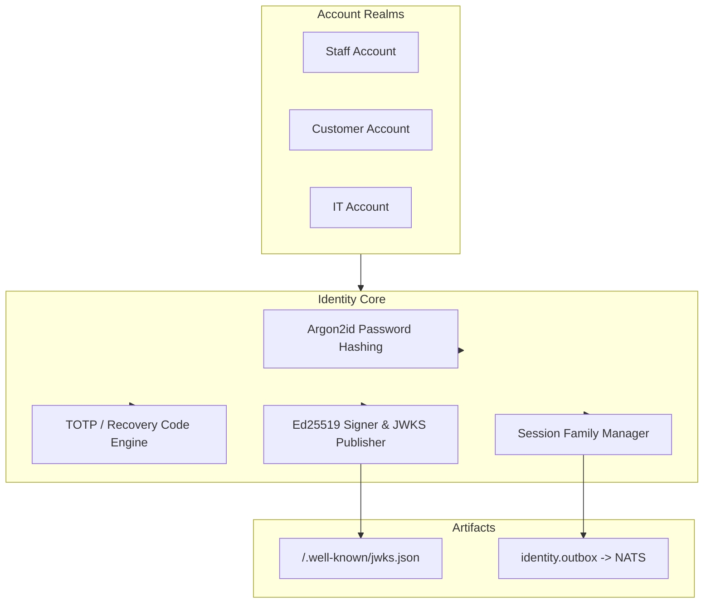

# Identity Service (`identity`)

Authentication, realm management, password hashing, Multi-Factor Authentication (MFA), session family rotation, and Ed25519 JWKS token issuance.
Owns the `identity` schema: `account`, `mfa_recovery_code`, `session_family`, and `outbox`.
The HTTP contract is [api/openapi.yaml](api/openapi.yaml); typed client functions live in `@platform/api-client`.

---

## 1. Responsibilities & Architecture

- **Realm Isolation**: Manages authentication across three isolated realms (`staff`, `customer`, `it`).
- **Cryptographic Standards**: Hashes passwords with Argon2id; issues Ed25519-signed JWT access tokens with published JWKS endpoints (`/.well-known/jwks.json`).
- **Multi-Factor Authentication (MFA)**: TOTP enrollment, QR code generation, single-use recovery codes, and mandatory MFA enforcement for IT accounts.
- **Session Family Management**: Session creation, rotation on refresh, reuse detection, and family revocation.
- **Outbox Events**: Emits `identity.user.created.v1`, `identity.user.changed.v1`, `identity.user.recovered.v1`, `identity.session.started.v1`, `identity.session.revoked.v1`.



---

## 2. API Endpoints

| Endpoint Path | Caller Realm | Authorization | Description |
|---|---|---|---|
| `GET /.well-known/jwks.json` | Public | Public | Returns active Ed25519 public key set for token verification. |
| `POST /v1/identity/staff/login` | Admin App | Service Token | Staff authentication issuing access & refresh token DTOs. |
| `POST /v1/identity/it/login` | IT Dashboard | Service Token | IT operator authentication with mandatory MFA challenge. |
| `POST /v1/identity/customer/login` | Web App | Service Token | Customer authentication with password or email OTP code. |
| `POST /v1/identity/session/refresh` | App Gateway | Service Token | Rotates refresh token and issues fresh short-lived access token. |
| `POST /v1/identity/session/logout` | App Gateway | Service Token | Revokes target session family. |
| `GET /v1/identity/desk/it-accounts` | IT Dashboard | `it_accounts:read` | Lists IT realm accounts, active MFA status, and roles. |
| `POST /v1/identity/desk/it-accounts` | IT Dashboard | `it_accounts:create` | Provisions fresh IT account, TOTP secret, and recovery codes. |
| `GET /v1/identity/desk/sessions` | IT Dashboard | `sessions:read` | Inspects live session families across realms. |
| `DELETE /v1/identity/desk/sessions/{id}` | IT Dashboard | `sessions:delete` | Revokes target session family and invalidates credentials. |

---

## 3. IT Administrator Operations

### Bootstrapping First IT Account
```bash
docker compose run --rm identity bootstrap-it -email it-admin@example.com
```
* Prompts for initial password without echo (minimum 14 characters).
* Prints `otpauth://` link, base32 secret, and 10 single-use recovery codes.

### Emergency IT Account Recovery
```bash
docker compose run --rm identity recover-it -email it-admin@example.com -actor operator-101
```
* Replaces password hash, TOTP secret, and recovery codes in one transaction.
* Revokes all active sessions and records an audit event with `operator:101`.

---

## 4. Running & Verification

The service binary supports `serve`, `worker`, `migrate`, and `healthcheck`.

- Public API on `:8080` (behind gateway route `/v1/identity/`)
- Admin listener on `:9090` (`/livez`, `/readyz`, `/metrics`)

```bash
# Run unit & integration tests
go test -race ./services/identity/...
```
