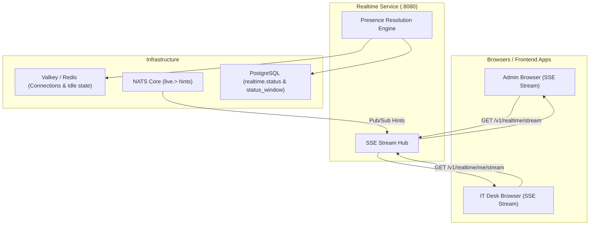

# Realtime Service (`realtime`)

Real-time Server-Sent Events (SSE) streaming, user presence tracking, status window management, and live notification hints.
Owns the `realtime` schema: `status` and `status_window`. Connection and idle state reside in Valkey.
The HTTP contract is [api/openapi.yaml](api/openapi.yaml); typed client functions live in `@platform/api-client`.

---

## 1. Responsibilities & Architecture

- **Server-Sent Events (SSE)**: Pushes real-time JSON hints (`data:` frame) to client browsers over persistent HTTP streams.
- **NATS Core Pub/Sub**: Replicas subscribe to `live.>` NATS subjects to broadcast hints across browser streams without sticky sessions.
- **Presence Resolution**: Evaluates user presence hierarchy: Explicit Offline → Approved Leave → Custom Status → Calendar Meeting → Auto-Away (5 min idle) → Available.
- **Status Windows**: Receives calendar meeting and leave schedule windows to dynamically update presence.



---

## 2. Realtime Event Hints

| Hint Type | Source Service | Meaning & Payload |
|---|---|---|
| `realtime.ready` | `realtime` | Connection handshake established. |
| `notification.created` | `notify` | New notification queued (`id`, `category`, `priority`, `silent`). |
| `notification.changed` | `notify` | Notification unread count or read status updated. |
| `notification.preferences` | `notify` | User notification preferences or category mutes updated. |
| `presence.changed` | `realtime` | User presence state changed (`userId`). |
| `entity.changed` | Domain Services | Domain record changed (`resource`, `id`). |

---

## 3. Endpoints

| Endpoint Path | Caller | Authorization | Description |
|---|---|---|---|
| `GET /v1/realtime/stream` | Admin & Web | Service Token | Opens persistent SSE event stream for staff/customer. |
| `GET /v1/realtime/me/stream` | IT Dashboard | IT Realm Token | Opens persistent SSE event stream for IT operators. |
| `POST /v1/realtime/publish` | Domain Services | Service Token | Publishes an event hint to target user or topic stream. |
| `GET /v1/realtime/presence` | Admin & IT | `REALTIME_CALLERS` | Retrieves presence state for target users. |
| `PUT /v1/realtime/status` | Admin App | Service Token | Updates a user's custom status choice. |
| `PUT /v1/realtime/windows` | Admin App | Service Token | Registers a meeting or leave status window. |
| `POST /v1/realtime/windows/sync` | Admin App | Service Token | Periodically synchronizes coming schedule windows. |

---

## 4. Running & Verification

The service binary supports `serve`, `migrate`, and `healthcheck`.

- Public API on `:8080` (behind gateway route `/v1/realtime/`)
- Admin listener on `:9090` (`/livez`, `/readyz`, `/metrics`)

```bash
# Run unit & stream integration tests
go test -race ./services/realtime/... ./pkg/live/...
```
