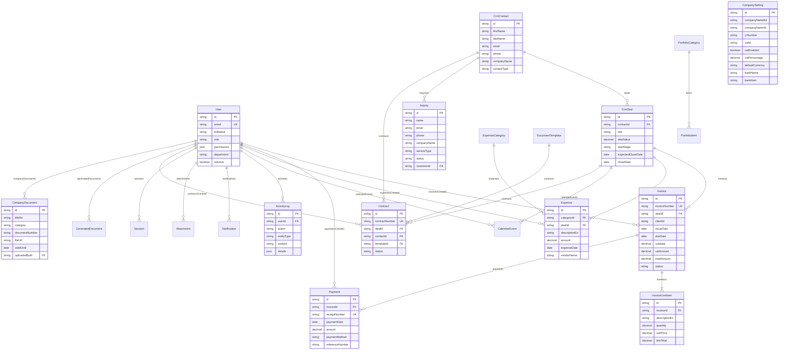

# API, server actions and data model reference

Moved from the README. Generated contracts for every server action live in `apps/admin/lib/action-schemas.json` (`pnpm test:action-schemas` keeps them current); the schema of record is `packages/database/prisma/schema.prisma`.

## APIs and server actions

### 1. Consumer Web Application APIs (`apps/web`)

| Endpoint          | Method | Purpose & Description                                                                                                                                     |
| :---------------- | :----- | :-------------------------------------------------------------------------------------------------------------------------------------------------------- |
| `/api/inquiry`    | `POST` | Processes web brief submissions via `resolveIncomingLead()`. Deduplicates contacts, records `Inquiry`, and dispatches dual client/team emails via Resend. |
| `/api/revalidate` | `POST` | Triggers on-demand ISR revalidation for dynamic static pages.                                                                                             |

#### Web Inquiry Payload Example (`POST /api/inquiry`):

```json
{
  "fullName": "Sara Ahmed",
  "email": "client@company.com",
  "phone": "+973 3900 0000",
  "company": "Zain Bahrain",
  "services": ["TVC Commercial", "Post-Production"],
  "budget": "5,000 - 10,000 BHD",
  "timeline": "Q4 2026",
  "message": "We require a 30-second cinema commercial shoot.",
  "locale": "ar"
}
```

---

### 2. Admin Dashboard HTTP APIs (`apps/admin`)

| Endpoint                  | Method | Description                                                                      |
| :------------------------ | :----- | :------------------------------------------------------------------------------- |
| `/api/auth/login`         | `POST` | Authenticates admin credentials, sets encrypted JWT cookie.                      |
| `/api/auth/logout`        | `POST` | Revokes session and clears authentication cookies.                               |
| `/api/auth/me`            | `GET`  | Returns currently authenticated user profile & RBAC permissions.                 |
| `/api/documents/[id]/pdf` | `GET`  | Generates and streams isolated A4 printable PDF documents for invoices/receipts. |

---

### 3. Admin Server Actions (`apps/admin/app/actions`)

#### CRM & Lead Management (`actions/crm.ts`)

- `createContactAction(data)` — Provision new client dossier.
- `updateContactAction(id, data)` — Update customer details.
- `deleteContactAction(id)` — Delete customer profile (Safeguarded).
- `createCRMDealAction(data)` — Create commercial deal pipeline.
- `updateDealStageAction(id, stage)` — Advance deal stage in Kanban board.
- `deleteCRMDealAction(id)` — Delete deal record.
- `updateInquiryStatusAction(id, status)` — Qualify or archive lead inquiry.
- `deleteInquiryAction(id)` — Delete lead inquiry.

#### Financial Engine (`actions/finance.ts`)

- `createInvoiceAction(data)` — Generate invoice with line items, VAT, and discounts.
- `updateInvoiceAction(id, data)` — Update mutable invoice details.
- `voidInvoiceAction(id)` — Mark invoice status as `void` with audit log trace.
- `deleteInvoiceAction(id)` — Delete invoice record.
- `createPaymentAction(data)` — Record payment tranche and issue receipt.
- `deletePaymentAction(id)` — Delete payment transaction.
- `createExpenseAction(data)` — Log production expense with vendor receipt attachment.
- `deleteExpenseAction(id)` — Delete expense record.

#### Corporate Legal Repository (`actions/documents.ts`)

- `createCompanyDocumentAction(data)` — Upload company legal asset (CR, VAT, Bylaws).
- `deleteCompanyDocumentAction(id)` — Remove legal document asset.

#### System User Management (`actions/users.ts`)

- `createUserAction(data)` — Provision system user with RBAC role.
- `updateUserAction(id, data)` — Update user profile and permissions.
- `deleteUserAction(id)` — Revoke user account.

#### Company Settings (`actions/settings.ts`)

- `updateCompanySettingsAction(data)` — Update company corporate information, bank details, and VAT percentages.

---

## Database Schema & Entity Relationship Diagram


