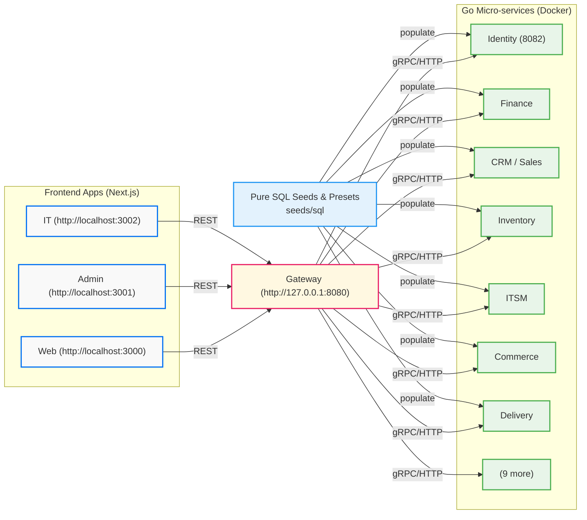

# Architecture

The platform combines three independent Next.js App Router frontend applications with a decoupled Go microservices backend.



```
Browser ──▶ apps/web · apps/admin · apps/it   (Next.js: UI, cookies, Server Components, Server Actions)
                 │ server-side only: Bearer token + X-Request-ID, typed @platform/api-client
                 ▼
             gateway ── routing · token check (JWKS) · rate limits (Valkey) · OpenTelemetry
                 ▼
   16 Go microservices:
   identity · system · files · notify · realtime · audit · itsm
   cms · sales · finance · workflow · hr · inventory · commerce · delivery
         │ pgx + sqlc                    │ outbox → NATS JetStream          │ River jobs
         ▼                               ▼                                   ▼
   PostgreSQL 17 (schema per service)    Valkey    S3-compatible storage    OpenTelemetry
```

## Frontend Applications

- **`apps/admin`**: The internal business operating system (CRM, sales, finance, HR and payroll, assets, approvals, documents, website and CMS, products, stock, purchasing, online store, delivery, tasks, reports). Server actions validate input via action schemas and dispatch commands to Go services through the API gateway.
- **`apps/it`**: The IT operational dashboard. Operates against its own `identity` realm with mandatory TOTP MFA. Manages ticket queues, SLA configuration, system health probes, module switches, company branding, database maintenance, staff access, and audit trail inspection.
- **`apps/web`**: The public-facing website and customer storefront in Arabic (`/ar`) and English (`/en`). Renders published CMS blocks, product catalog, customer accounts, shopping cart, checkout, payment webhooks, and shipment tracking.

The frontends are completely decoupled, standalone npm applications. Each application owns its dedicated `lib/`, `contracts/`, `components/`, `locales/`, `scripts/`, and `tests/`, without shared package dependencies or monorepo workspace requirements. Inter-application communication is strictly bounded through backend APIs, gateways, or the database.

## Go Microservices Backend

The backend is composed of 16 domain-scoped Go services:
- **`gateway`**: Reverse proxy, path routing, rate limiting, and JWT validation via JWKS.
- **`identity`**: Manages staff, customer, and IT accounts, sessions, passwords, MFA, and OAuth.
- **`system`**: Company profile settings, setup wizard, module toggles, encrypted integration credentials, and site settings.
- **`files`**: S3-compatible file storage, metadata records, upload validation, and River garbage collection.
- **`notify`**: Email and WhatsApp delivery, delivery webhook processing, and in-app notifications.
- **`realtime`**: Server-Sent Events (SSE) for real-time presence, notifications, and dashboard updates.
- **`audit`**: Immutable, append-only audit trail capturing published domain events.
- **`itsm`**: IT ticket lifecycles, SLA policy tracking, breach detection, and ticket comments.
- **`cms`**: Content management, pages, articles, reviews, FAQs, statistics, and published content snapshots.
- **`sales`**: CRM contacts, pipeline deals, inquiries, quotations, and outreach campaigns.
- **`finance`**: Invoicing, payment records, expense claims, and bank settlements.
- **`workflow`**: Multi-step approvals, digital signatures, official letters, tasks, and company calendar.
- **`hr`**: Organizational departments, employee profiles, leave requests, attendance, and payroll.
- **`inventory`**: Product catalogue, variants, stock movements, batches, counts, and warehouses.
- **`commerce`**: Customers, addresses, store configuration, discount coupons, sales orders, and retail POS.
- **`delivery`**: Shipping zones, time slots, delivery fleet, route sheets, shipments, courier adapters, and COD.

## Architectural Decisions & Core Principles

The platform's technical architecture is governed by key engineering decisions:

### 1. Go Microservices with Echo & API Gateway
- **Decision**: The backend is written in Go using the Echo v4 web framework, partitioned into domain-scoped services behind an API Gateway (`gateway`).
- **Rationale**: Replaces the monolith where database access, business rules, and UI rendering were coupled in Next.js Server Actions. Enables independent service scaling, resource allocation, and zero-downtime rolling updates.

### 2. Schema-per-Service Database Isolation
- **Decision**: PostgreSQL 17 serves as the primary database with a dedicated schema and role for each microservice (`identity`, `system`, `files`, `notify`, `realtime`, `audit`, `itsm`, `cms`, `sales`, `finance`, `workflow`, `hr`, `inventory`, `commerce`, `delivery`).
- **Rationale**: Enforces hard domain boundaries at the database layer. No service may read or write another service's tables directly. Cross-service interactions must use HTTP APIs or asynchronous events.

### 3. Transactional Outbox & NATS JetStream Events
- **Decision**: State mutations write domain events to an append-only `outbox` table in the same database transaction. An outbox relay worker publishes these events to NATS JetStream, and subscribing services consume messages via durable consumers with an `inbox` table.
- **Rationale**: Eliminates dual-write anomalies, prevents lost events on crash, and decouples side-effects (e.g. notifications, audit trail, projections) from synchronous request latency.

### 4. River Background Workers
- **Decision**: Background jobs, retry schedules, and maintenance tasks run as PostgreSQL-backed River workers compiled directly into Go service binaries.
- **Rationale**: Guarantees atomic job scheduling within domain transactions (`FOR UPDATE SKIP LOCKED`), eliminating external cron routes and dedicated Node worker processes.

### 5. Triple Identity Realms & JWKS Token Verification
- **Decision**: The `identity` service manages three isolated realms with separate policies:
  - **Staff Realm**: Employee accounts with role permissions and optional MFA.
  - **IT Realm**: Operational accounts with mandatory TOTP MFA.
  - **Customer Realm**: Store visitors with email code and Google/Apple OAuth sign-in.
- **Rationale**: Prevents privilege leakage between public shoppers, employees, and infrastructure operators. Services verify caller tokens using EdDSA public keys fetched from `identity` JWKS endpoints.

### 6. OpenAPI-First Contracts & Typed Client Generation
- **Decision**: Microservice HTTP interfaces are defined using OpenAPI 3.1 specifications (`api/openapi.yaml`), and typed TypeScript client functions in `packages/api-client` are automatically generated.
- **Rationale**: Provides contract testing, strict input/output validation, and prevents schema divergence between frontend applications and backend handlers.

### 7. Centralized Business Catalogue
- **Decision**: Common constants, enumerations, statuses, and workflow transitions reside in `contracts/catalog/*.json` and are generated into both Go packages (`backend/pkg/catalog`) and TypeScript constants.
- **Rationale**: Single source of truth across language boundaries without manual duplication or drift.

### 8. Private S3-Compatible Storage
- **Decision**: File storage uses S3-compatible APIs (SeaweedFS locally, cloud S3 in production). The Go `files` service validates MIME types, dimensions, and quotas before storing bytes.
- **Rationale**: All storage buckets remain private. Client browsers access files only through authorized application proxy routes.

### 9. Dedicated IT Operational Dashboard
- **Decision**: IT operations, system health, ticketing, database maintenance, and access policies are hosted in a separate application (`apps/it`) rather than inside the general business admin.
- **Rationale**: Keeps administrative and infrastructure controls physically and architecturally separate from daily business functions.

### 10. Decoupled Frontend Applications & Standalone NPM Setup
- **Decision**: `apps/admin`, `apps/it`, and `apps/web` are standalone npm projects referencing local packages (`@platform/*`) via relative `file:../../packages/<pkg>` dependencies.
- **Rationale**: Eliminates monorepo workspace managers (PNPM, Turborepo), avoids root `node_modules` pollution, and enables independent frontend builds, deployments, and testing.

## Company Identity and Theming

```
seeds/assets/<name>      ──db:bootstrap / db:seed──▶  CompanySetting (identity, theme JSON, file URLs)
setup wizard / Settings ─────────────────────────────▶          │        + files in storage (public-assets)
                                                                ▼
              each root layout: themeStylesheet(theme) → <style> CSS variables + Google/uploaded fonts
                                                                ▼
                       Tailwind classes (bg-primary, text-accent, bg-tone-90, font-sans…)
              PDFs: colours and font from the theme · emails: colours inlined · <meta theme-color>
```

- `normalizeTheme` turns any stored value into a complete, safe theme: hex colours only, plain font names, and approved font files only.
- `themeVariables` derives tonal shades and contrast-compliant surfaces for light and dark modes.
- The admin's default light or dark mode comes from the theme; individual users can toggle their preference.
- `CompanySetting.setupCompletedAt` gates the dashboard: until it is set, dashboard pages redirect to `/setup`.

## Infrastructure

- **Database:** PostgreSQL 17 with schema-per-service isolation (`identity`, `system`, `files`, `notify`, `realtime`, `audit`, `itsm`, `cms`, `sales`, `finance`, `workflow`, `hr`, `inventory`, `commerce`, `delivery`).
- **Storage:** Go `files` service backed by S3-compatible storage (SeaweedFS locally). Buckets remain private; applications proxy authorized access.
- **Messaging:** NATS JetStream for event outbox publishing and durable subscriber consumption.
- **Background Jobs:** PostgreSQL-backed River workers within Go services.
