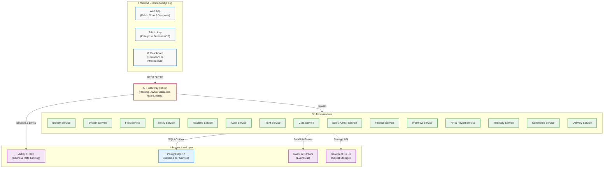
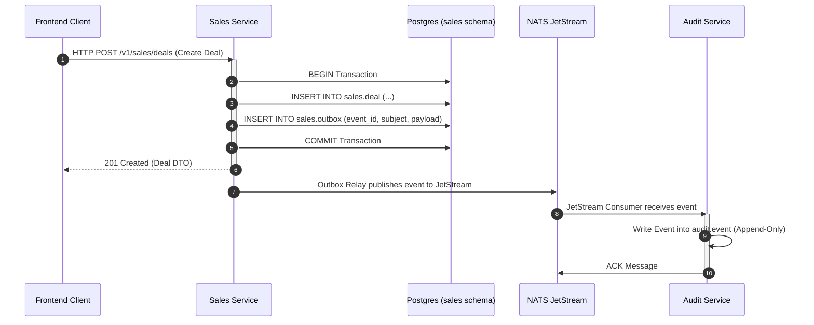
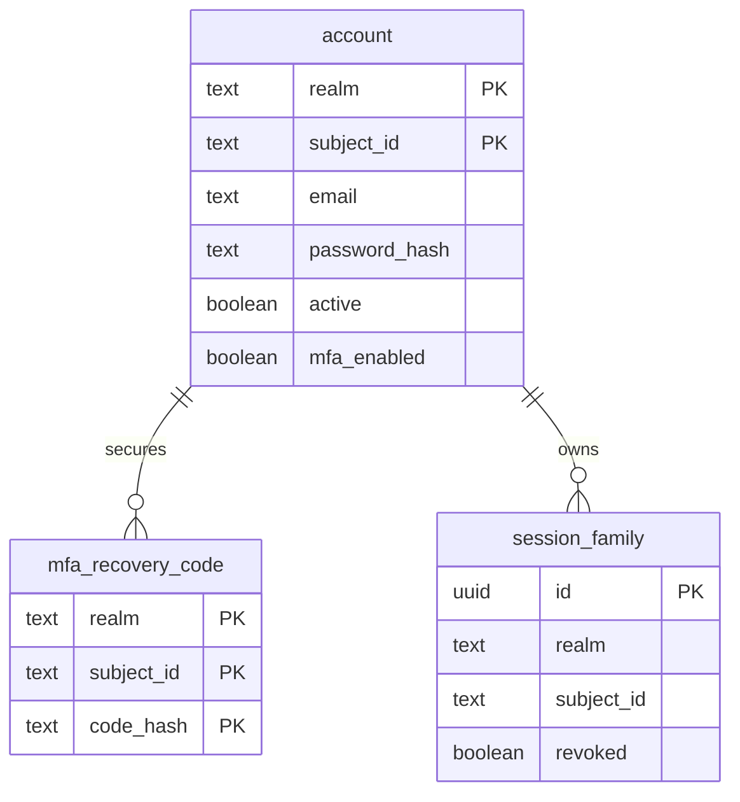
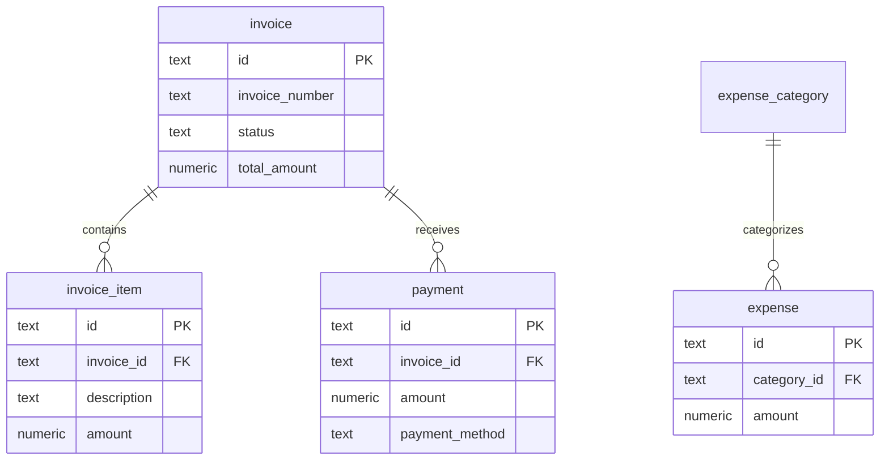
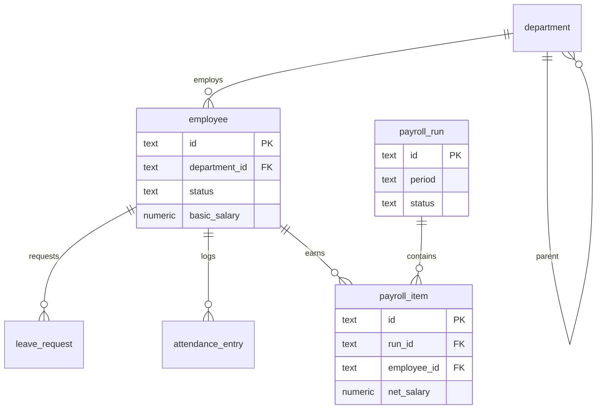
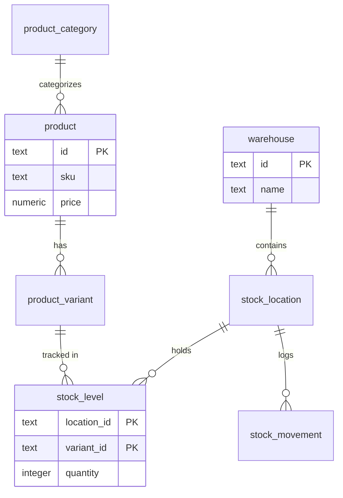
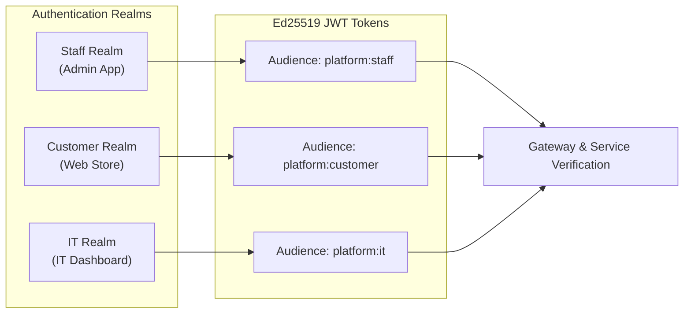

# 🏗️ System Architecture & Platform Principles

This document provides a comprehensive, advanced overview of the platform's system architecture, domain-scoped microservices, data isolation strategies, event-driven communications, and frontend ecosystems.

---

## 1. System Architecture & High-Level Data Flow

The platform combines three independent Next.js 16 frontend applications with a decoupled, event-driven Go microservices backend. An **API Gateway** acts as the single public entry point, routing requests to **16 Domain-Scoped Go Microservices**. Microservices do not share databases; instead, each service owns its dedicated PostgreSQL schema and communicates asynchronously via **NATS JetStream** using the **Transactional Outbox Pattern**.

---

## 2. Microservices Domain & Storage Matrix

Each backend microservice is entirely isolated, operating under its own PostgreSQL database role (`svc_<service>`) and schema.

| Microservice | Database Schema | Primary Domain Responsibilities | Outbox Events Emitted |
|---|---|---|---|
| **gateway** | *(None)* | Reverse proxy routing, JWKS token verification, rate limiting, and session status checks. | — |
| **identity** | `identity` | Staff, Customer, and IT account realms, Argon2id passwords, TOTP MFA, and Ed25519 JWKS issuing. | `identity.user.created.v1`, `identity.session.revoked.v1` |
| **system** | `system` | Company profiles, feature toggles, encrypted integration keys, site settings, and document sequences. | `system.settings.updated.v1`, `system.module.toggled.v1` |
| **files** | `files` | S3-compatible file metadata, upload authorization, checksum verification, and background cleanup. | `files.object.uploaded.v1`, `files.object.deleted.v1` |
| **notify** | `notify` | E-mail (Resend/SMTP), WhatsApp Cloud API dispatch, retry queues, and in-app user notification inboxes. | `notify.message.sent.v1`, `notify.message.failed.v1` |
| **realtime** | `realtime` | Server-Sent Events (SSE) streaming, user connection tracking, presence states, and calendar/leave windows. | `realtime.presence.changed.v1` |
| **audit** | `audit` | Append-only security audit trail for all published system events across all domain microservices. | — |
| **itsm** | `itsm` | IT support tickets, categories, SLA breach tracking, comments, and attachments. | `itsm.ticket.created.v1`, `itsm.ticket.breached.v1` |
| **cms** | `cms` | Dynamic block-based pages, localized articles, customer reviews, FAQs, statistics, and published snapshots. | `cms.page.published.v1`, `cms.article.published.v1` |
| **sales** | `sales` | CRM contacts, lead inquiries, pipeline deal stages, commercial quotations, and marketing campaigns. | `sales.deal.won.v1`, `sales.quotation.issued.v1` |
| **finance** | `finance` | Invoices, payments, expense claims, tax calculation, and bank settlements. | `finance.invoice.issued.v1`, `finance.payment.recorded.v1` |
| **workflow** | `workflow` | Multi-step approval requests, digital client signatures, official letters, tasks, and shared calendar events. | `workflow.approval.decided.v1`, `workflow.document.signed.v1` |
| **hr** | `hr` | Organizational departments, employee directory, GOSI social insurance, leave requests, attendance, and payroll. | `hr.payroll.processed.v1`, `hr.leave.approved.v1` |
| **inventory** | `inventory` | Warehouses, stock locations, products, variants, append-only stock ledger, batches, and physical stock counts. | `inventory.stock.adjusted.v1`, `inventory.transfer.completed.v1` |
| **commerce** | `commerce` | Store customers, delivery addresses, store settings, discount coupons, sales orders, POS registers, and shifts. | `commerce.order.placed.v1`, `commerce.order.paid.v1` |
| **delivery** | `delivery` | Delivery zones, time slots, vehicle fleet, route sheets, shipment milestones, driver COD, and courier APIs. | `delivery.shipment.dispatched.v1`, `delivery.shipment.delivered.v1` |

---

## 3. Transactional Outbox Pattern & Event Architecture

To achieve strong eventual consistency across decoupled microservice schemas without distributed transactions (2PC), services write events to a local `outbox` table within the same PostgreSQL transaction that modifies business entities. A background worker picks up outbox entries and publishes them to NATS JetStream.

---

## 4. Microservices Domain Models (ERDs)

Below is the Entity Relationship Diagram (ERD) representation of key domain models across the core microservices.

### 4.1. Identity Service Schema

### 4.2. Finance Service Schema

### 4.3. HR & Payroll Service Schema

### 4.4. Inventory & Warehouse Service Schema

---

## 5. Frontend BFF & Token Realm Security

The platform supports three isolated authentication realms enforced across both frontends and backend services:

* **Frontend Isolation:** Frontends (`apps/web`, `apps/admin`, `apps/it`) communicate exclusively with the Go backend through the API Gateway via `@platform/api-client`. Frontends never share code or perform direct database access.
* **Token Verification:** Gateway and Go microservices verify Ed25519 JWT signatures in-memory using public JWKS keys without external network calls.
* **Database Isolation:** PostgreSQL connection pools utilize service-specific roles (`svc_<service>`) ensuring strong schema boundaries.
