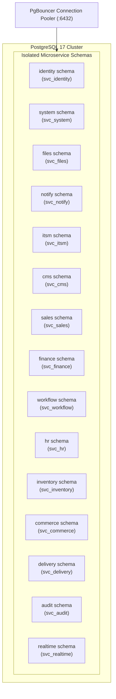

# Database Guide: Schema Architecture, Migrations & Seeding

The platform relies on PostgreSQL 17 with 15 isolated microservice schemas. See [ERD.md](./ERD.md) for the complete entity-relationship diagrams (Mermaid) and column-level table reference. Standalone company seed packages reside under [`seeds/`](../seeds/).

---

## 1. Schema Architecture & Service Ownership

Each backend Go microservice operates under a dedicated PostgreSQL database role (`svc_<service>`) owning a single, isolated schema. Microservices do not perform cross-schema JOINs or queries.



---

## 2. Microservice Schemas & Model Breakdown

| Schema | Primary Tables | Owning Service | Description |
|---|---|---|---|
| `identity` | `account`, `mfa_recovery_code`, `session_family`, `outbox` | `identity` | Staff, Customer, IT accounts, sessions, and MFA keys. |
| `system` | `company`, `service`, `project`, `module_setting`, `integration_setting`, `site_setting` | `system` | Global company branding, live service catalog, projects, module toggles, and integration credentials. |
| `files` | `upload_object`, `entity_attachment`, `outbox` | `files` | Public/private file upload metadata, polymorphic entity attachments (`entity_type`, `entity_id`, `document_id`), and storage pointers. |
| `notify` | `message`, `attachment`, `notification`, `preference`, `outbox` | `notify` | Outbound messaging queues and user notification inboxes. |
| `realtime` | `status`, `status_window` | `realtime` | User presence statuses, connection state, and calendar windows. |
| `audit` | `event` | `audit` | Append-only security audit trail for all published system events. |
| `itsm` | `ticket`, `ticket_event`, `ticket_comment`, `asset`, `asset_handover`, `sla_policy`, `staff_ref` | `itsm` | Support tickets, SLA tracking, IT assets & handovers, comments, attachments, and NATS-synced `staff_ref` projections. |
| `cms` | `page`, `article`, `review`, `faq`, `statistic`, `snapshot`, `outbox` | `cms` | Block-based website pages, articles, reviews, and snapshots. |
| `sales` | `contact`, `deal`, `inquiry`, `quotation`, `campaign`, `service_catalog_ref`, `finance_invoice_ref`, `outbox` | `sales` | CRM contacts, deal pipelines, quotations, campaigns, and live service/finance projections. |
| `finance` | `invoice`, `invoice_line`, `payment`, `expense`, `settlement`, `sales_quotation_ref`, `sales_deal_ref`, `outbox` | `finance` | Invoices, payments, expense claims, bank settlements, and sales projections. |
| `workflow` | `minute_of_meeting`, `mom_attendee`, `mom_action_item`, `contract`, `approval_request`, `signature_request`, `official_letter`, `task`, `directory_ref`, `outbox` | `workflow` | Meetings (MoMs), contracts, multi-step approvals, digital client signatures, official letters, tasks, and `directory_ref` projections. |
| `hr` | `department`, `employee`, `leave_request`, `leave_balance`, `attendance_entry`, `payroll_run`, `identity_user_ref` | `hr` | Departments, employee hierarchies (`reporting_to`, `manager_id`), leave balances, attendance, payroll, and Identity sync. |
| `inventory` | `warehouse`, `location`, `product`, `product_variant`, `stock_level`, `stock_movement`, `purchase_order`, `rfq` | `inventory` | Multi-warehouse inventory, stock ledger, procurement RFQs & POs, variants, and counts. |
| `commerce` | `customer`, `customer_address`, `store_settings`, `sales_order`, `warehouse_ref`, `identity_user_ref`, `retail_register` | `commerce` | Store customers, sales orders, coupons, POS shifts, and inventory warehouse projections. |
| `delivery` | `delivery_zone`, `delivery_slot`, `vehicle`, `route_sheet`, `shipment`, `cod_settlement`, `order_ref`, `driver_ref` | `delivery` | Delivery zones, fleet vehicles, route sheets, shipments, and commerce/HR driver & order projections. |

---

## 3. Database Roles & Connection Pooling

### Database Roles (`tools/db-roles`)
Microservice database roles (`svc_<service>`) are generated and managed by `tools/db-roles`. Each role is granted `ALL PRIVILEGES` exclusively on its own schema.

### Connection Pooling (PgBouncer)
Application queries connect through **PgBouncer** in transaction pooling mode on port `6432` (`DATABASE_URL`). Goose schema migrations connect directly to PostgreSQL on port `5432` (`DATABASE_DIRECT_URL`).

---

## 4. Seeding & Clean Bootstrap System

By default, database initialization and container builds produce a **fresh, empty database** (`seeds/bootstrap/seed_bootstrap.sql`) ready for the IT Setup Wizard, with zero business or demo records. Optional standalone company seed packages live in `seeds/<company>/`:

```
seeds/
├── bootstrap/
│   └── seed_bootstrap.sql  # Minimal clean installation (default)
└── <company>/              # 25 standalone company seed packages
    ├── company.json        # Company profile & businessActivity config
    ├── theme.json          # Theme colors, radius & fonts
    ├── seed.sql            # Standalone SQL seed for this company
    └── assets/             # Company-owned logos, icons, banners & fonts
```

Included packages cover all **23 core business activities**, 1 multi-business group (`zayed-group`), and 1 media production profile (`ishoot`, with store disabled), with varied `hasWeb` and `hasStore` configurations.

### Seeding Commands

| Task | Command | Description |
|---|---|---|
| **Clean Bootstrap (Default)** | `./run.sh db bootstrap` | Initializes a fresh empty database with default roles, permissions, sequences, and module toggles. |
| **Seed a Company** | `./run.sh db seed <company>` | Loads `seeds/<company>/seed.sql` and uploads `seeds/<company>/assets/` to SeaweedFS S3 (e.g., `./run.sh db seed zayed-group`). |
| **Verify Seed Dates** | `node scripts/verify-seed-dates.js` | Asserts seeded invoice dates span the past 6 months to 2 months ahead. |
| **Regenerate ERD & Schema Metadata** | `node scripts/generate-erd-and-meta.cjs` | Introspects live PostgreSQL 17 schemas (`320` tables, `170` FKs) and updates [ERD.md](./ERD.md) and `scripts/schema-meta.json`. |
| **Regenerate Company Seed Packages** | `node scripts/generate-seeds.cjs` | Rebuilds all 25 standalone company seed SQL bundles (`seed.sql` + 15 per-service `.sql` files). |

---

## 5. Schema Migration Workflow

1. **Add Migration File**: Create SQL migration under `backend/services/<service>/migrations/`:
   ```sql
   -- +goose Up
   CREATE TABLE sales.deal_notes (...);

   -- +goose Down
   DROP TABLE sales.deal_notes;
   ```
2. **Generate Code**: Update sqlc queries and models:
   ```bash
   sqlc generate
   ```
3. **Apply Migrations**:
   ```bash
   ./run.sh db migrate
   ```

---

## 6. Database Reset & Backup Procedures

### Resetting Local Database
```bash
./run.sh db reset
```
`db reset` drops all microservice schemas, re-runs Goose migrations, resets SeaweedFS S3 storage buckets, and initializes a clean empty database via `seeds/bootstrap/seed_bootstrap.sql` (pass `--company <slug>` or run `./run.sh db seed <company>` afterwards to load a seed company).

### Backup & Restore Commands
```bash
# Dump custom-format PostgreSQL backup
./run.sh db backup

# Restore custom-format PostgreSQL backup
./run.sh db restore backups/platform_db-2026-11-02.dump
```
