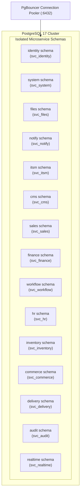

# Database Guide: Schema Architecture, Migrations & Seeding

The platform relies on PostgreSQL 17 with 15+ isolated microservice schemas. Seed fixtures, activity presets, and brand assets reside under [`seeds/`](../seeds/).

---

## 1. Schema Architecture & Service Ownership

Each backend Go microservice operates under a dedicated PostgreSQL database role (`svc_<service>`) owning a single, isolated schema. Microservices do not perform cross-schema JOINs or queries.



---

## 2. Microservice Schemas & Model Breakdown

| Schema | Primary Tables | Owning Service | Description |
|---|---|---|---|
| `identity` | `account`, `mfa_recovery_code`, `session_family`, `outbox` | `identity` | Staff, Customer, IT accounts, sessions, and MFA keys. |
| `system` | `company`, `module_setting`, `integration_setting`, `site_setting` | `system` | Global company branding, module toggles, and integration credentials. |
| `files` | `upload_object`, `outbox` | `files` | Public/private file upload metadata and storage pointers. |
| `notify` | `message`, `attachment`, `notification`, `preference`, `outbox` | `notify` | Outbound messaging queues and user notification inboxes. |
| `realtime` | `status`, `status_window` | `realtime` | User presence statuses, connection state, and calendar windows. |
| `audit` | `event` | `audit` | Append-only security audit trail for all published system events. |
| `itsm` | `ticket`, `ticket_event`, `ticket_comment`, `sla_policy` | `itsm` | Support tickets, SLA tracking, comments, and attachments. |
| `cms` | `page`, `article`, `review`, `faq`, `statistic`, `snapshot`, `outbox` | `cms` | Block-based website pages, articles, reviews, and snapshots. |
| `sales` | `contact`, `deal`, `inquiry`, `quotation`, `campaign`, `outbox` | `sales` | CRM contacts, deal pipelines, quotations, and marketing campaigns. |
| `finance` | `invoice`, `invoice_line`, `payment`, `expense`, `settlement`, `outbox` | `finance` | Invoices, payments, expense claims, and bank settlements. |
| `workflow` | `approval_request`, `signature`, `official_letter`, `task`, `outbox` | `workflow` | Multi-step approvals, client digital signatures, and tasks. |
| `hr` | `department`, `employee`, `leave_request`, `attendance`, `payroll_run` | `hr` | Departments, employee records, leave, attendance, and payroll. |
| `inventory` | `warehouse`, `location`, `product`, `variant`, `stock_level`, `movement` | `inventory` | Multi-warehouse inventory, stock ledger, variants, and counts. |
| `commerce` | `customer`, `customer_address`, `store_setting`, `order`, `register` | `commerce` | Customers, sales orders, store configuration, and POS shifts. |
| `delivery` | `zone`, `slot`, `vehicle`, `route_sheet`, `shipment`, `cod_settlement` | `delivery` | Delivery zones, fleet vehicles, route sheets, and shipments. |

---

## 3. Database Roles & Connection Pooling

### Database Roles (`tools/db-roles`)
Microservice database roles (`svc_<service>`) are generated and managed by `tools/db-roles`. Each role is granted `ALL PRIVILEGES` exclusively on its own schema.

### Connection Pooling (PgBouncer)
Application queries connect through **PgBouncer** in transaction pooling mode on port `6432` (`DATABASE_URL`). Goose schema migrations connect directly to PostgreSQL on port `5432` (`DATABASE_DIRECT_URL`).

---

## 4. Seeding & Preset System

Pure SQL seeds and company brand assets reside in `seeds/`:

```
seeds/
├── sql/
│   ├── seed_ishoot.sql     # Full SQL seed for iShoot Cinema
│   ├── seed_northwind.sql  # Full SQL seed for Northwind Studio
│   ├── seed_bootstrap.sql  # Bootstrap seed for blank wizard setup
│   └── presets/            # Activity presets (commerce, services, food, etc.)
└── assets/
    ├── ishoot/             # iShoot brand artwork, logos, fonts
    └── demo/               # Northwind Studio brand artwork
```

### Seeding Commands

| Task | Command | Description |
|---|---|---|
| **Seed Default Demo** | `./run.sh db seed` | Loads iShoot Cinema demo data (`seeds/sql/seed_ishoot.sql`). |
| **Seed Neutral Demo** | `./run.sh db seed demo` | Loads Northwind Studio demo data (`seeds/sql/seed_northwind.sql`). |
| **Apply Activity Preset** | `./run.sh db preset commerce` | Overrides activity settings with `preset_commerce.sql`. |
| **Clean Bootstrap** | `./run.sh db bootstrap` | Creates default roles, permissions, and initial admin without demo data. |
| **Verify Seed Dates** | `node scripts/verify-seed-dates.js` | Asserts transaction dates span the past 6 months to 1 month ahead. |

---

## 5. Schema Migration Workflow

1. **Add Migration File**: Create SQL migration under `backend/services/<service>/migrations/`:
   ```sql
   -- +goose Up
   CREATE TABLE sales.deal_notes (...);

   -- +goose Down
   DROP TABLE sales.deal_notes;
   ```
2. **Generate Code**: Update sqlc queries and models:
   ```bash
   sqlc generate
   ```
3. **Apply Migrations**:
   ```bash
   ./run.sh db migrate
   ```

---

## 6. Database Reset & Backup Procedures

### Resetting Local Database
```bash
./run.sh db reset
```
`db reset` drops all microservice schemas, re-runs Goose migrations, resets SeaweedFS S3 storage buckets, seeds demo data, and verifies seed date ranges.

### Backup & Restore Commands
```bash
# Dump custom-format PostgreSQL backup
./run.sh db backup

# Restore custom-format PostgreSQL backup
./run.sh db restore backups/platform_db-2026-11-02.dump
```
