# Database Entity-Relationship Diagram (ERD)

Complete schema reference for PostgreSQL 17 (`platform_db`) generated directly from the live migrated database schemas. Each Go microservice owns an isolated schema (`svc_<service>`) with no cross-schema foreign keys or queries.

## Schema Overview

| Schema | Owning Service | Tables | Columns |
|---|---|---:|---:|
| [`audit`](#schema-audit) | `audit` | 1 | 10 |
| [`cms`](#schema-cms) | `cms` | 19 | 208 |
| [`commerce`](#schema-commerce) | `commerce` | 21 | 271 |
| [`delivery`](#schema-delivery) | `delivery` | 11 | 109 |
| [`files`](#schema-files) | `files` | 7 | 56 |
| [`finance`](#schema-finance) | `finance` | 29 | 391 |
| [`hr`](#schema-hr) | `hr` | 24 | 300 |
| [`identity`](#schema-identity) | `identity` | 32 | 255 |
| [`inventory`](#schema-inventory) | `inventory` | 29 | 328 |
| [`itsm`](#schema-itsm) | `itsm` | 22 | 198 |
| [`notify`](#schema-notify) | `notify` | 14 | 120 |
| [`realtime`](#schema-realtime) | `realtime` | 2 | 15 |
| [`sales`](#schema-sales) | `sales` | 16 | 267 |
| [`system`](#schema-system) | `system` | 92 | 993 |
| [`workflow`](#schema-workflow) | `workflow` | 10 | 82 |

---

## Schema: `audit` {#schema-audit}

### Entity-Relationship Diagram

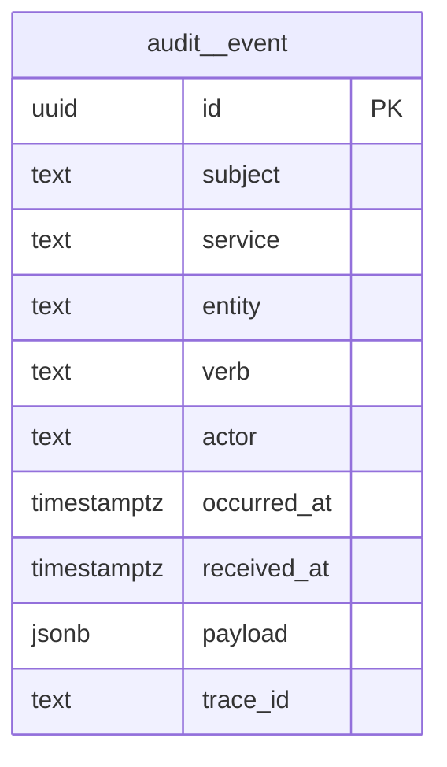

### Tables & Columns

#### `audit.event`

| Column | Type | Nullable | Key | References |
|---|---|---|---|---|
| `id` | `uuid` | NO | PK |  |
| `subject` | `text` | NO |  |  |
| `service` | `text` | NO |  |  |
| `entity` | `text` | NO |  |  |
| `verb` | `text` | NO |  |  |
| `actor` | `text` | YES |  |  |
| `occurred_at` | `timestamp with time zone` | NO |  |  |
| `received_at` | `timestamp with time zone` | NO |  |  |
| `payload` | `jsonb` | NO |  |  |
| `trace_id` | `text` | YES |  |  |

---

## Schema: `cms` {#schema-cms}

### Entity-Relationship Diagram

```mermaid
erDiagram
    cms__article {
        text id PK
        text slug
        text title_en
        text title_ar
        text excerpt_en
        text excerpt_ar
        jsonb body_en
        jsonb body_ar
        text body_html_en
        text body_html_ar
        text cover_url
        text category
        array tags
        text author_name
        text status
        timestamptz publish_at
        boolean featured
        text seo_title_en
        text seo_title_ar
        text seo_description_en
        text seo_description_ar
        timestamptz created_at
        timestamptz updated_at
    }
    cms__cms_article {
        text id PK
        text slug
        text title_en
        text title_ar
        text excerpt_en
        text excerpt_ar
        jsonb body_en
        jsonb body_ar
        text body_html_en
        text body_html_ar
        text cover_url
        text category
        text author_id
        text author_name
        text status
        timestamptz publish_at
        boolean featured
        text seo_title_en
        text seo_title_ar
        text seo_description_en
        text seo_description_ar
        timestamptz created_at
        timestamptz updated_at
        boolean is_sample
    }
    cms__cms_page {
        text id PK
        text slug
        text page_type
        text title_en
        text title_ar
        text seo_title_en
        text seo_title_ar
        text seo_description_en
        text seo_description_ar
    }
    cms__content_snapshot {
        text id PK
        jsonb draft
        jsonb published
        integer revision
        timestamptz published_at
        timestamptz updated_at
    }
    cms__faq {
        text id PK
        text question_en
        text question_ar
        text answer_en
        text answer_ar
        text category
        boolean is_published
        integer sort_order
        timestamptz created_at
    }
    cms__inbox {
        text consumer PK
        uuid event_id PK
        timestamptz handled_at
    }
    cms__outbox {
        uuid id PK
        text subject
        jsonb payload
        jsonb headers
        timestamptz created_at
        timestamptz published_at
        integer attempts
        timestamptz next_try_at
        text last_error
    }
    cms__page {
        text id PK
        text slug
        text page_type
        text title_en
        text title_ar
        text seo_title_en
        text seo_title_ar
        text seo_description_en
        text seo_description_ar
        jsonb blocks
        boolean is_visible
        boolean in_header
        boolean in_footer
        integer sort_order
        timestamptz created_at
        timestamptz updated_at
    }
    cms__portfolio_category {
        text id PK
        text slug
        text name_en
        text name_ar
        integer display_order
    }
    cms__portfolio_item {
        text id PK
        text category_id
        text slug
        text title_en
        text title_ar
        text client_name
        integer year
        text subtitle_en
        text subtitle_ar
        numeric price
        text price_note_en
        text price_note_ar
        text location
        text external_url
    }
    cms__review {
        text id PK
        text author_en
        text author_ar
        text company_en
        text company_ar
        text quote_en
        text quote_ar
        integer rating
        boolean is_approved
        integer sort_order
        text year
        timestamptz created_at
    }
    cms__social_content_plan {
        text id PK
        text title
        text caption
        text media_url
        timestamptz scheduled_for
        text status
        text published_url
        text assignee_id
        text created_by_id
        timestamptz created_at
        timestamptz updated_at
    }
    cms__social_insight_snapshot {
        text id PK
        text platform
        text source_provider
        text source_account_id
        integer period_days
        timestamptz period_start
        timestamptz period_end
        text time_zone
        jsonb metrics
        jsonb native_metrics
        timestamptz recorded_at
    }
    cms__social_link {
        text id PK
        text platform
        text url
        text icon
        boolean is_active
        integer display_order
        timestamptz created_at
        timestamptz updated_at
    }
    cms__social_metric {
        text id PK
        text platform
        text metric_type
        float8 value
        text source_provider
        text source_account_id
        timestamptz recorded_at
        boolean is_stale
        text error_status
        timestamptz created_at
    }
    cms__social_post {
        text id PK
        text platform
        text external_id
        text source_provider
        text source_account_id
        text caption
        text media_type
        text permalink
        text thumbnail_url
        timestamptz published_at
        float8 likes
        float8 comments
        float8 shares
        float8 views
        float8 reach
        float8 saves
        timestamptz fetched_at
        timestamptz created_at
    }
    cms__social_post_snapshot {
        text id PK
        text post_id
        text source_account_id
        timestamptz recorded_at
        jsonb counters
    }
    cms__statistic {
        text id PK
        text metric_value
        text label_en
        text label_ar
        text sub_label_en
        text sub_label_ar
        text icon
        integer sort_order
    }
    cms__website_content {
        text id PK
        jsonb draft
        jsonb published
        jsonb previous
        integer revision
        timestamptz published_at
        timestamptz updated_at
    }
```

### Tables & Columns

#### `cms.article`

| Column | Type | Nullable | Key | References |
|---|---|---|---|---|
| `id` | `text` | NO | PK |  |
| `slug` | `text` | NO |  |  |
| `title_en` | `text` | NO |  |  |
| `title_ar` | `text` | NO |  |  |
| `excerpt_en` | `text` | YES |  |  |
| `excerpt_ar` | `text` | YES |  |  |
| `body_en` | `jsonb` | YES |  |  |
| `body_ar` | `jsonb` | YES |  |  |
| `body_html_en` | `text` | YES |  |  |
| `body_html_ar` | `text` | YES |  |  |
| `cover_url` | `text` | YES |  |  |
| `category` | `text` | NO |  |  |
| `tags` | `ARRAY` | NO |  |  |
| `author_name` | `text` | YES |  |  |
| `status` | `text` | NO |  |  |
| `publish_at` | `timestamp with time zone` | YES |  |  |
| `featured` | `boolean` | NO |  |  |
| `seo_title_en` | `text` | YES |  |  |
| `seo_title_ar` | `text` | YES |  |  |
| `seo_description_en` | `text` | YES |  |  |
| `seo_description_ar` | `text` | YES |  |  |
| `created_at` | `timestamp with time zone` | NO |  |  |
| `updated_at` | `timestamp with time zone` | NO |  |  |

#### `cms.cms_article`

| Column | Type | Nullable | Key | References |
|---|---|---|---|---|
| `id` | `text` | NO | PK |  |
| `slug` | `text` | YES |  |  |
| `title_en` | `text` | YES |  |  |
| `title_ar` | `text` | YES |  |  |
| `excerpt_en` | `text` | YES |  |  |
| `excerpt_ar` | `text` | YES |  |  |
| `body_en` | `jsonb` | YES |  |  |
| `body_ar` | `jsonb` | YES |  |  |
| `body_html_en` | `text` | YES |  |  |
| `body_html_ar` | `text` | YES |  |  |
| `cover_url` | `text` | YES |  |  |
| `category` | `text` | YES |  |  |
| `author_id` | `text` | YES |  |  |
| `author_name` | `text` | YES |  |  |
| `status` | `text` | YES |  |  |
| `publish_at` | `timestamp with time zone` | YES |  |  |
| `featured` | `boolean` | YES |  |  |
| `seo_title_en` | `text` | YES |  |  |
| `seo_title_ar` | `text` | YES |  |  |
| `seo_description_en` | `text` | YES |  |  |
| `seo_description_ar` | `text` | YES |  |  |
| `created_at` | `timestamp with time zone` | NO |  |  |
| `updated_at` | `timestamp with time zone` | NO |  |  |
| `is_sample` | `boolean` | YES |  |  |

#### `cms.cms_page`

| Column | Type | Nullable | Key | References |
|---|---|---|---|---|
| `id` | `text` | NO | PK |  |
| `slug` | `text` | YES |  |  |
| `page_type` | `text` | YES |  |  |
| `title_en` | `text` | YES |  |  |
| `title_ar` | `text` | YES |  |  |
| `seo_title_en` | `text` | YES |  |  |
| `seo_title_ar` | `text` | YES |  |  |
| `seo_description_en` | `text` | YES |  |  |
| `seo_description_ar` | `text` | YES |  |  |

#### `cms.content_snapshot`

| Column | Type | Nullable | Key | References |
|---|---|---|---|---|
| `id` | `text` | NO | PK |  |
| `draft` | `jsonb` | NO |  |  |
| `published` | `jsonb` | YES |  |  |
| `revision` | `integer` | NO |  |  |
| `published_at` | `timestamp with time zone` | YES |  |  |
| `updated_at` | `timestamp with time zone` | NO |  |  |

#### `cms.faq`

| Column | Type | Nullable | Key | References |
|---|---|---|---|---|
| `id` | `text` | NO | PK |  |
| `question_en` | `text` | NO |  |  |
| `question_ar` | `text` | NO |  |  |
| `answer_en` | `text` | NO |  |  |
| `answer_ar` | `text` | NO |  |  |
| `category` | `text` | NO |  |  |
| `is_published` | `boolean` | NO |  |  |
| `sort_order` | `integer` | NO |  |  |
| `created_at` | `timestamp with time zone` | NO |  |  |

#### `cms.inbox`

| Column | Type | Nullable | Key | References |
|---|---|---|---|---|
| `consumer` | `text` | NO | PK |  |
| `event_id` | `uuid` | NO | PK |  |
| `handled_at` | `timestamp with time zone` | NO |  |  |

#### `cms.outbox`

| Column | Type | Nullable | Key | References |
|---|---|---|---|---|
| `id` | `uuid` | NO | PK |  |
| `subject` | `text` | NO |  |  |
| `payload` | `jsonb` | NO |  |  |
| `headers` | `jsonb` | NO |  |  |
| `created_at` | `timestamp with time zone` | NO |  |  |
| `published_at` | `timestamp with time zone` | YES |  |  |
| `attempts` | `integer` | NO |  |  |
| `next_try_at` | `timestamp with time zone` | NO |  |  |
| `last_error` | `text` | YES |  |  |

#### `cms.page`

| Column | Type | Nullable | Key | References |
|---|---|---|---|---|
| `id` | `text` | NO | PK |  |
| `slug` | `text` | NO |  |  |
| `page_type` | `text` | NO |  |  |
| `title_en` | `text` | NO |  |  |
| `title_ar` | `text` | NO |  |  |
| `seo_title_en` | `text` | YES |  |  |
| `seo_title_ar` | `text` | YES |  |  |
| `seo_description_en` | `text` | YES |  |  |
| `seo_description_ar` | `text` | YES |  |  |
| `blocks` | `jsonb` | NO |  |  |
| `is_visible` | `boolean` | NO |  |  |
| `in_header` | `boolean` | NO |  |  |
| `in_footer` | `boolean` | NO |  |  |
| `sort_order` | `integer` | NO |  |  |
| `created_at` | `timestamp with time zone` | NO |  |  |
| `updated_at` | `timestamp with time zone` | NO |  |  |

#### `cms.portfolio_category`

| Column | Type | Nullable | Key | References |
|---|---|---|---|---|
| `id` | `text` | NO | PK |  |
| `slug` | `text` | YES |  |  |
| `name_en` | `text` | YES |  |  |
| `name_ar` | `text` | YES |  |  |
| `display_order` | `integer` | YES |  |  |

#### `cms.portfolio_item`

| Column | Type | Nullable | Key | References |
|---|---|---|---|---|
| `id` | `text` | NO | PK |  |
| `category_id` | `text` | YES |  |  |
| `slug` | `text` | YES |  |  |
| `title_en` | `text` | YES |  |  |
| `title_ar` | `text` | YES |  |  |
| `client_name` | `text` | YES |  |  |
| `year` | `integer` | YES |  |  |
| `subtitle_en` | `text` | YES |  |  |
| `subtitle_ar` | `text` | YES |  |  |
| `price` | `numeric` | YES |  |  |
| `price_note_en` | `text` | YES |  |  |
| `price_note_ar` | `text` | YES |  |  |
| `location` | `text` | YES |  |  |
| `external_url` | `text` | YES |  |  |

#### `cms.review`

| Column | Type | Nullable | Key | References |
|---|---|---|---|---|
| `id` | `text` | NO | PK |  |
| `author_en` | `text` | NO |  |  |
| `author_ar` | `text` | NO |  |  |
| `company_en` | `text` | YES |  |  |
| `company_ar` | `text` | YES |  |  |
| `quote_en` | `text` | NO |  |  |
| `quote_ar` | `text` | NO |  |  |
| `rating` | `integer` | NO |  |  |
| `is_approved` | `boolean` | NO |  |  |
| `sort_order` | `integer` | NO |  |  |
| `year` | `text` | NO |  |  |
| `created_at` | `timestamp with time zone` | NO |  |  |

#### `cms.social_content_plan`

| Column | Type | Nullable | Key | References |
|---|---|---|---|---|
| `id` | `text` | NO | PK |  |
| `title` | `text` | YES |  |  |
| `caption` | `text` | YES |  |  |
| `media_url` | `text` | YES |  |  |
| `scheduled_for` | `timestamp with time zone` | YES |  |  |
| `status` | `text` | YES |  |  |
| `published_url` | `text` | YES |  |  |
| `assignee_id` | `text` | YES |  |  |
| `created_by_id` | `text` | YES |  |  |
| `created_at` | `timestamp with time zone` | NO |  |  |
| `updated_at` | `timestamp with time zone` | NO |  |  |

#### `cms.social_insight_snapshot`

| Column | Type | Nullable | Key | References |
|---|---|---|---|---|
| `id` | `text` | NO | PK |  |
| `platform` | `text` | YES |  |  |
| `source_provider` | `text` | YES |  |  |
| `source_account_id` | `text` | YES |  |  |
| `period_days` | `integer` | YES |  |  |
| `period_start` | `timestamp with time zone` | YES |  |  |
| `period_end` | `timestamp with time zone` | YES |  |  |
| `time_zone` | `text` | YES |  |  |
| `metrics` | `jsonb` | YES |  |  |
| `native_metrics` | `jsonb` | YES |  |  |
| `recorded_at` | `timestamp with time zone` | YES |  |  |

#### `cms.social_link`

| Column | Type | Nullable | Key | References |
|---|---|---|---|---|
| `id` | `text` | NO | PK |  |
| `platform` | `text` | YES |  |  |
| `url` | `text` | YES |  |  |
| `icon` | `text` | YES |  |  |
| `is_active` | `boolean` | YES |  |  |
| `display_order` | `integer` | YES |  |  |
| `created_at` | `timestamp with time zone` | NO |  |  |
| `updated_at` | `timestamp with time zone` | NO |  |  |

#### `cms.social_metric`

| Column | Type | Nullable | Key | References |
|---|---|---|---|---|
| `id` | `text` | NO | PK |  |
| `platform` | `text` | YES |  |  |
| `metric_type` | `text` | YES |  |  |
| `value` | `double precision` | YES |  |  |
| `source_provider` | `text` | YES |  |  |
| `source_account_id` | `text` | YES |  |  |
| `recorded_at` | `timestamp with time zone` | YES |  |  |
| `is_stale` | `boolean` | YES |  |  |
| `error_status` | `text` | YES |  |  |
| `created_at` | `timestamp with time zone` | NO |  |  |

#### `cms.social_post`

| Column | Type | Nullable | Key | References |
|---|---|---|---|---|
| `id` | `text` | NO | PK |  |
| `platform` | `text` | YES |  |  |
| `external_id` | `text` | YES |  |  |
| `source_provider` | `text` | YES |  |  |
| `source_account_id` | `text` | YES |  |  |
| `caption` | `text` | YES |  |  |
| `media_type` | `text` | YES |  |  |
| `permalink` | `text` | YES |  |  |
| `thumbnail_url` | `text` | YES |  |  |
| `published_at` | `timestamp with time zone` | YES |  |  |
| `likes` | `double precision` | YES |  |  |
| `comments` | `double precision` | YES |  |  |
| `shares` | `double precision` | YES |  |  |
| `views` | `double precision` | YES |  |  |
| `reach` | `double precision` | YES |  |  |
| `saves` | `double precision` | YES |  |  |
| `fetched_at` | `timestamp with time zone` | YES |  |  |
| `created_at` | `timestamp with time zone` | NO |  |  |

#### `cms.social_post_snapshot`

| Column | Type | Nullable | Key | References |
|---|---|---|---|---|
| `id` | `text` | NO | PK |  |
| `post_id` | `text` | YES |  |  |
| `source_account_id` | `text` | YES |  |  |
| `recorded_at` | `timestamp with time zone` | YES |  |  |
| `counters` | `jsonb` | YES |  |  |

#### `cms.statistic`

| Column | Type | Nullable | Key | References |
|---|---|---|---|---|
| `id` | `text` | NO | PK |  |
| `metric_value` | `text` | NO |  |  |
| `label_en` | `text` | NO |  |  |
| `label_ar` | `text` | NO |  |  |
| `sub_label_en` | `text` | YES |  |  |
| `sub_label_ar` | `text` | YES |  |  |
| `icon` | `text` | YES |  |  |
| `sort_order` | `integer` | NO |  |  |

#### `cms.website_content`

| Column | Type | Nullable | Key | References |
|---|---|---|---|---|
| `id` | `text` | NO | PK |  |
| `draft` | `jsonb` | YES |  |  |
| `published` | `jsonb` | YES |  |  |
| `previous` | `jsonb` | YES |  |  |
| `revision` | `integer` | YES |  |  |
| `published_at` | `timestamp with time zone` | YES |  |  |
| `updated_at` | `timestamp with time zone` | NO |  |  |

---

## Schema: `commerce` {#schema-commerce}

### Entity-Relationship Diagram

```mermaid
erDiagram
    commerce__coupon {
        text id PK
        text code
        text discount_type
        numeric discount_value
        numeric min_order_amount
        numeric max_discount_amount
        timestamptz starts_at
        timestamptz expires_at
        integer usage_limit
        integer usage_count
        boolean is_active
        timestamptz created_at
        text kind
        numeric value
        numeric min_order
        timestamptz ends_at
        integer max_uses
        integer used_count
    }
    commerce__customer {
        text id PK
        text email
        text phone
        text first_name
        text last_name
        text status
        timestamptz created_at
        timestamptz updated_at
        text name
        text password_hash
        timestamptz email_verified_at
        text locale
        text google_sub
        text apple_sub
        boolean marketing_opt_in
        text crm_contact_id
    }
    commerce__customer_address {
        text id PK
        text customer_id FK
        text address_type
        text label
        text line1
        text line2
        text city
        text state
        text postal_code
        text country
        boolean is_default
        text name
        text phone
        text area
        timestamptz created_at
    }
    commerce__customer_auth_code {
        text id PK
        text email
        text code_hash
        integer attempts
        timestamptz expires_at
        timestamptz used_at
        timestamptz created_at
    }
    commerce__customer_segment {
        text id PK
        text name
    }
    commerce__customer_session {
        text id PK
        text customer_id
        text token_hash
        timestamptz expires_at
        text user_agent
        timestamptz created_at
    }
    commerce__delivery_settings {
        text id PK
        text mode
        integer sla_hours
        text time_zone
        integer slot_days
        integer lead_minutes
        boolean require_slot
        timestamptz updated_at
    }
    commerce__delivery_slot {
        text id PK
        text zone_id
        integer weekday
        text start
        text end
        integer capacity
        boolean is_active
        timestamptz created_at
    }
    commerce__delivery_zone {
        text id PK
        text name_en
        text name_ar
        numeric fee
        numeric min_order
        numeric free_over
        boolean is_active
        integer sort_order
        timestamptz created_at
        timestamptz updated_at
    }
    commerce__inbox {
        text consumer PK
        uuid event_id PK
        timestamptz handled_at
    }
    commerce__outbox {
        uuid id PK
        text subject
        jsonb payload
        jsonb headers
        timestamptz created_at
        timestamptz published_at
        integer attempts
        timestamptz next_try_at
        text last_error
    }
    commerce__retail_closing {
        text id PK
        text shift_id FK
        date closing_date
        numeric total_sales
        numeric total_cash
        numeric total_card
        text notes
        text branch_id
        text level
        text target_id
        timestamptz business_date
        timestamptz closed_at
        text closed_by_id
        numeric total_returns
        numeric total_other
        numeric cash_variance
        jsonb snapshot
        text signature
        text journal_id
        text status
        integer revision
    }
    commerce__retail_register {
        text id PK
        text name
        text branch_id
        boolean is_active
        text code
        integer revision
        timestamptz created_at
        timestamptz updated_at
    }
    commerce__retail_shift {
        text id PK
        text register_id FK
        text cashier_id
        timestamptz opened_at
        timestamptz closed_at
        numeric starting_cash
        numeric closing_cash
        numeric expected_cash
        text status
    }
    commerce__sales_order {
        text id PK
        text number
        text customer_id FK
        text contact_id
        text email
        text name
        text phone
        text channel
        text status
        text payment_status
        text payment_method
        text fulfilment
        jsonb shipping_address
        numeric subtotal
        numeric discount_amount
        text coupon_code
        numeric vat_amount
        numeric delivery_fee
        numeric total
        numeric amount_paid
        numeric amount_refunded
        text currency
        text locale
        text note
        text warehouse_id
        text invoice_id
        text created_by_id
        timestamptz placed_at
        timestamptz paid_at
        timestamptz shipped_at
        timestamptz delivered_at
        timestamptz cancelled_at
        text utm_campaign
        text utm_source
        text utm_medium
        timestamptz updated_at
    }
    commerce__sales_order_event {
        text id PK
        text order_id FK
        text kind
        text status
        text note
        numeric amount
        text by_id
        timestamptz created_at
    }
    commerce__sales_order_line {
        text id PK
        text order_id FK
        text product_id
        text variant_key
        text sku
        text description
        numeric quantity
        numeric unit_price
        boolean vat_exempt
        numeric line_total
        text location_id
        numeric returned_quantity
        integer sort_order
    }
    commerce__shipment {
        text id PK
        text number
        text order_id
        text status
        text method
        text zone_id
        text slot_id
        timestamptz slot_date
        text slot_start
        text slot_end
        timestamptz promised_by
        text recipient_name
        text recipient_phone
        jsonb address
        numeric cod_amount
        numeric cod_collected
        text tracking_token
        integer attempts
        text failure_reason
        timestamptz out_at
        timestamptz delivered_at
        text driver_id
        text vehicle_id
        text route_sheet_id
        integer route_stop
        text proof_photo_url
        text proof_signature
        text cod_settlement_id
        text agency_id
        text tracking_number
        text courier_booking_agency_id
        text courier_booking_status
        timestamptz courier_booking_started_at
        text label_url
        numeric agency_fee
        text agency_invoice_id
        timestamptz tracked_at
        timestamptz created_at
        timestamptz updated_at
    }
    commerce__shipment_event {
        text id PK
        text shipment_id
        text status
        text reason
        text note
        text by_id
        timestamptz at
    }
    commerce__store_region {
        text id PK
        text code
        text name_en
        text name_ar
        text currency
        text default_language
        text branch_id
        boolean is_enabled
        numeric price_multiplier
        jsonb settings
    }
    commerce__store_settings {
        text id PK
        text currency
        boolean tax_inclusive
        numeric default_tax_rate
        numeric minimum_order_amount
        numeric free_shipping_threshold
        boolean guest_checkout
        boolean delivery_enabled
        numeric delivery_fee
        numeric free_delivery_over
        boolean pickup_enabled
        boolean cod_enabled
        boolean bank_transfer_enabled
        text bank_instructions_en
        text bank_instructions_ar
        text order_notify_email
        text payment_gateway
        timestamptz updated_at
    }
    commerce__customer ||--o{ commerce__customer_address : "customer_id"
    commerce__retail_shift ||--o{ commerce__retail_closing : "shift_id"
    commerce__retail_register ||--o{ commerce__retail_shift : "register_id"
    commerce__customer ||--o{ commerce__sales_order : "customer_id"
    commerce__sales_order ||--o{ commerce__sales_order_event : "order_id"
    commerce__sales_order ||--o{ commerce__sales_order_line : "order_id"
```

### Tables & Columns

#### `commerce.coupon`

| Column | Type | Nullable | Key | References |
|---|---|---|---|---|
| `id` | `text` | NO | PK |  |
| `code` | `text` | NO |  |  |
| `discount_type` | `text` | NO |  |  |
| `discount_value` | `numeric` | NO |  |  |
| `min_order_amount` | `numeric` | NO |  |  |
| `max_discount_amount` | `numeric` | YES |  |  |
| `starts_at` | `timestamp with time zone` | YES |  |  |
| `expires_at` | `timestamp with time zone` | YES |  |  |
| `usage_limit` | `integer` | YES |  |  |
| `usage_count` | `integer` | NO |  |  |
| `is_active` | `boolean` | NO |  |  |
| `created_at` | `timestamp with time zone` | NO |  |  |
| `kind` | `text` | YES |  |  |
| `value` | `numeric` | YES |  |  |
| `min_order` | `numeric` | YES |  |  |
| `ends_at` | `timestamp with time zone` | YES |  |  |
| `max_uses` | `integer` | YES |  |  |
| `used_count` | `integer` | YES |  |  |

#### `commerce.customer`

| Column | Type | Nullable | Key | References |
|---|---|---|---|---|
| `id` | `text` | NO | PK |  |
| `email` | `text` | YES |  |  |
| `phone` | `text` | YES |  |  |
| `first_name` | `text` | NO |  |  |
| `last_name` | `text` | NO |  |  |
| `status` | `text` | NO |  |  |
| `created_at` | `timestamp with time zone` | NO |  |  |
| `updated_at` | `timestamp with time zone` | NO |  |  |
| `name` | `text` | YES |  |  |
| `password_hash` | `text` | YES |  |  |
| `email_verified_at` | `timestamp with time zone` | YES |  |  |
| `locale` | `text` | YES |  |  |
| `google_sub` | `text` | YES |  |  |
| `apple_sub` | `text` | YES |  |  |
| `marketing_opt_in` | `boolean` | YES |  |  |
| `crm_contact_id` | `text` | YES |  |  |

#### `commerce.customer_address`

| Column | Type | Nullable | Key | References |
|---|---|---|---|---|
| `id` | `text` | NO | PK |  |
| `customer_id` | `text` | NO | FK | `commerce.customer.id` |
| `address_type` | `text` | NO |  |  |
| `label` | `text` | NO |  |  |
| `line1` | `text` | NO |  |  |
| `line2` | `text` | NO |  |  |
| `city` | `text` | NO |  |  |
| `state` | `text` | NO |  |  |
| `postal_code` | `text` | NO |  |  |
| `country` | `text` | NO |  |  |
| `is_default` | `boolean` | NO |  |  |
| `name` | `text` | YES |  |  |
| `phone` | `text` | YES |  |  |
| `area` | `text` | YES |  |  |
| `created_at` | `timestamp with time zone` | YES |  |  |

#### `commerce.customer_auth_code`

| Column | Type | Nullable | Key | References |
|---|---|---|---|---|
| `id` | `text` | NO | PK |  |
| `email` | `text` | YES |  |  |
| `code_hash` | `text` | YES |  |  |
| `attempts` | `integer` | YES |  |  |
| `expires_at` | `timestamp with time zone` | YES |  |  |
| `used_at` | `timestamp with time zone` | YES |  |  |
| `created_at` | `timestamp with time zone` | NO |  |  |

#### `commerce.customer_segment`

| Column | Type | Nullable | Key | References |
|---|---|---|---|---|
| `id` | `text` | NO | PK |  |
| `name` | `text` | YES |  |  |

#### `commerce.customer_session`

| Column | Type | Nullable | Key | References |
|---|---|---|---|---|
| `id` | `text` | NO | PK |  |
| `customer_id` | `text` | YES |  |  |
| `token_hash` | `text` | YES |  |  |
| `expires_at` | `timestamp with time zone` | YES |  |  |
| `user_agent` | `text` | YES |  |  |
| `created_at` | `timestamp with time zone` | NO |  |  |

#### `commerce.delivery_settings`

| Column | Type | Nullable | Key | References |
|---|---|---|---|---|
| `id` | `text` | NO | PK |  |
| `mode` | `text` | YES |  |  |
| `sla_hours` | `integer` | YES |  |  |
| `time_zone` | `text` | YES |  |  |
| `slot_days` | `integer` | YES |  |  |
| `lead_minutes` | `integer` | YES |  |  |
| `require_slot` | `boolean` | YES |  |  |
| `updated_at` | `timestamp with time zone` | NO |  |  |

#### `commerce.delivery_slot`

| Column | Type | Nullable | Key | References |
|---|---|---|---|---|
| `id` | `text` | NO | PK |  |
| `zone_id` | `text` | YES |  |  |
| `weekday` | `integer` | YES |  |  |
| `start` | `text` | YES |  |  |
| `end` | `text` | YES |  |  |
| `capacity` | `integer` | YES |  |  |
| `is_active` | `boolean` | YES |  |  |
| `created_at` | `timestamp with time zone` | NO |  |  |

#### `commerce.delivery_zone`

| Column | Type | Nullable | Key | References |
|---|---|---|---|---|
| `id` | `text` | NO | PK |  |
| `name_en` | `text` | YES |  |  |
| `name_ar` | `text` | YES |  |  |
| `fee` | `numeric` | YES |  |  |
| `min_order` | `numeric` | YES |  |  |
| `free_over` | `numeric` | YES |  |  |
| `is_active` | `boolean` | YES |  |  |
| `sort_order` | `integer` | YES |  |  |
| `created_at` | `timestamp with time zone` | NO |  |  |
| `updated_at` | `timestamp with time zone` | NO |  |  |

#### `commerce.inbox`

| Column | Type | Nullable | Key | References |
|---|---|---|---|---|
| `consumer` | `text` | NO | PK |  |
| `event_id` | `uuid` | NO | PK |  |
| `handled_at` | `timestamp with time zone` | NO |  |  |

#### `commerce.outbox`

| Column | Type | Nullable | Key | References |
|---|---|---|---|---|
| `id` | `uuid` | NO | PK |  |
| `subject` | `text` | NO |  |  |
| `payload` | `jsonb` | NO |  |  |
| `headers` | `jsonb` | NO |  |  |
| `created_at` | `timestamp with time zone` | NO |  |  |
| `published_at` | `timestamp with time zone` | YES |  |  |
| `attempts` | `integer` | NO |  |  |
| `next_try_at` | `timestamp with time zone` | NO |  |  |
| `last_error` | `text` | YES |  |  |

#### `commerce.retail_closing`

| Column | Type | Nullable | Key | References |
|---|---|---|---|---|
| `id` | `text` | NO | PK |  |
| `shift_id` | `text` | NO | FK | `commerce.retail_shift.id` |
| `closing_date` | `date` | NO |  |  |
| `total_sales` | `numeric` | NO |  |  |
| `total_cash` | `numeric` | NO |  |  |
| `total_card` | `numeric` | NO |  |  |
| `notes` | `text` | YES |  |  |
| `branch_id` | `text` | YES |  |  |
| `level` | `text` | YES |  |  |
| `target_id` | `text` | YES |  |  |
| `business_date` | `timestamp with time zone` | YES |  |  |
| `closed_at` | `timestamp with time zone` | YES |  |  |
| `closed_by_id` | `text` | YES |  |  |
| `total_returns` | `numeric` | YES |  |  |
| `total_other` | `numeric` | YES |  |  |
| `cash_variance` | `numeric` | YES |  |  |
| `snapshot` | `jsonb` | YES |  |  |
| `signature` | `text` | YES |  |  |
| `journal_id` | `text` | YES |  |  |
| `status` | `text` | YES |  |  |
| `revision` | `integer` | YES |  |  |

#### `commerce.retail_register`

| Column | Type | Nullable | Key | References |
|---|---|---|---|---|
| `id` | `text` | NO | PK |  |
| `name` | `text` | NO |  |  |
| `branch_id` | `text` | YES |  |  |
| `is_active` | `boolean` | NO |  |  |
| `code` | `text` | YES |  |  |
| `revision` | `integer` | YES |  |  |
| `created_at` | `timestamp with time zone` | YES |  |  |
| `updated_at` | `timestamp with time zone` | YES |  |  |

#### `commerce.retail_shift`

| Column | Type | Nullable | Key | References |
|---|---|---|---|---|
| `id` | `text` | NO | PK |  |
| `register_id` | `text` | NO | FK | `commerce.retail_register.id` |
| `cashier_id` | `text` | NO |  |  |
| `opened_at` | `timestamp with time zone` | NO |  |  |
| `closed_at` | `timestamp with time zone` | YES |  |  |
| `starting_cash` | `numeric` | NO |  |  |
| `closing_cash` | `numeric` | NO |  |  |
| `expected_cash` | `numeric` | NO |  |  |
| `status` | `text` | NO |  |  |

#### `commerce.sales_order`

| Column | Type | Nullable | Key | References |
|---|---|---|---|---|
| `id` | `text` | NO | PK |  |
| `number` | `text` | NO |  |  |
| `customer_id` | `text` | YES | FK | `commerce.customer.id` |
| `contact_id` | `text` | YES |  |  |
| `email` | `text` | YES |  |  |
| `name` | `text` | NO |  |  |
| `phone` | `text` | YES |  |  |
| `channel` | `text` | NO |  |  |
| `status` | `text` | NO |  |  |
| `payment_status` | `text` | NO |  |  |
| `payment_method` | `text` | NO |  |  |
| `fulfilment` | `text` | NO |  |  |
| `shipping_address` | `jsonb` | YES |  |  |
| `subtotal` | `numeric` | NO |  |  |
| `discount_amount` | `numeric` | NO |  |  |
| `coupon_code` | `text` | YES |  |  |
| `vat_amount` | `numeric` | NO |  |  |
| `delivery_fee` | `numeric` | NO |  |  |
| `total` | `numeric` | NO |  |  |
| `amount_paid` | `numeric` | NO |  |  |
| `amount_refunded` | `numeric` | NO |  |  |
| `currency` | `text` | NO |  |  |
| `locale` | `text` | NO |  |  |
| `note` | `text` | YES |  |  |
| `warehouse_id` | `text` | YES |  |  |
| `invoice_id` | `text` | YES |  |  |
| `created_by_id` | `text` | YES |  |  |
| `placed_at` | `timestamp with time zone` | NO |  |  |
| `paid_at` | `timestamp with time zone` | YES |  |  |
| `shipped_at` | `timestamp with time zone` | YES |  |  |
| `delivered_at` | `timestamp with time zone` | YES |  |  |
| `cancelled_at` | `timestamp with time zone` | YES |  |  |
| `utm_campaign` | `text` | YES |  |  |
| `utm_source` | `text` | YES |  |  |
| `utm_medium` | `text` | YES |  |  |
| `updated_at` | `timestamp with time zone` | NO |  |  |

#### `commerce.sales_order_event`

| Column | Type | Nullable | Key | References |
|---|---|---|---|---|
| `id` | `text` | NO | PK |  |
| `order_id` | `text` | NO | FK | `commerce.sales_order.id` |
| `kind` | `text` | NO |  |  |
| `status` | `text` | YES |  |  |
| `note` | `text` | YES |  |  |
| `amount` | `numeric` | YES |  |  |
| `by_id` | `text` | YES |  |  |
| `created_at` | `timestamp with time zone` | NO |  |  |

#### `commerce.sales_order_line`

| Column | Type | Nullable | Key | References |
|---|---|---|---|---|
| `id` | `text` | NO | PK |  |
| `order_id` | `text` | NO | FK | `commerce.sales_order.id` |
| `product_id` | `text` | NO |  |  |
| `variant_key` | `text` | NO |  |  |
| `sku` | `text` | NO |  |  |
| `description` | `text` | NO |  |  |
| `quantity` | `numeric` | NO |  |  |
| `unit_price` | `numeric` | NO |  |  |
| `vat_exempt` | `boolean` | NO |  |  |
| `line_total` | `numeric` | NO |  |  |
| `location_id` | `text` | YES |  |  |
| `returned_quantity` | `numeric` | NO |  |  |
| `sort_order` | `integer` | NO |  |  |

#### `commerce.shipment`

| Column | Type | Nullable | Key | References |
|---|---|---|---|---|
| `id` | `text` | NO | PK |  |
| `number` | `text` | YES |  |  |
| `order_id` | `text` | YES |  |  |
| `status` | `text` | YES |  |  |
| `method` | `text` | YES |  |  |
| `zone_id` | `text` | YES |  |  |
| `slot_id` | `text` | YES |  |  |
| `slot_date` | `timestamp with time zone` | YES |  |  |
| `slot_start` | `text` | YES |  |  |
| `slot_end` | `text` | YES |  |  |
| `promised_by` | `timestamp with time zone` | YES |  |  |
| `recipient_name` | `text` | YES |  |  |
| `recipient_phone` | `text` | YES |  |  |
| `address` | `jsonb` | YES |  |  |
| `cod_amount` | `numeric` | YES |  |  |
| `cod_collected` | `numeric` | YES |  |  |
| `tracking_token` | `text` | YES |  |  |
| `attempts` | `integer` | YES |  |  |
| `failure_reason` | `text` | YES |  |  |
| `out_at` | `timestamp with time zone` | YES |  |  |
| `delivered_at` | `timestamp with time zone` | YES |  |  |
| `driver_id` | `text` | YES |  |  |
| `vehicle_id` | `text` | YES |  |  |
| `route_sheet_id` | `text` | YES |  |  |
| `route_stop` | `integer` | YES |  |  |
| `proof_photo_url` | `text` | YES |  |  |
| `proof_signature` | `text` | YES |  |  |
| `cod_settlement_id` | `text` | YES |  |  |
| `agency_id` | `text` | YES |  |  |
| `tracking_number` | `text` | YES |  |  |
| `courier_booking_agency_id` | `text` | YES |  |  |
| `courier_booking_status` | `text` | YES |  |  |
| `courier_booking_started_at` | `timestamp with time zone` | YES |  |  |
| `label_url` | `text` | YES |  |  |
| `agency_fee` | `numeric` | YES |  |  |
| `agency_invoice_id` | `text` | YES |  |  |
| `tracked_at` | `timestamp with time zone` | YES |  |  |
| `created_at` | `timestamp with time zone` | NO |  |  |
| `updated_at` | `timestamp with time zone` | NO |  |  |

#### `commerce.shipment_event`

| Column | Type | Nullable | Key | References |
|---|---|---|---|---|
| `id` | `text` | NO | PK |  |
| `shipment_id` | `text` | YES |  |  |
| `status` | `text` | YES |  |  |
| `reason` | `text` | YES |  |  |
| `note` | `text` | YES |  |  |
| `by_id` | `text` | YES |  |  |
| `at` | `timestamp with time zone` | YES |  |  |

#### `commerce.store_region`

| Column | Type | Nullable | Key | References |
|---|---|---|---|---|
| `id` | `text` | NO | PK |  |
| `code` | `text` | YES |  |  |
| `name_en` | `text` | YES |  |  |
| `name_ar` | `text` | YES |  |  |
| `currency` | `text` | YES |  |  |
| `default_language` | `text` | YES |  |  |
| `branch_id` | `text` | YES |  |  |
| `is_enabled` | `boolean` | YES |  |  |
| `price_multiplier` | `numeric` | YES |  |  |
| `settings` | `jsonb` | YES |  |  |

#### `commerce.store_settings`

| Column | Type | Nullable | Key | References |
|---|---|---|---|---|
| `id` | `text` | NO | PK |  |
| `currency` | `text` | NO |  |  |
| `tax_inclusive` | `boolean` | NO |  |  |
| `default_tax_rate` | `numeric` | NO |  |  |
| `minimum_order_amount` | `numeric` | NO |  |  |
| `free_shipping_threshold` | `numeric` | NO |  |  |
| `guest_checkout` | `boolean` | YES |  |  |
| `delivery_enabled` | `boolean` | YES |  |  |
| `delivery_fee` | `numeric` | YES |  |  |
| `free_delivery_over` | `numeric` | YES |  |  |
| `pickup_enabled` | `boolean` | YES |  |  |
| `cod_enabled` | `boolean` | YES |  |  |
| `bank_transfer_enabled` | `boolean` | YES |  |  |
| `bank_instructions_en` | `text` | YES |  |  |
| `bank_instructions_ar` | `text` | YES |  |  |
| `order_notify_email` | `text` | YES |  |  |
| `payment_gateway` | `text` | YES |  |  |
| `updated_at` | `timestamp with time zone` | YES |  |  |

---

## Schema: `delivery` {#schema-delivery}

### Entity-Relationship Diagram

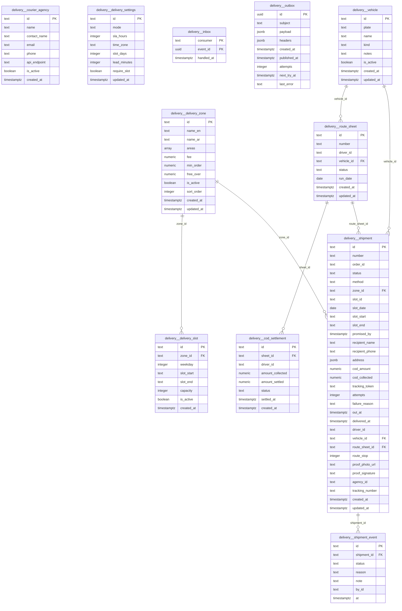

### Tables & Columns

#### `delivery.cod_settlement`

| Column | Type | Nullable | Key | References |
|---|---|---|---|---|
| `id` | `text` | NO | PK |  |
| `sheet_id` | `text` | YES | FK | `delivery.route_sheet.id` |
| `driver_id` | `text` | NO |  |  |
| `amount_collected` | `numeric` | NO |  |  |
| `amount_settled` | `numeric` | NO |  |  |
| `status` | `text` | NO |  |  |
| `settled_at` | `timestamp with time zone` | YES |  |  |
| `created_at` | `timestamp with time zone` | NO |  |  |

#### `delivery.courier_agency`

| Column | Type | Nullable | Key | References |
|---|---|---|---|---|
| `id` | `text` | NO | PK |  |
| `name` | `text` | NO |  |  |
| `contact_name` | `text` | YES |  |  |
| `email` | `text` | YES |  |  |
| `phone` | `text` | YES |  |  |
| `api_endpoint` | `text` | YES |  |  |
| `is_active` | `boolean` | NO |  |  |
| `created_at` | `timestamp with time zone` | NO |  |  |

#### `delivery.delivery_settings`

| Column | Type | Nullable | Key | References |
|---|---|---|---|---|
| `id` | `text` | NO | PK |  |
| `mode` | `text` | NO |  |  |
| `sla_hours` | `integer` | NO |  |  |
| `time_zone` | `text` | YES |  |  |
| `slot_days` | `integer` | NO |  |  |
| `lead_minutes` | `integer` | NO |  |  |
| `require_slot` | `boolean` | NO |  |  |
| `updated_at` | `timestamp with time zone` | NO |  |  |

#### `delivery.delivery_slot`

| Column | Type | Nullable | Key | References |
|---|---|---|---|---|
| `id` | `text` | NO | PK |  |
| `zone_id` | `text` | YES | FK | `delivery.delivery_zone.id` |
| `weekday` | `integer` | NO |  |  |
| `slot_start` | `text` | NO |  |  |
| `slot_end` | `text` | NO |  |  |
| `capacity` | `integer` | YES |  |  |
| `is_active` | `boolean` | NO |  |  |
| `created_at` | `timestamp with time zone` | NO |  |  |

#### `delivery.delivery_zone`

| Column | Type | Nullable | Key | References |
|---|---|---|---|---|
| `id` | `text` | NO | PK |  |
| `name_en` | `text` | NO |  |  |
| `name_ar` | `text` | NO |  |  |
| `areas` | `ARRAY` | NO |  |  |
| `fee` | `numeric` | NO |  |  |
| `min_order` | `numeric` | YES |  |  |
| `free_over` | `numeric` | YES |  |  |
| `is_active` | `boolean` | NO |  |  |
| `sort_order` | `integer` | NO |  |  |
| `created_at` | `timestamp with time zone` | NO |  |  |
| `updated_at` | `timestamp with time zone` | NO |  |  |

#### `delivery.inbox`

| Column | Type | Nullable | Key | References |
|---|---|---|---|---|
| `consumer` | `text` | NO | PK |  |
| `event_id` | `uuid` | NO | PK |  |
| `handled_at` | `timestamp with time zone` | NO |  |  |

#### `delivery.outbox`

| Column | Type | Nullable | Key | References |
|---|---|---|---|---|
| `id` | `uuid` | NO | PK |  |
| `subject` | `text` | NO |  |  |
| `payload` | `jsonb` | NO |  |  |
| `headers` | `jsonb` | NO |  |  |
| `created_at` | `timestamp with time zone` | NO |  |  |
| `published_at` | `timestamp with time zone` | YES |  |  |
| `attempts` | `integer` | NO |  |  |
| `next_try_at` | `timestamp with time zone` | NO |  |  |
| `last_error` | `text` | YES |  |  |

#### `delivery.route_sheet`

| Column | Type | Nullable | Key | References |
|---|---|---|---|---|
| `id` | `text` | NO | PK |  |
| `number` | `text` | NO |  |  |
| `driver_id` | `text` | YES |  |  |
| `vehicle_id` | `text` | YES | FK | `delivery.vehicle.id` |
| `status` | `text` | NO |  |  |
| `run_date` | `date` | NO |  |  |
| `created_at` | `timestamp with time zone` | NO |  |  |
| `updated_at` | `timestamp with time zone` | NO |  |  |

#### `delivery.shipment`

| Column | Type | Nullable | Key | References |
|---|---|---|---|---|
| `id` | `text` | NO | PK |  |
| `number` | `text` | NO |  |  |
| `order_id` | `text` | NO |  |  |
| `status` | `text` | NO |  |  |
| `method` | `text` | NO |  |  |
| `zone_id` | `text` | YES | FK | `delivery.delivery_zone.id` |
| `slot_id` | `text` | YES |  |  |
| `slot_date` | `date` | YES |  |  |
| `slot_start` | `text` | YES |  |  |
| `slot_end` | `text` | YES |  |  |
| `promised_by` | `timestamp with time zone` | NO |  |  |
| `recipient_name` | `text` | NO |  |  |
| `recipient_phone` | `text` | NO |  |  |
| `address` | `jsonb` | NO |  |  |
| `cod_amount` | `numeric` | NO |  |  |
| `cod_collected` | `numeric` | NO |  |  |
| `tracking_token` | `text` | NO |  |  |
| `attempts` | `integer` | NO |  |  |
| `failure_reason` | `text` | YES |  |  |
| `out_at` | `timestamp with time zone` | YES |  |  |
| `delivered_at` | `timestamp with time zone` | YES |  |  |
| `driver_id` | `text` | YES |  |  |
| `vehicle_id` | `text` | YES | FK | `delivery.vehicle.id` |
| `route_sheet_id` | `text` | YES | FK | `delivery.route_sheet.id` |
| `route_stop` | `integer` | YES |  |  |
| `proof_photo_url` | `text` | YES |  |  |
| `proof_signature` | `text` | YES |  |  |
| `agency_id` | `text` | YES |  |  |
| `tracking_number` | `text` | YES |  |  |
| `created_at` | `timestamp with time zone` | NO |  |  |
| `updated_at` | `timestamp with time zone` | NO |  |  |

#### `delivery.shipment_event`

| Column | Type | Nullable | Key | References |
|---|---|---|---|---|
| `id` | `text` | NO | PK |  |
| `shipment_id` | `text` | NO | FK | `delivery.shipment.id` |
| `status` | `text` | NO |  |  |
| `reason` | `text` | YES |  |  |
| `note` | `text` | YES |  |  |
| `by_id` | `text` | YES |  |  |
| `at` | `timestamp with time zone` | NO |  |  |

#### `delivery.vehicle`

| Column | Type | Nullable | Key | References |
|---|---|---|---|---|
| `id` | `text` | NO | PK |  |
| `plate` | `text` | NO |  |  |
| `name` | `text` | NO |  |  |
| `kind` | `text` | NO |  |  |
| `notes` | `text` | YES |  |  |
| `is_active` | `boolean` | NO |  |  |
| `created_at` | `timestamp with time zone` | NO |  |  |
| `updated_at` | `timestamp with time zone` | NO |  |  |

---

## Schema: `files` {#schema-files}

### Entity-Relationship Diagram

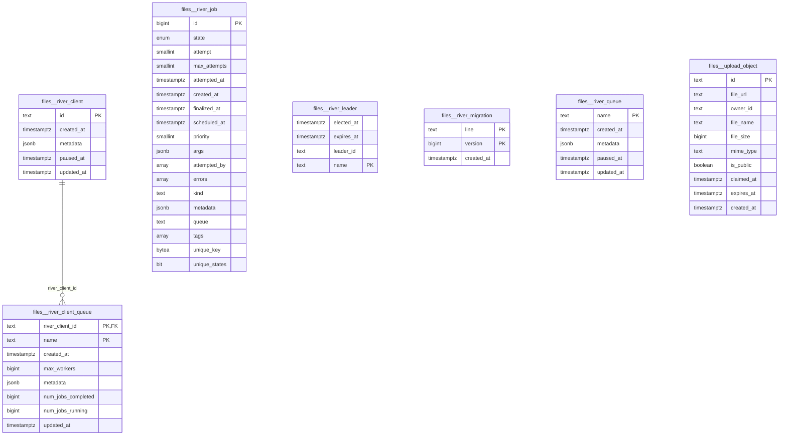

### Tables & Columns

#### `files.river_client`

| Column | Type | Nullable | Key | References |
|---|---|---|---|---|
| `id` | `text` | NO | PK |  |
| `created_at` | `timestamp with time zone` | NO |  |  |
| `metadata` | `jsonb` | NO |  |  |
| `paused_at` | `timestamp with time zone` | YES |  |  |
| `updated_at` | `timestamp with time zone` | NO |  |  |

#### `files.river_client_queue`

| Column | Type | Nullable | Key | References |
|---|---|---|---|---|
| `river_client_id` | `text` | NO | PK, FK | `files.river_client.id` |
| `name` | `text` | NO | PK |  |
| `created_at` | `timestamp with time zone` | NO |  |  |
| `max_workers` | `bigint` | NO |  |  |
| `metadata` | `jsonb` | NO |  |  |
| `num_jobs_completed` | `bigint` | NO |  |  |
| `num_jobs_running` | `bigint` | NO |  |  |
| `updated_at` | `timestamp with time zone` | NO |  |  |

#### `files.river_job`

| Column | Type | Nullable | Key | References |
|---|---|---|---|---|
| `id` | `bigint` | NO | PK |  |
| `state` | `USER-DEFINED` | NO |  |  |
| `attempt` | `smallint` | NO |  |  |
| `max_attempts` | `smallint` | NO |  |  |
| `attempted_at` | `timestamp with time zone` | YES |  |  |
| `created_at` | `timestamp with time zone` | NO |  |  |
| `finalized_at` | `timestamp with time zone` | YES |  |  |
| `scheduled_at` | `timestamp with time zone` | NO |  |  |
| `priority` | `smallint` | NO |  |  |
| `args` | `jsonb` | NO |  |  |
| `attempted_by` | `ARRAY` | YES |  |  |
| `errors` | `ARRAY` | YES |  |  |
| `kind` | `text` | NO |  |  |
| `metadata` | `jsonb` | NO |  |  |
| `queue` | `text` | NO |  |  |
| `tags` | `ARRAY` | NO |  |  |
| `unique_key` | `bytea` | YES |  |  |
| `unique_states` | `bit` | YES |  |  |

#### `files.river_leader`

| Column | Type | Nullable | Key | References |
|---|---|---|---|---|
| `elected_at` | `timestamp with time zone` | NO |  |  |
| `expires_at` | `timestamp with time zone` | NO |  |  |
| `leader_id` | `text` | NO |  |  |
| `name` | `text` | NO | PK |  |

#### `files.river_migration`

| Column | Type | Nullable | Key | References |
|---|---|---|---|---|
| `line` | `text` | NO | PK |  |
| `version` | `bigint` | NO | PK |  |
| `created_at` | `timestamp with time zone` | NO |  |  |

#### `files.river_queue`

| Column | Type | Nullable | Key | References |
|---|---|---|---|---|
| `name` | `text` | NO | PK |  |
| `created_at` | `timestamp with time zone` | NO |  |  |
| `metadata` | `jsonb` | NO |  |  |
| `paused_at` | `timestamp with time zone` | YES |  |  |
| `updated_at` | `timestamp with time zone` | NO |  |  |

#### `files.upload_object`

| Column | Type | Nullable | Key | References |
|---|---|---|---|---|
| `id` | `text` | NO | PK |  |
| `file_url` | `text` | NO |  |  |
| `owner_id` | `text` | YES |  |  |
| `file_name` | `text` | NO |  |  |
| `file_size` | `bigint` | NO |  |  |
| `mime_type` | `text` | NO |  |  |
| `is_public` | `boolean` | NO |  |  |
| `claimed_at` | `timestamp with time zone` | YES |  |  |
| `expires_at` | `timestamp with time zone` | NO |  |  |
| `created_at` | `timestamp with time zone` | NO |  |  |

---

## Schema: `finance` {#schema-finance}

### Entity-Relationship Diagram

```mermaid
erDiagram
    finance__agency_invoice {
        text id PK
        text agency_id
        text reference
        timestamptz invoice_date
        numeric amount
        text expense_id
        text created_by_id
        timestamptz created_at
    }
    finance__bank_settlement {
        text id PK
        text settlement_number
        text bank_account
        numeric amount
        text currency
        timestamptz settled_at
        text status
        text notes
        timestamptz created_at
    }
    finance__cash_drawer {
        text id PK
        text register_id
        text code
        text name
        text currency
        numeric opening_float
        numeric current_balance
        boolean is_active
        integer revision
        timestamptz created_at
        timestamptz updated_at
    }
    finance__cashier_session {
        text id PK
        text register_id
        text drawer_id
        text cashier_id
        text shift_id
        timestamptz opened_at
        timestamptz closed_at
        numeric opening_float
        numeric closing_float
        numeric expected_cash
        numeric actual_cash
        numeric cash_difference
        numeric total_sales
        numeric total_returns
        text status
        text note
        integer revision
        timestamptz created_at
        timestamptz updated_at
    }
    finance__commission_payout {
        text id PK
        text user_id
        text period_month
        numeric basis_amount
        numeric rate_percent
        numeric amount
        text currency
        text expense_id
        text payroll_item_id
        text recorded_by_id
        timestamptz created_at
    }
    finance__commission_rule {
        text id PK
        text code
        text name
        numeric rate
        timestamptz effective_from
        timestamptz effective_to
        integer version
        boolean is_active
        timestamptz created_at
    }
    finance__commission_snapshot {
        text id PK
        text order_id
        text order_line_id
        text attributed_user_id
        text rule_id
        integer rule_version
        numeric rule_rate
        numeric basis_amount
        numeric commission_amount
        text currency
        text status
        text reversal_of_id
        jsonb calculation_details
        timestamptz earned_at
        text created_by_id
    }
    finance__document_tax {
        text id PK
        text invoice_id
        text quotation_id
        text tax_rate_id
        text code
        text name_en
        text name_ar
        numeric rate_percent
        text registration_number
        numeric amount
        integer display_order
    }
    finance__expense {
        text id PK
        text title
        text category_id FK
        numeric amount
        text currency
        date expense_date
        text status
        text notes
        text vendor
        text receipt_url
        text created_by
        text approved_by
        timestamptz created_at
        timestamptz updated_at
        text deal_id
        text client_id
        text scope
        text payment_method
        text description_en
        text description_ar
        numeric net_amount
        numeric input_vat_amount
        boolean is_vat_recoverable
        text tax_invoice_number
        text vendor_name
        boolean is_billable
        boolean is_recurring
        text recurrence_interval
        text review_notes
        text created_by_id
        text recurring_expense_id
    }
    finance__expense_category {
        text id PK
        text name_en
        text name_ar
        text code
        integer sort_order
        text slug
        text color
        integer display_order
        text kind
        boolean is_system
        boolean is_active
    }
    finance__expense_claim {
        text id PK
        text claim_number
        text claimant_id
        numeric amount
        text currency
        timestamptz expense_date
        text reason
        text category_id
        text deal_id
        text invoice_id
        text calendar_event_id
        text receipt_url
        text status
        text review_notes
        timestamptz scheduled_at
        timestamptz scheduled_for_date
        text scheduled_by_id
        timestamptz paid_at
        text paid_by_id
        text payment_method
        text payment_reference
        text expense_id
        timestamptz created_at
        timestamptz updated_at
    }
    finance__inbox {
        text consumer PK
        uuid event_id PK
        timestamptz handled_at
    }
    finance__invoice {
        text id PK
        text invoice_number
        text quotation_id
        text contact_id
        text deal_id
        text status
        date issue_date
        date due_date
        numeric subtotal
        numeric discount
        numeric vat_rate
        numeric vat_amount
        numeric total
        numeric amount_paid
        numeric balance_due
        text currency
        text notes
        text terms
        timestamptz created_at
        timestamptz updated_at
        text client_id
        boolean vat_enabled
        numeric vat_percentage
        numeric other_tax_amount
        text discount_type
        numeric discount_value
        numeric discount_amount
        numeric total_amount
        text language
        text approval_status
        integer approval_revision
        text content_hash
        text pdf_storage_path
        text delivery_channel
        timestamptz delivered_at
        text notes_en
        text notes_ar
        text created_by_id
        text sales_owner_id
        text signed_by_id
        timestamptz signed_at
        text signer_signature_url
    }
    finance__invoice_item {
        text id PK
        text invoice_id FK
        text description
        numeric quantity
        numeric unit_price
        numeric amount
        integer sort_order
    }
    finance__invoice_line_item {
        text id PK
        text invoice_id
        text service_id
        text description_en
        text description_ar
        numeric quantity
        numeric unit_price
        numeric line_total
        integer display_order
    }
    finance__journal_entry {
        text id PK
        text source_key
        text request_hash
        text period_id
        timestamptz posting_date
        text currency
        text memo
        text branch_id
        text reversal_of_id
        text created_by_id
        timestamptz created_at
    }
    finance__journal_line {
        text id PK
        text entry_id
        text account_id
        numeric debit
        numeric credit
        text memo
    }
    finance__outbox {
        uuid id PK
        text subject
        jsonb payload
        jsonb headers
        timestamptz created_at
        timestamptz published_at
        integer attempts
        timestamptz next_try_at
        text last_error
    }
    finance__payment {
        text id PK
        text payment_number
        text invoice_id FK
        text contact_id
        numeric amount
        text currency
        text payment_method
        date payment_date
        text reference
        text status
        text notes
        timestamptz created_at
        text receipt_number
        text reference_number
        text receipt_pdf_path
        text notification_channel
        boolean notification_sent
        text created_by_id
        text signed_by_id
        timestamptz signed_at
        text signer_signature_url
    }
    finance__payment_allocation {
        text id PK
        text payment_id
        text invoice_id
        numeric allocated_amount
        text currency
        timestamptz allocated_at
    }
    finance__payment_attempt {
        text id PK
        text order_id
        text gateway
        text session_id
        text gateway_payment_id
        numeric amount
        text currency
        text status
        boolean test_mode
        text payment_id
        numeric amount_refunded
        text failure_reason
        timestamptz created_at
        timestamptz paid_at
        timestamptz updated_at
    }
    finance__payment_collection {
        text id PK
        text number
        text branch_id
        text session_id
        text order_id
        text invoice_id
        numeric amount
        text currency
        text method_code
        text reference_number
        jsonb evidence
        text status
        text collected_by_id
        timestamptz collected_at
    }
    finance__payment_method_config {
        text id PK
        text branch_id
        text code
        text name_en
        text name_ar
        boolean is_enabled
        boolean allow_change
        boolean requires_reference
        numeric surcharge_rate
        integer sort_order
        timestamptz created_at
        timestamptz updated_at
    }
    finance__payment_webhook_event {
        text gateway
        text event_id
        text attempt_id
        timestamptz received_at
    }
    finance__recurring_expense {
        text id PK
        text title_en
        text title_ar
        text category_id
        text vendor_name
        text reference
        numeric amount
        numeric input_vat_amount
        boolean is_vat_recoverable
        text currency
        text payment_method
        text frequency
        timestamptz start_date
        timestamptz end_date
        timestamptz next_due_date
        boolean auto_record
        integer remind_days_before
        boolean is_active
        text notes
        text created_by_id
        timestamptz last_recorded_at
        timestamptz created_at
        timestamptz updated_at
    }
    finance__supplier_bill {
        text id PK
        text number
        text supplier_ref
        text supplier_id
        text purchase_order_id
        timestamptz bill_date
        timestamptz due_date
        text status
        numeric subtotal
        numeric vat_amount
        numeric total
        numeric amount_paid
        text expense_id
        text override_reason
        text attachment_url
        text note
        text created_by_id
        text approved_by_id
        timestamptz approved_at
        timestamptz created_at
        timestamptz updated_at
    }
    finance__supplier_bill_line {
        text id PK
        text bill_id
        text order_line_id
        text description
        numeric quantity
        numeric unit_price
        integer sort_order
    }
    finance__supplier_payment {
        text id PK
        text bill_id
        numeric amount
        timestamptz paid_on
        text method
        text reference
        text created_by_id
        timestamptz created_at
    }
    finance__tax_rate {
        text id PK
        text code
        text name_en
        text name_ar
        numeric rate_percent
        text registration_number
        text certificate_url
        timestamptz certificate_valid_until
        boolean applies_to_invoices
        boolean applies_to_quotations
        boolean is_active
        integer display_order
        timestamptz created_at
        timestamptz updated_at
    }
    finance__expense_category ||--o{ finance__expense : "category_id"
    finance__invoice ||--o{ finance__invoice_item : "invoice_id"
    finance__invoice ||--o{ finance__payment : "invoice_id"
```

### Tables & Columns

#### `finance.agency_invoice`

| Column | Type | Nullable | Key | References |
|---|---|---|---|---|
| `id` | `text` | NO | PK |  |
| `agency_id` | `text` | YES |  |  |
| `reference` | `text` | YES |  |  |
| `invoice_date` | `timestamp with time zone` | YES |  |  |
| `amount` | `numeric` | YES |  |  |
| `expense_id` | `text` | YES |  |  |
| `created_by_id` | `text` | YES |  |  |
| `created_at` | `timestamp with time zone` | NO |  |  |

#### `finance.bank_settlement`

| Column | Type | Nullable | Key | References |
|---|---|---|---|---|
| `id` | `text` | NO | PK |  |
| `settlement_number` | `text` | NO |  |  |
| `bank_account` | `text` | NO |  |  |
| `amount` | `numeric` | NO |  |  |
| `currency` | `text` | NO |  |  |
| `settled_at` | `timestamp with time zone` | NO |  |  |
| `status` | `text` | NO |  |  |
| `notes` | `text` | YES |  |  |
| `created_at` | `timestamp with time zone` | NO |  |  |

#### `finance.cash_drawer`

| Column | Type | Nullable | Key | References |
|---|---|---|---|---|
| `id` | `text` | NO | PK |  |
| `register_id` | `text` | YES |  |  |
| `code` | `text` | YES |  |  |
| `name` | `text` | YES |  |  |
| `currency` | `text` | YES |  |  |
| `opening_float` | `numeric` | YES |  |  |
| `current_balance` | `numeric` | YES |  |  |
| `is_active` | `boolean` | YES |  |  |
| `revision` | `integer` | YES |  |  |
| `created_at` | `timestamp with time zone` | NO |  |  |
| `updated_at` | `timestamp with time zone` | NO |  |  |

#### `finance.cashier_session`

| Column | Type | Nullable | Key | References |
|---|---|---|---|---|
| `id` | `text` | NO | PK |  |
| `register_id` | `text` | YES |  |  |
| `drawer_id` | `text` | YES |  |  |
| `cashier_id` | `text` | YES |  |  |
| `shift_id` | `text` | YES |  |  |
| `opened_at` | `timestamp with time zone` | YES |  |  |
| `closed_at` | `timestamp with time zone` | YES |  |  |
| `opening_float` | `numeric` | YES |  |  |
| `closing_float` | `numeric` | YES |  |  |
| `expected_cash` | `numeric` | YES |  |  |
| `actual_cash` | `numeric` | YES |  |  |
| `cash_difference` | `numeric` | YES |  |  |
| `total_sales` | `numeric` | YES |  |  |
| `total_returns` | `numeric` | YES |  |  |
| `status` | `text` | YES |  |  |
| `note` | `text` | YES |  |  |
| `revision` | `integer` | YES |  |  |
| `created_at` | `timestamp with time zone` | NO |  |  |
| `updated_at` | `timestamp with time zone` | NO |  |  |

#### `finance.commission_payout`

| Column | Type | Nullable | Key | References |
|---|---|---|---|---|
| `id` | `text` | NO | PK |  |
| `user_id` | `text` | YES |  |  |
| `period_month` | `text` | YES |  |  |
| `basis_amount` | `numeric` | YES |  |  |
| `rate_percent` | `numeric` | YES |  |  |
| `amount` | `numeric` | YES |  |  |
| `currency` | `text` | YES |  |  |
| `expense_id` | `text` | YES |  |  |
| `payroll_item_id` | `text` | YES |  |  |
| `recorded_by_id` | `text` | YES |  |  |
| `created_at` | `timestamp with time zone` | NO |  |  |

#### `finance.commission_rule`

| Column | Type | Nullable | Key | References |
|---|---|---|---|---|
| `id` | `text` | NO | PK |  |
| `code` | `text` | YES |  |  |
| `name` | `text` | YES |  |  |
| `rate` | `numeric` | YES |  |  |
| `effective_from` | `timestamp with time zone` | YES |  |  |
| `effective_to` | `timestamp with time zone` | YES |  |  |
| `version` | `integer` | YES |  |  |
| `is_active` | `boolean` | YES |  |  |
| `created_at` | `timestamp with time zone` | NO |  |  |

#### `finance.commission_snapshot`

| Column | Type | Nullable | Key | References |
|---|---|---|---|---|
| `id` | `text` | NO | PK |  |
| `order_id` | `text` | YES |  |  |
| `order_line_id` | `text` | YES |  |  |
| `attributed_user_id` | `text` | YES |  |  |
| `rule_id` | `text` | YES |  |  |
| `rule_version` | `integer` | YES |  |  |
| `rule_rate` | `numeric` | YES |  |  |
| `basis_amount` | `numeric` | YES |  |  |
| `commission_amount` | `numeric` | YES |  |  |
| `currency` | `text` | YES |  |  |
| `status` | `text` | YES |  |  |
| `reversal_of_id` | `text` | YES |  |  |
| `calculation_details` | `jsonb` | YES |  |  |
| `earned_at` | `timestamp with time zone` | YES |  |  |
| `created_by_id` | `text` | YES |  |  |

#### `finance.document_tax`

| Column | Type | Nullable | Key | References |
|---|---|---|---|---|
| `id` | `text` | NO | PK |  |
| `invoice_id` | `text` | YES |  |  |
| `quotation_id` | `text` | YES |  |  |
| `tax_rate_id` | `text` | YES |  |  |
| `code` | `text` | YES |  |  |
| `name_en` | `text` | YES |  |  |
| `name_ar` | `text` | YES |  |  |
| `rate_percent` | `numeric` | YES |  |  |
| `registration_number` | `text` | YES |  |  |
| `amount` | `numeric` | YES |  |  |
| `display_order` | `integer` | YES |  |  |

#### `finance.expense`

| Column | Type | Nullable | Key | References |
|---|---|---|---|---|
| `id` | `text` | NO | PK |  |
| `title` | `text` | NO |  |  |
| `category_id` | `text` | YES | FK | `finance.expense_category.id` |
| `amount` | `numeric` | NO |  |  |
| `currency` | `text` | NO |  |  |
| `expense_date` | `date` | NO |  |  |
| `status` | `text` | NO |  |  |
| `notes` | `text` | YES |  |  |
| `vendor` | `text` | YES |  |  |
| `receipt_url` | `text` | YES |  |  |
| `created_by` | `text` | YES |  |  |
| `approved_by` | `text` | YES |  |  |
| `created_at` | `timestamp with time zone` | NO |  |  |
| `updated_at` | `timestamp with time zone` | NO |  |  |
| `deal_id` | `text` | YES |  |  |
| `client_id` | `text` | YES |  |  |
| `scope` | `text` | YES |  |  |
| `payment_method` | `text` | YES |  |  |
| `description_en` | `text` | YES |  |  |
| `description_ar` | `text` | YES |  |  |
| `net_amount` | `numeric` | YES |  |  |
| `input_vat_amount` | `numeric` | YES |  |  |
| `is_vat_recoverable` | `boolean` | YES |  |  |
| `tax_invoice_number` | `text` | YES |  |  |
| `vendor_name` | `text` | YES |  |  |
| `is_billable` | `boolean` | YES |  |  |
| `is_recurring` | `boolean` | YES |  |  |
| `recurrence_interval` | `text` | YES |  |  |
| `review_notes` | `text` | YES |  |  |
| `created_by_id` | `text` | YES |  |  |
| `recurring_expense_id` | `text` | YES |  |  |

#### `finance.expense_category`

| Column | Type | Nullable | Key | References |
|---|---|---|---|---|
| `id` | `text` | NO | PK |  |
| `name_en` | `text` | NO |  |  |
| `name_ar` | `text` | NO |  |  |
| `code` | `text` | NO |  |  |
| `sort_order` | `integer` | NO |  |  |
| `slug` | `text` | YES |  |  |
| `color` | `text` | YES |  |  |
| `display_order` | `integer` | YES |  |  |
| `kind` | `text` | YES |  |  |
| `is_system` | `boolean` | YES |  |  |
| `is_active` | `boolean` | YES |  |  |

#### `finance.expense_claim`

| Column | Type | Nullable | Key | References |
|---|---|---|---|---|
| `id` | `text` | NO | PK |  |
| `claim_number` | `text` | YES |  |  |
| `claimant_id` | `text` | YES |  |  |
| `amount` | `numeric` | YES |  |  |
| `currency` | `text` | YES |  |  |
| `expense_date` | `timestamp with time zone` | YES |  |  |
| `reason` | `text` | YES |  |  |
| `category_id` | `text` | YES |  |  |
| `deal_id` | `text` | YES |  |  |
| `invoice_id` | `text` | YES |  |  |
| `calendar_event_id` | `text` | YES |  |  |
| `receipt_url` | `text` | YES |  |  |
| `status` | `text` | YES |  |  |
| `review_notes` | `text` | YES |  |  |
| `scheduled_at` | `timestamp with time zone` | YES |  |  |
| `scheduled_for_date` | `timestamp with time zone` | YES |  |  |
| `scheduled_by_id` | `text` | YES |  |  |
| `paid_at` | `timestamp with time zone` | YES |  |  |
| `paid_by_id` | `text` | YES |  |  |
| `payment_method` | `text` | YES |  |  |
| `payment_reference` | `text` | YES |  |  |
| `expense_id` | `text` | YES |  |  |
| `created_at` | `timestamp with time zone` | NO |  |  |
| `updated_at` | `timestamp with time zone` | NO |  |  |

#### `finance.inbox`

| Column | Type | Nullable | Key | References |
|---|---|---|---|---|
| `consumer` | `text` | NO | PK |  |
| `event_id` | `uuid` | NO | PK |  |
| `handled_at` | `timestamp with time zone` | NO |  |  |

#### `finance.invoice`

| Column | Type | Nullable | Key | References |
|---|---|---|---|---|
| `id` | `text` | NO | PK |  |
| `invoice_number` | `text` | NO |  |  |
| `quotation_id` | `text` | YES |  |  |
| `contact_id` | `text` | YES |  |  |
| `deal_id` | `text` | YES |  |  |
| `status` | `text` | NO |  |  |
| `issue_date` | `date` | NO |  |  |
| `due_date` | `date` | NO |  |  |
| `subtotal` | `numeric` | NO |  |  |
| `discount` | `numeric` | NO |  |  |
| `vat_rate` | `numeric` | NO |  |  |
| `vat_amount` | `numeric` | NO |  |  |
| `total` | `numeric` | NO |  |  |
| `amount_paid` | `numeric` | NO |  |  |
| `balance_due` | `numeric` | NO |  |  |
| `currency` | `text` | NO |  |  |
| `notes` | `text` | YES |  |  |
| `terms` | `text` | YES |  |  |
| `created_at` | `timestamp with time zone` | NO |  |  |
| `updated_at` | `timestamp with time zone` | NO |  |  |
| `client_id` | `text` | YES |  |  |
| `vat_enabled` | `boolean` | YES |  |  |
| `vat_percentage` | `numeric` | YES |  |  |
| `other_tax_amount` | `numeric` | YES |  |  |
| `discount_type` | `text` | YES |  |  |
| `discount_value` | `numeric` | YES |  |  |
| `discount_amount` | `numeric` | YES |  |  |
| `total_amount` | `numeric` | YES |  |  |
| `language` | `text` | YES |  |  |
| `approval_status` | `text` | YES |  |  |
| `approval_revision` | `integer` | YES |  |  |
| `content_hash` | `text` | YES |  |  |
| `pdf_storage_path` | `text` | YES |  |  |
| `delivery_channel` | `text` | YES |  |  |
| `delivered_at` | `timestamp with time zone` | YES |  |  |
| `notes_en` | `text` | YES |  |  |
| `notes_ar` | `text` | YES |  |  |
| `created_by_id` | `text` | YES |  |  |
| `sales_owner_id` | `text` | YES |  |  |
| `signed_by_id` | `text` | YES |  |  |
| `signed_at` | `timestamp with time zone` | YES |  |  |
| `signer_signature_url` | `text` | YES |  |  |

#### `finance.invoice_item`

| Column | Type | Nullable | Key | References |
|---|---|---|---|---|
| `id` | `text` | NO | PK |  |
| `invoice_id` | `text` | NO | FK | `finance.invoice.id` |
| `description` | `text` | NO |  |  |
| `quantity` | `numeric` | NO |  |  |
| `unit_price` | `numeric` | NO |  |  |
| `amount` | `numeric` | NO |  |  |
| `sort_order` | `integer` | NO |  |  |

#### `finance.invoice_line_item`

| Column | Type | Nullable | Key | References |
|---|---|---|---|---|
| `id` | `text` | NO | PK |  |
| `invoice_id` | `text` | YES |  |  |
| `service_id` | `text` | YES |  |  |
| `description_en` | `text` | YES |  |  |
| `description_ar` | `text` | YES |  |  |
| `quantity` | `numeric` | YES |  |  |
| `unit_price` | `numeric` | YES |  |  |
| `line_total` | `numeric` | YES |  |  |
| `display_order` | `integer` | YES |  |  |

#### `finance.journal_entry`

| Column | Type | Nullable | Key | References |
|---|---|---|---|---|
| `id` | `text` | NO | PK |  |
| `source_key` | `text` | YES |  |  |
| `request_hash` | `text` | YES |  |  |
| `period_id` | `text` | YES |  |  |
| `posting_date` | `timestamp with time zone` | YES |  |  |
| `currency` | `text` | YES |  |  |
| `memo` | `text` | YES |  |  |
| `branch_id` | `text` | YES |  |  |
| `reversal_of_id` | `text` | YES |  |  |
| `created_by_id` | `text` | YES |  |  |
| `created_at` | `timestamp with time zone` | NO |  |  |

#### `finance.journal_line`

| Column | Type | Nullable | Key | References |
|---|---|---|---|---|
| `id` | `text` | NO | PK |  |
| `entry_id` | `text` | YES |  |  |
| `account_id` | `text` | YES |  |  |
| `debit` | `numeric` | YES |  |  |
| `credit` | `numeric` | YES |  |  |
| `memo` | `text` | YES |  |  |

#### `finance.outbox`

| Column | Type | Nullable | Key | References |
|---|---|---|---|---|
| `id` | `uuid` | NO | PK |  |
| `subject` | `text` | NO |  |  |
| `payload` | `jsonb` | NO |  |  |
| `headers` | `jsonb` | NO |  |  |
| `created_at` | `timestamp with time zone` | NO |  |  |
| `published_at` | `timestamp with time zone` | YES |  |  |
| `attempts` | `integer` | NO |  |  |
| `next_try_at` | `timestamp with time zone` | NO |  |  |
| `last_error` | `text` | YES |  |  |

#### `finance.payment`

| Column | Type | Nullable | Key | References |
|---|---|---|---|---|
| `id` | `text` | NO | PK |  |
| `payment_number` | `text` | NO |  |  |
| `invoice_id` | `text` | YES | FK | `finance.invoice.id` |
| `contact_id` | `text` | YES |  |  |
| `amount` | `numeric` | NO |  |  |
| `currency` | `text` | NO |  |  |
| `payment_method` | `text` | NO |  |  |
| `payment_date` | `date` | NO |  |  |
| `reference` | `text` | YES |  |  |
| `status` | `text` | NO |  |  |
| `notes` | `text` | YES |  |  |
| `created_at` | `timestamp with time zone` | NO |  |  |
| `receipt_number` | `text` | YES |  |  |
| `reference_number` | `text` | YES |  |  |
| `receipt_pdf_path` | `text` | YES |  |  |
| `notification_channel` | `text` | YES |  |  |
| `notification_sent` | `boolean` | YES |  |  |
| `created_by_id` | `text` | YES |  |  |
| `signed_by_id` | `text` | YES |  |  |
| `signed_at` | `timestamp with time zone` | YES |  |  |
| `signer_signature_url` | `text` | YES |  |  |

#### `finance.payment_allocation`

| Column | Type | Nullable | Key | References |
|---|---|---|---|---|
| `id` | `text` | NO | PK |  |
| `payment_id` | `text` | YES |  |  |
| `invoice_id` | `text` | YES |  |  |
| `allocated_amount` | `numeric` | YES |  |  |
| `currency` | `text` | YES |  |  |
| `allocated_at` | `timestamp with time zone` | YES |  |  |

#### `finance.payment_attempt`

| Column | Type | Nullable | Key | References |
|---|---|---|---|---|
| `id` | `text` | NO | PK |  |
| `order_id` | `text` | YES |  |  |
| `gateway` | `text` | YES |  |  |
| `session_id` | `text` | YES |  |  |
| `gateway_payment_id` | `text` | YES |  |  |
| `amount` | `numeric` | YES |  |  |
| `currency` | `text` | YES |  |  |
| `status` | `text` | YES |  |  |
| `test_mode` | `boolean` | YES |  |  |
| `payment_id` | `text` | YES |  |  |
| `amount_refunded` | `numeric` | YES |  |  |
| `failure_reason` | `text` | YES |  |  |
| `created_at` | `timestamp with time zone` | NO |  |  |
| `paid_at` | `timestamp with time zone` | YES |  |  |
| `updated_at` | `timestamp with time zone` | NO |  |  |

#### `finance.payment_collection`

| Column | Type | Nullable | Key | References |
|---|---|---|---|---|
| `id` | `text` | NO | PK |  |
| `number` | `text` | YES |  |  |
| `branch_id` | `text` | YES |  |  |
| `session_id` | `text` | YES |  |  |
| `order_id` | `text` | YES |  |  |
| `invoice_id` | `text` | YES |  |  |
| `amount` | `numeric` | YES |  |  |
| `currency` | `text` | YES |  |  |
| `method_code` | `text` | YES |  |  |
| `reference_number` | `text` | YES |  |  |
| `evidence` | `jsonb` | YES |  |  |
| `status` | `text` | YES |  |  |
| `collected_by_id` | `text` | YES |  |  |
| `collected_at` | `timestamp with time zone` | YES |  |  |

#### `finance.payment_method_config`

| Column | Type | Nullable | Key | References |
|---|---|---|---|---|
| `id` | `text` | NO | PK |  |
| `branch_id` | `text` | YES |  |  |
| `code` | `text` | YES |  |  |
| `name_en` | `text` | YES |  |  |
| `name_ar` | `text` | YES |  |  |
| `is_enabled` | `boolean` | YES |  |  |
| `allow_change` | `boolean` | YES |  |  |
| `requires_reference` | `boolean` | YES |  |  |
| `surcharge_rate` | `numeric` | YES |  |  |
| `sort_order` | `integer` | YES |  |  |
| `created_at` | `timestamp with time zone` | NO |  |  |
| `updated_at` | `timestamp with time zone` | NO |  |  |

#### `finance.payment_webhook_event`

| Column | Type | Nullable | Key | References |
|---|---|---|---|---|
| `gateway` | `text` | YES |  |  |
| `event_id` | `text` | YES |  |  |
| `attempt_id` | `text` | YES |  |  |
| `received_at` | `timestamp with time zone` | YES |  |  |

#### `finance.recurring_expense`

| Column | Type | Nullable | Key | References |
|---|---|---|---|---|
| `id` | `text` | NO | PK |  |
| `title_en` | `text` | YES |  |  |
| `title_ar` | `text` | YES |  |  |
| `category_id` | `text` | YES |  |  |
| `vendor_name` | `text` | YES |  |  |
| `reference` | `text` | YES |  |  |
| `amount` | `numeric` | YES |  |  |
| `input_vat_amount` | `numeric` | YES |  |  |
| `is_vat_recoverable` | `boolean` | YES |  |  |
| `currency` | `text` | YES |  |  |
| `payment_method` | `text` | YES |  |  |
| `frequency` | `text` | YES |  |  |
| `start_date` | `timestamp with time zone` | YES |  |  |
| `end_date` | `timestamp with time zone` | YES |  |  |
| `next_due_date` | `timestamp with time zone` | YES |  |  |
| `auto_record` | `boolean` | YES |  |  |
| `remind_days_before` | `integer` | YES |  |  |
| `is_active` | `boolean` | YES |  |  |
| `notes` | `text` | YES |  |  |
| `created_by_id` | `text` | YES |  |  |
| `last_recorded_at` | `timestamp with time zone` | YES |  |  |
| `created_at` | `timestamp with time zone` | NO |  |  |
| `updated_at` | `timestamp with time zone` | NO |  |  |

#### `finance.supplier_bill`

| Column | Type | Nullable | Key | References |
|---|---|---|---|---|
| `id` | `text` | NO | PK |  |
| `number` | `text` | YES |  |  |
| `supplier_ref` | `text` | YES |  |  |
| `supplier_id` | `text` | YES |  |  |
| `purchase_order_id` | `text` | YES |  |  |
| `bill_date` | `timestamp with time zone` | YES |  |  |
| `due_date` | `timestamp with time zone` | YES |  |  |
| `status` | `text` | YES |  |  |
| `subtotal` | `numeric` | YES |  |  |
| `vat_amount` | `numeric` | YES |  |  |
| `total` | `numeric` | YES |  |  |
| `amount_paid` | `numeric` | YES |  |  |
| `expense_id` | `text` | YES |  |  |
| `override_reason` | `text` | YES |  |  |
| `attachment_url` | `text` | YES |  |  |
| `note` | `text` | YES |  |  |
| `created_by_id` | `text` | YES |  |  |
| `approved_by_id` | `text` | YES |  |  |
| `approved_at` | `timestamp with time zone` | YES |  |  |
| `created_at` | `timestamp with time zone` | NO |  |  |
| `updated_at` | `timestamp with time zone` | NO |  |  |

#### `finance.supplier_bill_line`

| Column | Type | Nullable | Key | References |
|---|---|---|---|---|
| `id` | `text` | NO | PK |  |
| `bill_id` | `text` | YES |  |  |
| `order_line_id` | `text` | YES |  |  |
| `description` | `text` | YES |  |  |
| `quantity` | `numeric` | YES |  |  |
| `unit_price` | `numeric` | YES |  |  |
| `sort_order` | `integer` | YES |  |  |

#### `finance.supplier_payment`

| Column | Type | Nullable | Key | References |
|---|---|---|---|---|
| `id` | `text` | NO | PK |  |
| `bill_id` | `text` | YES |  |  |
| `amount` | `numeric` | YES |  |  |
| `paid_on` | `timestamp with time zone` | YES |  |  |
| `method` | `text` | YES |  |  |
| `reference` | `text` | YES |  |  |
| `created_by_id` | `text` | YES |  |  |
| `created_at` | `timestamp with time zone` | NO |  |  |

#### `finance.tax_rate`

| Column | Type | Nullable | Key | References |
|---|---|---|---|---|
| `id` | `text` | NO | PK |  |
| `code` | `text` | YES |  |  |
| `name_en` | `text` | YES |  |  |
| `name_ar` | `text` | YES |  |  |
| `rate_percent` | `numeric` | YES |  |  |
| `registration_number` | `text` | YES |  |  |
| `certificate_url` | `text` | YES |  |  |
| `certificate_valid_until` | `timestamp with time zone` | YES |  |  |
| `applies_to_invoices` | `boolean` | YES |  |  |
| `applies_to_quotations` | `boolean` | YES |  |  |
| `is_active` | `boolean` | YES |  |  |
| `display_order` | `integer` | YES |  |  |
| `created_at` | `timestamp with time zone` | NO |  |  |
| `updated_at` | `timestamp with time zone` | NO |  |  |

---

## Schema: `hr` {#schema-hr}

### Entity-Relationship Diagram

```mermaid
erDiagram
    hr__attendance_entry {
        text id PK
        text employee_id FK
        date entry_date
        timestamptz check_in
        timestamptz check_out
        text status
        text notes
        timestamptz created_at
        timestamptz date
        integer late_minutes
        integer overtime_minutes
        integer overtime_night_minutes
        integer overtime_rest_day_minutes
        integer overtime_holiday_minutes
        text shift_type_id
        text source
        text recorded_by_id
        timestamptz updated_at
    }
    hr__benefit_plan {
        text id PK
        text code
        text name_en
        text name_ar
        text coverage_details
        numeric employer_contribution
        numeric employee_contribution
        timestamptz created_at
    }
    hr__department {
        text id PK
        text name_en
        text name_ar
        text code
        text head_id
        text parent_id FK
        text catalogue_key
        text manager_id
        text deputy_id
        text cost_centre
        integer sort_order
        boolean is_active
        timestamptz created_at
        timestamptz updated_at
    }
    hr__employee {
        text id PK
        text employee_number
        text first_name_en
        text last_name_en
        text first_name_ar
        text last_name_ar
        text email
        text phone
        text job_title_en
        text job_title_ar
        text department_id FK
        date hire_date
        text status
        numeric basic_salary
        numeric housing_allowance
        numeric transport_allowance
        numeric other_allowances
        timestamptz created_at
        timestamptz updated_at
        text reporting_to FK
        text user_id
        text cpr_number
        timestamptz cpr_expiry_date
        text nationality
        timestamptz date_of_birth
        text gender
        text passport_number
        text passport_country
        timestamptz passport_expiry_date
        numeric leave_balance_days
    }
    hr__employee_credential {
        text id PK
        text employee_id
        text kind
        text visa_type
        text label
        text number
        text issuing_country
        timestamptz issue_date
        timestamptz expiry_date
        text sponsor
        numeric cost_amount
        text cost_currency
        text cost_frequency
        integer cost_term_months
        text paid_by
        text file_url
        text notes
        timestamptz created_at
        timestamptz updated_at
    }
    hr__employee_gosi_record {
        text id PK
        text employee_id
        text category
        text registration_number
        numeric registered_wage
    }
    hr__employee_handover {
        text id PK
        text reference
        text employee_id
        text kind
        text leave_request_id
        timestamptz effective_date
        timestamptz return_date
        text reason
        text status
        text cases_mode
        text delegate_user_id
    }
    hr__employee_handover_case {
        text id PK
        text handover_id
        text case_type
        text case_id
        text label
        text to_user_id
        text status
        timestamptz reassigned_at
        timestamptz created_at
    }
    hr__employee_recurring_pay {
        text id PK
        text employee_id
        text kind
        text category
        text label
        numeric amount
        text start_month
        text end_month
        boolean is_active
        text note
        timestamptz created_at
        timestamptz updated_at
    }
    hr__employee_support {
        text id PK
        text employee_id
        text program_id
        text status
        text qualification
        text application_ref
        timestamptz applied_on
        timestamptz decided_on
        text start_month
        text end_month
        numeric approved_percent
        numeric approved_amount
        numeric monthly_cap
        text notes
        text created_by_id
        timestamptz created_at
        timestamptz updated_at
    }
    hr__employee_support_event {
        text id PK
        text support_id
        text action
        jsonb details
        text actor_id
        timestamptz created_at
    }
    hr__gosi_component {
        text id PK
        text code
        text name_en
        text name_ar
        numeric employee_percent
        numeric employer_percent
    }
    hr__gosi_settings {
        jsonb nationality_categories
    }
    hr__inbox {
        text consumer PK
        uuid event_id PK
        timestamptz handled_at
    }
    hr__leave_adjustment {
        text id PK
        text employee_id
        text leave_type_id
        integer year
        numeric days
        text reason
        text created_by_id
        timestamptz created_at
    }
    hr__leave_request {
        text id PK
        text employee_id FK
        text leave_type
        date start_date
        date end_date
        numeric days_count
        text status
        text reason
        text approved_by
        timestamptz created_at
        timestamptz updated_at
        text leave_type_id
        boolean full_day
        numeric hours
        text day_portion
        numeric days
        text attachment_url
        text approved_by_id
        timestamptz approved_at
        text review_notes
    }
    hr__leave_type {
        text id PK
        text code
        text name_en
        text name_ar
        numeric days_allowed_per_year
        boolean is_paid
        integer pay_percent
    }
    hr__outbox {
        uuid id PK
        text subject
        jsonb payload
        jsonb headers
        timestamptz created_at
        timestamptz published_at
        integer attempts
        timestamptz next_try_at
        text last_error
    }
    hr__payroll_item {
        text id PK
        text payroll_run_id FK
        text employee_id FK
        numeric basic_salary
        numeric allowances
        numeric deductions
        numeric net_salary
        text status
        numeric housing_allowance
        numeric transport_allowance
        numeric other_allowances
        numeric gross_salary
        numeric gosi_employee
        numeric gosi_employer
        numeric external_support
        jsonb calculation_snapshot
        numeric other_deductions
        numeric bonus
        numeric overtime_pay
        numeric shift_allowance
        numeric commission
        numeric absence_deduction
        numeric leave_deduction
        numeric lateness_deduction
        jsonb attendance_summary
        text adjustment_note
        text edited_by_id
        timestamptz edited_at
        text payment_status
        timestamptz paid_at
        text paid_by_id
        text payment_method
        text payment_reference
        timestamptz created_at
    }
    hr__payroll_item_line {
        text id PK
        text payroll_item_id
        text kind
        text category
        text label
        numeric amount
        text note
        text source
        text recurring_id
        integer display_order
        text created_by_id
        timestamptz created_at
    }
    hr__payroll_run {
        text id PK
        integer period_month
        integer period_year
        text status
        numeric total_gross
        numeric total_deductions
        numeric total_net
        text currency
        timestamptz processed_at
        text approved_by
        timestamptz created_at
        integer month
        integer year
        timestamptz period_start
        timestamptz period_end
        timestamptz attendance_start
        timestamptz attendance_end
        timestamptz pay_date
        numeric total_employer_cost
        text approved_by_id
        timestamptz approved_at
        timestamptz paid_at
        timestamptz updated_at
    }
    hr__retail_shift {
        text id PK
        text branch_id
        text shift_number
        text opened_by_id
        text closed_by_id
        timestamptz opened_at
        timestamptz closed_at
        text status
        integer revision
    }
    hr__salary_document {
        text id PK
        text employee_id
        text kind
        jsonb months
        text status
        text requested_by_id
        text reviewed_by_id
        text review_notes
        jsonb snapshot
        timestamptz created_at
        timestamptz issued_at
        timestamptz updated_at
    }
    hr__shift_type {
        text id PK
        text code
        text name_en
        text name_ar
        text allowance_mode
        numeric allowance_value
        boolean is_active
    }
    hr__employee ||--o{ hr__attendance_entry : "employee_id"
    hr__department ||--o{ hr__department : "parent_id"
    hr__department ||--o{ hr__employee : "department_id"
    hr__employee ||--o{ hr__employee : "reporting_to"
    hr__employee ||--o{ hr__leave_request : "employee_id"
    hr__payroll_run ||--o{ hr__payroll_item : "payroll_run_id"
    hr__employee ||--o{ hr__payroll_item : "employee_id"
```

### Tables & Columns

#### `hr.attendance_entry`

| Column | Type | Nullable | Key | References |
|---|---|---|---|---|
| `id` | `text` | NO | PK |  |
| `employee_id` | `text` | NO | FK | `hr.employee.id` |
| `entry_date` | `date` | NO |  |  |
| `check_in` | `timestamp with time zone` | YES |  |  |
| `check_out` | `timestamp with time zone` | YES |  |  |
| `status` | `text` | NO |  |  |
| `notes` | `text` | YES |  |  |
| `created_at` | `timestamp with time zone` | NO |  |  |
| `date` | `timestamp with time zone` | YES |  |  |
| `late_minutes` | `integer` | YES |  |  |
| `overtime_minutes` | `integer` | YES |  |  |
| `overtime_night_minutes` | `integer` | YES |  |  |
| `overtime_rest_day_minutes` | `integer` | YES |  |  |
| `overtime_holiday_minutes` | `integer` | YES |  |  |
| `shift_type_id` | `text` | YES |  |  |
| `source` | `text` | YES |  |  |
| `recorded_by_id` | `text` | YES |  |  |
| `updated_at` | `timestamp with time zone` | YES |  |  |

#### `hr.benefit_plan`

| Column | Type | Nullable | Key | References |
|---|---|---|---|---|
| `id` | `text` | NO | PK |  |
| `code` | `text` | YES |  |  |
| `name_en` | `text` | YES |  |  |
| `name_ar` | `text` | YES |  |  |
| `coverage_details` | `text` | YES |  |  |
| `employer_contribution` | `numeric` | YES |  |  |
| `employee_contribution` | `numeric` | YES |  |  |
| `created_at` | `timestamp with time zone` | NO |  |  |

#### `hr.department`

| Column | Type | Nullable | Key | References |
|---|---|---|---|---|
| `id` | `text` | NO | PK |  |
| `name_en` | `text` | NO |  |  |
| `name_ar` | `text` | NO |  |  |
| `code` | `text` | NO |  |  |
| `head_id` | `text` | YES |  |  |
| `parent_id` | `text` | YES | FK | `hr.department.id` |
| `catalogue_key` | `text` | YES |  |  |
| `manager_id` | `text` | YES |  |  |
| `deputy_id` | `text` | YES |  |  |
| `cost_centre` | `text` | YES |  |  |
| `sort_order` | `integer` | YES |  |  |
| `is_active` | `boolean` | YES |  |  |
| `created_at` | `timestamp with time zone` | YES |  |  |
| `updated_at` | `timestamp with time zone` | YES |  |  |

#### `hr.employee`

| Column | Type | Nullable | Key | References |
|---|---|---|---|---|
| `id` | `text` | NO | PK |  |
| `employee_number` | `text` | NO |  |  |
| `first_name_en` | `text` | NO |  |  |
| `last_name_en` | `text` | NO |  |  |
| `first_name_ar` | `text` | NO |  |  |
| `last_name_ar` | `text` | NO |  |  |
| `email` | `text` | NO |  |  |
| `phone` | `text` | YES |  |  |
| `job_title_en` | `text` | NO |  |  |
| `job_title_ar` | `text` | NO |  |  |
| `department_id` | `text` | YES | FK | `hr.department.id` |
| `hire_date` | `date` | NO |  |  |
| `status` | `text` | NO |  |  |
| `basic_salary` | `numeric` | NO |  |  |
| `housing_allowance` | `numeric` | NO |  |  |
| `transport_allowance` | `numeric` | NO |  |  |
| `other_allowances` | `numeric` | NO |  |  |
| `created_at` | `timestamp with time zone` | NO |  |  |
| `updated_at` | `timestamp with time zone` | NO |  |  |
| `reporting_to` | `text` | YES | FK | `hr.employee.id` |
| `user_id` | `text` | YES |  |  |
| `cpr_number` | `text` | YES |  |  |
| `cpr_expiry_date` | `timestamp with time zone` | YES |  |  |
| `nationality` | `text` | YES |  |  |
| `date_of_birth` | `timestamp with time zone` | YES |  |  |
| `gender` | `text` | YES |  |  |
| `passport_number` | `text` | YES |  |  |
| `passport_country` | `text` | YES |  |  |
| `passport_expiry_date` | `timestamp with time zone` | YES |  |  |
| `leave_balance_days` | `numeric` | YES |  |  |

#### `hr.employee_credential`

| Column | Type | Nullable | Key | References |
|---|---|---|---|---|
| `id` | `text` | NO | PK |  |
| `employee_id` | `text` | YES |  |  |
| `kind` | `text` | YES |  |  |
| `visa_type` | `text` | YES |  |  |
| `label` | `text` | YES |  |  |
| `number` | `text` | YES |  |  |
| `issuing_country` | `text` | YES |  |  |
| `issue_date` | `timestamp with time zone` | YES |  |  |
| `expiry_date` | `timestamp with time zone` | YES |  |  |
| `sponsor` | `text` | YES |  |  |
| `cost_amount` | `numeric` | YES |  |  |
| `cost_currency` | `text` | YES |  |  |
| `cost_frequency` | `text` | YES |  |  |
| `cost_term_months` | `integer` | YES |  |  |
| `paid_by` | `text` | YES |  |  |
| `file_url` | `text` | YES |  |  |
| `notes` | `text` | YES |  |  |
| `created_at` | `timestamp with time zone` | NO |  |  |
| `updated_at` | `timestamp with time zone` | NO |  |  |

#### `hr.employee_gosi_record`

| Column | Type | Nullable | Key | References |
|---|---|---|---|---|
| `id` | `text` | NO | PK |  |
| `employee_id` | `text` | YES |  |  |
| `category` | `text` | YES |  |  |
| `registration_number` | `text` | YES |  |  |
| `registered_wage` | `numeric` | YES |  |  |

#### `hr.employee_handover`

| Column | Type | Nullable | Key | References |
|---|---|---|---|---|
| `id` | `text` | NO | PK |  |
| `reference` | `text` | YES |  |  |
| `employee_id` | `text` | YES |  |  |
| `kind` | `text` | YES |  |  |
| `leave_request_id` | `text` | YES |  |  |
| `effective_date` | `timestamp with time zone` | YES |  |  |
| `return_date` | `timestamp with time zone` | YES |  |  |
| `reason` | `text` | YES |  |  |
| `status` | `text` | YES |  |  |
| `cases_mode` | `text` | YES |  |  |
| `delegate_user_id` | `text` | YES |  |  |

#### `hr.employee_handover_case`

| Column | Type | Nullable | Key | References |
|---|---|---|---|---|
| `id` | `text` | NO | PK |  |
| `handover_id` | `text` | YES |  |  |
| `case_type` | `text` | YES |  |  |
| `case_id` | `text` | YES |  |  |
| `label` | `text` | YES |  |  |
| `to_user_id` | `text` | YES |  |  |
| `status` | `text` | YES |  |  |
| `reassigned_at` | `timestamp with time zone` | YES |  |  |
| `created_at` | `timestamp with time zone` | NO |  |  |

#### `hr.employee_recurring_pay`

| Column | Type | Nullable | Key | References |
|---|---|---|---|---|
| `id` | `text` | NO | PK |  |
| `employee_id` | `text` | YES |  |  |
| `kind` | `text` | YES |  |  |
| `category` | `text` | YES |  |  |
| `label` | `text` | YES |  |  |
| `amount` | `numeric` | YES |  |  |
| `start_month` | `text` | YES |  |  |
| `end_month` | `text` | YES |  |  |
| `is_active` | `boolean` | YES |  |  |
| `note` | `text` | YES |  |  |
| `created_at` | `timestamp with time zone` | NO |  |  |
| `updated_at` | `timestamp with time zone` | NO |  |  |

#### `hr.employee_support`

| Column | Type | Nullable | Key | References |
|---|---|---|---|---|
| `id` | `text` | NO | PK |  |
| `employee_id` | `text` | YES |  |  |
| `program_id` | `text` | YES |  |  |
| `status` | `text` | YES |  |  |
| `qualification` | `text` | YES |  |  |
| `application_ref` | `text` | YES |  |  |
| `applied_on` | `timestamp with time zone` | YES |  |  |
| `decided_on` | `timestamp with time zone` | YES |  |  |
| `start_month` | `text` | YES |  |  |
| `end_month` | `text` | YES |  |  |
| `approved_percent` | `numeric` | YES |  |  |
| `approved_amount` | `numeric` | YES |  |  |
| `monthly_cap` | `numeric` | YES |  |  |
| `notes` | `text` | YES |  |  |
| `created_by_id` | `text` | YES |  |  |
| `created_at` | `timestamp with time zone` | NO |  |  |
| `updated_at` | `timestamp with time zone` | NO |  |  |

#### `hr.employee_support_event`

| Column | Type | Nullable | Key | References |
|---|---|---|---|---|
| `id` | `text` | NO | PK |  |
| `support_id` | `text` | YES |  |  |
| `action` | `text` | YES |  |  |
| `details` | `jsonb` | YES |  |  |
| `actor_id` | `text` | YES |  |  |
| `created_at` | `timestamp with time zone` | NO |  |  |

#### `hr.gosi_component`

| Column | Type | Nullable | Key | References |
|---|---|---|---|---|
| `id` | `text` | NO | PK |  |
| `code` | `text` | YES |  |  |
| `name_en` | `text` | YES |  |  |
| `name_ar` | `text` | YES |  |  |
| `employee_percent` | `numeric` | YES |  |  |
| `employer_percent` | `numeric` | YES |  |  |

#### `hr.gosi_settings`

| Column | Type | Nullable | Key | References |
|---|---|---|---|---|
| `nationality_categories` | `jsonb` | YES |  |  |

#### `hr.inbox`

| Column | Type | Nullable | Key | References |
|---|---|---|---|---|
| `consumer` | `text` | NO | PK |  |
| `event_id` | `uuid` | NO | PK |  |
| `handled_at` | `timestamp with time zone` | NO |  |  |

#### `hr.leave_adjustment`

| Column | Type | Nullable | Key | References |
|---|---|---|---|---|
| `id` | `text` | NO | PK |  |
| `employee_id` | `text` | YES |  |  |
| `leave_type_id` | `text` | YES |  |  |
| `year` | `integer` | YES |  |  |
| `days` | `numeric` | YES |  |  |
| `reason` | `text` | YES |  |  |
| `created_by_id` | `text` | YES |  |  |
| `created_at` | `timestamp with time zone` | NO |  |  |

#### `hr.leave_request`

| Column | Type | Nullable | Key | References |
|---|---|---|---|---|
| `id` | `text` | NO | PK |  |
| `employee_id` | `text` | NO | FK | `hr.employee.id` |
| `leave_type` | `text` | NO |  |  |
| `start_date` | `date` | NO |  |  |
| `end_date` | `date` | NO |  |  |
| `days_count` | `numeric` | NO |  |  |
| `status` | `text` | NO |  |  |
| `reason` | `text` | YES |  |  |
| `approved_by` | `text` | YES |  |  |
| `created_at` | `timestamp with time zone` | NO |  |  |
| `updated_at` | `timestamp with time zone` | NO |  |  |
| `leave_type_id` | `text` | YES |  |  |
| `full_day` | `boolean` | YES |  |  |
| `hours` | `numeric` | YES |  |  |
| `day_portion` | `text` | YES |  |  |
| `days` | `numeric` | YES |  |  |
| `attachment_url` | `text` | YES |  |  |
| `approved_by_id` | `text` | YES |  |  |
| `approved_at` | `timestamp with time zone` | YES |  |  |
| `review_notes` | `text` | YES |  |  |

#### `hr.leave_type`

| Column | Type | Nullable | Key | References |
|---|---|---|---|---|
| `id` | `text` | NO | PK |  |
| `code` | `text` | YES |  |  |
| `name_en` | `text` | YES |  |  |
| `name_ar` | `text` | YES |  |  |
| `days_allowed_per_year` | `numeric` | YES |  |  |
| `is_paid` | `boolean` | YES |  |  |
| `pay_percent` | `integer` | YES |  |  |

#### `hr.outbox`

| Column | Type | Nullable | Key | References |
|---|---|---|---|---|
| `id` | `uuid` | NO | PK |  |
| `subject` | `text` | NO |  |  |
| `payload` | `jsonb` | NO |  |  |
| `headers` | `jsonb` | NO |  |  |
| `created_at` | `timestamp with time zone` | NO |  |  |
| `published_at` | `timestamp with time zone` | YES |  |  |
| `attempts` | `integer` | NO |  |  |
| `next_try_at` | `timestamp with time zone` | NO |  |  |
| `last_error` | `text` | YES |  |  |

#### `hr.payroll_item`

| Column | Type | Nullable | Key | References |
|---|---|---|---|---|
| `id` | `text` | NO | PK |  |
| `payroll_run_id` | `text` | NO | FK | `hr.payroll_run.id` |
| `employee_id` | `text` | NO | FK | `hr.employee.id` |
| `basic_salary` | `numeric` | NO |  |  |
| `allowances` | `numeric` | NO |  |  |
| `deductions` | `numeric` | NO |  |  |
| `net_salary` | `numeric` | NO |  |  |
| `status` | `text` | NO |  |  |
| `housing_allowance` | `numeric` | YES |  |  |
| `transport_allowance` | `numeric` | YES |  |  |
| `other_allowances` | `numeric` | YES |  |  |
| `gross_salary` | `numeric` | YES |  |  |
| `gosi_employee` | `numeric` | YES |  |  |
| `gosi_employer` | `numeric` | YES |  |  |
| `external_support` | `numeric` | YES |  |  |
| `calculation_snapshot` | `jsonb` | YES |  |  |
| `other_deductions` | `numeric` | YES |  |  |
| `bonus` | `numeric` | YES |  |  |
| `overtime_pay` | `numeric` | YES |  |  |
| `shift_allowance` | `numeric` | YES |  |  |
| `commission` | `numeric` | YES |  |  |
| `absence_deduction` | `numeric` | YES |  |  |
| `leave_deduction` | `numeric` | YES |  |  |
| `lateness_deduction` | `numeric` | YES |  |  |
| `attendance_summary` | `jsonb` | YES |  |  |
| `adjustment_note` | `text` | YES |  |  |
| `edited_by_id` | `text` | YES |  |  |
| `edited_at` | `timestamp with time zone` | YES |  |  |
| `payment_status` | `text` | YES |  |  |
| `paid_at` | `timestamp with time zone` | YES |  |  |
| `paid_by_id` | `text` | YES |  |  |
| `payment_method` | `text` | YES |  |  |
| `payment_reference` | `text` | YES |  |  |
| `created_at` | `timestamp with time zone` | YES |  |  |

#### `hr.payroll_item_line`

| Column | Type | Nullable | Key | References |
|---|---|---|---|---|
| `id` | `text` | NO | PK |  |
| `payroll_item_id` | `text` | YES |  |  |
| `kind` | `text` | YES |  |  |
| `category` | `text` | YES |  |  |
| `label` | `text` | YES |  |  |
| `amount` | `numeric` | YES |  |  |
| `note` | `text` | YES |  |  |
| `source` | `text` | YES |  |  |
| `recurring_id` | `text` | YES |  |  |
| `display_order` | `integer` | YES |  |  |
| `created_by_id` | `text` | YES |  |  |
| `created_at` | `timestamp with time zone` | NO |  |  |

#### `hr.payroll_run`

| Column | Type | Nullable | Key | References |
|---|---|---|---|---|
| `id` | `text` | NO | PK |  |
| `period_month` | `integer` | NO |  |  |
| `period_year` | `integer` | NO |  |  |
| `status` | `text` | NO |  |  |
| `total_gross` | `numeric` | NO |  |  |
| `total_deductions` | `numeric` | NO |  |  |
| `total_net` | `numeric` | NO |  |  |
| `currency` | `text` | NO |  |  |
| `processed_at` | `timestamp with time zone` | YES |  |  |
| `approved_by` | `text` | YES |  |  |
| `created_at` | `timestamp with time zone` | NO |  |  |
| `month` | `integer` | YES |  |  |
| `year` | `integer` | YES |  |  |
| `period_start` | `timestamp with time zone` | YES |  |  |
| `period_end` | `timestamp with time zone` | YES |  |  |
| `attendance_start` | `timestamp with time zone` | YES |  |  |
| `attendance_end` | `timestamp with time zone` | YES |  |  |
| `pay_date` | `timestamp with time zone` | YES |  |  |
| `total_employer_cost` | `numeric` | YES |  |  |
| `approved_by_id` | `text` | YES |  |  |
| `approved_at` | `timestamp with time zone` | YES |  |  |
| `paid_at` | `timestamp with time zone` | YES |  |  |
| `updated_at` | `timestamp with time zone` | YES |  |  |

#### `hr.retail_shift`

| Column | Type | Nullable | Key | References |
|---|---|---|---|---|
| `id` | `text` | NO | PK |  |
| `branch_id` | `text` | YES |  |  |
| `shift_number` | `text` | YES |  |  |
| `opened_by_id` | `text` | YES |  |  |
| `closed_by_id` | `text` | YES |  |  |
| `opened_at` | `timestamp with time zone` | YES |  |  |
| `closed_at` | `timestamp with time zone` | YES |  |  |
| `status` | `text` | YES |  |  |
| `revision` | `integer` | YES |  |  |

#### `hr.salary_document`

| Column | Type | Nullable | Key | References |
|---|---|---|---|---|
| `id` | `text` | NO | PK |  |
| `employee_id` | `text` | YES |  |  |
| `kind` | `text` | YES |  |  |
| `months` | `jsonb` | YES |  |  |
| `status` | `text` | YES |  |  |
| `requested_by_id` | `text` | YES |  |  |
| `reviewed_by_id` | `text` | YES |  |  |
| `review_notes` | `text` | YES |  |  |
| `snapshot` | `jsonb` | YES |  |  |
| `created_at` | `timestamp with time zone` | NO |  |  |
| `issued_at` | `timestamp with time zone` | YES |  |  |
| `updated_at` | `timestamp with time zone` | NO |  |  |

#### `hr.shift_type`

| Column | Type | Nullable | Key | References |
|---|---|---|---|---|
| `id` | `text` | NO | PK |  |
| `code` | `text` | YES |  |  |
| `name_en` | `text` | YES |  |  |
| `name_ar` | `text` | YES |  |  |
| `allowance_mode` | `text` | YES |  |  |
| `allowance_value` | `numeric` | YES |  |  |
| `is_active` | `boolean` | YES |  |  |

---

## Schema: `identity` {#schema-identity}

### Entity-Relationship Diagram

```mermaid
erDiagram
    identity__account {
        text realm PK,FK
        text subject_id PK
        text email
        text password_hash
        array roles
        boolean active
        boolean mfa_enabled
        text mfa_secret_encrypted
        bigint mfa_last_step
        timestamptz last_login_at
        timestamptz created_at
        timestamptz updated_at
        text mfa_pending_secret_encrypted
        timestamptz mfa_pending_expires_at
        text username
        text reporting_to FK
    }
    identity__auth_challenge {
        text id PK
        text user_id
        text email
        text type
        text code_hash
        timestamptz expires_at
        integer attempts
        timestamptz created_at
    }
    identity__branch {
        text id PK
        text code
        text name
        text time_zone
        integer business_day_start
        boolean is_active
        integer revision
        timestamptz created_at
        timestamptz updated_at
    }
    identity__branch_grant {
        text id PK
        text branch_id
        text user_id
        boolean can_manage
    }
    identity__customer_code {
        text email PK
        text id
        text hash_kind
        text code_hash
        integer attempts
        timestamptz expires_at
        timestamptz used_at
    }
    identity__customer_provider {
        text provider PK
        text provider_subject PK
        text realm FK
        text subject_id FK
        timestamptz created_at
    }
    identity__inbox {
        text consumer PK
        uuid event_id PK
        timestamptz handled_at
    }
    identity__it_permission {
        text id PK
        text role_id FK
        text resource
        text action
        boolean allowed
        timestamptz created_at
    }
    identity__it_role {
        text id PK
        text name_en
        text name_ar
        boolean is_system
        text reporting_to_role FK
        bigint revision
        timestamptz created_at
    }
    identity__legacy_reset_challenge {
        text id PK
        text realm FK
        text subject_id FK
        text code_hash
        text kind
        timestamptz used_at
        integer attempts
        timestamptz expires_at
        timestamptz created_at
    }
    identity__mfa_recovery_code {
        text realm PK,FK
        text subject_id PK,FK
        text code_hash PK
        timestamptz used_at
        text id
        text user_id
    }
    identity__oauth_state {
        text state_hash PK
        text provider
        text redirect_uri
        text next_path
        text locale
        text secret_encrypted
        text claims_encrypted
        timestamptz exchanging_at
        timestamptz consumed_at
        timestamptz expires_at
        timestamptz created_at
    }
    identity__outbox {
        uuid id PK
        text subject
        jsonb payload
        jsonb headers
        timestamptz created_at
        timestamptz published_at
        integer attempts
        timestamptz next_try_at
        text last_error
    }
    identity__password_reset {
        text token_hash PK
        text realm FK
        text subject_id FK
        timestamptz expires_at
        timestamptz used_at
        timestamptz created_at
    }
    identity__permission {
        text id PK
        text role
        text resource
        text action
        boolean allowed
        timestamptz created_at
    }
    identity__profile_projection {
        text realm PK
        text subject_id PK
        bigint version
        bigint delivered_version
        boolean deleted
        timestamptz updated_at
    }
    identity__refresh_token {
        text token_hash PK
        uuid family_id FK
        timestamptz consumed_at
        timestamptz created_at
    }
    identity__river_client {
        text id PK
        timestamptz created_at
        jsonb metadata
        timestamptz paused_at
        timestamptz updated_at
    }
    identity__river_client_queue {
        text river_client_id PK,FK
        text name PK
        timestamptz created_at
        bigint max_workers
        jsonb metadata
        bigint num_jobs_completed
        bigint num_jobs_running
        timestamptz updated_at
    }
    identity__river_job {
        bigint id PK
        enum state
        smallint attempt
        smallint max_attempts
        timestamptz attempted_at
        timestamptz created_at
        timestamptz finalized_at
        timestamptz scheduled_at
        smallint priority
        jsonb args
        array attempted_by
        array errors
        text kind
        jsonb metadata
        text queue
        array tags
        bytea unique_key
        bit unique_states
    }
    identity__river_leader {
        timestamptz elected_at
        timestamptz expires_at
        text leader_id
        text name PK
    }
    identity__river_migration {
        text line PK
        bigint version PK
        timestamptz created_at
    }
    identity__river_queue {
        text name PK
        timestamptz created_at
        jsonb metadata
        timestamptz paused_at
        timestamptz updated_at
    }
    identity__role {
        text id PK
        text name_en
        text name_ar
        boolean is_system
        timestamptz created_at
    }
    identity__role_data_scope {
        text role
        text area
        text scope
    }
    identity__session {
        text id PK
        text user_id
        text token
        text ip_address
        text user_agent
        timestamptz expires_at
        timestamptz created_at
    }
    identity__session_family {
        uuid id PK
        text subject_id
        text realm
        timestamptz expires_at
        timestamptz revoked_at
        timestamptz created_at
        text user_agent
        text client_ip
    }
    identity__staff_access {
        text realm PK,FK
        text subject_id PK,FK
        jsonb permission_overrides
        timestamptz updated_at
        text display_name
        jsonb data_scopes
    }
    identity__staff_permission {
        text id PK
        text role_id FK
        text resource
        text action
        boolean allowed
        timestamptz created_at
    }
    identity__staff_role {
        text id PK
        text name_en
        text name_ar
        boolean is_system
        timestamptz created_at
        bigint revision
        text reporting_to_role FK
    }
    identity__staff_role_scope {
        text role_id PK,FK
        text area PK
        text scope
    }
    identity__user {
        text id PK
        text email
        text full_name
        text password_hash
        text role
        jsonb permissions
        text avatar_url
        text signature_url
        text phone
        text department
        text department_id
        text manager_id
        boolean is_active
        timestamptz last_login_at
        boolean mfa_enabled
        text mfa_secret_encrypted
        text mfa_pending_secret_encrypted
        timestamptz mfa_pending_expires_at
        bigint mfa_last_step
        text reset_token
        timestamptz reset_expires_at
        timestamptz created_at
        timestamptz updated_at
        numeric discount_limit_percent
        numeric commission_rate_percent
        timestamptz archived_at
        text archived_by_id
        timestamptz suspended_at
        text suspended_by_id
        text suspension_reason
    }
    identity__account ||--o{ identity__account : "realm"
    identity__account ||--o{ identity__account : "reporting_to"
    identity__account ||--o{ identity__customer_provider : "realm"
    identity__account ||--o{ identity__customer_provider : "subject_id"
    identity__it_role ||--o{ identity__it_permission : "role_id"
    identity__it_role ||--o{ identity__it_role : "reporting_to_role"
    identity__account ||--o{ identity__legacy_reset_challenge : "realm"
    identity__account ||--o{ identity__legacy_reset_challenge : "subject_id"
    identity__account ||--o{ identity__mfa_recovery_code : "realm"
    identity__account ||--o{ identity__mfa_recovery_code : "subject_id"
    identity__account ||--o{ identity__password_reset : "realm"
    identity__account ||--o{ identity__password_reset : "subject_id"
    identity__session_family ||--o{ identity__refresh_token : "family_id"
    itsm__river_client ||--o{ identity__river_client_queue : "river_client_id"
    identity__account ||--o{ identity__staff_access : "realm"
    identity__account ||--o{ identity__staff_access : "subject_id"
    identity__staff_role ||--o{ identity__staff_permission : "role_id"
    identity__staff_role ||--o{ identity__staff_role : "reporting_to_role"
    identity__staff_role ||--o{ identity__staff_role_scope : "role_id"
```

### Tables & Columns

#### `identity.account`

| Column | Type | Nullable | Key | References |
|---|---|---|---|---|
| `realm` | `text` | NO | PK, FK | `identity.account.realm` |
| `subject_id` | `text` | NO | PK |  |
| `email` | `text` | NO |  |  |
| `password_hash` | `text` | YES |  |  |
| `roles` | `ARRAY` | NO |  |  |
| `active` | `boolean` | NO |  |  |
| `mfa_enabled` | `boolean` | NO |  |  |
| `mfa_secret_encrypted` | `text` | YES |  |  |
| `mfa_last_step` | `bigint` | YES |  |  |
| `last_login_at` | `timestamp with time zone` | YES |  |  |
| `created_at` | `timestamp with time zone` | NO |  |  |
| `updated_at` | `timestamp with time zone` | NO |  |  |
| `mfa_pending_secret_encrypted` | `text` | YES |  |  |
| `mfa_pending_expires_at` | `timestamp with time zone` | YES |  |  |
| `username` | `text` | YES |  |  |
| `reporting_to` | `text` | YES | FK | `identity.account.subject_id` |

#### `identity.auth_challenge`

| Column | Type | Nullable | Key | References |
|---|---|---|---|---|
| `id` | `text` | NO | PK |  |
| `user_id` | `text` | YES |  |  |
| `email` | `text` | YES |  |  |
| `type` | `text` | YES |  |  |
| `code_hash` | `text` | YES |  |  |
| `expires_at` | `timestamp with time zone` | YES |  |  |
| `attempts` | `integer` | YES |  |  |
| `created_at` | `timestamp with time zone` | NO |  |  |

#### `identity.branch`

| Column | Type | Nullable | Key | References |
|---|---|---|---|---|
| `id` | `text` | NO | PK |  |
| `code` | `text` | YES |  |  |
| `name` | `text` | YES |  |  |
| `time_zone` | `text` | YES |  |  |
| `business_day_start` | `integer` | YES |  |  |
| `is_active` | `boolean` | YES |  |  |
| `revision` | `integer` | YES |  |  |
| `created_at` | `timestamp with time zone` | NO |  |  |
| `updated_at` | `timestamp with time zone` | NO |  |  |

#### `identity.branch_grant`

| Column | Type | Nullable | Key | References |
|---|---|---|---|---|
| `id` | `text` | NO | PK |  |
| `branch_id` | `text` | YES |  |  |
| `user_id` | `text` | YES |  |  |
| `can_manage` | `boolean` | YES |  |  |

#### `identity.customer_code`

| Column | Type | Nullable | Key | References |
|---|---|---|---|---|
| `email` | `text` | NO | PK |  |
| `id` | `text` | NO |  |  |
| `hash_kind` | `text` | NO |  |  |
| `code_hash` | `text` | NO |  |  |
| `attempts` | `integer` | NO |  |  |
| `expires_at` | `timestamp with time zone` | NO |  |  |
| `used_at` | `timestamp with time zone` | YES |  |  |

#### `identity.customer_provider`

| Column | Type | Nullable | Key | References |
|---|---|---|---|---|
| `provider` | `text` | NO | PK |  |
| `provider_subject` | `text` | NO | PK |  |
| `realm` | `text` | NO | FK | `identity.account.realm` |
| `subject_id` | `text` | NO | FK | `identity.account.subject_id` |
| `created_at` | `timestamp with time zone` | NO |  |  |

#### `identity.inbox`

| Column | Type | Nullable | Key | References |
|---|---|---|---|---|
| `consumer` | `text` | NO | PK |  |
| `event_id` | `uuid` | NO | PK |  |
| `handled_at` | `timestamp with time zone` | NO |  |  |

#### `identity.it_permission`

| Column | Type | Nullable | Key | References |
|---|---|---|---|---|
| `id` | `text` | NO | PK |  |
| `role_id` | `text` | NO | FK | `identity.it_role.id` |
| `resource` | `text` | NO |  |  |
| `action` | `text` | NO |  |  |
| `allowed` | `boolean` | NO |  |  |
| `created_at` | `timestamp with time zone` | NO |  |  |

#### `identity.it_role`

| Column | Type | Nullable | Key | References |
|---|---|---|---|---|
| `id` | `text` | NO | PK |  |
| `name_en` | `text` | NO |  |  |
| `name_ar` | `text` | NO |  |  |
| `is_system` | `boolean` | NO |  |  |
| `reporting_to_role` | `text` | YES | FK | `identity.it_role.id` |
| `revision` | `bigint` | NO |  |  |
| `created_at` | `timestamp with time zone` | NO |  |  |

#### `identity.legacy_reset_challenge`

| Column | Type | Nullable | Key | References |
|---|---|---|---|---|
| `id` | `text` | NO | PK |  |
| `realm` | `text` | NO | FK | `identity.account.subject_id` |
| `subject_id` | `text` | NO | FK | `identity.account.subject_id` |
| `code_hash` | `text` | NO |  |  |
| `kind` | `text` | NO |  |  |
| `used_at` | `timestamp with time zone` | YES |  |  |
| `attempts` | `integer` | NO |  |  |
| `expires_at` | `timestamp with time zone` | NO |  |  |
| `created_at` | `timestamp with time zone` | NO |  |  |

#### `identity.mfa_recovery_code`

| Column | Type | Nullable | Key | References |
|---|---|---|---|---|
| `realm` | `text` | NO | PK, FK | `identity.account.subject_id` |
| `subject_id` | `text` | NO | PK, FK | `identity.account.realm` |
| `code_hash` | `text` | NO | PK |  |
| `used_at` | `timestamp with time zone` | YES |  |  |
| `id` | `text` | YES |  |  |
| `user_id` | `text` | YES |  |  |

#### `identity.oauth_state`

| Column | Type | Nullable | Key | References |
|---|---|---|---|---|
| `state_hash` | `text` | NO | PK |  |
| `provider` | `text` | NO |  |  |
| `redirect_uri` | `text` | NO |  |  |
| `next_path` | `text` | NO |  |  |
| `locale` | `text` | NO |  |  |
| `secret_encrypted` | `text` | NO |  |  |
| `claims_encrypted` | `text` | YES |  |  |
| `exchanging_at` | `timestamp with time zone` | YES |  |  |
| `consumed_at` | `timestamp with time zone` | YES |  |  |
| `expires_at` | `timestamp with time zone` | NO |  |  |
| `created_at` | `timestamp with time zone` | NO |  |  |

#### `identity.outbox`

| Column | Type | Nullable | Key | References |
|---|---|---|---|---|
| `id` | `uuid` | NO | PK |  |
| `subject` | `text` | NO |  |  |
| `payload` | `jsonb` | NO |  |  |
| `headers` | `jsonb` | NO |  |  |
| `created_at` | `timestamp with time zone` | NO |  |  |
| `published_at` | `timestamp with time zone` | YES |  |  |
| `attempts` | `integer` | NO |  |  |
| `next_try_at` | `timestamp with time zone` | NO |  |  |
| `last_error` | `text` | YES |  |  |

#### `identity.password_reset`

| Column | Type | Nullable | Key | References |
|---|---|---|---|---|
| `token_hash` | `text` | NO | PK |  |
| `realm` | `text` | NO | FK | `identity.account.realm` |
| `subject_id` | `text` | NO | FK | `identity.account.realm` |
| `expires_at` | `timestamp with time zone` | NO |  |  |
| `used_at` | `timestamp with time zone` | YES |  |  |
| `created_at` | `timestamp with time zone` | NO |  |  |

#### `identity.permission`

| Column | Type | Nullable | Key | References |
|---|---|---|---|---|
| `id` | `text` | NO | PK |  |
| `role` | `text` | YES |  |  |
| `resource` | `text` | YES |  |  |
| `action` | `text` | YES |  |  |
| `allowed` | `boolean` | YES |  |  |
| `created_at` | `timestamp with time zone` | NO |  |  |

#### `identity.profile_projection`

| Column | Type | Nullable | Key | References |
|---|---|---|---|---|
| `realm` | `text` | NO | PK |  |
| `subject_id` | `text` | NO | PK |  |
| `version` | `bigint` | NO |  |  |
| `delivered_version` | `bigint` | NO |  |  |
| `deleted` | `boolean` | NO |  |  |
| `updated_at` | `timestamp with time zone` | NO |  |  |

#### `identity.refresh_token`

| Column | Type | Nullable | Key | References |
|---|---|---|---|---|
| `token_hash` | `text` | NO | PK |  |
| `family_id` | `uuid` | NO | FK | `identity.session_family.id` |
| `consumed_at` | `timestamp with time zone` | YES |  |  |
| `created_at` | `timestamp with time zone` | NO |  |  |

#### `identity.river_client`

| Column | Type | Nullable | Key | References |
|---|---|---|---|---|
| `id` | `text` | NO | PK |  |
| `created_at` | `timestamp with time zone` | NO |  |  |
| `metadata` | `jsonb` | NO |  |  |
| `paused_at` | `timestamp with time zone` | YES |  |  |
| `updated_at` | `timestamp with time zone` | NO |  |  |

#### `identity.river_client_queue`

| Column | Type | Nullable | Key | References |
|---|---|---|---|---|
| `river_client_id` | `text` | NO | PK, FK | `itsm.river_client.id` |
| `name` | `text` | NO | PK |  |
| `created_at` | `timestamp with time zone` | NO |  |  |
| `max_workers` | `bigint` | NO |  |  |
| `metadata` | `jsonb` | NO |  |  |
| `num_jobs_completed` | `bigint` | NO |  |  |
| `num_jobs_running` | `bigint` | NO |  |  |
| `updated_at` | `timestamp with time zone` | NO |  |  |

#### `identity.river_job`

| Column | Type | Nullable | Key | References |
|---|---|---|---|---|
| `id` | `bigint` | NO | PK |  |
| `state` | `USER-DEFINED` | NO |  |  |
| `attempt` | `smallint` | NO |  |  |
| `max_attempts` | `smallint` | NO |  |  |
| `attempted_at` | `timestamp with time zone` | YES |  |  |
| `created_at` | `timestamp with time zone` | NO |  |  |
| `finalized_at` | `timestamp with time zone` | YES |  |  |
| `scheduled_at` | `timestamp with time zone` | NO |  |  |
| `priority` | `smallint` | NO |  |  |
| `args` | `jsonb` | NO |  |  |
| `attempted_by` | `ARRAY` | YES |  |  |
| `errors` | `ARRAY` | YES |  |  |
| `kind` | `text` | NO |  |  |
| `metadata` | `jsonb` | NO |  |  |
| `queue` | `text` | NO |  |  |
| `tags` | `ARRAY` | NO |  |  |
| `unique_key` | `bytea` | YES |  |  |
| `unique_states` | `bit` | YES |  |  |

#### `identity.river_leader`

| Column | Type | Nullable | Key | References |
|---|---|---|---|---|
| `elected_at` | `timestamp with time zone` | NO |  |  |
| `expires_at` | `timestamp with time zone` | NO |  |  |
| `leader_id` | `text` | NO |  |  |
| `name` | `text` | NO | PK |  |

#### `identity.river_migration`

| Column | Type | Nullable | Key | References |
|---|---|---|---|---|
| `line` | `text` | NO | PK |  |
| `version` | `bigint` | NO | PK |  |
| `created_at` | `timestamp with time zone` | NO |  |  |

#### `identity.river_queue`

| Column | Type | Nullable | Key | References |
|---|---|---|---|---|
| `name` | `text` | NO | PK |  |
| `created_at` | `timestamp with time zone` | NO |  |  |
| `metadata` | `jsonb` | NO |  |  |
| `paused_at` | `timestamp with time zone` | YES |  |  |
| `updated_at` | `timestamp with time zone` | NO |  |  |

#### `identity.role`

| Column | Type | Nullable | Key | References |
|---|---|---|---|---|
| `id` | `text` | NO | PK |  |
| `name_en` | `text` | YES |  |  |
| `name_ar` | `text` | YES |  |  |
| `is_system` | `boolean` | YES |  |  |
| `created_at` | `timestamp with time zone` | NO |  |  |

#### `identity.role_data_scope`

| Column | Type | Nullable | Key | References |
|---|---|---|---|---|
| `role` | `text` | YES |  |  |
| `area` | `text` | YES |  |  |
| `scope` | `text` | YES |  |  |

#### `identity.session`

| Column | Type | Nullable | Key | References |
|---|---|---|---|---|
| `id` | `text` | NO | PK |  |
| `user_id` | `text` | YES |  |  |
| `token` | `text` | YES |  |  |
| `ip_address` | `text` | YES |  |  |
| `user_agent` | `text` | YES |  |  |
| `expires_at` | `timestamp with time zone` | YES |  |  |
| `created_at` | `timestamp with time zone` | NO |  |  |

#### `identity.session_family`

| Column | Type | Nullable | Key | References |
|---|---|---|---|---|
| `id` | `uuid` | NO | PK |  |
| `subject_id` | `text` | NO |  |  |
| `realm` | `text` | NO |  |  |
| `expires_at` | `timestamp with time zone` | NO |  |  |
| `revoked_at` | `timestamp with time zone` | YES |  |  |
| `created_at` | `timestamp with time zone` | NO |  |  |
| `user_agent` | `text` | YES |  |  |
| `client_ip` | `text` | YES |  |  |

#### `identity.staff_access`

| Column | Type | Nullable | Key | References |
|---|---|---|---|---|
| `realm` | `text` | NO | PK, FK | `identity.account.realm` |
| `subject_id` | `text` | NO | PK, FK | `identity.account.subject_id` |
| `permission_overrides` | `jsonb` | NO |  |  |
| `updated_at` | `timestamp with time zone` | NO |  |  |
| `display_name` | `text` | NO |  |  |
| `data_scopes` | `jsonb` | NO |  |  |

#### `identity.staff_permission`

| Column | Type | Nullable | Key | References |
|---|---|---|---|---|
| `id` | `text` | NO | PK |  |
| `role_id` | `text` | NO | FK | `identity.staff_role.id` |
| `resource` | `text` | NO |  |  |
| `action` | `text` | NO |  |  |
| `allowed` | `boolean` | NO |  |  |
| `created_at` | `timestamp with time zone` | NO |  |  |

#### `identity.staff_role`

| Column | Type | Nullable | Key | References |
|---|---|---|---|---|
| `id` | `text` | NO | PK |  |
| `name_en` | `text` | NO |  |  |
| `name_ar` | `text` | NO |  |  |
| `is_system` | `boolean` | NO |  |  |
| `created_at` | `timestamp with time zone` | NO |  |  |
| `revision` | `bigint` | NO |  |  |
| `reporting_to_role` | `text` | YES | FK | `identity.staff_role.id` |

#### `identity.staff_role_scope`

| Column | Type | Nullable | Key | References |
|---|---|---|---|---|
| `role_id` | `text` | NO | PK, FK | `identity.staff_role.id` |
| `area` | `text` | NO | PK |  |
| `scope` | `text` | NO |  |  |

#### `identity.user`

| Column | Type | Nullable | Key | References |
|---|---|---|---|---|
| `id` | `text` | NO | PK |  |
| `email` | `text` | YES |  |  |
| `full_name` | `text` | YES |  |  |
| `password_hash` | `text` | YES |  |  |
| `role` | `text` | YES |  |  |
| `permissions` | `jsonb` | YES |  |  |
| `avatar_url` | `text` | YES |  |  |
| `signature_url` | `text` | YES |  |  |
| `phone` | `text` | YES |  |  |
| `department` | `text` | YES |  |  |
| `department_id` | `text` | YES |  |  |
| `manager_id` | `text` | YES |  |  |
| `is_active` | `boolean` | YES |  |  |
| `last_login_at` | `timestamp with time zone` | YES |  |  |
| `mfa_enabled` | `boolean` | YES |  |  |
| `mfa_secret_encrypted` | `text` | YES |  |  |
| `mfa_pending_secret_encrypted` | `text` | YES |  |  |
| `mfa_pending_expires_at` | `timestamp with time zone` | YES |  |  |
| `mfa_last_step` | `bigint` | YES |  |  |
| `reset_token` | `text` | YES |  |  |
| `reset_expires_at` | `timestamp with time zone` | YES |  |  |
| `created_at` | `timestamp with time zone` | NO |  |  |
| `updated_at` | `timestamp with time zone` | NO |  |  |
| `discount_limit_percent` | `numeric` | YES |  |  |
| `commission_rate_percent` | `numeric` | YES |  |  |
| `archived_at` | `timestamp with time zone` | YES |  |  |
| `archived_by_id` | `text` | YES |  |  |
| `suspended_at` | `timestamp with time zone` | YES |  |  |
| `suspended_by_id` | `text` | YES |  |  |
| `suspension_reason` | `text` | YES |  |  |

---

## Schema: `inventory` {#schema-inventory}

### Entity-Relationship Diagram

```mermaid
erDiagram
    inventory__goods_receipt {
        text id PK
        text number
        text purchase_order_id
        text location_id
        text received_by_id
        timestamptz received_at
        text note
        timestamptz created_at
    }
    inventory__goods_receipt_line {
        text id PK
        text receipt_id
        text order_line_id
        numeric quantity
        numeric rejected_quantity
        text reject_reason
        text batch_number
        timestamptz expiry_date
    }
    inventory__inbox {
        text consumer PK
        uuid event_id PK
        timestamptz handled_at
    }
    inventory__outbox {
        uuid id PK
        text subject
        jsonb payload
        jsonb headers
        timestamptz created_at
        timestamptz published_at
        integer attempts
        timestamptz next_try_at
        text last_error
    }
    inventory__product {
        text id PK
        text sku
        text name_en
        text name_ar
        text description_en
        text description_ar
        text category_id FK
        numeric cost_price
        numeric selling_price
        text currency
        numeric tax_rate
        text barcode
        boolean is_active
        boolean track_inventory
        numeric reorder_point
        timestamptz created_at
        timestamptz updated_at
        text brand
        text unit
        numeric cost
        numeric price
        boolean vat_exempt
    }
    inventory__product_category {
        text id PK
        text slug
        text name_en
        text name_ar
        text description_en
        text description_ar
        text parent_id FK
        integer sort_order
        boolean is_active
        timestamptz created_at
        timestamptz updated_at
    }
    inventory__product_packaging_unit {
        text id PK
        text product_id
        text code
        text name
        numeric base_units
        boolean indivisible
        text barcode
        integer revision
        boolean is_active
        timestamptz created_at
    }
    inventory__product_variant {
        text id PK
        text product_id FK
        text sku
        text name_en
        text name_ar
        text barcode
        numeric cost_price
        numeric selling_price
        boolean is_active
        jsonb attributes
        numeric price
        numeric cost
        integer sort_order
        timestamptz created_at
        timestamptz updated_at
    }
    inventory__purchase_order {
        text id PK
        text number
        text supplier_id
        text status
        timestamptz order_date
        timestamptz expected_date
        text warehouse_id
        text requisition_id
        text rfq_id
        text note
        text terms
        boolean vat_enabled
        numeric vat_percentage
        numeric subtotal
        numeric vat_amount
        numeric total
        timestamptz sent_at
        text sent_via
        text created_by_id
        text approved_by_id
        timestamptz approved_at
        timestamptz created_at
        timestamptz updated_at
    }
    inventory__purchase_order_line {
        text id PK
        text purchase_order_id
        text product_id
        text variant_key
        text description
        numeric quantity
        numeric unit_price
        numeric received_quantity
        numeric rejected_quantity
        numeric billed_quantity
        integer sort_order
    }
    inventory__purchase_requisition {
        text id PK
        text number
        text requested_by_id
        text department_id
        text status
        timestamptz needed_by
        text note
        text decision_note
        numeric estimated_total
        timestamptz created_at
        timestamptz updated_at
    }
    inventory__purchase_requisition_line {
        text id PK
        text requisition_id
        text product_id
        text variant_key
        text description
        numeric quantity
        numeric estimated_unit_cost
        integer sort_order
    }
    inventory__rfq {
        text id PK
        text number
        text requisition_id
        text title
        text status
        timestamptz due_date
        text note
        text created_by_id
        timestamptz created_at
        timestamptz updated_at
    }
    inventory__rfq_line {
        text id PK
        text rfq_id
        text product_id
        text variant_key
        text description
        numeric quantity
        integer sort_order
    }
    inventory__rfq_quote {
        text id PK
        text rfq_id
        text line_id
        text supplier_id
        numeric unit_price
        integer lead_time_days
        text note
        boolean selected
        timestamptz created_at
    }
    inventory__stock_acknowledgment {
        text id PK
        text allocation_id
        integer revision
        text stage
        text actor_id
        text signer_name
        text statement
        jsonb manifest
        text manifest_hash
        text signature
        timestamptz created_at
    }
    inventory__stock_allocation {
        text id PK
        text number
        text kind
        text source_location_id
        text transit_location_id
        text destination_location_id
        text status
        integer revision
        text created_by_id
        text approved_by_id
        text carrier_id
        timestamptz created_at
        timestamptz updated_at
    }
    inventory__stock_allocation_line {
        text id PK
        text allocation_id
        text product_id
        text variant_key
        text batch_key
        numeric requested
        numeric dispatched
        numeric received
        numeric rejected
        jsonb unit_snapshot
    }
    inventory__stock_batch {
        text id PK
        text batch_number
        text product_id FK
        text variant_id FK
        text location_id FK
        numeric initial_quantity
        numeric remaining_quantity
        numeric cost_per_unit
        date expiry_date
        timestamptz received_at
        text variant_key
        timestamptz created_at
    }
    inventory__stock_count {
        text id PK
        text count_number
        text warehouse_id FK
        text status
        text notes
        text counted_by_id
        text approved_by_id
        timestamptz counted_at
        timestamptz approved_at
        timestamptz created_at
        text number
        text scope
        text note
        text created_by_id
        timestamptz submitted_at
        timestamptz updated_at
    }
    inventory__stock_count_line {
        text id PK
        text count_id FK
        text product_id FK
        text variant_id FK
        numeric system_quantity
        numeric counted_quantity
        numeric variance
        text notes
        text variant_key
        text location_id
        text batch_key
        numeric expected
        numeric counted
        text note
    }
    inventory__stock_item {
        text id PK
        text product_id
        text variant_key
        numeric average_cost
        numeric reorder_point
        numeric reorder_quantity
        timestamptz low_alerted_at
        timestamptz updated_at
    }
    inventory__stock_level {
        text id PK
        text product_id FK
        text variant_id FK
        text location_id FK
        numeric quantity_on_hand
        numeric quantity_reserved
        numeric quantity_available
        numeric reorder_point
        timestamptz updated_at
        text variant_key
        text batch_key
        numeric on_hand
        numeric reserved
    }
    inventory__stock_location {
        text id PK
        text warehouse_id FK
        text code
        text name
        boolean is_active
        timestamptz created_at
    }
    inventory__stock_movement {
        text id PK
        text movement_type
        text product_id FK
        text variant_id FK
        text location_id FK
        numeric quantity
        numeric unit_cost
        text source_type
        text source_id
        text transfer_id
        text reason
        text note
        text created_by_id
        timestamptz created_at
        text type
        text variant_key
        text batch_key
    }
    inventory__stock_package {
        text id PK
        text code
        text kind
        text location_id
        text parent_id
        text status
        text seal_number
        integer revision
        text created_by_id
        timestamptz created_at
    }
    inventory__stock_serial {
        text id PK
        text code
        text product_id
        text variant_key
        text batch_key
        text location_id
        text manufacturer_serial
        text manufacturer_scope
        text status
        text package_id
        text generation_id
        integer revision
        timestamptz created_at
        timestamptz updated_at
    }
    inventory__stock_trace_event {
        text id PK
        text entity_type
        text entity_id
        integer revision
        text action
        text actor_id
        jsonb details
        timestamptz created_at
    }
    inventory__warehouse {
        text id PK
        text code
        text name_en
        text name_ar
        text address
        boolean is_active
        boolean is_default
        text branch_id
        integer sort_order
        timestamptz created_at
        timestamptz updated_at
    }
    inventory__product_category ||--o{ inventory__product : "category_id"
    inventory__product_category ||--o{ inventory__product_category : "parent_id"
    inventory__product ||--o{ inventory__product_variant : "product_id"
    inventory__product ||--o{ inventory__stock_batch : "product_id"
    inventory__product_variant ||--o{ inventory__stock_batch : "variant_id"
    inventory__stock_location ||--o{ inventory__stock_batch : "location_id"
    inventory__warehouse ||--o{ inventory__stock_count : "warehouse_id"
    inventory__stock_count ||--o{ inventory__stock_count_line : "count_id"
    inventory__product ||--o{ inventory__stock_count_line : "product_id"
    inventory__product_variant ||--o{ inventory__stock_count_line : "variant_id"
    inventory__product ||--o{ inventory__stock_level : "product_id"
    inventory__product_variant ||--o{ inventory__stock_level : "variant_id"
    inventory__stock_location ||--o{ inventory__stock_level : "location_id"
    inventory__warehouse ||--o{ inventory__stock_location : "warehouse_id"
    inventory__product ||--o{ inventory__stock_movement : "product_id"
    inventory__product_variant ||--o{ inventory__stock_movement : "variant_id"
    inventory__stock_location ||--o{ inventory__stock_movement : "location_id"
```

### Tables & Columns

#### `inventory.goods_receipt`

| Column | Type | Nullable | Key | References |
|---|---|---|---|---|
| `id` | `text` | NO | PK |  |
| `number` | `text` | YES |  |  |
| `purchase_order_id` | `text` | YES |  |  |
| `location_id` | `text` | YES |  |  |
| `received_by_id` | `text` | YES |  |  |
| `received_at` | `timestamp with time zone` | YES |  |  |
| `note` | `text` | YES |  |  |
| `created_at` | `timestamp with time zone` | NO |  |  |

#### `inventory.goods_receipt_line`

| Column | Type | Nullable | Key | References |
|---|---|---|---|---|
| `id` | `text` | NO | PK |  |
| `receipt_id` | `text` | YES |  |  |
| `order_line_id` | `text` | YES |  |  |
| `quantity` | `numeric` | YES |  |  |
| `rejected_quantity` | `numeric` | YES |  |  |
| `reject_reason` | `text` | YES |  |  |
| `batch_number` | `text` | YES |  |  |
| `expiry_date` | `timestamp with time zone` | YES |  |  |

#### `inventory.inbox`

| Column | Type | Nullable | Key | References |
|---|---|---|---|---|
| `consumer` | `text` | NO | PK |  |
| `event_id` | `uuid` | NO | PK |  |
| `handled_at` | `timestamp with time zone` | NO |  |  |

#### `inventory.outbox`

| Column | Type | Nullable | Key | References |
|---|---|---|---|---|
| `id` | `uuid` | NO | PK |  |
| `subject` | `text` | NO |  |  |
| `payload` | `jsonb` | NO |  |  |
| `headers` | `jsonb` | NO |  |  |
| `created_at` | `timestamp with time zone` | NO |  |  |
| `published_at` | `timestamp with time zone` | YES |  |  |
| `attempts` | `integer` | NO |  |  |
| `next_try_at` | `timestamp with time zone` | NO |  |  |
| `last_error` | `text` | YES |  |  |

#### `inventory.product`

| Column | Type | Nullable | Key | References |
|---|---|---|---|---|
| `id` | `text` | NO | PK |  |
| `sku` | `text` | NO |  |  |
| `name_en` | `text` | NO |  |  |
| `name_ar` | `text` | NO |  |  |
| `description_en` | `text` | NO |  |  |
| `description_ar` | `text` | NO |  |  |
| `category_id` | `text` | YES | FK | `inventory.product_category.id` |
| `cost_price` | `numeric` | NO |  |  |
| `selling_price` | `numeric` | NO |  |  |
| `currency` | `text` | NO |  |  |
| `tax_rate` | `numeric` | NO |  |  |
| `barcode` | `text` | YES |  |  |
| `is_active` | `boolean` | NO |  |  |
| `track_inventory` | `boolean` | NO |  |  |
| `reorder_point` | `numeric` | NO |  |  |
| `created_at` | `timestamp with time zone` | NO |  |  |
| `updated_at` | `timestamp with time zone` | NO |  |  |
| `brand` | `text` | YES |  |  |
| `unit` | `text` | YES |  |  |
| `cost` | `numeric` | YES |  |  |
| `price` | `numeric` | YES |  |  |
| `vat_exempt` | `boolean` | YES |  |  |

#### `inventory.product_category`

| Column | Type | Nullable | Key | References |
|---|---|---|---|---|
| `id` | `text` | NO | PK |  |
| `slug` | `text` | NO |  |  |
| `name_en` | `text` | NO |  |  |
| `name_ar` | `text` | NO |  |  |
| `description_en` | `text` | NO |  |  |
| `description_ar` | `text` | NO |  |  |
| `parent_id` | `text` | YES | FK | `inventory.product_category.id` |
| `sort_order` | `integer` | NO |  |  |
| `is_active` | `boolean` | NO |  |  |
| `created_at` | `timestamp with time zone` | YES |  |  |
| `updated_at` | `timestamp with time zone` | YES |  |  |

#### `inventory.product_packaging_unit`

| Column | Type | Nullable | Key | References |
|---|---|---|---|---|
| `id` | `text` | NO | PK |  |
| `product_id` | `text` | YES |  |  |
| `code` | `text` | YES |  |  |
| `name` | `text` | YES |  |  |
| `base_units` | `numeric` | YES |  |  |
| `indivisible` | `boolean` | YES |  |  |
| `barcode` | `text` | YES |  |  |
| `revision` | `integer` | YES |  |  |
| `is_active` | `boolean` | YES |  |  |
| `created_at` | `timestamp with time zone` | NO |  |  |

#### `inventory.product_variant`

| Column | Type | Nullable | Key | References |
|---|---|---|---|---|
| `id` | `text` | NO | PK |  |
| `product_id` | `text` | NO | FK | `inventory.product.id` |
| `sku` | `text` | NO |  |  |
| `name_en` | `text` | NO |  |  |
| `name_ar` | `text` | NO |  |  |
| `barcode` | `text` | YES |  |  |
| `cost_price` | `numeric` | NO |  |  |
| `selling_price` | `numeric` | NO |  |  |
| `is_active` | `boolean` | NO |  |  |
| `attributes` | `jsonb` | NO |  |  |
| `price` | `numeric` | YES |  |  |
| `cost` | `numeric` | YES |  |  |
| `sort_order` | `integer` | YES |  |  |
| `created_at` | `timestamp with time zone` | YES |  |  |
| `updated_at` | `timestamp with time zone` | YES |  |  |

#### `inventory.purchase_order`

| Column | Type | Nullable | Key | References |
|---|---|---|---|---|
| `id` | `text` | NO | PK |  |
| `number` | `text` | YES |  |  |
| `supplier_id` | `text` | YES |  |  |
| `status` | `text` | YES |  |  |
| `order_date` | `timestamp with time zone` | YES |  |  |
| `expected_date` | `timestamp with time zone` | YES |  |  |
| `warehouse_id` | `text` | YES |  |  |
| `requisition_id` | `text` | YES |  |  |
| `rfq_id` | `text` | YES |  |  |
| `note` | `text` | YES |  |  |
| `terms` | `text` | YES |  |  |
| `vat_enabled` | `boolean` | YES |  |  |
| `vat_percentage` | `numeric` | YES |  |  |
| `subtotal` | `numeric` | YES |  |  |
| `vat_amount` | `numeric` | YES |  |  |
| `total` | `numeric` | YES |  |  |
| `sent_at` | `timestamp with time zone` | YES |  |  |
| `sent_via` | `text` | YES |  |  |
| `created_by_id` | `text` | YES |  |  |
| `approved_by_id` | `text` | YES |  |  |
| `approved_at` | `timestamp with time zone` | YES |  |  |
| `created_at` | `timestamp with time zone` | NO |  |  |
| `updated_at` | `timestamp with time zone` | NO |  |  |

#### `inventory.purchase_order_line`

| Column | Type | Nullable | Key | References |
|---|---|---|---|---|
| `id` | `text` | NO | PK |  |
| `purchase_order_id` | `text` | YES |  |  |
| `product_id` | `text` | YES |  |  |
| `variant_key` | `text` | YES |  |  |
| `description` | `text` | YES |  |  |
| `quantity` | `numeric` | YES |  |  |
| `unit_price` | `numeric` | YES |  |  |
| `received_quantity` | `numeric` | YES |  |  |
| `rejected_quantity` | `numeric` | YES |  |  |
| `billed_quantity` | `numeric` | YES |  |  |
| `sort_order` | `integer` | YES |  |  |

#### `inventory.purchase_requisition`

| Column | Type | Nullable | Key | References |
|---|---|---|---|---|
| `id` | `text` | NO | PK |  |
| `number` | `text` | YES |  |  |
| `requested_by_id` | `text` | YES |  |  |
| `department_id` | `text` | YES |  |  |
| `status` | `text` | YES |  |  |
| `needed_by` | `timestamp with time zone` | YES |  |  |
| `note` | `text` | YES |  |  |
| `decision_note` | `text` | YES |  |  |
| `estimated_total` | `numeric` | YES |  |  |
| `created_at` | `timestamp with time zone` | NO |  |  |
| `updated_at` | `timestamp with time zone` | NO |  |  |

#### `inventory.purchase_requisition_line`

| Column | Type | Nullable | Key | References |
|---|---|---|---|---|
| `id` | `text` | NO | PK |  |
| `requisition_id` | `text` | YES |  |  |
| `product_id` | `text` | YES |  |  |
| `variant_key` | `text` | YES |  |  |
| `description` | `text` | YES |  |  |
| `quantity` | `numeric` | YES |  |  |
| `estimated_unit_cost` | `numeric` | YES |  |  |
| `sort_order` | `integer` | YES |  |  |

#### `inventory.rfq`

| Column | Type | Nullable | Key | References |
|---|---|---|---|---|
| `id` | `text` | NO | PK |  |
| `number` | `text` | YES |  |  |
| `requisition_id` | `text` | YES |  |  |
| `title` | `text` | YES |  |  |
| `status` | `text` | YES |  |  |
| `due_date` | `timestamp with time zone` | YES |  |  |
| `note` | `text` | YES |  |  |
| `created_by_id` | `text` | YES |  |  |
| `created_at` | `timestamp with time zone` | NO |  |  |
| `updated_at` | `timestamp with time zone` | NO |  |  |

#### `inventory.rfq_line`

| Column | Type | Nullable | Key | References |
|---|---|---|---|---|
| `id` | `text` | NO | PK |  |
| `rfq_id` | `text` | YES |  |  |
| `product_id` | `text` | YES |  |  |
| `variant_key` | `text` | YES |  |  |
| `description` | `text` | YES |  |  |
| `quantity` | `numeric` | YES |  |  |
| `sort_order` | `integer` | YES |  |  |

#### `inventory.rfq_quote`

| Column | Type | Nullable | Key | References |
|---|---|---|---|---|
| `id` | `text` | NO | PK |  |
| `rfq_id` | `text` | YES |  |  |
| `line_id` | `text` | YES |  |  |
| `supplier_id` | `text` | YES |  |  |
| `unit_price` | `numeric` | YES |  |  |
| `lead_time_days` | `integer` | YES |  |  |
| `note` | `text` | YES |  |  |
| `selected` | `boolean` | YES |  |  |
| `created_at` | `timestamp with time zone` | NO |  |  |

#### `inventory.stock_acknowledgment`

| Column | Type | Nullable | Key | References |
|---|---|---|---|---|
| `id` | `text` | NO | PK |  |
| `allocation_id` | `text` | YES |  |  |
| `revision` | `integer` | YES |  |  |
| `stage` | `text` | YES |  |  |
| `actor_id` | `text` | YES |  |  |
| `signer_name` | `text` | YES |  |  |
| `statement` | `text` | YES |  |  |
| `manifest` | `jsonb` | YES |  |  |
| `manifest_hash` | `text` | YES |  |  |
| `signature` | `text` | YES |  |  |
| `created_at` | `timestamp with time zone` | NO |  |  |

#### `inventory.stock_allocation`

| Column | Type | Nullable | Key | References |
|---|---|---|---|---|
| `id` | `text` | NO | PK |  |
| `number` | `text` | YES |  |  |
| `kind` | `text` | YES |  |  |
| `source_location_id` | `text` | YES |  |  |
| `transit_location_id` | `text` | YES |  |  |
| `destination_location_id` | `text` | YES |  |  |
| `status` | `text` | YES |  |  |
| `revision` | `integer` | YES |  |  |
| `created_by_id` | `text` | YES |  |  |
| `approved_by_id` | `text` | YES |  |  |
| `carrier_id` | `text` | YES |  |  |
| `created_at` | `timestamp with time zone` | NO |  |  |
| `updated_at` | `timestamp with time zone` | NO |  |  |

#### `inventory.stock_allocation_line`

| Column | Type | Nullable | Key | References |
|---|---|---|---|---|
| `id` | `text` | NO | PK |  |
| `allocation_id` | `text` | YES |  |  |
| `product_id` | `text` | YES |  |  |
| `variant_key` | `text` | YES |  |  |
| `batch_key` | `text` | YES |  |  |
| `requested` | `numeric` | YES |  |  |
| `dispatched` | `numeric` | YES |  |  |
| `received` | `numeric` | YES |  |  |
| `rejected` | `numeric` | YES |  |  |
| `unit_snapshot` | `jsonb` | YES |  |  |

#### `inventory.stock_batch`

| Column | Type | Nullable | Key | References |
|---|---|---|---|---|
| `id` | `text` | NO | PK |  |
| `batch_number` | `text` | NO |  |  |
| `product_id` | `text` | NO | FK | `inventory.product.id` |
| `variant_id` | `text` | YES | FK | `inventory.product_variant.id` |
| `location_id` | `text` | NO | FK | `inventory.stock_location.id` |
| `initial_quantity` | `numeric` | NO |  |  |
| `remaining_quantity` | `numeric` | NO |  |  |
| `cost_per_unit` | `numeric` | NO |  |  |
| `expiry_date` | `date` | YES |  |  |
| `received_at` | `timestamp with time zone` | NO |  |  |
| `variant_key` | `text` | YES |  |  |
| `created_at` | `timestamp with time zone` | YES |  |  |

#### `inventory.stock_count`

| Column | Type | Nullable | Key | References |
|---|---|---|---|---|
| `id` | `text` | NO | PK |  |
| `count_number` | `text` | NO |  |  |
| `warehouse_id` | `text` | NO | FK | `inventory.warehouse.id` |
| `status` | `text` | NO |  |  |
| `notes` | `text` | YES |  |  |
| `counted_by_id` | `text` | YES |  |  |
| `approved_by_id` | `text` | YES |  |  |
| `counted_at` | `timestamp with time zone` | YES |  |  |
| `approved_at` | `timestamp with time zone` | YES |  |  |
| `created_at` | `timestamp with time zone` | NO |  |  |
| `number` | `text` | YES |  |  |
| `scope` | `text` | YES |  |  |
| `note` | `text` | YES |  |  |
| `created_by_id` | `text` | YES |  |  |
| `submitted_at` | `timestamp with time zone` | YES |  |  |
| `updated_at` | `timestamp with time zone` | YES |  |  |

#### `inventory.stock_count_line`

| Column | Type | Nullable | Key | References |
|---|---|---|---|---|
| `id` | `text` | NO | PK |  |
| `count_id` | `text` | NO | FK | `inventory.stock_count.id` |
| `product_id` | `text` | NO | FK | `inventory.product.id` |
| `variant_id` | `text` | YES | FK | `inventory.product_variant.id` |
| `system_quantity` | `numeric` | NO |  |  |
| `counted_quantity` | `numeric` | NO |  |  |
| `variance` | `numeric` | NO |  |  |
| `notes` | `text` | YES |  |  |
| `variant_key` | `text` | YES |  |  |
| `location_id` | `text` | YES |  |  |
| `batch_key` | `text` | YES |  |  |
| `expected` | `numeric` | YES |  |  |
| `counted` | `numeric` | YES |  |  |
| `note` | `text` | YES |  |  |

#### `inventory.stock_item`

| Column | Type | Nullable | Key | References |
|---|---|---|---|---|
| `id` | `text` | NO | PK |  |
| `product_id` | `text` | YES |  |  |
| `variant_key` | `text` | YES |  |  |
| `average_cost` | `numeric` | YES |  |  |
| `reorder_point` | `numeric` | YES |  |  |
| `reorder_quantity` | `numeric` | YES |  |  |
| `low_alerted_at` | `timestamp with time zone` | YES |  |  |
| `updated_at` | `timestamp with time zone` | NO |  |  |

#### `inventory.stock_level`

| Column | Type | Nullable | Key | References |
|---|---|---|---|---|
| `id` | `text` | NO | PK |  |
| `product_id` | `text` | NO | FK | `inventory.product.id` |
| `variant_id` | `text` | YES | FK | `inventory.product_variant.id` |
| `location_id` | `text` | NO | FK | `inventory.stock_location.id` |
| `quantity_on_hand` | `numeric` | NO |  |  |
| `quantity_reserved` | `numeric` | NO |  |  |
| `quantity_available` | `numeric` | NO |  |  |
| `reorder_point` | `numeric` | NO |  |  |
| `updated_at` | `timestamp with time zone` | NO |  |  |
| `variant_key` | `text` | YES |  |  |
| `batch_key` | `text` | YES |  |  |
| `on_hand` | `numeric` | YES |  |  |
| `reserved` | `numeric` | YES |  |  |

#### `inventory.stock_location`

| Column | Type | Nullable | Key | References |
|---|---|---|---|---|
| `id` | `text` | NO | PK |  |
| `warehouse_id` | `text` | NO | FK | `inventory.warehouse.id` |
| `code` | `text` | NO |  |  |
| `name` | `text` | NO |  |  |
| `is_active` | `boolean` | NO |  |  |
| `created_at` | `timestamp with time zone` | NO |  |  |

#### `inventory.stock_movement`

| Column | Type | Nullable | Key | References |
|---|---|---|---|---|
| `id` | `text` | NO | PK |  |
| `movement_type` | `text` | NO |  |  |
| `product_id` | `text` | NO | FK | `inventory.product.id` |
| `variant_id` | `text` | YES | FK | `inventory.product_variant.id` |
| `location_id` | `text` | NO | FK | `inventory.stock_location.id` |
| `quantity` | `numeric` | NO |  |  |
| `unit_cost` | `numeric` | NO |  |  |
| `source_type` | `text` | NO |  |  |
| `source_id` | `text` | YES |  |  |
| `transfer_id` | `text` | YES |  |  |
| `reason` | `text` | YES |  |  |
| `note` | `text` | YES |  |  |
| `created_by_id` | `text` | YES |  |  |
| `created_at` | `timestamp with time zone` | NO |  |  |
| `type` | `text` | YES |  |  |
| `variant_key` | `text` | YES |  |  |
| `batch_key` | `text` | YES |  |  |

#### `inventory.stock_package`

| Column | Type | Nullable | Key | References |
|---|---|---|---|---|
| `id` | `text` | NO | PK |  |
| `code` | `text` | YES |  |  |
| `kind` | `text` | YES |  |  |
| `location_id` | `text` | YES |  |  |
| `parent_id` | `text` | YES |  |  |
| `status` | `text` | YES |  |  |
| `seal_number` | `text` | YES |  |  |
| `revision` | `integer` | YES |  |  |
| `created_by_id` | `text` | YES |  |  |
| `created_at` | `timestamp with time zone` | NO |  |  |

#### `inventory.stock_serial`

| Column | Type | Nullable | Key | References |
|---|---|---|---|---|
| `id` | `text` | NO | PK |  |
| `code` | `text` | YES |  |  |
| `product_id` | `text` | YES |  |  |
| `variant_key` | `text` | YES |  |  |
| `batch_key` | `text` | YES |  |  |
| `location_id` | `text` | YES |  |  |
| `manufacturer_serial` | `text` | YES |  |  |
| `manufacturer_scope` | `text` | YES |  |  |
| `status` | `text` | YES |  |  |
| `package_id` | `text` | YES |  |  |
| `generation_id` | `text` | YES |  |  |
| `revision` | `integer` | YES |  |  |
| `created_at` | `timestamp with time zone` | NO |  |  |
| `updated_at` | `timestamp with time zone` | NO |  |  |

#### `inventory.stock_trace_event`

| Column | Type | Nullable | Key | References |
|---|---|---|---|---|
| `id` | `text` | NO | PK |  |
| `entity_type` | `text` | YES |  |  |
| `entity_id` | `text` | YES |  |  |
| `revision` | `integer` | YES |  |  |
| `action` | `text` | YES |  |  |
| `actor_id` | `text` | YES |  |  |
| `details` | `jsonb` | YES |  |  |
| `created_at` | `timestamp with time zone` | NO |  |  |

#### `inventory.warehouse`

| Column | Type | Nullable | Key | References |
|---|---|---|---|---|
| `id` | `text` | NO | PK |  |
| `code` | `text` | NO |  |  |
| `name_en` | `text` | NO |  |  |
| `name_ar` | `text` | NO |  |  |
| `address` | `text` | YES |  |  |
| `is_active` | `boolean` | NO |  |  |
| `is_default` | `boolean` | NO |  |  |
| `branch_id` | `text` | YES |  |  |
| `sort_order` | `integer` | NO |  |  |
| `created_at` | `timestamp with time zone` | NO |  |  |
| `updated_at` | `timestamp with time zone` | NO |  |  |

---

## Schema: `itsm` {#schema-itsm}

### Entity-Relationship Diagram

```mermaid
erDiagram
    itsm__asset {
        text id PK
        text asset_tag
        text category_id
        text name
        text brand
        text model
        text serial_number
        timestamptz purchase_date
        numeric purchase_cost
        text currency
        text supplier
        text invoice_reference
        timestamptz warranty_until
        text condition
        text status
        jsonb specs
    }
    itsm__asset_category {
        text id PK
        text code
        text name_en
        text name_ar
    }
    itsm__asset_handover {
        text id PK
        text reference
        text asset_id
        text employee_id
        text kind
        text status
        timestamptz handover_date
        text condition
    }
    itsm__company_asset {
        text id PK
        text asset_key
        text title
        text file_url
        text mime_type
        integer file_size
        timestamptz updated_at
        timestamptz created_at
    }
    itsm__inbox {
        text consumer PK
        uuid event_id PK
        timestamptz handled_at
    }
    itsm__outbox {
        uuid id PK
        text subject
        jsonb payload
        jsonb headers
        timestamptz created_at
        timestamptz published_at
        integer attempts
        timestamptz next_try_at
        text last_error
    }
    itsm__river_client {
        text id PK
        timestamptz created_at
        jsonb metadata
        timestamptz paused_at
        timestamptz updated_at
    }
    itsm__river_client_queue {
        text river_client_id PK,FK
        text name PK
        timestamptz created_at
        bigint max_workers
        jsonb metadata
        bigint num_jobs_completed
        bigint num_jobs_running
        timestamptz updated_at
    }
    itsm__river_job {
        bigint id PK
        enum state
        smallint attempt
        smallint max_attempts
        timestamptz attempted_at
        timestamptz created_at
        timestamptz finalized_at
        timestamptz scheduled_at
        smallint priority
        jsonb args
        array attempted_by
        array errors
        text kind
        jsonb metadata
        text queue
        array tags
        bytea unique_key
        bit unique_states
    }
    itsm__river_leader {
        timestamptz elected_at
        timestamptz expires_at
        text leader_id
        text name PK
    }
    itsm__river_migration {
        text line PK
        bigint version PK
        timestamptz created_at
    }
    itsm__river_queue {
        text name PK
        timestamptz created_at
        jsonb metadata
        timestamptz paused_at
        timestamptz updated_at
    }
    itsm__sla_policy {
        text priority PK
        integer response_minutes
        integer resolve_minutes
        text updated_by
        timestamptz updated_at
    }
    itsm__support_program {
        text id PK
        text code
        text name_en
        text name_ar
        text provider
        integer claim_period_months
        boolean prorate
        boolean is_active
        text notes
        timestamptz created_at
        timestamptz updated_at
    }
    itsm__support_program_rule {
        text id PK
        text program_id
        timestamptz effective_from
        timestamptz effective_to
        text wage_basis
    }
    itsm__support_reimbursement {
        text id PK
        text employee_id
        text provider
        text period_start
        text period_end
        numeric claimed_amount
        numeric received_amount
        timestamptz received_on
        text reference
        text recorded_by_id
        timestamptz created_at
    }
    itsm__task {
        text id PK
        text number
        text title
        text description
        text project_id
        text status
        text priority
        text assignee_id
        text department_id
        timestamptz start_date
        timestamptz due_date
        integer sort_order
        text link_type
        text link_id
        text created_by_id
        timestamptz completed_at
        timestamptz reminded_at
        timestamptz created_at
        timestamptz updated_at
    }
    itsm__task_comment {
        text id PK
        text task_id
        text author_id
        text body
        timestamptz created_at
    }
    itsm__ticket {
        uuid id PK
        bigint number
        text requester_id
        text requester_name
        text requester_email
        text category
        text subcategory
        text priority
        text status
        text title
        text description
        text asset_ref
        text assignee_id
        text assignee_name
        timestamptz respond_by
        timestamptz resolve_by
        timestamptz first_response_at
        timestamptz breached_at
        timestamptz resolved_at
        timestamptz closed_at
        timestamptz created_at
        timestamptz updated_at
        timestamptz reminded_at
    }
    itsm__ticket_attachment {
        uuid ticket_id PK,FK
        text file_url PK
        text file_name
        text mime_type
        bigint file_size
        text added_by
        timestamptz created_at
        uuid comment_id FK
    }
    itsm__ticket_comment {
        uuid id PK
        uuid ticket_id FK
        text author_realm
        text author_id
        text author_name
        text body
        boolean internal
        timestamptz created_at
    }
    itsm__ticket_event {
        uuid id PK
        uuid ticket_id FK
        text actor_realm
        text actor_id
        text kind
        text from_status
        text to_status
        jsonb detail
        timestamptz created_at
    }
    files__river_client ||--o{ itsm__river_client_queue : "river_client_id"
    itsm__ticket ||--o{ itsm__ticket_attachment : "ticket_id"
    itsm__ticket_comment ||--o{ itsm__ticket_attachment : "comment_id"
    itsm__ticket ||--o{ itsm__ticket_comment : "ticket_id"
    itsm__ticket ||--o{ itsm__ticket_event : "ticket_id"
```

### Tables & Columns

#### `itsm.asset`

| Column | Type | Nullable | Key | References |
|---|---|---|---|---|
| `id` | `text` | NO | PK |  |
| `asset_tag` | `text` | YES |  |  |
| `category_id` | `text` | YES |  |  |
| `name` | `text` | YES |  |  |
| `brand` | `text` | YES |  |  |
| `model` | `text` | YES |  |  |
| `serial_number` | `text` | YES |  |  |
| `purchase_date` | `timestamp with time zone` | YES |  |  |
| `purchase_cost` | `numeric` | YES |  |  |
| `currency` | `text` | YES |  |  |
| `supplier` | `text` | YES |  |  |
| `invoice_reference` | `text` | YES |  |  |
| `warranty_until` | `timestamp with time zone` | YES |  |  |
| `condition` | `text` | YES |  |  |
| `status` | `text` | YES |  |  |
| `specs` | `jsonb` | YES |  |  |

#### `itsm.asset_category`

| Column | Type | Nullable | Key | References |
|---|---|---|---|---|
| `id` | `text` | NO | PK |  |
| `code` | `text` | YES |  |  |
| `name_en` | `text` | YES |  |  |
| `name_ar` | `text` | YES |  |  |

#### `itsm.asset_handover`

| Column | Type | Nullable | Key | References |
|---|---|---|---|---|
| `id` | `text` | NO | PK |  |
| `reference` | `text` | YES |  |  |
| `asset_id` | `text` | YES |  |  |
| `employee_id` | `text` | YES |  |  |
| `kind` | `text` | YES |  |  |
| `status` | `text` | YES |  |  |
| `handover_date` | `timestamp with time zone` | YES |  |  |
| `condition` | `text` | YES |  |  |

#### `itsm.company_asset`

| Column | Type | Nullable | Key | References |
|---|---|---|---|---|
| `id` | `text` | NO | PK |  |
| `asset_key` | `text` | YES |  |  |
| `title` | `text` | YES |  |  |
| `file_url` | `text` | YES |  |  |
| `mime_type` | `text` | YES |  |  |
| `file_size` | `integer` | YES |  |  |
| `updated_at` | `timestamp with time zone` | NO |  |  |
| `created_at` | `timestamp with time zone` | NO |  |  |

#### `itsm.inbox`

| Column | Type | Nullable | Key | References |
|---|---|---|---|---|
| `consumer` | `text` | NO | PK |  |
| `event_id` | `uuid` | NO | PK |  |
| `handled_at` | `timestamp with time zone` | NO |  |  |

#### `itsm.outbox`

| Column | Type | Nullable | Key | References |
|---|---|---|---|---|
| `id` | `uuid` | NO | PK |  |
| `subject` | `text` | NO |  |  |
| `payload` | `jsonb` | NO |  |  |
| `headers` | `jsonb` | NO |  |  |
| `created_at` | `timestamp with time zone` | NO |  |  |
| `published_at` | `timestamp with time zone` | YES |  |  |
| `attempts` | `integer` | NO |  |  |
| `next_try_at` | `timestamp with time zone` | NO |  |  |
| `last_error` | `text` | YES |  |  |

#### `itsm.river_client`

| Column | Type | Nullable | Key | References |
|---|---|---|---|---|
| `id` | `text` | NO | PK |  |
| `created_at` | `timestamp with time zone` | NO |  |  |
| `metadata` | `jsonb` | NO |  |  |
| `paused_at` | `timestamp with time zone` | YES |  |  |
| `updated_at` | `timestamp with time zone` | NO |  |  |

#### `itsm.river_client_queue`

| Column | Type | Nullable | Key | References |
|---|---|---|---|---|
| `river_client_id` | `text` | NO | PK, FK | `files.river_client.id` |
| `name` | `text` | NO | PK |  |
| `created_at` | `timestamp with time zone` | NO |  |  |
| `max_workers` | `bigint` | NO |  |  |
| `metadata` | `jsonb` | NO |  |  |
| `num_jobs_completed` | `bigint` | NO |  |  |
| `num_jobs_running` | `bigint` | NO |  |  |
| `updated_at` | `timestamp with time zone` | NO |  |  |

#### `itsm.river_job`

| Column | Type | Nullable | Key | References |
|---|---|---|---|---|
| `id` | `bigint` | NO | PK |  |
| `state` | `USER-DEFINED` | NO |  |  |
| `attempt` | `smallint` | NO |  |  |
| `max_attempts` | `smallint` | NO |  |  |
| `attempted_at` | `timestamp with time zone` | YES |  |  |
| `created_at` | `timestamp with time zone` | NO |  |  |
| `finalized_at` | `timestamp with time zone` | YES |  |  |
| `scheduled_at` | `timestamp with time zone` | NO |  |  |
| `priority` | `smallint` | NO |  |  |
| `args` | `jsonb` | NO |  |  |
| `attempted_by` | `ARRAY` | YES |  |  |
| `errors` | `ARRAY` | YES |  |  |
| `kind` | `text` | NO |  |  |
| `metadata` | `jsonb` | NO |  |  |
| `queue` | `text` | NO |  |  |
| `tags` | `ARRAY` | NO |  |  |
| `unique_key` | `bytea` | YES |  |  |
| `unique_states` | `bit` | YES |  |  |

#### `itsm.river_leader`

| Column | Type | Nullable | Key | References |
|---|---|---|---|---|
| `elected_at` | `timestamp with time zone` | NO |  |  |
| `expires_at` | `timestamp with time zone` | NO |  |  |
| `leader_id` | `text` | NO |  |  |
| `name` | `text` | NO | PK |  |

#### `itsm.river_migration`

| Column | Type | Nullable | Key | References |
|---|---|---|---|---|
| `line` | `text` | NO | PK |  |
| `version` | `bigint` | NO | PK |  |
| `created_at` | `timestamp with time zone` | NO |  |  |

#### `itsm.river_queue`

| Column | Type | Nullable | Key | References |
|---|---|---|---|---|
| `name` | `text` | NO | PK |  |
| `created_at` | `timestamp with time zone` | NO |  |  |
| `metadata` | `jsonb` | NO |  |  |
| `paused_at` | `timestamp with time zone` | YES |  |  |
| `updated_at` | `timestamp with time zone` | NO |  |  |

#### `itsm.sla_policy`

| Column | Type | Nullable | Key | References |
|---|---|---|---|---|
| `priority` | `text` | NO | PK |  |
| `response_minutes` | `integer` | NO |  |  |
| `resolve_minutes` | `integer` | NO |  |  |
| `updated_by` | `text` | YES |  |  |
| `updated_at` | `timestamp with time zone` | NO |  |  |

#### `itsm.support_program`

| Column | Type | Nullable | Key | References |
|---|---|---|---|---|
| `id` | `text` | NO | PK |  |
| `code` | `text` | YES |  |  |
| `name_en` | `text` | YES |  |  |
| `name_ar` | `text` | YES |  |  |
| `provider` | `text` | YES |  |  |
| `claim_period_months` | `integer` | YES |  |  |
| `prorate` | `boolean` | YES |  |  |
| `is_active` | `boolean` | YES |  |  |
| `notes` | `text` | YES |  |  |
| `created_at` | `timestamp with time zone` | NO |  |  |
| `updated_at` | `timestamp with time zone` | NO |  |  |

#### `itsm.support_program_rule`

| Column | Type | Nullable | Key | References |
|---|---|---|---|---|
| `id` | `text` | NO | PK |  |
| `program_id` | `text` | YES |  |  |
| `effective_from` | `timestamp with time zone` | YES |  |  |
| `effective_to` | `timestamp with time zone` | YES |  |  |
| `wage_basis` | `text` | YES |  |  |

#### `itsm.support_reimbursement`

| Column | Type | Nullable | Key | References |
|---|---|---|---|---|
| `id` | `text` | NO | PK |  |
| `employee_id` | `text` | YES |  |  |
| `provider` | `text` | YES |  |  |
| `period_start` | `text` | YES |  |  |
| `period_end` | `text` | YES |  |  |
| `claimed_amount` | `numeric` | YES |  |  |
| `received_amount` | `numeric` | YES |  |  |
| `received_on` | `timestamp with time zone` | YES |  |  |
| `reference` | `text` | YES |  |  |
| `recorded_by_id` | `text` | YES |  |  |
| `created_at` | `timestamp with time zone` | NO |  |  |

#### `itsm.task`

| Column | Type | Nullable | Key | References |
|---|---|---|---|---|
| `id` | `text` | NO | PK |  |
| `number` | `text` | YES |  |  |
| `title` | `text` | YES |  |  |
| `description` | `text` | YES |  |  |
| `project_id` | `text` | YES |  |  |
| `status` | `text` | YES |  |  |
| `priority` | `text` | YES |  |  |
| `assignee_id` | `text` | YES |  |  |
| `department_id` | `text` | YES |  |  |
| `start_date` | `timestamp with time zone` | YES |  |  |
| `due_date` | `timestamp with time zone` | YES |  |  |
| `sort_order` | `integer` | YES |  |  |
| `link_type` | `text` | YES |  |  |
| `link_id` | `text` | YES |  |  |
| `created_by_id` | `text` | YES |  |  |
| `completed_at` | `timestamp with time zone` | YES |  |  |
| `reminded_at` | `timestamp with time zone` | YES |  |  |
| `created_at` | `timestamp with time zone` | NO |  |  |
| `updated_at` | `timestamp with time zone` | NO |  |  |

#### `itsm.task_comment`

| Column | Type | Nullable | Key | References |
|---|---|---|---|---|
| `id` | `text` | NO | PK |  |
| `task_id` | `text` | YES |  |  |
| `author_id` | `text` | YES |  |  |
| `body` | `text` | YES |  |  |
| `created_at` | `timestamp with time zone` | NO |  |  |

#### `itsm.ticket`

| Column | Type | Nullable | Key | References |
|---|---|---|---|---|
| `id` | `uuid` | NO | PK |  |
| `number` | `bigint` | NO |  |  |
| `requester_id` | `text` | NO |  |  |
| `requester_name` | `text` | NO |  |  |
| `requester_email` | `text` | NO |  |  |
| `category` | `text` | NO |  |  |
| `subcategory` | `text` | NO |  |  |
| `priority` | `text` | NO |  |  |
| `status` | `text` | NO |  |  |
| `title` | `text` | NO |  |  |
| `description` | `text` | NO |  |  |
| `asset_ref` | `text` | YES |  |  |
| `assignee_id` | `text` | YES |  |  |
| `assignee_name` | `text` | YES |  |  |
| `respond_by` | `timestamp with time zone` | NO |  |  |
| `resolve_by` | `timestamp with time zone` | NO |  |  |
| `first_response_at` | `timestamp with time zone` | YES |  |  |
| `breached_at` | `timestamp with time zone` | YES |  |  |
| `resolved_at` | `timestamp with time zone` | YES |  |  |
| `closed_at` | `timestamp with time zone` | YES |  |  |
| `created_at` | `timestamp with time zone` | NO |  |  |
| `updated_at` | `timestamp with time zone` | NO |  |  |
| `reminded_at` | `timestamp with time zone` | YES |  |  |

#### `itsm.ticket_attachment`

| Column | Type | Nullable | Key | References |
|---|---|---|---|---|
| `ticket_id` | `uuid` | NO | PK, FK | `itsm.ticket.id` |
| `file_url` | `text` | NO | PK |  |
| `file_name` | `text` | NO |  |  |
| `mime_type` | `text` | NO |  |  |
| `file_size` | `bigint` | NO |  |  |
| `added_by` | `text` | NO |  |  |
| `created_at` | `timestamp with time zone` | NO |  |  |
| `comment_id` | `uuid` | YES | FK | `itsm.ticket_comment.id` |

#### `itsm.ticket_comment`

| Column | Type | Nullable | Key | References |
|---|---|---|---|---|
| `id` | `uuid` | NO | PK |  |
| `ticket_id` | `uuid` | NO | FK | `itsm.ticket.id` |
| `author_realm` | `text` | NO |  |  |
| `author_id` | `text` | NO |  |  |
| `author_name` | `text` | NO |  |  |
| `body` | `text` | NO |  |  |
| `internal` | `boolean` | NO |  |  |
| `created_at` | `timestamp with time zone` | NO |  |  |

#### `itsm.ticket_event`

| Column | Type | Nullable | Key | References |
|---|---|---|---|---|
| `id` | `uuid` | NO | PK |  |
| `ticket_id` | `uuid` | NO | FK | `itsm.ticket.id` |
| `actor_realm` | `text` | NO |  |  |
| `actor_id` | `text` | NO |  |  |
| `kind` | `text` | NO |  |  |
| `from_status` | `text` | YES |  |  |
| `to_status` | `text` | YES |  |  |
| `detail` | `jsonb` | NO |  |  |
| `created_at` | `timestamp with time zone` | NO |  |  |

---

## Schema: `notify` {#schema-notify}

### Entity-Relationship Diagram

```mermaid
erDiagram
    notify__attachment {
        uuid message_id PK,FK
        integer position PK
        text filename
        text content_type
        bytea content
    }
    notify__category_setting {
        text realm PK
        text user_id PK
        text category PK
        boolean muted
        boolean sound
    }
    notify__inbox {
        text consumer PK
        uuid event_id PK
        timestamptz handled_at
    }
    notify__message {
        uuid id PK
        text caller
        text idempotency_key
        text actor
        text channel
        text recipient
        text subject
        text body_text
        text body_html
        text status
        integer attempts
        text provider
        text provider_id
        text last_error
        timestamptz created_at
        timestamptz updated_at
        timestamptz sent_at
    }
    notify__mute {
        text realm PK
        text user_id PK
        text entity_type PK
        text entity_id PK
        timestamptz until
        timestamptz created_at
    }
    notify__notification {
        uuid id PK
        text realm
        text recipient
        text category
        text priority
        text title
        text body
        text message_key
        jsonb message_params
        text action_url
        text entity_type
        text entity_id
        text actor
        text caller
        text dedupe_key
        boolean silent
        timestamptz deliver_at
        timestamptz read_at
        timestamptz archived_at
        timestamptz created_at
    }
    notify__outbox {
        uuid id PK
        text subject
        jsonb payload
        jsonb headers
        timestamptz created_at
        timestamptz published_at
        integer attempts
        timestamptz next_try_at
        text last_error
    }
    notify__preference {
        text realm PK
        text user_id PK
        timestamptz muted_until
        boolean sound_enabled
        text sound
        smallint volume
        boolean popups_enabled
        boolean desktop_enabled
        timestamptz updated_at
    }
    notify__river_client {
        text id PK
        timestamptz created_at
        jsonb metadata
        timestamptz paused_at
        timestamptz updated_at
    }
    notify__river_client_queue {
        text river_client_id PK,FK
        text name PK
        timestamptz created_at
        bigint max_workers
        jsonb metadata
        bigint num_jobs_completed
        bigint num_jobs_running
        timestamptz updated_at
    }
    notify__river_job {
        bigint id PK
        enum state
        smallint attempt
        smallint max_attempts
        timestamptz attempted_at
        timestamptz created_at
        timestamptz finalized_at
        timestamptz scheduled_at
        smallint priority
        jsonb args
        array attempted_by
        array errors
        text kind
        jsonb metadata
        text queue
        array tags
        bytea unique_key
        bit unique_states
    }
    notify__river_leader {
        timestamptz elected_at
        timestamptz expires_at
        text leader_id
        text name PK
    }
    notify__river_migration {
        text line PK
        bigint version PK
        timestamptz created_at
    }
    notify__river_queue {
        text name PK
        timestamptz created_at
        jsonb metadata
        timestamptz paused_at
        timestamptz updated_at
    }
    notify__message ||--o{ notify__attachment : "message_id"
    itsm__river_client ||--o{ notify__river_client_queue : "river_client_id"
```

### Tables & Columns

#### `notify.attachment`

| Column | Type | Nullable | Key | References |
|---|---|---|---|---|
| `message_id` | `uuid` | NO | PK, FK | `notify.message.id` |
| `position` | `integer` | NO | PK |  |
| `filename` | `text` | NO |  |  |
| `content_type` | `text` | NO |  |  |
| `content` | `bytea` | NO |  |  |

#### `notify.category_setting`

| Column | Type | Nullable | Key | References |
|---|---|---|---|---|
| `realm` | `text` | NO | PK |  |
| `user_id` | `text` | NO | PK |  |
| `category` | `text` | NO | PK |  |
| `muted` | `boolean` | NO |  |  |
| `sound` | `boolean` | NO |  |  |

#### `notify.inbox`

| Column | Type | Nullable | Key | References |
|---|---|---|---|---|
| `consumer` | `text` | NO | PK |  |
| `event_id` | `uuid` | NO | PK |  |
| `handled_at` | `timestamp with time zone` | NO |  |  |

#### `notify.message`

| Column | Type | Nullable | Key | References |
|---|---|---|---|---|
| `id` | `uuid` | NO | PK |  |
| `caller` | `text` | NO |  |  |
| `idempotency_key` | `text` | NO |  |  |
| `actor` | `text` | YES |  |  |
| `channel` | `text` | NO |  |  |
| `recipient` | `text` | NO |  |  |
| `subject` | `text` | YES |  |  |
| `body_text` | `text` | YES |  |  |
| `body_html` | `text` | YES |  |  |
| `status` | `text` | NO |  |  |
| `attempts` | `integer` | NO |  |  |
| `provider` | `text` | YES |  |  |
| `provider_id` | `text` | YES |  |  |
| `last_error` | `text` | YES |  |  |
| `created_at` | `timestamp with time zone` | NO |  |  |
| `updated_at` | `timestamp with time zone` | NO |  |  |
| `sent_at` | `timestamp with time zone` | YES |  |  |

#### `notify.mute`

| Column | Type | Nullable | Key | References |
|---|---|---|---|---|
| `realm` | `text` | NO | PK |  |
| `user_id` | `text` | NO | PK |  |
| `entity_type` | `text` | NO | PK |  |
| `entity_id` | `text` | NO | PK |  |
| `until` | `timestamp with time zone` | YES |  |  |
| `created_at` | `timestamp with time zone` | NO |  |  |

#### `notify.notification`

| Column | Type | Nullable | Key | References |
|---|---|---|---|---|
| `id` | `uuid` | NO | PK |  |
| `realm` | `text` | NO |  |  |
| `recipient` | `text` | NO |  |  |
| `category` | `text` | NO |  |  |
| `priority` | `text` | NO |  |  |
| `title` | `text` | NO |  |  |
| `body` | `text` | NO |  |  |
| `message_key` | `text` | YES |  |  |
| `message_params` | `jsonb` | NO |  |  |
| `action_url` | `text` | YES |  |  |
| `entity_type` | `text` | YES |  |  |
| `entity_id` | `text` | YES |  |  |
| `actor` | `text` | YES |  |  |
| `caller` | `text` | NO |  |  |
| `dedupe_key` | `text` | YES |  |  |
| `silent` | `boolean` | NO |  |  |
| `deliver_at` | `timestamp with time zone` | NO |  |  |
| `read_at` | `timestamp with time zone` | YES |  |  |
| `archived_at` | `timestamp with time zone` | YES |  |  |
| `created_at` | `timestamp with time zone` | NO |  |  |

#### `notify.outbox`

| Column | Type | Nullable | Key | References |
|---|---|---|---|---|
| `id` | `uuid` | NO | PK |  |
| `subject` | `text` | NO |  |  |
| `payload` | `jsonb` | NO |  |  |
| `headers` | `jsonb` | NO |  |  |
| `created_at` | `timestamp with time zone` | NO |  |  |
| `published_at` | `timestamp with time zone` | YES |  |  |
| `attempts` | `integer` | NO |  |  |
| `next_try_at` | `timestamp with time zone` | NO |  |  |
| `last_error` | `text` | YES |  |  |

#### `notify.preference`

| Column | Type | Nullable | Key | References |
|---|---|---|---|---|
| `realm` | `text` | NO | PK |  |
| `user_id` | `text` | NO | PK |  |
| `muted_until` | `timestamp with time zone` | YES |  |  |
| `sound_enabled` | `boolean` | NO |  |  |
| `sound` | `text` | NO |  |  |
| `volume` | `smallint` | NO |  |  |
| `popups_enabled` | `boolean` | NO |  |  |
| `desktop_enabled` | `boolean` | NO |  |  |
| `updated_at` | `timestamp with time zone` | NO |  |  |

#### `notify.river_client`

| Column | Type | Nullable | Key | References |
|---|---|---|---|---|
| `id` | `text` | NO | PK |  |
| `created_at` | `timestamp with time zone` | NO |  |  |
| `metadata` | `jsonb` | NO |  |  |
| `paused_at` | `timestamp with time zone` | YES |  |  |
| `updated_at` | `timestamp with time zone` | NO |  |  |

#### `notify.river_client_queue`

| Column | Type | Nullable | Key | References |
|---|---|---|---|---|
| `river_client_id` | `text` | NO | PK, FK | `itsm.river_client.id` |
| `name` | `text` | NO | PK |  |
| `created_at` | `timestamp with time zone` | NO |  |  |
| `max_workers` | `bigint` | NO |  |  |
| `metadata` | `jsonb` | NO |  |  |
| `num_jobs_completed` | `bigint` | NO |  |  |
| `num_jobs_running` | `bigint` | NO |  |  |
| `updated_at` | `timestamp with time zone` | NO |  |  |

#### `notify.river_job`

| Column | Type | Nullable | Key | References |
|---|---|---|---|---|
| `id` | `bigint` | NO | PK |  |
| `state` | `USER-DEFINED` | NO |  |  |
| `attempt` | `smallint` | NO |  |  |
| `max_attempts` | `smallint` | NO |  |  |
| `attempted_at` | `timestamp with time zone` | YES |  |  |
| `created_at` | `timestamp with time zone` | NO |  |  |
| `finalized_at` | `timestamp with time zone` | YES |  |  |
| `scheduled_at` | `timestamp with time zone` | NO |  |  |
| `priority` | `smallint` | NO |  |  |
| `args` | `jsonb` | NO |  |  |
| `attempted_by` | `ARRAY` | YES |  |  |
| `errors` | `ARRAY` | YES |  |  |
| `kind` | `text` | NO |  |  |
| `metadata` | `jsonb` | NO |  |  |
| `queue` | `text` | NO |  |  |
| `tags` | `ARRAY` | NO |  |  |
| `unique_key` | `bytea` | YES |  |  |
| `unique_states` | `bit` | YES |  |  |

#### `notify.river_leader`

| Column | Type | Nullable | Key | References |
|---|---|---|---|---|
| `elected_at` | `timestamp with time zone` | NO |  |  |
| `expires_at` | `timestamp with time zone` | NO |  |  |
| `leader_id` | `text` | NO |  |  |
| `name` | `text` | NO | PK |  |

#### `notify.river_migration`

| Column | Type | Nullable | Key | References |
|---|---|---|---|---|
| `line` | `text` | NO | PK |  |
| `version` | `bigint` | NO | PK |  |
| `created_at` | `timestamp with time zone` | NO |  |  |

#### `notify.river_queue`

| Column | Type | Nullable | Key | References |
|---|---|---|---|---|
| `name` | `text` | NO | PK |  |
| `created_at` | `timestamp with time zone` | NO |  |  |
| `metadata` | `jsonb` | NO |  |  |
| `paused_at` | `timestamp with time zone` | YES |  |  |
| `updated_at` | `timestamp with time zone` | NO |  |  |

---

## Schema: `realtime` {#schema-realtime}

### Entity-Relationship Diagram

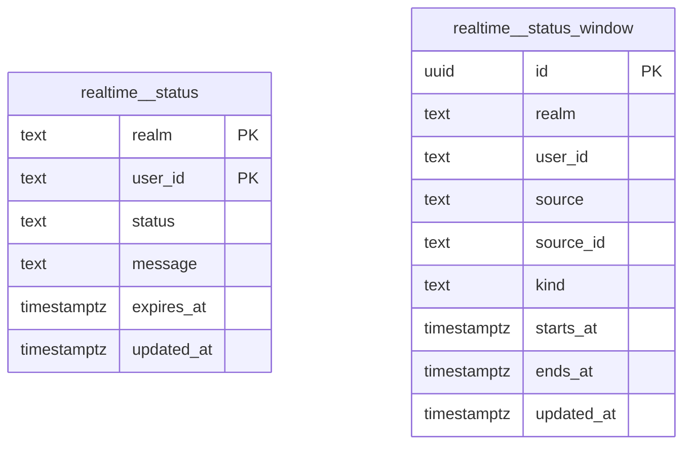

### Tables & Columns

#### `realtime.status`

| Column | Type | Nullable | Key | References |
|---|---|---|---|---|
| `realm` | `text` | NO | PK |  |
| `user_id` | `text` | NO | PK |  |
| `status` | `text` | NO |  |  |
| `message` | `text` | YES |  |  |
| `expires_at` | `timestamp with time zone` | YES |  |  |
| `updated_at` | `timestamp with time zone` | NO |  |  |

#### `realtime.status_window`

| Column | Type | Nullable | Key | References |
|---|---|---|---|---|
| `id` | `uuid` | NO | PK |  |
| `realm` | `text` | NO |  |  |
| `user_id` | `text` | NO |  |  |
| `source` | `text` | NO |  |  |
| `source_id` | `text` | NO |  |  |
| `kind` | `text` | NO |  |  |
| `starts_at` | `timestamp with time zone` | NO |  |  |
| `ends_at` | `timestamp with time zone` | NO |  |  |
| `updated_at` | `timestamp with time zone` | NO |  |  |

---

## Schema: `sales` {#schema-sales}

### Entity-Relationship Diagram

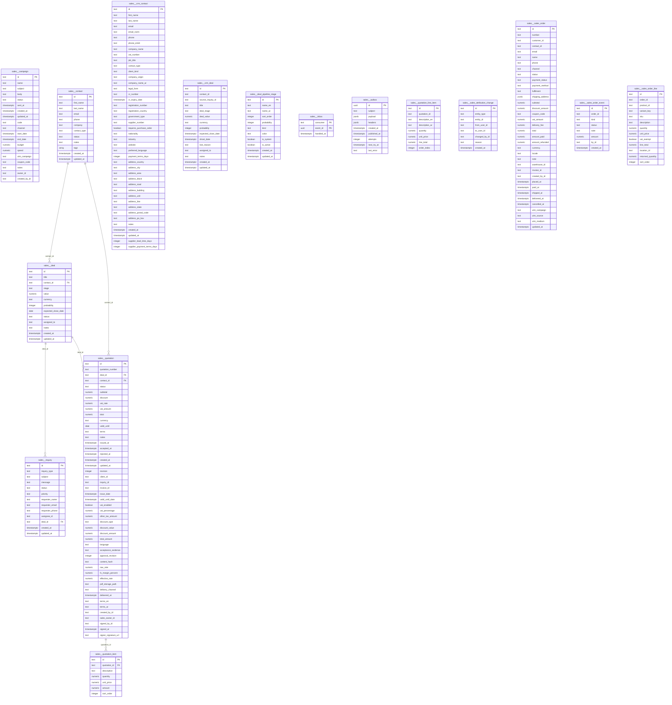

### Tables & Columns

#### `sales.campaign`

| Column | Type | Nullable | Key | References |
|---|---|---|---|---|
| `id` | `text` | NO | PK |  |
| `name` | `text` | NO |  |  |
| `subject` | `text` | NO |  |  |
| `body` | `text` | NO |  |  |
| `status` | `text` | NO |  |  |
| `sent_at` | `timestamp with time zone` | YES |  |  |
| `created_at` | `timestamp with time zone` | NO |  |  |
| `updated_at` | `timestamp with time zone` | NO |  |  |
| `code` | `text` | YES |  |  |
| `channel` | `text` | YES |  |  |
| `start_date` | `timestamp with time zone` | YES |  |  |
| `end_date` | `timestamp with time zone` | YES |  |  |
| `budget` | `numeric` | YES |  |  |
| `spend` | `numeric` | YES |  |  |
| `utm_campaign` | `text` | YES |  |  |
| `coupon_code` | `text` | YES |  |  |
| `notes` | `text` | YES |  |  |
| `owner_id` | `text` | YES |  |  |
| `created_by_id` | `text` | YES |  |  |

#### `sales.contact`

| Column | Type | Nullable | Key | References |
|---|---|---|---|---|
| `id` | `text` | NO | PK |  |
| `first_name` | `text` | NO |  |  |
| `last_name` | `text` | YES |  |  |
| `email` | `text` | YES |  |  |
| `phone` | `text` | YES |  |  |
| `company` | `text` | YES |  |  |
| `contact_type` | `text` | NO |  |  |
| `status` | `text` | NO |  |  |
| `notes` | `text` | YES |  |  |
| `tags` | `ARRAY` | NO |  |  |
| `created_at` | `timestamp with time zone` | NO |  |  |
| `updated_at` | `timestamp with time zone` | NO |  |  |

#### `sales.crm_contact`

| Column | Type | Nullable | Key | References |
|---|---|---|---|---|
| `id` | `text` | NO | PK |  |
| `first_name` | `text` | YES |  |  |
| `last_name` | `text` | YES |  |  |
| `email` | `text` | YES |  |  |
| `email_norm` | `text` | YES |  |  |
| `phone` | `text` | YES |  |  |
| `phone_e164` | `text` | YES |  |  |
| `company_name` | `text` | YES |  |  |
| `vat_number` | `text` | YES |  |  |
| `job_title` | `text` | YES |  |  |
| `contact_type` | `text` | YES |  |  |
| `client_kind` | `text` | YES |  |  |
| `company_origin` | `text` | YES |  |  |
| `company_name_ar` | `text` | YES |  |  |
| `legal_form` | `text` | YES |  |  |
| `cr_number` | `text` | YES |  |  |
| `cr_expiry_date` | `timestamp with time zone` | YES |  |  |
| `registration_number` | `text` | YES |  |  |
| `registration_country` | `text` | YES |  |  |
| `government_type` | `text` | YES |  |  |
| `supplier_number` | `text` | YES |  |  |
| `requires_purchase_order` | `boolean` | YES |  |  |
| `nationality` | `text` | YES |  |  |
| `industry` | `text` | YES |  |  |
| `website` | `text` | YES |  |  |
| `preferred_language` | `text` | YES |  |  |
| `payment_terms_days` | `integer` | YES |  |  |
| `address_country` | `text` | YES |  |  |
| `address_city` | `text` | YES |  |  |
| `address_area` | `text` | YES |  |  |
| `address_block` | `text` | YES |  |  |
| `address_road` | `text` | YES |  |  |
| `address_building` | `text` | YES |  |  |
| `address_unit` | `text` | YES |  |  |
| `address_line` | `text` | YES |  |  |
| `address_state` | `text` | YES |  |  |
| `address_postal_code` | `text` | YES |  |  |
| `address_po_box` | `text` | YES |  |  |
| `notes` | `text` | YES |  |  |
| `created_at` | `timestamp with time zone` | NO |  |  |
| `updated_at` | `timestamp with time zone` | NO |  |  |
| `supplier_lead_time_days` | `integer` | YES |  |  |
| `supplier_payment_terms_days` | `integer` | YES |  |  |

#### `sales.crm_deal`

| Column | Type | Nullable | Key | References |
|---|---|---|---|---|
| `id` | `text` | NO | PK |  |
| `contact_id` | `text` | YES |  |  |
| `source_inquiry_id` | `text` | YES |  |  |
| `title` | `text` | YES |  |  |
| `deal_stage` | `text` | YES |  |  |
| `deal_value` | `numeric` | YES |  |  |
| `currency` | `text` | YES |  |  |
| `probability` | `integer` | YES |  |  |
| `expected_close_date` | `timestamp with time zone` | YES |  |  |
| `shoot_date` | `timestamp with time zone` | YES |  |  |
| `lost_reason` | `text` | YES |  |  |
| `assigned_to` | `text` | YES |  |  |
| `notes` | `text` | YES |  |  |
| `created_at` | `timestamp with time zone` | NO |  |  |
| `updated_at` | `timestamp with time zone` | NO |  |  |

#### `sales.deal`

| Column | Type | Nullable | Key | References |
|---|---|---|---|---|
| `id` | `text` | NO | PK |  |
| `title` | `text` | NO |  |  |
| `contact_id` | `text` | YES | FK | `sales.contact.id` |
| `stage` | `text` | NO |  |  |
| `value` | `numeric` | NO |  |  |
| `currency` | `text` | NO |  |  |
| `probability` | `integer` | NO |  |  |
| `expected_close_date` | `date` | YES |  |  |
| `status` | `text` | NO |  |  |
| `assigned_to` | `text` | YES |  |  |
| `notes` | `text` | YES |  |  |
| `created_at` | `timestamp with time zone` | NO |  |  |
| `updated_at` | `timestamp with time zone` | NO |  |  |

#### `sales.deal_pipeline_stage`

| Column | Type | Nullable | Key | References |
|---|---|---|---|---|
| `id` | `text` | NO | PK |  |
| `name_en` | `text` | YES |  |  |
| `name_ar` | `text` | YES |  |  |
| `sort_order` | `integer` | YES |  |  |
| `probability` | `integer` | YES |  |  |
| `kind` | `text` | YES |  |  |
| `color` | `text` | YES |  |  |
| `is_system` | `boolean` | YES |  |  |
| `is_active` | `boolean` | YES |  |  |
| `created_at` | `timestamp with time zone` | NO |  |  |
| `updated_at` | `timestamp with time zone` | NO |  |  |

#### `sales.inbox`

| Column | Type | Nullable | Key | References |
|---|---|---|---|---|
| `consumer` | `text` | NO | PK |  |
| `event_id` | `uuid` | NO | PK |  |
| `handled_at` | `timestamp with time zone` | NO |  |  |

#### `sales.inquiry`

| Column | Type | Nullable | Key | References |
|---|---|---|---|---|
| `id` | `text` | NO | PK |  |
| `inquiry_type` | `text` | NO |  |  |
| `subject` | `text` | NO |  |  |
| `message` | `text` | NO |  |  |
| `status` | `text` | NO |  |  |
| `priority` | `text` | NO |  |  |
| `requester_name` | `text` | NO |  |  |
| `requester_email` | `text` | NO |  |  |
| `requester_phone` | `text` | YES |  |  |
| `assignee_id` | `text` | YES |  |  |
| `deal_id` | `text` | YES | FK | `sales.deal.id` |
| `created_at` | `timestamp with time zone` | NO |  |  |
| `updated_at` | `timestamp with time zone` | NO |  |  |

#### `sales.outbox`

| Column | Type | Nullable | Key | References |
|---|---|---|---|---|
| `id` | `uuid` | NO | PK |  |
| `subject` | `text` | NO |  |  |
| `payload` | `jsonb` | NO |  |  |
| `headers` | `jsonb` | NO |  |  |
| `created_at` | `timestamp with time zone` | NO |  |  |
| `published_at` | `timestamp with time zone` | YES |  |  |
| `attempts` | `integer` | NO |  |  |
| `next_try_at` | `timestamp with time zone` | NO |  |  |
| `last_error` | `text` | YES |  |  |

#### `sales.quotation`

| Column | Type | Nullable | Key | References |
|---|---|---|---|---|
| `id` | `text` | NO | PK |  |
| `quotation_number` | `text` | NO |  |  |
| `deal_id` | `text` | YES | FK | `sales.deal.id` |
| `contact_id` | `text` | YES | FK | `sales.contact.id` |
| `status` | `text` | NO |  |  |
| `subtotal` | `numeric` | NO |  |  |
| `discount` | `numeric` | NO |  |  |
| `vat_rate` | `numeric` | NO |  |  |
| `vat_amount` | `numeric` | NO |  |  |
| `total` | `numeric` | NO |  |  |
| `currency` | `text` | NO |  |  |
| `valid_until` | `date` | YES |  |  |
| `terms` | `text` | YES |  |  |
| `notes` | `text` | YES |  |  |
| `issued_at` | `timestamp with time zone` | YES |  |  |
| `accepted_at` | `timestamp with time zone` | YES |  |  |
| `rejected_at` | `timestamp with time zone` | YES |  |  |
| `created_at` | `timestamp with time zone` | NO |  |  |
| `updated_at` | `timestamp with time zone` | NO |  |  |
| `revision` | `integer` | YES |  |  |
| `client_id` | `text` | YES |  |  |
| `inquiry_id` | `text` | YES |  |  |
| `invoice_id` | `text` | YES |  |  |
| `issue_date` | `timestamp with time zone` | YES |  |  |
| `valid_until_date` | `timestamp with time zone` | YES |  |  |
| `vat_enabled` | `boolean` | YES |  |  |
| `vat_percentage` | `numeric` | YES |  |  |
| `other_tax_amount` | `numeric` | YES |  |  |
| `discount_type` | `text` | YES |  |  |
| `discount_value` | `numeric` | YES |  |  |
| `discount_amount` | `numeric` | YES |  |  |
| `total_amount` | `numeric` | YES |  |  |
| `language` | `text` | YES |  |  |
| `acceptance_evidence` | `text` | YES |  |  |
| `approval_revision` | `integer` | YES |  |  |
| `content_hash` | `text` | YES |  |  |
| `raw_rate` | `numeric` | YES |  |  |
| `fx_margin_percent` | `numeric` | YES |  |  |
| `effective_rate` | `numeric` | YES |  |  |
| `pdf_storage_path` | `text` | YES |  |  |
| `delivery_channel` | `text` | YES |  |  |
| `delivered_at` | `timestamp with time zone` | YES |  |  |
| `terms_en` | `text` | YES |  |  |
| `terms_ar` | `text` | YES |  |  |
| `created_by_id` | `text` | YES |  |  |
| `sales_owner_id` | `text` | YES |  |  |
| `signed_by_id` | `text` | YES |  |  |
| `signed_at` | `timestamp with time zone` | YES |  |  |
| `signer_signature_url` | `text` | YES |  |  |

#### `sales.quotation_item`

| Column | Type | Nullable | Key | References |
|---|---|---|---|---|
| `id` | `text` | NO | PK |  |
| `quotation_id` | `text` | NO | FK | `sales.quotation.id` |
| `description` | `text` | NO |  |  |
| `quantity` | `numeric` | NO |  |  |
| `unit_price` | `numeric` | NO |  |  |
| `amount` | `numeric` | NO |  |  |
| `sort_order` | `integer` | NO |  |  |

#### `sales.quotation_line_item`

| Column | Type | Nullable | Key | References |
|---|---|---|---|---|
| `id` | `text` | NO | PK |  |
| `quotation_id` | `text` | YES |  |  |
| `description_en` | `text` | YES |  |  |
| `description_ar` | `text` | YES |  |  |
| `quantity` | `numeric` | YES |  |  |
| `unit_price` | `numeric` | YES |  |  |
| `line_total` | `numeric` | YES |  |  |
| `order_index` | `integer` | YES |  |  |

#### `sales.sales_attribution_change`

| Column | Type | Nullable | Key | References |
|---|---|---|---|---|
| `id` | `text` | NO | PK |  |
| `entity_type` | `text` | YES |  |  |
| `entity_id` | `text` | YES |  |  |
| `from_user_id` | `text` | YES |  |  |
| `to_user_id` | `text` | YES |  |  |
| `changed_by_id` | `text` | YES |  |  |
| `reason` | `text` | YES |  |  |
| `created_at` | `timestamp with time zone` | NO |  |  |

#### `sales.sales_order`

| Column | Type | Nullable | Key | References |
|---|---|---|---|---|
| `id` | `text` | NO | PK |  |
| `number` | `text` | YES |  |  |
| `customer_id` | `text` | YES |  |  |
| `contact_id` | `text` | YES |  |  |
| `email` | `text` | YES |  |  |
| `name` | `text` | YES |  |  |
| `phone` | `text` | YES |  |  |
| `channel` | `text` | YES |  |  |
| `status` | `text` | YES |  |  |
| `payment_status` | `text` | YES |  |  |
| `payment_method` | `text` | YES |  |  |
| `fulfilment` | `text` | YES |  |  |
| `shipping_address` | `jsonb` | YES |  |  |
| `subtotal` | `numeric` | YES |  |  |
| `discount_amount` | `numeric` | YES |  |  |
| `coupon_code` | `text` | YES |  |  |
| `vat_amount` | `numeric` | YES |  |  |
| `delivery_fee` | `numeric` | YES |  |  |
| `total` | `numeric` | YES |  |  |
| `amount_paid` | `numeric` | YES |  |  |
| `amount_refunded` | `numeric` | YES |  |  |
| `currency` | `text` | YES |  |  |
| `locale` | `text` | YES |  |  |
| `note` | `text` | YES |  |  |
| `warehouse_id` | `text` | YES |  |  |
| `invoice_id` | `text` | YES |  |  |
| `created_by_id` | `text` | YES |  |  |
| `placed_at` | `timestamp with time zone` | YES |  |  |
| `paid_at` | `timestamp with time zone` | YES |  |  |
| `shipped_at` | `timestamp with time zone` | YES |  |  |
| `delivered_at` | `timestamp with time zone` | YES |  |  |
| `cancelled_at` | `timestamp with time zone` | YES |  |  |
| `utm_campaign` | `text` | YES |  |  |
| `utm_source` | `text` | YES |  |  |
| `utm_medium` | `text` | YES |  |  |
| `updated_at` | `timestamp with time zone` | NO |  |  |

#### `sales.sales_order_event`

| Column | Type | Nullable | Key | References |
|---|---|---|---|---|
| `id` | `text` | NO | PK |  |
| `order_id` | `text` | YES |  |  |
| `kind` | `text` | YES |  |  |
| `status` | `text` | YES |  |  |
| `note` | `text` | YES |  |  |
| `amount` | `numeric` | YES |  |  |
| `by_id` | `text` | YES |  |  |
| `created_at` | `timestamp with time zone` | NO |  |  |

#### `sales.sales_order_line`

| Column | Type | Nullable | Key | References |
|---|---|---|---|---|
| `id` | `text` | NO | PK |  |
| `order_id` | `text` | YES |  |  |
| `product_id` | `text` | YES |  |  |
| `variant_key` | `text` | YES |  |  |
| `sku` | `text` | YES |  |  |
| `description` | `text` | YES |  |  |
| `quantity` | `numeric` | YES |  |  |
| `unit_price` | `numeric` | YES |  |  |
| `vat_exempt` | `boolean` | YES |  |  |
| `line_total` | `numeric` | YES |  |  |
| `location_id` | `text` | YES |  |  |
| `returned_quantity` | `numeric` | YES |  |  |
| `sort_order` | `integer` | YES |  |  |

---

## Schema: `system` {#schema-system}

### Entity-Relationship Diagram

```mermaid
erDiagram
    system__abuse_window {
        text key PK
        integer count
        timestamptz expires_at
    }
    system__account_change_request {
        text id PK
        text user_id
        text requested_by_id
        jsonb changes
        jsonb before
        text reason
        text status
        text decided_by_id
        text review_notes
        timestamptz decided_at
        timestamptz created_at
    }
    system__accounting_account {
        text id PK
        text code
        text name
        text kind
        boolean is_active
    }
    system__accounting_period {
        text id PK
        text name
        timestamptz starts_on
        timestamptz ends_on
        text status
        text closed_by_id
        timestamptz closed_at
    }
    system__activity_log {
        text id PK
        text user_id
        text action
        text entity_type
        text entity_id
        jsonb details
        jsonb diff_payload
    }
    system__announcement {
        text id PK
        text reference
        text title_en
        text title_ar
        text body_en
        text body_ar
        text category
        text priority
        text audience
        boolean official
        boolean requires_acknowledgement
        boolean pinned
        text status
        timestamptz publish_at
        timestamptz expires_at
        timestamptz published_at
        text created_by_id
        text signed_by_id
        text signature_url
        timestamptz signed_at
        text decision_notes
        timestamptz created_at
        timestamptz updated_at
    }
    system__announcement_receipt {
        text announcement_id
        text user_id
        timestamptz read_at
        timestamptz acknowledged_at
        timestamptz hidden_at
    }
    system__api_key {
        text id PK
        text name
        text key_prefix
        text key_hash
        array scopes
        integer rate_limit
        timestamptz last_used_at
        timestamptz expires_at
        text created_by
        timestamptz created_at
        timestamptz revoked_at
    }
    system__approval_decision {
        text id PK
        text approval_request_id
        text decision
        text decided_by_id
        text reason
        integer step
        text signature_data
        timestamptz decided_at
    }
    system__approval_policy {
        text id PK
        text target_type
        boolean enabled
        boolean allow_self_approval
        integer reminder_after_hours
        timestamptz created_at
        timestamptz updated_at
    }
    system__approval_policy_step {
        text id PK
        text policy_id
        integer order
        text approver_mode
        text role_key
        text user_id
        text permission
        numeric min_amount
        numeric min_days
        numeric min_discount_percent
        integer escalate_after_hours
        text escalate_mode
        text escalate_role_key
        text escalate_user_id
    }
    system__approval_request {
        text id PK
        text target_type
        text target_id
        integer revision
        text content_hash
        text status
        text requested_by_id
        jsonb policy_snapshot
        jsonb diff_payload
        text discount_reason
        text policy_id
        integer current_step
        boolean self_approved
    }
    system__attachment {
        text id PK
        text file_name
        text file_url
        integer file_size
        text mime_type
        text entity_type
        text entity_id
        text uploaded_by_id
        timestamptz created_at
    }
    system__backup_record {
        text id PK
        text kind
        text file_name
        bigint file_size
        text checksum
        text status
        text error_message
        text created_by
        timestamptz created_at
        timestamptz verified_at
        jsonb details
    }
    system__bank_settlement {
        text id PK
        text payment_id
        timestamptz settlement_date
        numeric received_amount
        text received_currency
        numeric settled_amount_bhd
        numeric bank_fee_bhd
        numeric fx_gain_loss_bhd
        text bank_reference
        text status
        timestamptz created_at
    }
    system__broadcast {
        text id PK
        text name
        text segment_id
        text campaign_id
        text subject_en
        text subject_ar
        text body_en
        text body_ar
        text status
        text created_by_id
        timestamptz queued_at
        timestamptz sent_at
        timestamptz created_at
        timestamptz updated_at
    }
    system__broadcast_recipient {
        text id PK
        text broadcast_id
        text customer_id
        text email
        text locale
        text status
        text error
        timestamptz sent_at
    }
    system__calendar_event {
        text id PK
        text title
        text title_ar
        text description
        timestamptz start_date
        timestamptz end_date
        boolean all_day
        text location
        text color
        text event_type
        text deal_id
        text created_by_id
        text google_event_id
        text google_calendar_id
        text recurrence
        jsonb reminders
        jsonb attendees
        text visibility
        timestamptz created_at
        timestamptz updated_at
    }
    system__calendar_feed_token {
        text id PK
        text user_id
        text token_hash
        timestamptz last_used_at
        timestamptz created_at
    }
    system__canned_reply {
        text id PK
        text title
        text body_en
        text body_ar
        boolean is_active
        integer sort_order
        timestamptz created_at
        timestamptz updated_at
    }
    system__client_contact_person {
        text id PK
        text contact_id
        text full_name
        text position
        text department
        text email
        text phone
        boolean is_primary
        text notes
        integer display_order
        timestamptz created_at
        timestamptz updated_at
    }
    system__client_logo {
        text id PK
        text name
        text logo_url
        text website_url
        boolean is_dark_logo
        integer display_order
        boolean is_active
    }
    system__client_signature {
        text id PK
        text document_type
        text document_id
        text method
        text status
        text token_hash
        timestamptz expires_at
        text recipient_email
        text signer_name
        text signer_title
        text signature_data
        text signed_file_url
        text terms_text
        boolean terms_accepted
        text document_hash
        text signed_ip
        text signed_user_agent
        timestamptz signed_at
        timestamptz viewed_at
        timestamptz revoked_at
        text created_by_id
        timestamptz created_at
    }
    system__cod_settlement {
        text id PK
        text number
        text driver_id
        text agency_id
        numeric expected
        numeric received
        text note
        text settled_by_id
        timestamptz settled_at
    }
    system__communication_message {
        text id PK
        text thread_id
        text message_id
        text in_reply_to
        text direction
        text from_email
        text to_email
        text subject
        text body_text
        text body_html
        text status
        jsonb delivery_log
        text invoice_id
        text quotation_id
        timestamptz created_at
        timestamptz updated_at
    }
    system__communication_settings {
        text id PK
        boolean managers_announce_to_team
        text updated_by_id
        timestamptz updated_at
    }
    system__communication_thread {
        text id PK
        text subject
        text status
        text contact_id
        text inquiry_id
        text assigned_to
        timestamptz created_at
        timestamptz updated_at
    }
    system__company {
        text id PK
        boolean singleton
        jsonb data
        boolean currency_locked
        bigint revision
        text updated_by
        timestamptz updated_at
    }
    system__company_asset {
        text id PK
        text asset_key
        text title
        text file_url
        text mime_type
        bigint file_size
        timestamptz created_at
        timestamptz updated_at
    }
    system__company_document {
        text id PK
        text title_en
        text title_ar
        text category
        text document_number
        text file_url
        integer file_size
        text mime_type
        timestamptz valid_from
        timestamptz valid_until
        text notes
        text uploaded_by_id
        timestamptz created_at
        timestamptz updated_at
    }
    system__company_setting {
        text id PK
        integer singleton
        text company_name_en
        text company_name_ar
        text cr_number
        text vat_id
        boolean vat_enabled
        numeric vat_percentage
        text vat_certificate_url
        text default_currency
        integer currency_decimals
        text address_en
        text address_ar
        text phone
        text whatsapp_phone
        text email
        text website
        text instagram_url
        text linkedin_url
        text youtube_url
        text bank_name
        text bank_iban
        text bank_account_number
        text bank_swift
        text time_zone
        text logo_url
        text dark_logo_url
        text full_logo_url
        text dark_full_logo_url
        text icon_url
        text dark_icon_url
        text document_header_url
        text document_footer_url
        text stamp_url
        text signature_url
        integer payment_terms_days
        text invoice_prefix
        integer invoice_next_number
        text receipt_prefix
        integer receipt_next_number
        text ceo_name_en
        text ceo_name_ar
        text ceo_title_en
        text ceo_title_ar
        text ceo_quote_en
        text ceo_quote_ar
        text mission_en
        text mission_ar
        text vision_en
        text vision_ar
        text about_text_en
        text about_text_ar
        text terms_en
        text terms_ar
        text rules_en
        text rules_ar
        timestamptz updated_at
        numeric default_discount_limit_percent
        boolean quotations_always_need_approval
        jsonb theme
        timestamptz setup_completed_at
        text primary_language
        text business_activity
        text tagline_en
        text tagline_ar
        integer founded_year
        text city
        text country
        text map_url
        text website_domain
        text admin_domain
    }
    system__contract {
        text id PK
        text contract_number
        text deal_id
        text contact_id
        text template_id
        text title_en
        text title_ar
        text body_html
        text status
        text signature_hash
        timestamptz signed_at
        timestamptz valid_from
        timestamptz valid_until
        text pdf_storage_path
        jsonb metadata
        text created_by_id
        timestamptz created_at
        timestamptz updated_at
    }
    system__courier_agency {
        text id PK
        text name
        text kind
    }
    system__dashboard_layout {
        text user_id PK
    }
    system__debug_toggle {
        text id PK
        text service
        text log_level
        text enabled_by
        timestamptz enabled_at
        timestamptz expires_at
    }
    system__document_fx {
        text id PK
        text document_type
        text document_id
        numeric base_amount
        numeric target_amount
        numeric raw_rate
        numeric margin_percent
        numeric effective_rate
        text rate_snapshot_id
        timestamptz created_at
    }
    system__document_sequence {
        text kind PK
        text prefix
        bigint next_number
    }
    system__document_template {
        text id PK
        text slug
        text name_en
        text name_ar
        text category
        text body_html
        jsonb body_json
        integer version
        boolean is_active
        timestamptz created_at
        timestamptz updated_at
    }
    system__email_job {
        text id PK
        text event_key
        text mom_id
        text created_by_id
        text recipient
        text subject
        text html
        text attachment_name
        text attachment
        text status
        integer attempts
        timestamptz next_attempt_at
        text provider_id
        text last_error
        timestamptz accepted_at
        timestamptz created_at
    }
    system__employment_record {
        text id PK
        text employee_id
        text contract_type
        numeric basic_salary
        numeric housing_allowance
        numeric transport_allowance
        numeric other_allowances
        jsonb payroll_settings
        timestamptz effective_from
        timestamptz effective_to
        boolean is_current
        timestamptz created_at
    }
    system__exchange_rate_snapshot {
        text id PK
        text base_currency
        text quote_currency
        numeric rate
        timestamptz effective_date
        timestamptz fetched_at
        text provider
        text source_evidence
        timestamptz created_at
    }
    system__faq {
        text id PK
        text question_en
        text question_ar
        text answer_en
        text answer_ar
        text category
        boolean is_published
        integer sort_order
        timestamptz created_at
        boolean is_sample
    }
    system__feature_toggle {
        text id PK
        text module_key
        boolean is_enabled
        text name_en
        text name_ar
        text description
    }
    system__final_settlement {
        text id PK
        text reference
        text employee_id
        text handover_id
        text reason
        timestamptz last_working_day
        text status
        text currency
        numeric total_additions
        numeric total_deductions
        numeric net_amount
        numeric employer_contributions
        jsonb calculation
    }
    system__final_settlement_line {
        text id PK
        text settlement_id
        text kind
        text category
        text label_en
        text label_ar
        numeric amount
        text source
        jsonb details
        integer display_order
    }
    system__generated_document {
        text id PK
        text document_type
        text source_entity_type
        text source_entity_id
        text file_name
        text storage_path
        integer file_size
        text checksum
        text generated_by_id
        timestamptz created_at
    }
    system__hero_banner {
        text id PK
        text title_en
        text title_ar
        text subtitle_en
        text subtitle_ar
        text media_type
        text media_url
        text poster_url
        integer display_order
        boolean is_active
        text cta_label_en
        text cta_label_ar
        text cta_link
        timestamptz created_at
        boolean is_sample
    }
    system__hr_policy {
        text id PK
        text salary_timing
        integer pay_day
        integer attendance_cutoff_day
        numeric workday_hours
        text workday_start
        text daily_rate_basis
        text deduction_base
        text overtime_base
        numeric overtime_rate
        numeric overtime_night_rate
        numeric overtime_rest_day_rate
        numeric overtime_holiday_rate
        integer late_grace_minutes
        boolean deduct_lateness
        text unmarked_days
        boolean prorate_joiners
        boolean commission_in_payroll
        jsonb gratuity_rules
    }
    system__inbox {
        text consumer PK
        uuid event_id PK
        timestamptz handled_at
    }
    system__inquiry {
        text id PK
        text name
        text email
        text email_norm
        text phone
        text phone_e164
        text company_name
        text service_type
        text budget_range
        text timeline
        text message
        text status
        text locale
        text source
        text customer_id
        text intent
        text reference
        text submission_key
        text request_hash
        text project_reference
        text location
        text assigned_to_id
        text team
        text workflow_status
        jsonb custom_assignments
    }
    system__inquiry_note {
        text id PK
        text inquiry_id
        text author_id
        text body
        timestamptz created_at
    }
    system__integration_setting {
        text provider PK
        boolean is_active
        text credentials
        jsonb config
        text sync_lease_token
        timestamptz sync_lease_until
        text health_status
        timestamptz last_checked_at
        text last_error
        text account_name
        timestamptz last_synced_at
        timestamptz updated_at
        text updated_by
        text updated_by_id
    }
    system__label_print_job {
        text id PK
        text idempotency_key
        text request_hash
        jsonb template
        jsonb labels
        text status
        text original_job_id
        text created_by_id
        text confirmed_by_id
        timestamptz confirmed_at
        timestamptz created_at
    }
    system__legal_matter {
        text id PK
        text number
        text title
        text kind
        text status
        text counterparty
        text reference
        timestamptz next_date
        text assignee_id
        numeric amount_at_stake
        text description
        text outcome
        text created_by_id
        timestamptz closed_at
        timestamptz reminded_for
        timestamptz created_at
        timestamptz updated_at
    }
    system__legal_matter_event {
        text id PK
        text matter_id
        text kind
        text body
        text by_id
        timestamptz at
    }
    system__letter_template {
        text id PK
        text key
        text name_en
        text name_ar
        text subject_en
        text subject_ar
        text body_en
        text body_ar
        boolean about_employee
        boolean is_active
        integer display_order
        timestamptz created_at
        timestamptz updated_at
    }
    system__media_contact {
        text id PK
        text name
        text outlet
        text role
        text beat
        text email
        text phone
        text notes
        boolean is_active
        timestamptz created_at
        timestamptz updated_at
    }
    system__media_coverage {
        text id PK
        text title
        text outlet
        text url
        timestamptz published_on
        integer reach
        text sentiment
        text article_id
        text notes
        text created_by_id
        timestamptz created_at
    }
    system__message_attachment {
        text id PK
        text message_id
        text filename
        text content_type
        integer size
        text storage_path
        boolean is_quarantined
        timestamptz created_at
    }
    system__minute_of_meeting {
        text id PK
        text mom_number
        text title
        text title_ar
        timestamptz meeting_date
        text start_time
        text end_time
        text location
        text deal_id
        text client_id
        jsonb attendees
    }
    system__module_setting {
        text module_key PK
        boolean enabled
        text updated_by
        timestamptz updated_at
    }
    system__notification {
        text id PK
        text user_id
        text title
        text message
        text type
        text entity_type
        text entity_id
        text message_key
        jsonb message_params
        text action_url
        text event_key
        boolean is_read
        timestamptz hidden_at
        timestamptz created_at
    }
    system__number_reservation {
        text caller PK
        text idempotency_key PK
        text kind
        date document_date
        text document_number
        timestamptz created_at
    }
    system__official_letter {
        text id PK
        text reference
        text template_id
        text employee_id
        text recipient_name
        text recipient_title
        text recipient_organization
        text recipient_address
        text subject_en
        text subject_ar
        text body_en
        text body_ar
        timestamptz letter_date
        text classification
        boolean show_signature
        boolean show_stamp
        text status
        text created_by_id
        text signer_id
        text signature_url
        timestamptz signed_at
        text verification_code
        text decision_notes
        timestamptz created_at
        timestamptz updated_at
    }
    system__outbox {
        uuid id PK
        text subject
        jsonb payload
        jsonb headers
        timestamptz created_at
        timestamptz published_at
        integer attempts
        timestamptz next_try_at
        text last_error
    }
    system__package_content {
        text id PK
        text package_id
        text product_id
        text variant_key
        text batch_key
        numeric quantity
    }
    system__payslip {
        text id PK
        text payroll_item_id
        text employee_id
        integer month
        integer year
        text storage_path
        timestamptz issued_at
    }
    system__profile_change_request {
        text id PK
        text user_id
        text requested_by_id
        text manager_id
        text status
        jsonb old_values
        jsonb new_values
        timestamptz reviewed_at
        text review_notes
        timestamptz created_at
        timestamptz updated_at
    }
    system__project {
        text id PK
        text code
        text name
        text description
        text status
        text department_id
        text owner_id
        text color
        timestamptz start_date
        timestamptz due_date
        text created_by_id
        timestamptz created_at
        timestamptz updated_at
    }
    system__public_holiday {
        text id PK
        timestamptz date
        text name_en
        text name_ar
    }
    system__reference_sequence {
        text id PK
        text prefix
        integer year
        integer last_number
        timestamptz updated_at
    }
    system__report_schedule {
        text id PK
        text report_key
        text frequency
        text format
        text locale
        boolean compare
        text owner_id
        boolean is_active
        timestamptz next_run_at
        timestamptz last_sent_at
        text last_error
        timestamptz created_at
        timestamptz updated_at
    }
    system__request_assignment {
        text id PK
        text inquiry_id
        text assigned_to_id
        text assigned_by_id
        text team
        text reason
        boolean active
        timestamptz created_at
    }
    system__request_comment {
        text id PK
        text inquiry_id
        text author_id
        text body
        boolean is_client_visible
        text channel
        jsonb attachments
        timestamptz created_at
        timestamptz updated_at
    }
    system__request_event {
        text id PK
        text inquiry_id
        text actor_id
        text event_type
        jsonb details
        timestamptz created_at
    }
    system__revalidation_job {
        text id PK
        text event_key
        jsonb payload
        text status
        integer attempts
        timestamptz next_attempt_at
        text last_error
        timestamptz delivered_at
        timestamptz created_at
    }
    system__review {
        text id PK
        text client_id
        text original_locale
        text submission_key
        text request_hash
        text author_en
        text author_ar
        text company_en
        text company_ar
        text quote_en
        text quote_ar
        integer rating
        boolean is_approved
        integer sort_order
        text year
        timestamptz created_at
    }
    system__route_sheet {
        text id PK
        text number
        timestamptz date
        text driver_id
        text vehicle_id
        text status
        text note
        text created_by_id
        timestamptz created_at
        timestamptz updated_at
    }
    system__serial_generation {
        text id PK
        text idempotency_key
        text request_hash
        text product_id
        text variant_key
        text batch_key
        text location_id
        integer quantity
        text created_by_id
        timestamptz created_at
    }
    system__service {
        text id PK
        text code
        text name_en
        text name_ar
        text category
        text description_en
        text description_ar
        text unit
        numeric default_rate
        boolean is_active
        integer display_order
        boolean is_public
        text image_url
        timestamptz created_at
        timestamptz updated_at
        boolean is_sample
    }
    system__service_settings {
        text id PK
        integer sla_urgent_hours
        integer sla_high_hours
        integer sla_normal_hours
        timestamptz updated_at
    }
    system__signature_change {
        text id PK
        text user_id
        text signature_url
        text previous_url
        text status
        text reviewed_by_id
        text review_notes
        timestamptz decided_at
        timestamptz created_at
    }
    system__signature_policy {
        text document_type PK
        text mode
        text updated_by_id
        timestamptz updated_at
    }
    system__signature_request {
        text id PK
        text document_type
        text document_id
        text token_hash
        text status
        timestamptz expires_at
        text recipient_email
        text recipient_phone
        text signer_name
        text signature_data
        timestamptz signed_at
        text signed_ip
        text signed_user_agent
        timestamptz viewed_at
        timestamptz revoked_at
        text created_by_id
        timestamptz created_at
    }
    system__site_setting {
        boolean id PK
        text website_domain
        text admin_domain
        jsonb code
        timestamptz updated_at
        text updated_by
    }
    system__statistic {
        text id PK
        text value
        text label_en
        text label_ar
        text sub_label_en
        text sub_label_ar
        text icon
        integer sort_order
        text source
        text preset
        integer preset_param
        integer round_to
        text suffix
        boolean is_sample
    }
    system__studio_equipment {
        text id PK
        text category
        text name_en
        text name_ar
        text brand
        numeric daily_rate_bhd
        integer quantity
        text specification
        text description_en
        text description_ar
        text image_url
        integer display_order
        timestamptz created_at
    }
    system__tag {
        text id PK
        text name
        text name_ar
        text color
        text entity_type
        timestamptz created_at
    }
    system__upload_object {
        text id PK
        text file_url
        text owner_id
        text file_name
        integer file_size
        text mime_type
        boolean is_public
        timestamptz claimed_at
        timestamptz expires_at
        timestamptz created_at
    }
    system__vehicle {
        text id PK
        text plate
        text name
        text kind
        text notes
        boolean is_active
        timestamptz created_at
        timestamptz updated_at
    }
    system__warehouse {
        text branch_id
        text id PK
        text code
        text name_en
        text name_ar
        text address
        boolean is_active
        boolean is_default
        integer sort_order
        timestamptz created_at
        timestamptz updated_at
    }
    system__wishlist_item {
        text id PK
        text customer_id
        text catalogue_item_id
        timestamptz created_at
    }
```

### Tables & Columns

#### `system.abuse_window`

| Column | Type | Nullable | Key | References |
|---|---|---|---|---|
| `key` | `text` | NO | PK |  |
| `count` | `integer` | YES |  |  |
| `expires_at` | `timestamp with time zone` | YES |  |  |

#### `system.account_change_request`

| Column | Type | Nullable | Key | References |
|---|---|---|---|---|
| `id` | `text` | NO | PK |  |
| `user_id` | `text` | YES |  |  |
| `requested_by_id` | `text` | YES |  |  |
| `changes` | `jsonb` | YES |  |  |
| `before` | `jsonb` | YES |  |  |
| `reason` | `text` | YES |  |  |
| `status` | `text` | YES |  |  |
| `decided_by_id` | `text` | YES |  |  |
| `review_notes` | `text` | YES |  |  |
| `decided_at` | `timestamp with time zone` | YES |  |  |
| `created_at` | `timestamp with time zone` | NO |  |  |

#### `system.accounting_account`

| Column | Type | Nullable | Key | References |
|---|---|---|---|---|
| `id` | `text` | NO | PK |  |
| `code` | `text` | YES |  |  |
| `name` | `text` | YES |  |  |
| `kind` | `text` | YES |  |  |
| `is_active` | `boolean` | YES |  |  |

#### `system.accounting_period`

| Column | Type | Nullable | Key | References |
|---|---|---|---|---|
| `id` | `text` | NO | PK |  |
| `name` | `text` | YES |  |  |
| `starts_on` | `timestamp with time zone` | YES |  |  |
| `ends_on` | `timestamp with time zone` | YES |  |  |
| `status` | `text` | YES |  |  |
| `closed_by_id` | `text` | YES |  |  |
| `closed_at` | `timestamp with time zone` | YES |  |  |

#### `system.activity_log`

| Column | Type | Nullable | Key | References |
|---|---|---|---|---|
| `id` | `text` | NO | PK |  |
| `user_id` | `text` | YES |  |  |
| `action` | `text` | YES |  |  |
| `entity_type` | `text` | YES |  |  |
| `entity_id` | `text` | YES |  |  |
| `details` | `jsonb` | YES |  |  |
| `diff_payload` | `jsonb` | YES |  |  |

#### `system.announcement`

| Column | Type | Nullable | Key | References |
|---|---|---|---|---|
| `id` | `text` | NO | PK |  |
| `reference` | `text` | YES |  |  |
| `title_en` | `text` | YES |  |  |
| `title_ar` | `text` | YES |  |  |
| `body_en` | `text` | YES |  |  |
| `body_ar` | `text` | YES |  |  |
| `category` | `text` | YES |  |  |
| `priority` | `text` | YES |  |  |
| `audience` | `text` | YES |  |  |
| `official` | `boolean` | YES |  |  |
| `requires_acknowledgement` | `boolean` | YES |  |  |
| `pinned` | `boolean` | YES |  |  |
| `status` | `text` | YES |  |  |
| `publish_at` | `timestamp with time zone` | YES |  |  |
| `expires_at` | `timestamp with time zone` | YES |  |  |
| `published_at` | `timestamp with time zone` | YES |  |  |
| `created_by_id` | `text` | YES |  |  |
| `signed_by_id` | `text` | YES |  |  |
| `signature_url` | `text` | YES |  |  |
| `signed_at` | `timestamp with time zone` | YES |  |  |
| `decision_notes` | `text` | YES |  |  |
| `created_at` | `timestamp with time zone` | NO |  |  |
| `updated_at` | `timestamp with time zone` | NO |  |  |

#### `system.announcement_receipt`

| Column | Type | Nullable | Key | References |
|---|---|---|---|---|
| `announcement_id` | `text` | YES |  |  |
| `user_id` | `text` | YES |  |  |
| `read_at` | `timestamp with time zone` | YES |  |  |
| `acknowledged_at` | `timestamp with time zone` | YES |  |  |
| `hidden_at` | `timestamp with time zone` | YES |  |  |

#### `system.api_key`

| Column | Type | Nullable | Key | References |
|---|---|---|---|---|
| `id` | `text` | NO | PK |  |
| `name` | `text` | NO |  |  |
| `key_prefix` | `text` | NO |  |  |
| `key_hash` | `text` | NO |  |  |
| `scopes` | `ARRAY` | NO |  |  |
| `rate_limit` | `integer` | NO |  |  |
| `last_used_at` | `timestamp with time zone` | YES |  |  |
| `expires_at` | `timestamp with time zone` | YES |  |  |
| `created_by` | `text` | NO |  |  |
| `created_at` | `timestamp with time zone` | NO |  |  |
| `revoked_at` | `timestamp with time zone` | YES |  |  |

#### `system.approval_decision`

| Column | Type | Nullable | Key | References |
|---|---|---|---|---|
| `id` | `text` | NO | PK |  |
| `approval_request_id` | `text` | YES |  |  |
| `decision` | `text` | YES |  |  |
| `decided_by_id` | `text` | YES |  |  |
| `reason` | `text` | YES |  |  |
| `step` | `integer` | YES |  |  |
| `signature_data` | `text` | YES |  |  |
| `decided_at` | `timestamp with time zone` | YES |  |  |

#### `system.approval_policy`

| Column | Type | Nullable | Key | References |
|---|---|---|---|---|
| `id` | `text` | NO | PK |  |
| `target_type` | `text` | YES |  |  |
| `enabled` | `boolean` | YES |  |  |
| `allow_self_approval` | `boolean` | YES |  |  |
| `reminder_after_hours` | `integer` | YES |  |  |
| `created_at` | `timestamp with time zone` | NO |  |  |
| `updated_at` | `timestamp with time zone` | NO |  |  |

#### `system.approval_policy_step`

| Column | Type | Nullable | Key | References |
|---|---|---|---|---|
| `id` | `text` | NO | PK |  |
| `policy_id` | `text` | YES |  |  |
| `order` | `integer` | YES |  |  |
| `approver_mode` | `text` | YES |  |  |
| `role_key` | `text` | YES |  |  |
| `user_id` | `text` | YES |  |  |
| `permission` | `text` | YES |  |  |
| `min_amount` | `numeric` | YES |  |  |
| `min_days` | `numeric` | YES |  |  |
| `min_discount_percent` | `numeric` | YES |  |  |
| `escalate_after_hours` | `integer` | YES |  |  |
| `escalate_mode` | `text` | YES |  |  |
| `escalate_role_key` | `text` | YES |  |  |
| `escalate_user_id` | `text` | YES |  |  |

#### `system.approval_request`

| Column | Type | Nullable | Key | References |
|---|---|---|---|---|
| `id` | `text` | NO | PK |  |
| `target_type` | `text` | YES |  |  |
| `target_id` | `text` | YES |  |  |
| `revision` | `integer` | YES |  |  |
| `content_hash` | `text` | YES |  |  |
| `status` | `text` | YES |  |  |
| `requested_by_id` | `text` | YES |  |  |
| `policy_snapshot` | `jsonb` | YES |  |  |
| `diff_payload` | `jsonb` | YES |  |  |
| `discount_reason` | `text` | YES |  |  |
| `policy_id` | `text` | YES |  |  |
| `current_step` | `integer` | YES |  |  |
| `self_approved` | `boolean` | YES |  |  |

#### `system.attachment`

| Column | Type | Nullable | Key | References |
|---|---|---|---|---|
| `id` | `text` | NO | PK |  |
| `file_name` | `text` | YES |  |  |
| `file_url` | `text` | YES |  |  |
| `file_size` | `integer` | YES |  |  |
| `mime_type` | `text` | YES |  |  |
| `entity_type` | `text` | YES |  |  |
| `entity_id` | `text` | YES |  |  |
| `uploaded_by_id` | `text` | YES |  |  |
| `created_at` | `timestamp with time zone` | NO |  |  |

#### `system.backup_record`

| Column | Type | Nullable | Key | References |
|---|---|---|---|---|
| `id` | `text` | NO | PK |  |
| `kind` | `text` | NO |  |  |
| `file_name` | `text` | NO |  |  |
| `file_size` | `bigint` | NO |  |  |
| `checksum` | `text` | NO |  |  |
| `status` | `text` | NO |  |  |
| `error_message` | `text` | YES |  |  |
| `created_by` | `text` | NO |  |  |
| `created_at` | `timestamp with time zone` | NO |  |  |
| `verified_at` | `timestamp with time zone` | YES |  |  |
| `details` | `jsonb` | NO |  |  |

#### `system.bank_settlement`

| Column | Type | Nullable | Key | References |
|---|---|---|---|---|
| `id` | `text` | NO | PK |  |
| `payment_id` | `text` | YES |  |  |
| `settlement_date` | `timestamp with time zone` | YES |  |  |
| `received_amount` | `numeric` | YES |  |  |
| `received_currency` | `text` | YES |  |  |
| `settled_amount_bhd` | `numeric` | YES |  |  |
| `bank_fee_bhd` | `numeric` | YES |  |  |
| `fx_gain_loss_bhd` | `numeric` | YES |  |  |
| `bank_reference` | `text` | YES |  |  |
| `status` | `text` | YES |  |  |
| `created_at` | `timestamp with time zone` | NO |  |  |

#### `system.broadcast`

| Column | Type | Nullable | Key | References |
|---|---|---|---|---|
| `id` | `text` | NO | PK |  |
| `name` | `text` | YES |  |  |
| `segment_id` | `text` | YES |  |  |
| `campaign_id` | `text` | YES |  |  |
| `subject_en` | `text` | YES |  |  |
| `subject_ar` | `text` | YES |  |  |
| `body_en` | `text` | YES |  |  |
| `body_ar` | `text` | YES |  |  |
| `status` | `text` | YES |  |  |
| `created_by_id` | `text` | YES |  |  |
| `queued_at` | `timestamp with time zone` | YES |  |  |
| `sent_at` | `timestamp with time zone` | YES |  |  |
| `created_at` | `timestamp with time zone` | NO |  |  |
| `updated_at` | `timestamp with time zone` | NO |  |  |

#### `system.broadcast_recipient`

| Column | Type | Nullable | Key | References |
|---|---|---|---|---|
| `id` | `text` | NO | PK |  |
| `broadcast_id` | `text` | YES |  |  |
| `customer_id` | `text` | YES |  |  |
| `email` | `text` | YES |  |  |
| `locale` | `text` | YES |  |  |
| `status` | `text` | YES |  |  |
| `error` | `text` | YES |  |  |
| `sent_at` | `timestamp with time zone` | YES |  |  |

#### `system.calendar_event`

| Column | Type | Nullable | Key | References |
|---|---|---|---|---|
| `id` | `text` | NO | PK |  |
| `title` | `text` | YES |  |  |
| `title_ar` | `text` | YES |  |  |
| `description` | `text` | YES |  |  |
| `start_date` | `timestamp with time zone` | YES |  |  |
| `end_date` | `timestamp with time zone` | YES |  |  |
| `all_day` | `boolean` | YES |  |  |
| `location` | `text` | YES |  |  |
| `color` | `text` | YES |  |  |
| `event_type` | `text` | YES |  |  |
| `deal_id` | `text` | YES |  |  |
| `created_by_id` | `text` | YES |  |  |
| `google_event_id` | `text` | YES |  |  |
| `google_calendar_id` | `text` | YES |  |  |
| `recurrence` | `text` | YES |  |  |
| `reminders` | `jsonb` | YES |  |  |
| `attendees` | `jsonb` | YES |  |  |
| `visibility` | `text` | YES |  |  |
| `created_at` | `timestamp with time zone` | NO |  |  |
| `updated_at` | `timestamp with time zone` | NO |  |  |

#### `system.calendar_feed_token`

| Column | Type | Nullable | Key | References |
|---|---|---|---|---|
| `id` | `text` | NO | PK |  |
| `user_id` | `text` | YES |  |  |
| `token_hash` | `text` | YES |  |  |
| `last_used_at` | `timestamp with time zone` | YES |  |  |
| `created_at` | `timestamp with time zone` | NO |  |  |

#### `system.canned_reply`

| Column | Type | Nullable | Key | References |
|---|---|---|---|---|
| `id` | `text` | NO | PK |  |
| `title` | `text` | YES |  |  |
| `body_en` | `text` | YES |  |  |
| `body_ar` | `text` | YES |  |  |
| `is_active` | `boolean` | YES |  |  |
| `sort_order` | `integer` | YES |  |  |
| `created_at` | `timestamp with time zone` | NO |  |  |
| `updated_at` | `timestamp with time zone` | NO |  |  |

#### `system.client_contact_person`

| Column | Type | Nullable | Key | References |
|---|---|---|---|---|
| `id` | `text` | NO | PK |  |
| `contact_id` | `text` | YES |  |  |
| `full_name` | `text` | YES |  |  |
| `position` | `text` | YES |  |  |
| `department` | `text` | YES |  |  |
| `email` | `text` | YES |  |  |
| `phone` | `text` | YES |  |  |
| `is_primary` | `boolean` | YES |  |  |
| `notes` | `text` | YES |  |  |
| `display_order` | `integer` | YES |  |  |
| `created_at` | `timestamp with time zone` | NO |  |  |
| `updated_at` | `timestamp with time zone` | NO |  |  |

#### `system.client_logo`

| Column | Type | Nullable | Key | References |
|---|---|---|---|---|
| `id` | `text` | NO | PK |  |
| `name` | `text` | YES |  |  |
| `logo_url` | `text` | YES |  |  |
| `website_url` | `text` | YES |  |  |
| `is_dark_logo` | `boolean` | YES |  |  |
| `display_order` | `integer` | YES |  |  |
| `is_active` | `boolean` | YES |  |  |

#### `system.client_signature`

| Column | Type | Nullable | Key | References |
|---|---|---|---|---|
| `id` | `text` | NO | PK |  |
| `document_type` | `text` | YES |  |  |
| `document_id` | `text` | YES |  |  |
| `method` | `text` | YES |  |  |
| `status` | `text` | YES |  |  |
| `token_hash` | `text` | YES |  |  |
| `expires_at` | `timestamp with time zone` | YES |  |  |
| `recipient_email` | `text` | YES |  |  |
| `signer_name` | `text` | YES |  |  |
| `signer_title` | `text` | YES |  |  |
| `signature_data` | `text` | YES |  |  |
| `signed_file_url` | `text` | YES |  |  |
| `terms_text` | `text` | YES |  |  |
| `terms_accepted` | `boolean` | YES |  |  |
| `document_hash` | `text` | YES |  |  |
| `signed_ip` | `text` | YES |  |  |
| `signed_user_agent` | `text` | YES |  |  |
| `signed_at` | `timestamp with time zone` | YES |  |  |
| `viewed_at` | `timestamp with time zone` | YES |  |  |
| `revoked_at` | `timestamp with time zone` | YES |  |  |
| `created_by_id` | `text` | YES |  |  |
| `created_at` | `timestamp with time zone` | NO |  |  |

#### `system.cod_settlement`

| Column | Type | Nullable | Key | References |
|---|---|---|---|---|
| `id` | `text` | NO | PK |  |
| `number` | `text` | YES |  |  |
| `driver_id` | `text` | YES |  |  |
| `agency_id` | `text` | YES |  |  |
| `expected` | `numeric` | YES |  |  |
| `received` | `numeric` | YES |  |  |
| `note` | `text` | YES |  |  |
| `settled_by_id` | `text` | YES |  |  |
| `settled_at` | `timestamp with time zone` | YES |  |  |

#### `system.communication_message`

| Column | Type | Nullable | Key | References |
|---|---|---|---|---|
| `id` | `text` | NO | PK |  |
| `thread_id` | `text` | YES |  |  |
| `message_id` | `text` | YES |  |  |
| `in_reply_to` | `text` | YES |  |  |
| `direction` | `text` | YES |  |  |
| `from_email` | `text` | YES |  |  |
| `to_email` | `text` | YES |  |  |
| `subject` | `text` | YES |  |  |
| `body_text` | `text` | YES |  |  |
| `body_html` | `text` | YES |  |  |
| `status` | `text` | YES |  |  |
| `delivery_log` | `jsonb` | YES |  |  |
| `invoice_id` | `text` | YES |  |  |
| `quotation_id` | `text` | YES |  |  |
| `created_at` | `timestamp with time zone` | NO |  |  |
| `updated_at` | `timestamp with time zone` | NO |  |  |

#### `system.communication_settings`

| Column | Type | Nullable | Key | References |
|---|---|---|---|---|
| `id` | `text` | NO | PK |  |
| `managers_announce_to_team` | `boolean` | YES |  |  |
| `updated_by_id` | `text` | YES |  |  |
| `updated_at` | `timestamp with time zone` | NO |  |  |

#### `system.communication_thread`

| Column | Type | Nullable | Key | References |
|---|---|---|---|---|
| `id` | `text` | NO | PK |  |
| `subject` | `text` | YES |  |  |
| `status` | `text` | YES |  |  |
| `contact_id` | `text` | YES |  |  |
| `inquiry_id` | `text` | YES |  |  |
| `assigned_to` | `text` | YES |  |  |
| `created_at` | `timestamp with time zone` | NO |  |  |
| `updated_at` | `timestamp with time zone` | NO |  |  |

#### `system.company`

| Column | Type | Nullable | Key | References |
|---|---|---|---|---|
| `id` | `text` | NO | PK |  |
| `singleton` | `boolean` | NO |  |  |
| `data` | `jsonb` | NO |  |  |
| `currency_locked` | `boolean` | NO |  |  |
| `revision` | `bigint` | NO |  |  |
| `updated_by` | `text` | NO |  |  |
| `updated_at` | `timestamp with time zone` | NO |  |  |

#### `system.company_asset`

| Column | Type | Nullable | Key | References |
|---|---|---|---|---|
| `id` | `text` | NO | PK |  |
| `asset_key` | `text` | NO |  |  |
| `title` | `text` | NO |  |  |
| `file_url` | `text` | NO |  |  |
| `mime_type` | `text` | YES |  |  |
| `file_size` | `bigint` | YES |  |  |
| `created_at` | `timestamp with time zone` | NO |  |  |
| `updated_at` | `timestamp with time zone` | NO |  |  |

#### `system.company_document`

| Column | Type | Nullable | Key | References |
|---|---|---|---|---|
| `id` | `text` | NO | PK |  |
| `title_en` | `text` | YES |  |  |
| `title_ar` | `text` | YES |  |  |
| `category` | `text` | YES |  |  |
| `document_number` | `text` | YES |  |  |
| `file_url` | `text` | YES |  |  |
| `file_size` | `integer` | YES |  |  |
| `mime_type` | `text` | YES |  |  |
| `valid_from` | `timestamp with time zone` | YES |  |  |
| `valid_until` | `timestamp with time zone` | YES |  |  |
| `notes` | `text` | YES |  |  |
| `uploaded_by_id` | `text` | YES |  |  |
| `created_at` | `timestamp with time zone` | NO |  |  |
| `updated_at` | `timestamp with time zone` | NO |  |  |

#### `system.company_setting`

| Column | Type | Nullable | Key | References |
|---|---|---|---|---|
| `id` | `text` | NO | PK |  |
| `singleton` | `integer` | YES |  |  |
| `company_name_en` | `text` | YES |  |  |
| `company_name_ar` | `text` | YES |  |  |
| `cr_number` | `text` | YES |  |  |
| `vat_id` | `text` | YES |  |  |
| `vat_enabled` | `boolean` | YES |  |  |
| `vat_percentage` | `numeric` | YES |  |  |
| `vat_certificate_url` | `text` | YES |  |  |
| `default_currency` | `text` | YES |  |  |
| `currency_decimals` | `integer` | YES |  |  |
| `address_en` | `text` | YES |  |  |
| `address_ar` | `text` | YES |  |  |
| `phone` | `text` | YES |  |  |
| `whatsapp_phone` | `text` | YES |  |  |
| `email` | `text` | YES |  |  |
| `website` | `text` | YES |  |  |
| `instagram_url` | `text` | YES |  |  |
| `linkedin_url` | `text` | YES |  |  |
| `youtube_url` | `text` | YES |  |  |
| `bank_name` | `text` | YES |  |  |
| `bank_iban` | `text` | YES |  |  |
| `bank_account_number` | `text` | YES |  |  |
| `bank_swift` | `text` | YES |  |  |
| `time_zone` | `text` | YES |  |  |
| `logo_url` | `text` | YES |  |  |
| `dark_logo_url` | `text` | YES |  |  |
| `full_logo_url` | `text` | YES |  |  |
| `dark_full_logo_url` | `text` | YES |  |  |
| `icon_url` | `text` | YES |  |  |
| `dark_icon_url` | `text` | YES |  |  |
| `document_header_url` | `text` | YES |  |  |
| `document_footer_url` | `text` | YES |  |  |
| `stamp_url` | `text` | YES |  |  |
| `signature_url` | `text` | YES |  |  |
| `payment_terms_days` | `integer` | YES |  |  |
| `invoice_prefix` | `text` | YES |  |  |
| `invoice_next_number` | `integer` | YES |  |  |
| `receipt_prefix` | `text` | YES |  |  |
| `receipt_next_number` | `integer` | YES |  |  |
| `ceo_name_en` | `text` | YES |  |  |
| `ceo_name_ar` | `text` | YES |  |  |
| `ceo_title_en` | `text` | YES |  |  |
| `ceo_title_ar` | `text` | YES |  |  |
| `ceo_quote_en` | `text` | YES |  |  |
| `ceo_quote_ar` | `text` | YES |  |  |
| `mission_en` | `text` | YES |  |  |
| `mission_ar` | `text` | YES |  |  |
| `vision_en` | `text` | YES |  |  |
| `vision_ar` | `text` | YES |  |  |
| `about_text_en` | `text` | YES |  |  |
| `about_text_ar` | `text` | YES |  |  |
| `terms_en` | `text` | YES |  |  |
| `terms_ar` | `text` | YES |  |  |
| `rules_en` | `text` | YES |  |  |
| `rules_ar` | `text` | YES |  |  |
| `updated_at` | `timestamp with time zone` | NO |  |  |
| `default_discount_limit_percent` | `numeric` | YES |  |  |
| `quotations_always_need_approval` | `boolean` | YES |  |  |
| `theme` | `jsonb` | YES |  |  |
| `setup_completed_at` | `timestamp with time zone` | YES |  |  |
| `primary_language` | `text` | YES |  |  |
| `business_activity` | `text` | YES |  |  |
| `tagline_en` | `text` | YES |  |  |
| `tagline_ar` | `text` | YES |  |  |
| `founded_year` | `integer` | YES |  |  |
| `city` | `text` | YES |  |  |
| `country` | `text` | YES |  |  |
| `map_url` | `text` | YES |  |  |
| `website_domain` | `text` | YES |  |  |
| `admin_domain` | `text` | YES |  |  |

#### `system.contract`

| Column | Type | Nullable | Key | References |
|---|---|---|---|---|
| `id` | `text` | NO | PK |  |
| `contract_number` | `text` | YES |  |  |
| `deal_id` | `text` | YES |  |  |
| `contact_id` | `text` | YES |  |  |
| `template_id` | `text` | YES |  |  |
| `title_en` | `text` | YES |  |  |
| `title_ar` | `text` | YES |  |  |
| `body_html` | `text` | YES |  |  |
| `status` | `text` | YES |  |  |
| `signature_hash` | `text` | YES |  |  |
| `signed_at` | `timestamp with time zone` | YES |  |  |
| `valid_from` | `timestamp with time zone` | YES |  |  |
| `valid_until` | `timestamp with time zone` | YES |  |  |
| `pdf_storage_path` | `text` | YES |  |  |
| `metadata` | `jsonb` | YES |  |  |
| `created_by_id` | `text` | YES |  |  |
| `created_at` | `timestamp with time zone` | NO |  |  |
| `updated_at` | `timestamp with time zone` | NO |  |  |

#### `system.courier_agency`

| Column | Type | Nullable | Key | References |
|---|---|---|---|---|
| `id` | `text` | NO | PK |  |
| `name` | `text` | YES |  |  |
| `kind` | `text` | YES |  |  |

#### `system.dashboard_layout`

| Column | Type | Nullable | Key | References |
|---|---|---|---|---|
| `user_id` | `text` | NO | PK |  |

#### `system.debug_toggle`

| Column | Type | Nullable | Key | References |
|---|---|---|---|---|
| `id` | `text` | NO | PK |  |
| `service` | `text` | NO |  |  |
| `log_level` | `text` | NO |  |  |
| `enabled_by` | `text` | NO |  |  |
| `enabled_at` | `timestamp with time zone` | NO |  |  |
| `expires_at` | `timestamp with time zone` | NO |  |  |

#### `system.document_fx`

| Column | Type | Nullable | Key | References |
|---|---|---|---|---|
| `id` | `text` | NO | PK |  |
| `document_type` | `text` | YES |  |  |
| `document_id` | `text` | YES |  |  |
| `base_amount` | `numeric` | YES |  |  |
| `target_amount` | `numeric` | YES |  |  |
| `raw_rate` | `numeric` | YES |  |  |
| `margin_percent` | `numeric` | YES |  |  |
| `effective_rate` | `numeric` | YES |  |  |
| `rate_snapshot_id` | `text` | YES |  |  |
| `created_at` | `timestamp with time zone` | NO |  |  |

#### `system.document_sequence`

| Column | Type | Nullable | Key | References |
|---|---|---|---|---|
| `kind` | `text` | NO | PK |  |
| `prefix` | `text` | NO |  |  |
| `next_number` | `bigint` | NO |  |  |

#### `system.document_template`

| Column | Type | Nullable | Key | References |
|---|---|---|---|---|
| `id` | `text` | NO | PK |  |
| `slug` | `text` | YES |  |  |
| `name_en` | `text` | YES |  |  |
| `name_ar` | `text` | YES |  |  |
| `category` | `text` | YES |  |  |
| `body_html` | `text` | YES |  |  |
| `body_json` | `jsonb` | YES |  |  |
| `version` | `integer` | YES |  |  |
| `is_active` | `boolean` | YES |  |  |
| `created_at` | `timestamp with time zone` | NO |  |  |
| `updated_at` | `timestamp with time zone` | NO |  |  |

#### `system.email_job`

| Column | Type | Nullable | Key | References |
|---|---|---|---|---|
| `id` | `text` | NO | PK |  |
| `event_key` | `text` | YES |  |  |
| `mom_id` | `text` | YES |  |  |
| `created_by_id` | `text` | YES |  |  |
| `recipient` | `text` | YES |  |  |
| `subject` | `text` | YES |  |  |
| `html` | `text` | YES |  |  |
| `attachment_name` | `text` | YES |  |  |
| `attachment` | `text` | YES |  |  |
| `status` | `text` | YES |  |  |
| `attempts` | `integer` | YES |  |  |
| `next_attempt_at` | `timestamp with time zone` | YES |  |  |
| `provider_id` | `text` | YES |  |  |
| `last_error` | `text` | YES |  |  |
| `accepted_at` | `timestamp with time zone` | YES |  |  |
| `created_at` | `timestamp with time zone` | NO |  |  |

#### `system.employment_record`

| Column | Type | Nullable | Key | References |
|---|---|---|---|---|
| `id` | `text` | NO | PK |  |
| `employee_id` | `text` | YES |  |  |
| `contract_type` | `text` | YES |  |  |
| `basic_salary` | `numeric` | YES |  |  |
| `housing_allowance` | `numeric` | YES |  |  |
| `transport_allowance` | `numeric` | YES |  |  |
| `other_allowances` | `numeric` | YES |  |  |
| `payroll_settings` | `jsonb` | YES |  |  |
| `effective_from` | `timestamp with time zone` | YES |  |  |
| `effective_to` | `timestamp with time zone` | YES |  |  |
| `is_current` | `boolean` | YES |  |  |
| `created_at` | `timestamp with time zone` | NO |  |  |

#### `system.exchange_rate_snapshot`

| Column | Type | Nullable | Key | References |
|---|---|---|---|---|
| `id` | `text` | NO | PK |  |
| `base_currency` | `text` | YES |  |  |
| `quote_currency` | `text` | YES |  |  |
| `rate` | `numeric` | YES |  |  |
| `effective_date` | `timestamp with time zone` | YES |  |  |
| `fetched_at` | `timestamp with time zone` | YES |  |  |
| `provider` | `text` | YES |  |  |
| `source_evidence` | `text` | YES |  |  |
| `created_at` | `timestamp with time zone` | NO |  |  |

#### `system.faq`

| Column | Type | Nullable | Key | References |
|---|---|---|---|---|
| `id` | `text` | NO | PK |  |
| `question_en` | `text` | YES |  |  |
| `question_ar` | `text` | YES |  |  |
| `answer_en` | `text` | YES |  |  |
| `answer_ar` | `text` | YES |  |  |
| `category` | `text` | YES |  |  |
| `is_published` | `boolean` | YES |  |  |
| `sort_order` | `integer` | YES |  |  |
| `created_at` | `timestamp with time zone` | NO |  |  |
| `is_sample` | `boolean` | YES |  |  |

#### `system.feature_toggle`

| Column | Type | Nullable | Key | References |
|---|---|---|---|---|
| `id` | `text` | NO | PK |  |
| `module_key` | `text` | YES |  |  |
| `is_enabled` | `boolean` | YES |  |  |
| `name_en` | `text` | YES |  |  |
| `name_ar` | `text` | YES |  |  |
| `description` | `text` | YES |  |  |

#### `system.final_settlement`

| Column | Type | Nullable | Key | References |
|---|---|---|---|---|
| `id` | `text` | NO | PK |  |
| `reference` | `text` | YES |  |  |
| `employee_id` | `text` | YES |  |  |
| `handover_id` | `text` | YES |  |  |
| `reason` | `text` | YES |  |  |
| `last_working_day` | `timestamp with time zone` | YES |  |  |
| `status` | `text` | YES |  |  |
| `currency` | `text` | YES |  |  |
| `total_additions` | `numeric` | YES |  |  |
| `total_deductions` | `numeric` | YES |  |  |
| `net_amount` | `numeric` | YES |  |  |
| `employer_contributions` | `numeric` | YES |  |  |
| `calculation` | `jsonb` | YES |  |  |

#### `system.final_settlement_line`

| Column | Type | Nullable | Key | References |
|---|---|---|---|---|
| `id` | `text` | NO | PK |  |
| `settlement_id` | `text` | YES |  |  |
| `kind` | `text` | YES |  |  |
| `category` | `text` | YES |  |  |
| `label_en` | `text` | YES |  |  |
| `label_ar` | `text` | YES |  |  |
| `amount` | `numeric` | YES |  |  |
| `source` | `text` | YES |  |  |
| `details` | `jsonb` | YES |  |  |
| `display_order` | `integer` | YES |  |  |

#### `system.generated_document`

| Column | Type | Nullable | Key | References |
|---|---|---|---|---|
| `id` | `text` | NO | PK |  |
| `document_type` | `text` | YES |  |  |
| `source_entity_type` | `text` | YES |  |  |
| `source_entity_id` | `text` | YES |  |  |
| `file_name` | `text` | YES |  |  |
| `storage_path` | `text` | YES |  |  |
| `file_size` | `integer` | YES |  |  |
| `checksum` | `text` | YES |  |  |
| `generated_by_id` | `text` | YES |  |  |
| `created_at` | `timestamp with time zone` | NO |  |  |

#### `system.hero_banner`

| Column | Type | Nullable | Key | References |
|---|---|---|---|---|
| `id` | `text` | NO | PK |  |
| `title_en` | `text` | YES |  |  |
| `title_ar` | `text` | YES |  |  |
| `subtitle_en` | `text` | YES |  |  |
| `subtitle_ar` | `text` | YES |  |  |
| `media_type` | `text` | YES |  |  |
| `media_url` | `text` | YES |  |  |
| `poster_url` | `text` | YES |  |  |
| `display_order` | `integer` | YES |  |  |
| `is_active` | `boolean` | YES |  |  |
| `cta_label_en` | `text` | YES |  |  |
| `cta_label_ar` | `text` | YES |  |  |
| `cta_link` | `text` | YES |  |  |
| `created_at` | `timestamp with time zone` | NO |  |  |
| `is_sample` | `boolean` | YES |  |  |

#### `system.hr_policy`

| Column | Type | Nullable | Key | References |
|---|---|---|---|---|
| `id` | `text` | NO | PK |  |
| `salary_timing` | `text` | YES |  |  |
| `pay_day` | `integer` | YES |  |  |
| `attendance_cutoff_day` | `integer` | YES |  |  |
| `workday_hours` | `numeric` | YES |  |  |
| `workday_start` | `text` | YES |  |  |
| `daily_rate_basis` | `text` | YES |  |  |
| `deduction_base` | `text` | YES |  |  |
| `overtime_base` | `text` | YES |  |  |
| `overtime_rate` | `numeric` | YES |  |  |
| `overtime_night_rate` | `numeric` | YES |  |  |
| `overtime_rest_day_rate` | `numeric` | YES |  |  |
| `overtime_holiday_rate` | `numeric` | YES |  |  |
| `late_grace_minutes` | `integer` | YES |  |  |
| `deduct_lateness` | `boolean` | YES |  |  |
| `unmarked_days` | `text` | YES |  |  |
| `prorate_joiners` | `boolean` | YES |  |  |
| `commission_in_payroll` | `boolean` | YES |  |  |
| `gratuity_rules` | `jsonb` | YES |  |  |

#### `system.inbox`

| Column | Type | Nullable | Key | References |
|---|---|---|---|---|
| `consumer` | `text` | NO | PK |  |
| `event_id` | `uuid` | NO | PK |  |
| `handled_at` | `timestamp with time zone` | NO |  |  |

#### `system.inquiry`

| Column | Type | Nullable | Key | References |
|---|---|---|---|---|
| `id` | `text` | NO | PK |  |
| `name` | `text` | YES |  |  |
| `email` | `text` | YES |  |  |
| `email_norm` | `text` | YES |  |  |
| `phone` | `text` | YES |  |  |
| `phone_e164` | `text` | YES |  |  |
| `company_name` | `text` | YES |  |  |
| `service_type` | `text` | YES |  |  |
| `budget_range` | `text` | YES |  |  |
| `timeline` | `text` | YES |  |  |
| `message` | `text` | YES |  |  |
| `status` | `text` | YES |  |  |
| `locale` | `text` | YES |  |  |
| `source` | `text` | YES |  |  |
| `customer_id` | `text` | YES |  |  |
| `intent` | `text` | YES |  |  |
| `reference` | `text` | YES |  |  |
| `submission_key` | `text` | YES |  |  |
| `request_hash` | `text` | YES |  |  |
| `project_reference` | `text` | YES |  |  |
| `location` | `text` | YES |  |  |
| `assigned_to_id` | `text` | YES |  |  |
| `team` | `text` | YES |  |  |
| `workflow_status` | `text` | YES |  |  |
| `custom_assignments` | `jsonb` | YES |  |  |

#### `system.inquiry_note`

| Column | Type | Nullable | Key | References |
|---|---|---|---|---|
| `id` | `text` | NO | PK |  |
| `inquiry_id` | `text` | YES |  |  |
| `author_id` | `text` | YES |  |  |
| `body` | `text` | YES |  |  |
| `created_at` | `timestamp with time zone` | NO |  |  |

#### `system.integration_setting`

| Column | Type | Nullable | Key | References |
|---|---|---|---|---|
| `provider` | `text` | NO | PK |  |
| `is_active` | `boolean` | NO |  |  |
| `credentials` | `text` | YES |  |  |
| `config` | `jsonb` | NO |  |  |
| `sync_lease_token` | `text` | YES |  |  |
| `sync_lease_until` | `timestamp with time zone` | YES |  |  |
| `health_status` | `text` | NO |  |  |
| `last_checked_at` | `timestamp with time zone` | YES |  |  |
| `last_error` | `text` | YES |  |  |
| `account_name` | `text` | YES |  |  |
| `last_synced_at` | `timestamp with time zone` | YES |  |  |
| `updated_at` | `timestamp with time zone` | NO |  |  |
| `updated_by` | `text` | YES |  |  |
| `updated_by_id` | `text` | YES |  |  |

#### `system.label_print_job`

| Column | Type | Nullable | Key | References |
|---|---|---|---|---|
| `id` | `text` | NO | PK |  |
| `idempotency_key` | `text` | YES |  |  |
| `request_hash` | `text` | YES |  |  |
| `template` | `jsonb` | YES |  |  |
| `labels` | `jsonb` | YES |  |  |
| `status` | `text` | YES |  |  |
| `original_job_id` | `text` | YES |  |  |
| `created_by_id` | `text` | YES |  |  |
| `confirmed_by_id` | `text` | YES |  |  |
| `confirmed_at` | `timestamp with time zone` | YES |  |  |
| `created_at` | `timestamp with time zone` | NO |  |  |

#### `system.legal_matter`

| Column | Type | Nullable | Key | References |
|---|---|---|---|---|
| `id` | `text` | NO | PK |  |
| `number` | `text` | YES |  |  |
| `title` | `text` | YES |  |  |
| `kind` | `text` | YES |  |  |
| `status` | `text` | YES |  |  |
| `counterparty` | `text` | YES |  |  |
| `reference` | `text` | YES |  |  |
| `next_date` | `timestamp with time zone` | YES |  |  |
| `assignee_id` | `text` | YES |  |  |
| `amount_at_stake` | `numeric` | YES |  |  |
| `description` | `text` | YES |  |  |
| `outcome` | `text` | YES |  |  |
| `created_by_id` | `text` | YES |  |  |
| `closed_at` | `timestamp with time zone` | YES |  |  |
| `reminded_for` | `timestamp with time zone` | YES |  |  |
| `created_at` | `timestamp with time zone` | NO |  |  |
| `updated_at` | `timestamp with time zone` | NO |  |  |

#### `system.legal_matter_event`

| Column | Type | Nullable | Key | References |
|---|---|---|---|---|
| `id` | `text` | NO | PK |  |
| `matter_id` | `text` | YES |  |  |
| `kind` | `text` | YES |  |  |
| `body` | `text` | YES |  |  |
| `by_id` | `text` | YES |  |  |
| `at` | `timestamp with time zone` | YES |  |  |

#### `system.letter_template`

| Column | Type | Nullable | Key | References |
|---|---|---|---|---|
| `id` | `text` | NO | PK |  |
| `key` | `text` | YES |  |  |
| `name_en` | `text` | YES |  |  |
| `name_ar` | `text` | YES |  |  |
| `subject_en` | `text` | YES |  |  |
| `subject_ar` | `text` | YES |  |  |
| `body_en` | `text` | YES |  |  |
| `body_ar` | `text` | YES |  |  |
| `about_employee` | `boolean` | YES |  |  |
| `is_active` | `boolean` | YES |  |  |
| `display_order` | `integer` | YES |  |  |
| `created_at` | `timestamp with time zone` | NO |  |  |
| `updated_at` | `timestamp with time zone` | NO |  |  |

#### `system.media_contact`

| Column | Type | Nullable | Key | References |
|---|---|---|---|---|
| `id` | `text` | NO | PK |  |
| `name` | `text` | YES |  |  |
| `outlet` | `text` | YES |  |  |
| `role` | `text` | YES |  |  |
| `beat` | `text` | YES |  |  |
| `email` | `text` | YES |  |  |
| `phone` | `text` | YES |  |  |
| `notes` | `text` | YES |  |  |
| `is_active` | `boolean` | YES |  |  |
| `created_at` | `timestamp with time zone` | NO |  |  |
| `updated_at` | `timestamp with time zone` | NO |  |  |

#### `system.media_coverage`

| Column | Type | Nullable | Key | References |
|---|---|---|---|---|
| `id` | `text` | NO | PK |  |
| `title` | `text` | YES |  |  |
| `outlet` | `text` | YES |  |  |
| `url` | `text` | YES |  |  |
| `published_on` | `timestamp with time zone` | YES |  |  |
| `reach` | `integer` | YES |  |  |
| `sentiment` | `text` | YES |  |  |
| `article_id` | `text` | YES |  |  |
| `notes` | `text` | YES |  |  |
| `created_by_id` | `text` | YES |  |  |
| `created_at` | `timestamp with time zone` | NO |  |  |

#### `system.message_attachment`

| Column | Type | Nullable | Key | References |
|---|---|---|---|---|
| `id` | `text` | NO | PK |  |
| `message_id` | `text` | YES |  |  |
| `filename` | `text` | YES |  |  |
| `content_type` | `text` | YES |  |  |
| `size` | `integer` | YES |  |  |
| `storage_path` | `text` | YES |  |  |
| `is_quarantined` | `boolean` | YES |  |  |
| `created_at` | `timestamp with time zone` | NO |  |  |

#### `system.minute_of_meeting`

| Column | Type | Nullable | Key | References |
|---|---|---|---|---|
| `id` | `text` | NO | PK |  |
| `mom_number` | `text` | YES |  |  |
| `title` | `text` | YES |  |  |
| `title_ar` | `text` | YES |  |  |
| `meeting_date` | `timestamp with time zone` | YES |  |  |
| `start_time` | `text` | YES |  |  |
| `end_time` | `text` | YES |  |  |
| `location` | `text` | YES |  |  |
| `deal_id` | `text` | YES |  |  |
| `client_id` | `text` | YES |  |  |
| `attendees` | `jsonb` | YES |  |  |

#### `system.module_setting`

| Column | Type | Nullable | Key | References |
|---|---|---|---|---|
| `module_key` | `text` | NO | PK |  |
| `enabled` | `boolean` | NO |  |  |
| `updated_by` | `text` | YES |  |  |
| `updated_at` | `timestamp with time zone` | NO |  |  |

#### `system.notification`

| Column | Type | Nullable | Key | References |
|---|---|---|---|---|
| `id` | `text` | NO | PK |  |
| `user_id` | `text` | YES |  |  |
| `title` | `text` | YES |  |  |
| `message` | `text` | YES |  |  |
| `type` | `text` | YES |  |  |
| `entity_type` | `text` | YES |  |  |
| `entity_id` | `text` | YES |  |  |
| `message_key` | `text` | YES |  |  |
| `message_params` | `jsonb` | YES |  |  |
| `action_url` | `text` | YES |  |  |
| `event_key` | `text` | YES |  |  |
| `is_read` | `boolean` | YES |  |  |
| `hidden_at` | `timestamp with time zone` | YES |  |  |
| `created_at` | `timestamp with time zone` | NO |  |  |

#### `system.number_reservation`

| Column | Type | Nullable | Key | References |
|---|---|---|---|---|
| `caller` | `text` | NO | PK |  |
| `idempotency_key` | `text` | NO | PK |  |
| `kind` | `text` | NO |  |  |
| `document_date` | `date` | NO |  |  |
| `document_number` | `text` | NO |  |  |
| `created_at` | `timestamp with time zone` | NO |  |  |

#### `system.official_letter`

| Column | Type | Nullable | Key | References |
|---|---|---|---|---|
| `id` | `text` | NO | PK |  |
| `reference` | `text` | YES |  |  |
| `template_id` | `text` | YES |  |  |
| `employee_id` | `text` | YES |  |  |
| `recipient_name` | `text` | YES |  |  |
| `recipient_title` | `text` | YES |  |  |
| `recipient_organization` | `text` | YES |  |  |
| `recipient_address` | `text` | YES |  |  |
| `subject_en` | `text` | YES |  |  |
| `subject_ar` | `text` | YES |  |  |
| `body_en` | `text` | YES |  |  |
| `body_ar` | `text` | YES |  |  |
| `letter_date` | `timestamp with time zone` | YES |  |  |
| `classification` | `text` | YES |  |  |
| `show_signature` | `boolean` | YES |  |  |
| `show_stamp` | `boolean` | YES |  |  |
| `status` | `text` | YES |  |  |
| `created_by_id` | `text` | YES |  |  |
| `signer_id` | `text` | YES |  |  |
| `signature_url` | `text` | YES |  |  |
| `signed_at` | `timestamp with time zone` | YES |  |  |
| `verification_code` | `text` | YES |  |  |
| `decision_notes` | `text` | YES |  |  |
| `created_at` | `timestamp with time zone` | NO |  |  |
| `updated_at` | `timestamp with time zone` | NO |  |  |

#### `system.outbox`

| Column | Type | Nullable | Key | References |
|---|---|---|---|---|
| `id` | `uuid` | NO | PK |  |
| `subject` | `text` | NO |  |  |
| `payload` | `jsonb` | NO |  |  |
| `headers` | `jsonb` | NO |  |  |
| `created_at` | `timestamp with time zone` | NO |  |  |
| `published_at` | `timestamp with time zone` | YES |  |  |
| `attempts` | `integer` | NO |  |  |
| `next_try_at` | `timestamp with time zone` | NO |  |  |
| `last_error` | `text` | YES |  |  |

#### `system.package_content`

| Column | Type | Nullable | Key | References |
|---|---|---|---|---|
| `id` | `text` | NO | PK |  |
| `package_id` | `text` | YES |  |  |
| `product_id` | `text` | YES |  |  |
| `variant_key` | `text` | YES |  |  |
| `batch_key` | `text` | YES |  |  |
| `quantity` | `numeric` | YES |  |  |

#### `system.payslip`

| Column | Type | Nullable | Key | References |
|---|---|---|---|---|
| `id` | `text` | NO | PK |  |
| `payroll_item_id` | `text` | YES |  |  |
| `employee_id` | `text` | YES |  |  |
| `month` | `integer` | YES |  |  |
| `year` | `integer` | YES |  |  |
| `storage_path` | `text` | YES |  |  |
| `issued_at` | `timestamp with time zone` | YES |  |  |

#### `system.profile_change_request`

| Column | Type | Nullable | Key | References |
|---|---|---|---|---|
| `id` | `text` | NO | PK |  |
| `user_id` | `text` | YES |  |  |
| `requested_by_id` | `text` | YES |  |  |
| `manager_id` | `text` | YES |  |  |
| `status` | `text` | YES |  |  |
| `old_values` | `jsonb` | YES |  |  |
| `new_values` | `jsonb` | YES |  |  |
| `reviewed_at` | `timestamp with time zone` | YES |  |  |
| `review_notes` | `text` | YES |  |  |
| `created_at` | `timestamp with time zone` | NO |  |  |
| `updated_at` | `timestamp with time zone` | NO |  |  |

#### `system.project`

| Column | Type | Nullable | Key | References |
|---|---|---|---|---|
| `id` | `text` | NO | PK |  |
| `code` | `text` | YES |  |  |
| `name` | `text` | YES |  |  |
| `description` | `text` | YES |  |  |
| `status` | `text` | YES |  |  |
| `department_id` | `text` | YES |  |  |
| `owner_id` | `text` | YES |  |  |
| `color` | `text` | YES |  |  |
| `start_date` | `timestamp with time zone` | YES |  |  |
| `due_date` | `timestamp with time zone` | YES |  |  |
| `created_by_id` | `text` | YES |  |  |
| `created_at` | `timestamp with time zone` | NO |  |  |
| `updated_at` | `timestamp with time zone` | NO |  |  |

#### `system.public_holiday`

| Column | Type | Nullable | Key | References |
|---|---|---|---|---|
| `id` | `text` | NO | PK |  |
| `date` | `timestamp with time zone` | YES |  |  |
| `name_en` | `text` | YES |  |  |
| `name_ar` | `text` | YES |  |  |

#### `system.reference_sequence`

| Column | Type | Nullable | Key | References |
|---|---|---|---|---|
| `id` | `text` | NO | PK |  |
| `prefix` | `text` | YES |  |  |
| `year` | `integer` | YES |  |  |
| `last_number` | `integer` | YES |  |  |
| `updated_at` | `timestamp with time zone` | NO |  |  |

#### `system.report_schedule`

| Column | Type | Nullable | Key | References |
|---|---|---|---|---|
| `id` | `text` | NO | PK |  |
| `report_key` | `text` | YES |  |  |
| `frequency` | `text` | YES |  |  |
| `format` | `text` | YES |  |  |
| `locale` | `text` | YES |  |  |
| `compare` | `boolean` | YES |  |  |
| `owner_id` | `text` | YES |  |  |
| `is_active` | `boolean` | YES |  |  |
| `next_run_at` | `timestamp with time zone` | YES |  |  |
| `last_sent_at` | `timestamp with time zone` | YES |  |  |
| `last_error` | `text` | YES |  |  |
| `created_at` | `timestamp with time zone` | NO |  |  |
| `updated_at` | `timestamp with time zone` | NO |  |  |

#### `system.request_assignment`

| Column | Type | Nullable | Key | References |
|---|---|---|---|---|
| `id` | `text` | NO | PK |  |
| `inquiry_id` | `text` | YES |  |  |
| `assigned_to_id` | `text` | YES |  |  |
| `assigned_by_id` | `text` | YES |  |  |
| `team` | `text` | YES |  |  |
| `reason` | `text` | YES |  |  |
| `active` | `boolean` | YES |  |  |
| `created_at` | `timestamp with time zone` | NO |  |  |

#### `system.request_comment`

| Column | Type | Nullable | Key | References |
|---|---|---|---|---|
| `id` | `text` | NO | PK |  |
| `inquiry_id` | `text` | YES |  |  |
| `author_id` | `text` | YES |  |  |
| `body` | `text` | YES |  |  |
| `is_client_visible` | `boolean` | YES |  |  |
| `channel` | `text` | YES |  |  |
| `attachments` | `jsonb` | YES |  |  |
| `created_at` | `timestamp with time zone` | NO |  |  |
| `updated_at` | `timestamp with time zone` | NO |  |  |

#### `system.request_event`

| Column | Type | Nullable | Key | References |
|---|---|---|---|---|
| `id` | `text` | NO | PK |  |
| `inquiry_id` | `text` | YES |  |  |
| `actor_id` | `text` | YES |  |  |
| `event_type` | `text` | YES |  |  |
| `details` | `jsonb` | YES |  |  |
| `created_at` | `timestamp with time zone` | NO |  |  |

#### `system.revalidation_job`

| Column | Type | Nullable | Key | References |
|---|---|---|---|---|
| `id` | `text` | NO | PK |  |
| `event_key` | `text` | YES |  |  |
| `payload` | `jsonb` | YES |  |  |
| `status` | `text` | YES |  |  |
| `attempts` | `integer` | YES |  |  |
| `next_attempt_at` | `timestamp with time zone` | YES |  |  |
| `last_error` | `text` | YES |  |  |
| `delivered_at` | `timestamp with time zone` | YES |  |  |
| `created_at` | `timestamp with time zone` | NO |  |  |

#### `system.review`

| Column | Type | Nullable | Key | References |
|---|---|---|---|---|
| `id` | `text` | NO | PK |  |
| `client_id` | `text` | YES |  |  |
| `original_locale` | `text` | YES |  |  |
| `submission_key` | `text` | YES |  |  |
| `request_hash` | `text` | YES |  |  |
| `author_en` | `text` | YES |  |  |
| `author_ar` | `text` | YES |  |  |
| `company_en` | `text` | YES |  |  |
| `company_ar` | `text` | YES |  |  |
| `quote_en` | `text` | YES |  |  |
| `quote_ar` | `text` | YES |  |  |
| `rating` | `integer` | YES |  |  |
| `is_approved` | `boolean` | YES |  |  |
| `sort_order` | `integer` | YES |  |  |
| `year` | `text` | YES |  |  |
| `created_at` | `timestamp with time zone` | NO |  |  |

#### `system.route_sheet`

| Column | Type | Nullable | Key | References |
|---|---|---|---|---|
| `id` | `text` | NO | PK |  |
| `number` | `text` | YES |  |  |
| `date` | `timestamp with time zone` | YES |  |  |
| `driver_id` | `text` | YES |  |  |
| `vehicle_id` | `text` | YES |  |  |
| `status` | `text` | YES |  |  |
| `note` | `text` | YES |  |  |
| `created_by_id` | `text` | YES |  |  |
| `created_at` | `timestamp with time zone` | NO |  |  |
| `updated_at` | `timestamp with time zone` | NO |  |  |

#### `system.serial_generation`

| Column | Type | Nullable | Key | References |
|---|---|---|---|---|
| `id` | `text` | NO | PK |  |
| `idempotency_key` | `text` | YES |  |  |
| `request_hash` | `text` | YES |  |  |
| `product_id` | `text` | YES |  |  |
| `variant_key` | `text` | YES |  |  |
| `batch_key` | `text` | YES |  |  |
| `location_id` | `text` | YES |  |  |
| `quantity` | `integer` | YES |  |  |
| `created_by_id` | `text` | YES |  |  |
| `created_at` | `timestamp with time zone` | NO |  |  |

#### `system.service`

| Column | Type | Nullable | Key | References |
|---|---|---|---|---|
| `id` | `text` | NO | PK |  |
| `code` | `text` | YES |  |  |
| `name_en` | `text` | YES |  |  |
| `name_ar` | `text` | YES |  |  |
| `category` | `text` | YES |  |  |
| `description_en` | `text` | YES |  |  |
| `description_ar` | `text` | YES |  |  |
| `unit` | `text` | YES |  |  |
| `default_rate` | `numeric` | YES |  |  |
| `is_active` | `boolean` | YES |  |  |
| `display_order` | `integer` | YES |  |  |
| `is_public` | `boolean` | YES |  |  |
| `image_url` | `text` | YES |  |  |
| `created_at` | `timestamp with time zone` | NO |  |  |
| `updated_at` | `timestamp with time zone` | NO |  |  |
| `is_sample` | `boolean` | YES |  |  |

#### `system.service_settings`

| Column | Type | Nullable | Key | References |
|---|---|---|---|---|
| `id` | `text` | NO | PK |  |
| `sla_urgent_hours` | `integer` | YES |  |  |
| `sla_high_hours` | `integer` | YES |  |  |
| `sla_normal_hours` | `integer` | YES |  |  |
| `updated_at` | `timestamp with time zone` | NO |  |  |

#### `system.signature_change`

| Column | Type | Nullable | Key | References |
|---|---|---|---|---|
| `id` | `text` | NO | PK |  |
| `user_id` | `text` | YES |  |  |
| `signature_url` | `text` | YES |  |  |
| `previous_url` | `text` | YES |  |  |
| `status` | `text` | YES |  |  |
| `reviewed_by_id` | `text` | YES |  |  |
| `review_notes` | `text` | YES |  |  |
| `decided_at` | `timestamp with time zone` | YES |  |  |
| `created_at` | `timestamp with time zone` | NO |  |  |

#### `system.signature_policy`

| Column | Type | Nullable | Key | References |
|---|---|---|---|---|
| `document_type` | `text` | NO | PK |  |
| `mode` | `text` | YES |  |  |
| `updated_by_id` | `text` | YES |  |  |
| `updated_at` | `timestamp with time zone` | NO |  |  |

#### `system.signature_request`

| Column | Type | Nullable | Key | References |
|---|---|---|---|---|
| `id` | `text` | NO | PK |  |
| `document_type` | `text` | YES |  |  |
| `document_id` | `text` | YES |  |  |
| `token_hash` | `text` | YES |  |  |
| `status` | `text` | YES |  |  |
| `expires_at` | `timestamp with time zone` | YES |  |  |
| `recipient_email` | `text` | YES |  |  |
| `recipient_phone` | `text` | YES |  |  |
| `signer_name` | `text` | YES |  |  |
| `signature_data` | `text` | YES |  |  |
| `signed_at` | `timestamp with time zone` | YES |  |  |
| `signed_ip` | `text` | YES |  |  |
| `signed_user_agent` | `text` | YES |  |  |
| `viewed_at` | `timestamp with time zone` | YES |  |  |
| `revoked_at` | `timestamp with time zone` | YES |  |  |
| `created_by_id` | `text` | YES |  |  |
| `created_at` | `timestamp with time zone` | NO |  |  |

#### `system.site_setting`

| Column | Type | Nullable | Key | References |
|---|---|---|---|---|
| `id` | `boolean` | NO | PK |  |
| `website_domain` | `text` | YES |  |  |
| `admin_domain` | `text` | YES |  |  |
| `code` | `jsonb` | NO |  |  |
| `updated_at` | `timestamp with time zone` | NO |  |  |
| `updated_by` | `text` | YES |  |  |

#### `system.statistic`

| Column | Type | Nullable | Key | References |
|---|---|---|---|---|
| `id` | `text` | NO | PK |  |
| `value` | `text` | YES |  |  |
| `label_en` | `text` | YES |  |  |
| `label_ar` | `text` | YES |  |  |
| `sub_label_en` | `text` | YES |  |  |
| `sub_label_ar` | `text` | YES |  |  |
| `icon` | `text` | YES |  |  |
| `sort_order` | `integer` | YES |  |  |
| `source` | `text` | YES |  |  |
| `preset` | `text` | YES |  |  |
| `preset_param` | `integer` | YES |  |  |
| `round_to` | `integer` | YES |  |  |
| `suffix` | `text` | YES |  |  |
| `is_sample` | `boolean` | YES |  |  |

#### `system.studio_equipment`

| Column | Type | Nullable | Key | References |
|---|---|---|---|---|
| `id` | `text` | NO | PK |  |
| `category` | `text` | YES |  |  |
| `name_en` | `text` | YES |  |  |
| `name_ar` | `text` | YES |  |  |
| `brand` | `text` | YES |  |  |
| `daily_rate_bhd` | `numeric` | YES |  |  |
| `quantity` | `integer` | YES |  |  |
| `specification` | `text` | YES |  |  |
| `description_en` | `text` | YES |  |  |
| `description_ar` | `text` | YES |  |  |
| `image_url` | `text` | YES |  |  |
| `display_order` | `integer` | YES |  |  |
| `created_at` | `timestamp with time zone` | NO |  |  |

#### `system.tag`

| Column | Type | Nullable | Key | References |
|---|---|---|---|---|
| `id` | `text` | NO | PK |  |
| `name` | `text` | YES |  |  |
| `name_ar` | `text` | YES |  |  |
| `color` | `text` | YES |  |  |
| `entity_type` | `text` | YES |  |  |
| `created_at` | `timestamp with time zone` | NO |  |  |

#### `system.upload_object`

| Column | Type | Nullable | Key | References |
|---|---|---|---|---|
| `id` | `text` | NO | PK |  |
| `file_url` | `text` | YES |  |  |
| `owner_id` | `text` | YES |  |  |
| `file_name` | `text` | YES |  |  |
| `file_size` | `integer` | YES |  |  |
| `mime_type` | `text` | YES |  |  |
| `is_public` | `boolean` | YES |  |  |
| `claimed_at` | `timestamp with time zone` | YES |  |  |
| `expires_at` | `timestamp with time zone` | YES |  |  |
| `created_at` | `timestamp with time zone` | NO |  |  |

#### `system.vehicle`

| Column | Type | Nullable | Key | References |
|---|---|---|---|---|
| `id` | `text` | NO | PK |  |
| `plate` | `text` | YES |  |  |
| `name` | `text` | YES |  |  |
| `kind` | `text` | YES |  |  |
| `notes` | `text` | YES |  |  |
| `is_active` | `boolean` | YES |  |  |
| `created_at` | `timestamp with time zone` | NO |  |  |
| `updated_at` | `timestamp with time zone` | NO |  |  |

#### `system.warehouse`

| Column | Type | Nullable | Key | References |
|---|---|---|---|---|
| `branch_id` | `text` | YES |  |  |
| `id` | `text` | NO | PK |  |
| `code` | `text` | YES |  |  |
| `name_en` | `text` | YES |  |  |
| `name_ar` | `text` | YES |  |  |
| `address` | `text` | YES |  |  |
| `is_active` | `boolean` | YES |  |  |
| `is_default` | `boolean` | YES |  |  |
| `sort_order` | `integer` | YES |  |  |
| `created_at` | `timestamp with time zone` | NO |  |  |
| `updated_at` | `timestamp with time zone` | NO |  |  |

#### `system.wishlist_item`

| Column | Type | Nullable | Key | References |
|---|---|---|---|---|
| `id` | `text` | NO | PK |  |
| `customer_id` | `text` | YES |  |  |
| `catalogue_item_id` | `text` | YES |  |  |
| `created_at` | `timestamp with time zone` | NO |  |  |

---

## Schema: `workflow` {#schema-workflow}

### Entity-Relationship Diagram

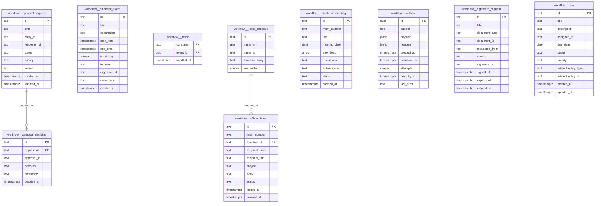

### Tables & Columns

#### `workflow.approval_decision`

| Column | Type | Nullable | Key | References |
|---|---|---|---|---|
| `id` | `text` | NO | PK |  |
| `request_id` | `text` | NO | FK | `workflow.approval_request.id` |
| `approver_id` | `text` | NO |  |  |
| `decision` | `text` | NO |  |  |
| `comments` | `text` | YES |  |  |
| `decided_at` | `timestamp with time zone` | NO |  |  |

#### `workflow.approval_request`

| Column | Type | Nullable | Key | References |
|---|---|---|---|---|
| `id` | `text` | NO | PK |  |
| `kind` | `text` | NO |  |  |
| `entity_id` | `text` | NO |  |  |
| `requester_id` | `text` | NO |  |  |
| `status` | `text` | NO |  |  |
| `priority` | `text` | NO |  |  |
| `reason` | `text` | YES |  |  |
| `created_at` | `timestamp with time zone` | NO |  |  |
| `updated_at` | `timestamp with time zone` | NO |  |  |

#### `workflow.calendar_event`

| Column | Type | Nullable | Key | References |
|---|---|---|---|---|
| `id` | `text` | NO | PK |  |
| `title` | `text` | NO |  |  |
| `description` | `text` | YES |  |  |
| `start_time` | `timestamp with time zone` | NO |  |  |
| `end_time` | `timestamp with time zone` | NO |  |  |
| `is_all_day` | `boolean` | NO |  |  |
| `location` | `text` | YES |  |  |
| `organizer_id` | `text` | NO |  |  |
| `event_type` | `text` | NO |  |  |
| `created_at` | `timestamp with time zone` | NO |  |  |

#### `workflow.inbox`

| Column | Type | Nullable | Key | References |
|---|---|---|---|---|
| `consumer` | `text` | NO | PK |  |
| `event_id` | `uuid` | NO | PK |  |
| `handled_at` | `timestamp with time zone` | NO |  |  |

#### `workflow.letter_template`

| Column | Type | Nullable | Key | References |
|---|---|---|---|---|
| `id` | `text` | NO | PK |  |
| `name_en` | `text` | NO |  |  |
| `name_ar` | `text` | NO |  |  |
| `template_body` | `text` | NO |  |  |
| `sort_order` | `integer` | NO |  |  |

#### `workflow.minute_of_meeting`

| Column | Type | Nullable | Key | References |
|---|---|---|---|---|
| `id` | `text` | NO | PK |  |
| `mom_number` | `text` | NO |  |  |
| `title` | `text` | NO |  |  |
| `meeting_date` | `date` | NO |  |  |
| `attendees` | `ARRAY` | NO |  |  |
| `discussion` | `text` | NO |  |  |
| `action_items` | `text` | YES |  |  |
| `status` | `text` | NO |  |  |
| `created_at` | `timestamp with time zone` | NO |  |  |

#### `workflow.official_letter`

| Column | Type | Nullable | Key | References |
|---|---|---|---|---|
| `id` | `text` | NO | PK |  |
| `letter_number` | `text` | NO |  |  |
| `template_id` | `text` | YES | FK | `workflow.letter_template.id` |
| `recipient_name` | `text` | NO |  |  |
| `recipient_title` | `text` | YES |  |  |
| `subject` | `text` | NO |  |  |
| `body` | `text` | NO |  |  |
| `status` | `text` | NO |  |  |
| `issued_at` | `timestamp with time zone` | YES |  |  |
| `created_at` | `timestamp with time zone` | NO |  |  |

#### `workflow.outbox`

| Column | Type | Nullable | Key | References |
|---|---|---|---|---|
| `id` | `uuid` | NO | PK |  |
| `subject` | `text` | NO |  |  |
| `payload` | `jsonb` | NO |  |  |
| `headers` | `jsonb` | NO |  |  |
| `created_at` | `timestamp with time zone` | NO |  |  |
| `published_at` | `timestamp with time zone` | YES |  |  |
| `attempts` | `integer` | NO |  |  |
| `next_try_at` | `timestamp with time zone` | NO |  |  |
| `last_error` | `text` | YES |  |  |

#### `workflow.signature_request`

| Column | Type | Nullable | Key | References |
|---|---|---|---|---|
| `id` | `text` | NO | PK |  |
| `title` | `text` | NO |  |  |
| `document_type` | `text` | NO |  |  |
| `document_id` | `text` | NO |  |  |
| `requested_from` | `text` | NO |  |  |
| `status` | `text` | NO |  |  |
| `signature_url` | `text` | YES |  |  |
| `signed_at` | `timestamp with time zone` | YES |  |  |
| `expires_at` | `timestamp with time zone` | YES |  |  |
| `created_at` | `timestamp with time zone` | NO |  |  |

#### `workflow.task`

| Column | Type | Nullable | Key | References |
|---|---|---|---|---|
| `id` | `text` | NO | PK |  |
| `title` | `text` | NO |  |  |
| `description` | `text` | YES |  |  |
| `assigned_to` | `text` | YES |  |  |
| `due_date` | `date` | YES |  |  |
| `status` | `text` | NO |  |  |
| `priority` | `text` | NO |  |  |
| `related_entity_type` | `text` | YES |  |  |
| `related_entity_id` | `text` | YES |  |  |
| `created_at` | `timestamp with time zone` | NO |  |  |
| `updated_at` | `timestamp with time zone` | NO |  |  |
