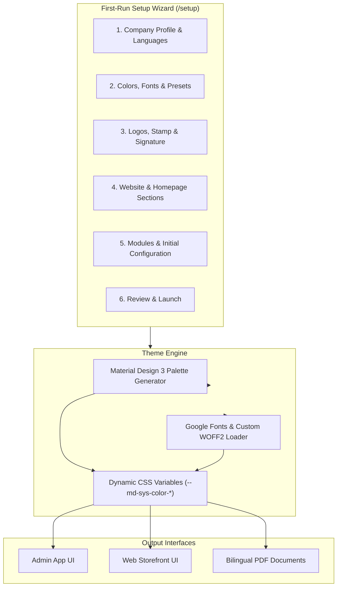
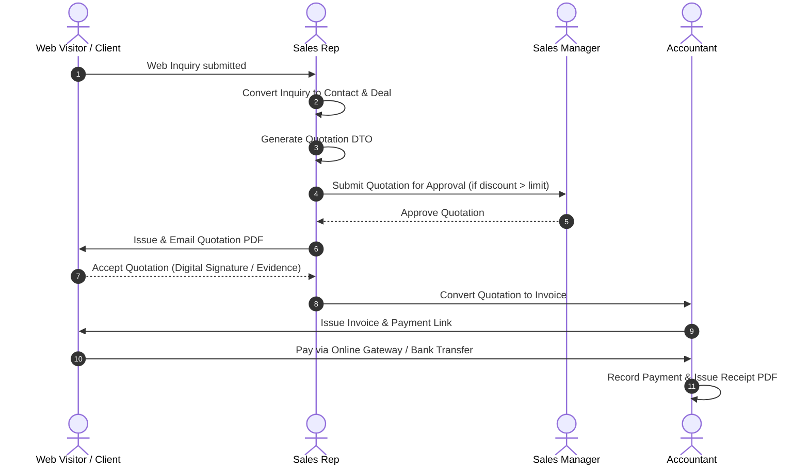
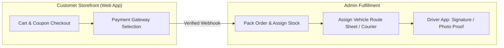

# Platform Feature Overview & Functional Guide

This document details the functional capabilities, business logic, and operational modules available across the platform.

---

## 1. Company Setup & Dynamic Branding

The platform features a complete white-label design engine driven by company profile settings.

### Branding & Theme Customization Capabilities
* **Style Presets**: 22 curated Material Design 3 style presets (light and dark palettes).
* **Typography**: 61 searchable Google Font families, custom uploaded WOFF2/TTF fonts, and script support for Arabic and Latin.
* **Bilingual Support**: Single-language (Arabic or English) or dual-language operational modes.
* **Document Branding**: Custom text logos, dark/light icons, official stamp, manager signature, and printable letterheads applied instantly to all generated PDFs.

---

## 2. Business Modules Overview

Optional modules can be enabled or disabled under **Settings → Modules**. Toggling a module dynamically updates navigation menus, permission structures, and dashboard widgets.

| Module | Core Functional Capabilities | Associated Backend Service |
|---|---|---|
| **CRM & Deals** | Leads, client directory, deal stages, probability, win/loss reasons, and sales outreach. | `sales` |
| **Invoicing & Billing** | Quotation-to-invoice conversion, line items, VAT calculations, discounts, and payment receipts. | `finance` |
| **Finance & Expenses** | Operational expenses, categories, recurring bills, employee claims, and bank settlements. | `finance` |
| **HR & Payroll** | Employee directory, department trees, attendance, leave requests, GOSI, and payroll runs. | `hr` |
| **Workflow & Approvals** | Multi-step approval policies, digital client signatures, official letters, and tasks. | `workflow` |
| **Inventory & Warehouses** | Multi-warehouse tracking, stock locations, variants, batch expiry, and physical stock counts. | `inventory` |
| **E-Commerce Storefront** | Product catalog, cart, coupons, guest checkout, payment gateways, and order management. | `commerce` |
| **Delivery & Logistics** | Delivery zones, time slots, vehicle fleet, driver route sheets, and courier APIs (Aramex, DHL, SMSA). | `delivery` |
| **IT Desk & Archiving** | Support ticket submission, SLA tracking, equipment tracking, and company document archiving. | `itsm`, `files` |

---

## 3. CRM & Invoicing Workflow Lifecycle

---

## 4. Human Resources, GOSI & Payroll Engine

### GOSI Social Insurance Rules
- **Contribution Schedules**: Supports employer and employee percentage schedules with configurable wage ceilings.
- **GCC Schemes**: National and GCC country-to-scheme mappings for cross-border social insurance compliance.
- **Wage Support Programmes**: Salary support subsidies reduce employer costs without reducing employee net pay.

### Payroll Run Execution Steps
1. **Attendance & Leave Processing**: Aggregates attendance entries, overtime hours, shift allowances, and approved leave.
2. **Deductions & Additions**: Applies recurring pay adjustments, sales commissions, and recoveries.
3. **Approval Flow**: Payroll runs move through multi-step approval before payment disbursement.
4. **Payslip & PDF Issuance**: Generates bilingual PDF payslips sent via retrying email or private WhatsApp attachments.

---

## 5. Inventory & Warehouse Management

* **Stock Ledger**: Append-only stock movements (`StockMovement`) guarantee stock levels never drop below zero or consume reserved units.
* **Multi-Warehouse Bins**: Locations defined per warehouse (e.g. Aisle, Shelf, Bin).
* **Weighted Average Cost (WAC)**: Automatically calculates cost of goods sold (COGS) and inventory valuation.
* **Physical Stock Counts**: Full or cycle counts support barcode scanning and generate single reconciliation movement records upon approval.

---

## 6. E-Commerce, Online Payments & Last-Mile Delivery

* **7 Payment Gateways**: Stripe, Tap, PayPal, Checkout.com, PayTabs, Moyasar, and HyperPay integration.
* **Driver Phone App (`/dashboard/driver`)**: Mobile view for delivery drivers to navigate, call customers, record signatures/photos, and collect cash on delivery (COD).
* **Courier Integrations**: Automated booking, shipping labels, and tracking for Aramex, DHL Express, and SMSA.
