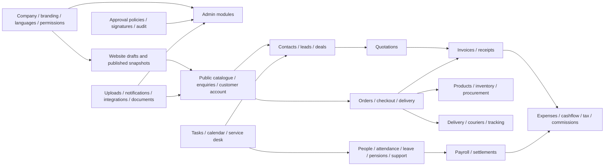

# Platform generalization — implementation ledger

The user requested a module-wide review and edits on 2026-10-28. Playwright, browser automation, E2E, unit and integration tests are deferred until explicit approval. Only source inspection, code generation, lint and TypeScript checks are permitted in this implementation phase.

## Module relationships

| Domain | Source modules | Main relationships and configuration |
| --- | --- | --- |
| Company and access | company-settings, departments, permissions, features, users, sessions, account-security | The company owns branding, currency, country, content languages, modules and roles. These apply to both applications. |
| Website | website, cms-pages, cms-articles, banners, portfolio, services, clients, faqs, reviews, social-links, samples | Draft content becomes a published snapshot. Catalogue names/layout, navigation, blocks, hero, commerce, promotions and appearance are company configuration. |
| CRM and sales | client-profiles, customers, crm, inquiries, deal-pipeline, requests, sales-attribution | Enquiries resolve contact identities, then deals and quotations. Sales ownership flows to invoices and commissions. |
| Finance | quotations, invoices, payments, expenses, expense-claims, recurring-expenses, taxes, finance, finance-reports | New records use the company currency. No rate fetching, conversion or FX surcharge. Historical amounts/currencies remain unchanged. |
| Commerce | store, products, inventory, online-payments, delivery, couriers, shipments | Server prices, inventory, coupons and fulfillment determine orders. Payment callbacks reconcile provider facts. Delivery uses order snapshots. |
| Procurement | procurement, procurement-billing, assets, equipment, fleet | Suppliers → purchase orders → receipts/stock → supplier bills/payments. Shared company currency and validated contact identities apply. |
| People and payroll | hrms, hr-settings, attendance, leave, leave-balances, recurring-pay, payroll, social-insurance, support-programs, support-claims | Dated employment/pension/support rules generate payroll snapshots. Approval, reimbursements and final settlements consume those snapshots. |
| Work management | tasks, calendar, moms, service-desk, dashboard-workload, directory | Assignment, department scope and activity permissions connect staff, clients and deliverables. |
| Governance | approvals, approval-policies, legal, document-signing, signature-policies, signature-requests, official-letters, announcements | State transitions and documents share approval/signature policies, permissions, audit records and retention rules. |
| Communications | marketing, press, social-analytics, social-metrics, integrations, notifications, notify, activity | Provider configuration, templates, audiences and activity records drive delivery; the website reads public content only. |
| Shared infrastructure | attachments, document-archive, company-assets, company-documents, sequence, data-scope, list-pages, reports, report-schedules | Upload ownership, numbering, permissions, pagination and reporting are reused across module boundaries. |

## Decisions and compatibility

- Reference standards belong in shared configuration: country calling codes come from the installed `libphonenumber-js` metadata; the active currency catalogue (excluding the reserved testing/no-currency codes XTS and XXX) comes from the ISO 4217 maintenance agency's [SIX reference](https://www.six-group.com/en/products-services/financial-information/data-standards.html), published 2026-09-17 and retrieved 2026-10-28.
- Company content and business rules belong in database settings. Translation JSON supplies interface copy and safe neutral defaults. Explicit activity presets may supply industry-specific wording only when selected.
- Phone controls show a country selector and national number. New writes are validated and normalized to E.164. Documents use the same compact international representation. Search accepts the digits without `+`.
- Historical database column names and snapshots are compatibility data, not new business policy. Do not drop historical FX tables or rewrite posted amounts merely to remove the feature.
- Currency changes after priced catalogue records, financial documents, payroll obligations or recurring commitments exist must be rejected so existing values cannot be silently relabeled. Pending provider callbacks retain their recorded currency and amount for reconciliation.
- Arabic and English retain their separate existing dictionaries. Additional interface dictionaries each live in one JSON file and inherit missing copy from English. Bilingual business content retains its existing storage and fallback behavior.

## Implementation status

- Shared country/calling-code catalogue, separated phone entry, canonical document/search formatting and database contact validation: implemented.
- Company-currency-only writes, removal of conversion/margins and currency-aware calculations: implemented. New monetary rows require an explicit currency; database defaults no longer silently supply BHD.
- Generic pension/support labels, custom country-to-scheme mappings, visa exemptions and claim periods: implemented. Historical identifiers and snapshots are preserved.
- Twenty interface languages, individual JSON overlays for the 18 added languages and language/copy controls: implemented. Untranslated additional-language copy falls back to English.
- Neutral public defaults, removal of sample testimonials/claims, custom service/resource categories and configurable Material 3 heroes/motion: implemented.
- Source inventory: [all 101 query modules and 731 exported operations](MODULE_INVENTORY.md), including their direct models and peer imports. The schema contains 182 models.
- Static validation: TypeScript and ESLint are the only permitted checks in this phase; results are recorded below. No runtime test result is claimed.

## Source review findings addressed

- Service category filters now come from stored services. Owners may enter custom categories and billing units; the universal media-only lists have been removed. Client legal forms and industries also accept bounded custom values.
- Local client registration/address defaults follow the configured company country. Existing explicit registration countries are preserved. Country-specific registration checks apply only when that country is explicitly known.
- Pension bulk registration uses a database country-to-scheme mapping. Employment authorization exemptions and wage-support claim cadence are configurable. New leaving-indemnity defaults are disabled until configured; existing stored policy values remain intact.
- Monetary precision follows the configured ISO currency in order pricing, payments and payroll calculations. Legacy calculation snapshots without currency preserve their original three-decimal interpretation. The prepared migration expands decimal storage without changing historical values.
- Database contact validation traverses schema-defined contact fields and nested writes, including bulk imports. JSON snapshots and audit history are excluded. E-mail validation checks format and bounds; it does not claim mailbox ownership or deliverability.
- Industry copy is selected explicitly. The neutral base dictionary no longer provides a media-company identity, and the old media wording lives in the optional media activity overlay.
- Existing non-company-currency documents remain readable. New invoices, quotations, payment initiation and manual receipts require the configured company currency; conversion/markup controls and the rate-fetching action have been removed. Old rate/settlement storage remains for history.

## Review and rollout boundary

The migration `20261028060000_general_platform_configuration` is prepared and has not been applied. It adds policy configuration, removes implicit monetary currency defaults, changes defaults for new records and widens existing numeric columns while preserving integer capacity. Apply it before using the changed HR screens or currencies requiring four decimal places. No production or development records were rewritten during this implementation phase.

Unit/contract fixtures were updated alongside the source and must not execute until the user approves testing. The historical E2E outcomes in `WEB_REDESIGN_PROGRESS.md` predate this request and do not validate these edits.

## Static validation and limits

TypeScript completed without diagnostics for the admin, web, database, seed sources, shared UI, locales and email packages, plus the three newly authored unit files. ESLint completed with zero errors and warnings across `apps/admin`, `apps/web` and `packages`. The Prisma client and action/API reference files were regenerated from saved source only.

No unit, integration, browser, Playwright or E2E tests ran. No Next.js production build ran, and no visual or provider behavior is claimed as verified. The prepared migration has not been applied. Once the user approves testing, apply the migration to the intended development/test database before testing the changed HR configuration, explicit currency writes and widened decimal storage.

Historical records, database/API identifiers and provider protocol identifiers remain intact. Standard lifecycle states, permission keys, ISO references and technical validation bounds remain source configuration; company identities, catalogue categories, policy choices and public content are stored settings. Additional languages do not expand the existing bilingual business-data model.
