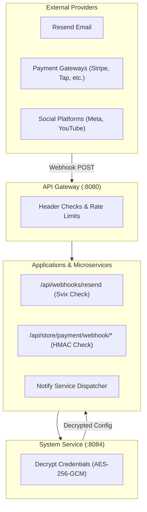

# Third-Party Integrations & External Service Reference

This document provides setup instructions, API specs, security requirements, and verification guidelines for all third-party integrations across the platform.

---

## 1. Integrations Overview & Service Matrix

Integrations are configured via **Settings → Integrations** (Admin App) or the IT Dashboard (`/integrations`). Credentials are encrypted at rest using **AES-256-GCM** via `pkg/secrets` with `ENCRYPTION_KEY`.

| Category | Provider | Purpose | Authentication Method | Webhook / Callback Endpoint |
|---|---|---|---|---|
| **Email** | **Resend** | Transactional & marketing email dispatch. | API Key (`re_...`) | `{admin}/api/webhooks/resend` (Svix signatures) |
| **Messaging** | **WhatsApp Cloud API** | Payslip PDFs, purchase orders, service replies. | Bearer Token & Phone ID | Direct Cloud API HTTPS |
| **OAuth Auth** | **Google Sign-In** | Customer account login on web store. | Client ID & Secret (PKCE) | `{website}/api/account/google/callback` |
| **OAuth Auth** | **Apple ID** | Customer account login on web store. | Service ID & Private Key | `{website}/api/account/apple/callback` |
| **Payment** | **Stripe** | Credit/debit card online checkout. | Secret Key & Webhook Secret | `{website}/api/store/payment/webhook/stripe` |
| **Payment** | **Tap Payments** | GCC cards, MADA, BenefitPay online checkout. | Secret Key & Hash Secret | `{website}/api/store/payment/webhook/tap` |
| **Payment** | **PayPal** | PayPal wallet & international cards. | Client ID & Client Secret | `{website}/api/store/payment/webhook/paypal` |
| **Payment** | **Checkout.com** | International card processing. | Secret Key & Signature Key | `{website}/api/store/payment/webhook/checkout` |
| **Payment** | **PayTabs** | Regional card payment gateway. | Server Key & Profile ID | `{website}/api/store/payment/webhook/paytabs` |
| **Payment** | **Moyasar** | KSA card & MADA checkout. | Secret Key | `{website}/api/store/payment/webhook/moyasar` |
| **Payment** | **HyperPay** | COPYandPAY hosted card frame. | Access Token & Entity ID | `{website}/api/store/payment/webhook/hyperpay` |
| **Logistics** | **Aramex** | Express parcel booking & tracking. | Account Number & Key | Courier API REST Client |
| **Logistics** | **DHL Express** | International parcel shipping. | API Key & Secret | Courier API REST Client |
| **Logistics** | **SMSA Express** | Regional parcel delivery. | PassKey Credential | Courier API REST Client |
| **Social** | **Meta (FB / IG)** | Social metrics & page insights. | Page Access Token & Page ID | Graph API REST Client |
| **Social** | **YouTube** | Public channel stats & owner analytics. | Data API Key & OAuth Token | Data API v3 REST Client |

---

## 2. Integration Webhook Architecture

---

## 3. Detailed Setup Instructions

### 3.1. Resend Email (`resend`)

1. **Verify Domain**: Add and verify your domain DNS records in the Resend dashboard.
2. **Configure API Key**: Copy your Resend API key (`re_...`) and sender email address into **Settings → Integrations**.
3. **Register Webhook**: Add `{admin}/api/webhooks/resend` to Resend Webhooks and copy the signing secret (`whsec_...`).
4. **Verification**: Execute **Test connection** from the IT Dashboard to verify domain status and key permissions.

### 3.2. WhatsApp Cloud API (`whatsapp`)

1. **Prerequisites**: Create a Meta Developer App with WhatsApp Business API enabled.
2. **Configure Credentials**: Copy Phone Number ID, Business Account ID, and Permanent System User Access Token.
3. **Test Dispatch**: Save settings and trigger **Send WhatsApp test message** to an international phone number.

### 3.3. Payment Gateways (Stripe, Tap, PayTabs, HyperPay)

1. **Configure Keys**: Copy Secret Keys, Public Keys, and Merchant IDs into **Settings → Integrations**.
2. **Set Return URL**: Register `{website}/api/store/payment/return` in the gateway merchant dashboard.
3. **Set Webhook URL**: Register `{website}/api/store/payment/webhook/{provider}` in the gateway webhook settings.
4. **Test Connection**: Trigger **Test connection** in the admin panel to verify API key validity.

---

## 4. Security & Encryption Standards

* **AES-256-GCM Key Ring**: Secrets are encrypted at rest with `ENCRYPTION_KEY` using authenticated AES-GCM encryption (`v1.<keyID>.<ciphertext>`).
* **Secret Redaction**: Integration credentials are never returned in full over API endpoints; secrets are returned only as presence flags or 4-character hints.
* **Webhook Deduplication**: Webhooks record delivery IDs in `PaymentWebhookEvent` to ensure atomic, single-execution processing.

---

---

## 5. Detailed Provider Setup Reference Guides (English & Arabic)

### EN Provider Guides

#### Facebook & Instagram (`meta`)

**prerequisites**: A Meta developer app, a Facebook Page you administer, and an Instagram professional account linked to that Page when Instagram is needed.

**permissions**: Page access for the account being read. Request pages_show_list and pages_read_engagement; Instagram access also needs the applicable Instagram basic/insights permissions. Business access and app review depend on your Meta login product.

**environment**: Use accounts assigned to app roles while the app is in development. Public customer accounts require the relevant approved access.

**steps**:
- Obtain a Page access token through your Meta app and copy the Page ID.
- Add the linked Instagram account ID if needed, save and enable this connection.
- Run Test connection, then Sync now. Renew the token when reconnect is requested.

**verify**: Test connection reads the Page identity. A successful sync is required to verify each configured account and its available metrics.

**errors**: Error 190: renew the token. Permission errors: check Page role, token permissions and app access. Respect the retry time on rate limits.

**limits**: Current sync reads public account/post counters. Owner-only reach, impressions and profile views are unavailable. Automatic token renewal and a social OAuth callback are not implemented.

#### WhatsApp Business (`whatsapp`)

**prerequisites**: A WhatsApp Business account, a Cloud API phone number and a Meta business app.

**permissions**: whatsapp_business_management for phone details and whatsapp_business_messaging for sending. Assign the phone number to the token owner.

**environment**: Use the Meta test phone and permitted recipients first. Live requires the registered business phone and appropriate business approval.

**steps**:
- Copy the phone number ID, optional business account ID and an authorized access token.
- Save, enable and run Test connection.
- Send a test only to an agreed recipient using the full international number.

**verify**: Test connection reads phone identity and sends nothing. Send a test message is a separate action that sends real text.

**errors**: Permission denied: check the phone assignment and token. Outside the customer-service window use an approved template through your messaging system.

**limits**: This app currently sends plain test text. Inbound messages, delivery-status webhooks, approved templates and document sending are not implemented here.

#### YouTube (`youtube`)

**prerequisites**: A Google Cloud project with YouTube Data API v3 enabled, the public channel ID, and YouTube Analytics API enabled for owner activity.

**permissions**: The public channel test uses a restricted Data API key. Private owner reports require the channel owner’s OAuth consent for youtube.readonly and yt-analytics.readonly. For automatic refresh, supply the OAuth client ID, client secret and offline refresh token together.

**steps**:
- Create a restricted Data API key and find the channel ID beginning with UC.
- For owner activity, authorize the channel owner through Google’s documented OAuth flow with both read scopes and offline access. A provider-issued owner access token works until it expires; the complete client ID/secret/refresh-token bundle refreshes during sync.
- Save the channel ID and key, optionally add the owner credentials, enable and run Test connection. This connector accepts issued tokens; it does not provide a YouTube OAuth callback route.
- Run Sync now. Check the separate owner-activity panel, its reported date range, timezone and last update. Owner consent must belong to the configured channel.

**verify**: Test connection reads one public channel. Sync verifies private owner access when supplied. Hidden subscriber totals remain unavailable; public subscriber totals can be rounded by YouTube. Actual zeroes are kept; empty or invalid reports are not replaced with zeroes.

**errors**: Invalid key: check Data API enablement and key restrictions. Owner 401/invalid_grant: check credentials or reconnect; 403 insufficientPermissions: enable Analytics API, grant both scopes and verify channel ownership. Google quotaExceeded can be HTTP 403; wait for the shown backoff and check project quota. Provider errors are redacted before display.

**limits**: Owner reports collect views, likes, comments, shares and subscribers gained/lost for 7/30/90/365-day windows ending at the latest reported day. Dates use Pacific time and may lag. Daily observations and period snapshots are retained. Reach, channel impressions, profile views and watch time are not collected by this connector; ad/card impressions are not substitutes. Published-date post filters still use UTC and lifetime counters.

**environment**: These APIs have no separate sandbox. Start with an owned test channel and a Google OAuth test user; public apps can require verification. Monitor the project quota.

#### TikTok (`tiktok`)

**prerequisites**: A TikTok developer app approved for Display API and an account that authorized it.

**permissions**: user.info.basic, user.info.stats and video.list for identity, counters and videos respectively.

**environment**: Follow the TikTok app review and test-account rules. The account token must belong to the intended profile.

**steps**:
- Complete TikTok authorization outside this app and obtain the user access token.
- Save the token, enable and run Test connection.
- Run Sync now; replace expired tokens when the connection requests reconnection.

**verify**: Test connection reads account identity. Statistics and video permissions are exercised during sync.

**errors**: 401/invalid token: renew authorization. Missing scope: request the required approved scope. 429: wait for the displayed retry window.

**limits**: Token refresh and an in-app TikTok OAuth callback are not implemented. Missing counters stay unavailable; a token alone does not grant every metric.

#### X (Twitter) (`x`)

**prerequisites**: An X developer project with API access that permits user lookup and user timeline reads.

**permissions**: An authorized app bearer token and the intended username. Endpoint availability and limits depend on the subscribed access tier.

**environment**: The same API serves test and live reads. Use an owned public profile first; reads consume the project allowance.

**steps**:
- Copy the project bearer token and enter the username without @.
- Save, enable and run Test connection.
- Sync posts and available public metrics using Sync now.

**verify**: Test connection looks up the username and reports the returned account identity.

**errors**: 403: confirm endpoint entitlement and account visibility. 401: replace the token. 429: wait for the provider reset time.

**limits**: Public counters only; private impressions and account owner insights are unavailable. Large timelines can hit the displayed page limit.

#### LinkedIn (`linkedin`)

**prerequisites**: A LinkedIn developer app with the relevant Community Management product access and an organization administrator.

**permissions**: Approved organization access for the networkSizes organization-follower endpoint. Confirm the current permissions for your granted product; older scopes alone may be insufficient.

**environment**: Use an organization the authorizing administrator manages. Organization access may require LinkedIn product approval.

**steps**:
- Obtain the organization ID and a user access token authorized for that organization.
- Save, enable and run Test connection.
- Run Sync now to store the available follower total.

**verify**: The check reads organization identity; sync reads organization follower network size. Requests pin LinkedIn version 202609.

**errors**: 403: check organization administration, approved product and token scopes. 401: obtain a current token. Version errors require an adapter review.

**limits**: The current adapter imports follower totals only. Post performance, impressions, reach, automatic renewal and an in-app authorization callback are not implemented.

#### Resend e-mail (`resend`)

**prerequisites**: A Resend account, verified sending domain and sender address on that domain.

**permissions**: The delivery key needs email sending access. The current domain-verification check additionally needs domain-read access; a sending-only key cannot pass that check.

**environment**: Use an owned test recipient before enabling live jobs. A connection test does not send an email.

**steps**:
- Verify the domain DNS in Resend, then save the API key and sender email here.
- Optionally register the admin webhook address below and save its signing secret for delivery events.
- Enable and test. The notify service sends every e-mail with these credentials; send a test from IT dashboard → Notifications, then verify the signed webhook.

**verify**: Test connection lists domains and verifies the sender domain. Actual delivery, idempotency and signed webhooks are separate checks.

**errors**: 403 with a sending-only key can mean the domain check is unauthorized, even if delivery works. Unverified domain: complete DNS verification. Signature errors: copy the webhook signing secret.

**limits**: Only the saved integration sends e-mail; environment keys are no longer read. Disconnecting makes queued e-mail fail until it is reconnected and sent again from Notifications. The connection test does not prove delivery: send a test message for that.

#### Sign in with Google (`google_signin`)

**prerequisites**: A Google Cloud OAuth web application, consent configuration and the website public domain.

**permissions**: openid, email and profile. Add test users while the consent app is in testing.

**environment**: Use a web OAuth client. Register the exact callback below for each environment; live needs a public HTTPS website.

**steps**:
- Create the web client and register the displayed callback as an authorized redirect URI.
- Copy client ID and client secret here, save and enable.
- Run Test connection, then complete a real customer sign-in on the website in a private browser window.

**verify**: The connection check validates credential format and provider availability. Only a completed sign-in proves the secret, consent and redirect configuration.

**errors**: redirect_uri_mismatch: compare scheme, host and complete path. invalid_client: verify the web client secret. access_denied: check consent status/test users.

**limits**: This connects customer website sign-in. It does not grant YouTube owner analytics, calendar access or an administrator login.

#### Sign in with Apple (`apple_signin`)

**prerequisites**: An Apple Developer team, a primary App ID enabled for Sign in with Apple, and an associated Services ID for this website.

**permissions**: Enable Sign in with Apple for the primary app and its key. Configure the website domains and exact return URL on the Services ID.

**environment**: Use the website Services ID, not an app bundle ID. Apple web return URLs require the registered public HTTPS domain.

**steps**:
- Register the website domain and displayed callback on the Services ID.
- Enter Services ID, Team ID and Key ID; select the downloaded .p8 private key file, then save and enable.
- Run Test connection, then complete an actual website sign-in to verify the team/domain association.

**verify**: The check validates key signing/identifier format and provider availability. A real browser sign-in is required to verify Apple account configuration.

**errors**: invalid_client: check all IDs and that the key belongs to the team/app. Invalid redirect: compare the registered HTTPS return URL. Relay email requires registered sending sources.

**limits**: The private key is encrypted and never returned in full after saving. Apple app/team approval and private relay email setup remain external account tasks.

#### Stripe (`stripe`)

**prerequisites**: A Stripe account with the intended currency and payment methods enabled.

**permissions**: A server secret key and a signing secret for the website webhook endpoint. Restricted keys need checkout, payment reads and refund permissions.

**environment**: Use sk_test_ keys and test webhooks first. Live keys create real charges; wallet availability depends on the merchant account and domain.

**steps**:
- Create the webhook below for checkout.session.completed, checkout.session.async_payment_succeeded and checkout.session.async_payment_failed.
- Save the server key and that endpoint signing secret, enable and test.
- Choose Stripe in Store settings, then complete a test checkout, webhook replay and refund before going live.

**verify**: Test connection reads account access without charging. Checkout, wallet presentation, event verification and refund acceptance need sandbox transactions. Orders with an unverified captured reference, amount or currency stay in review. Use Recheck payment after fixing the connection; do not charge again.

**errors**: 401: verify the server key/environment. Signature error: use the endpoint secret from the matching mode. Disabled payment methods need account activation.

**limits**: Card details stay on Stripe hosted checkout. A healthy credential check does not prove Apple Pay, Google Pay or every settlement currency is enabled.

#### Tap Payments (`tap`)

**prerequisites**: A Tap merchant account with the required cards/wallets and currencies approved.

**permissions**: The server secret key for the correct merchant environment. Never use a publishable key here.

**environment**: sk_test_ identifies test credentials. Live credentials can charge real customers; available local methods depend on the approved account.

**steps**:
- Save the merchant secret key, enable and run Test connection.
- Select Tap in Store settings; the app supplies the notification URL for each charge.
- Complete a sandbox checkout, signed notification and refund for each enabled method.

**verify**: The connection check is a non-charging account request. Tap notifications are verified using the secret key. Orders with an unverified captured reference, amount or currency stay in review. Use Recheck payment after fixing the connection; do not charge again.

**errors**: Unauthorized: confirm the secret key. Missing methods/currency: request merchant activation. Signature mismatch: use the key matching the charge.

**limits**: BenefitPay, mada, KNET and wallets appear only when Tap enables them for the merchant. Browser return alone does not prove settlement.

#### PayPal (`paypal`)

**prerequisites**: A PayPal REST app, sandbox business account and supported settlement currency.

**permissions**: Client ID/secret for the selected environment and webhook ID for that app/environment.

**environment**: Enter sandbox for test accounts, live for live. PayPal does not support every store currency; verify its current currency list before enabling.

**steps**:
- Create a webhook at the URL below for CHECKOUT.ORDER.APPROVED and PAYMENT.CAPTURE completed/denied events.
- Save the matching client credentials, environment and webhook ID, then test.
- Select PayPal in Store settings and verify sandbox approval, capture, webhook replay and refund.

**verify**: Test connection obtains an application access token. Payment settlement is recorded only after capture confirmation. Orders with an unverified captured reference, amount or currency stay in review. Use Recheck payment after fixing the connection; do not charge again.

**errors**: invalid_client: match app keys and environment. Webhook verification failure: check webhook ID. Unsupported currency requires another gateway or store currency.

**limits**: Supported currencies, cards and wallets depend on merchant region and gateway configuration.

#### Checkout.com (`checkout_com`)

**prerequisites**: A Checkout.com account, processing channel and the account API hostname from its dashboard.

**permissions**: A server secret key authorized for hosted payments, reads and refunds, plus the webhook signing secret.

**environment**: Use sandbox or live and its matching keys/channel. If the API host is account123.api.sandbox.checkout.com, API prefix is account123 only.

**steps**:
- Configure the webhook below for payment_captured, payment_declined, payment_expired and payment_capture_declined.
- Save environment, API prefix if assigned, key, channel, billing country and signing secret.
- Test, select this gateway in Store settings, then verify sandbox checkout, notifications and refunds.

**verify**: Test connection performs a read-only payment query. Billing country is an ISO two-letter code such as BH. Orders with an unverified captured reference, amount or currency stay in review. Use Recheck payment after fixing the connection; do not charge again.

**errors**: 401/403: check key permissions and processing channel. Host errors: copy only the account prefix. Signature mismatch: check the matching endpoint secret.

**limits**: An omitted API prefix retains the legacy host for existing accounts. Merchant-specific wallet and payment-method activation still needs sandbox acceptance.

#### PayTabs (`paytabs`)

**prerequisites**: A PayTabs merchant profile and its regional endpoint/server key.

**permissions**: The profile ID and server key issued for the same regional merchant profile.

**environment**: The merchant profile controls test/live behavior. The app cannot infer a test profile from its key; verify the profile mode in PayTabs before charging.

**steps**:
- Choose the regional code: SAU, ARE, EGY, OMN, JOR, IRQ, KWT, MAR, QAT or GLOBAL as appropriate for the issued endpoint.
- Save region, profile ID and server key, enable and test.
- Select PayTabs in Store settings. The app adds the callback per payment; verify a test-profile checkout and refund.

**verify**: Test connection runs a transaction query without creating a charge. A no-record/provider error is reported as an error rather than a successful credential test. Orders with an unverified captured reference, amount or currency stay in review. Use Recheck payment after fixing the connection; do not charge again.

**errors**: Unauthorized: verify regional host, profile and server key together. Signature mismatch: use the profile server key. No-record query results need account-backed verification.

**limits**: Confirm test mode with PayTabs directly. Browser return signatures and raw callback signatures are distinct; callback verification is handled by the adapter.

#### Moyasar (`moyasar`)

**prerequisites**: A Moyasar account with hosted invoices and the intended currency/method enabled.

**permissions**: A server secret key and the webhook secret token configured in the dashboard.

**environment**: sk_test_ identifies test keys. Verify the merchant-supported currency and invoice minimum before selecting this gateway.

**steps**:
- Register the webhook below for payment success/failure events and save its secret token.
- Save the server key, enable and run Test connection.
- Select Moyasar in Store settings, then verify a test invoice, payment event and refund.

**verify**: Test connection reads invoice access. The invoice success URL is a browser return; invoice callback_url is not pointed at that browser handler. Orders with an unverified captured reference, amount or currency stay in review. Use Recheck payment after fixing the connection; do not charge again.

**errors**: 401: verify the secret key. Secret-token mismatch: check the webhook setting. Small amounts/currency restrictions require an accepted amount or another gateway.

**limits**: Invoice creation and payment notifications are separate contracts. The app relies on the configured verified payment webhook for settlement notifications.

#### HyperPay (`hyperpay`)

**prerequisites**: A HyperPay entity, bearer token, approved brands and webhook encryption key.

**permissions**: Entity access for checkout, payment status and refunds; the 64-character hexadecimal webhook key issued for this entity.

**environment**: Use test with test entity credentials, then live with the approved live entity. Approved wallet/brand configuration is account-specific.

**steps**:
- Register the website webhook below in HyperPay and obtain its encryption key.
- Save environment, entity, token, space-separated brands and webhook key, then test.
- Select HyperPay in Store settings and verify hosted widget, encrypted notification and refund in test mode.

**verify**: The test performs a non-charging entity request. Status errors stay unavailable and do not cancel unresolved remote payments. Orders with an unverified captured reference, amount or currency stay in review. Use Recheck payment after fixing the connection; do not charge again.

**errors**: Unauthorized: match entity/token/environment. Decryption errors: check the 32-byte hex key. Excess amount precision: choose another payment method.

**limits**: The current COPYandPAY contract accepts two decimal places. Amounts exceeding accepted precision are rejected before checkout/refund, rather than rounded. Widget/wallet availability needs merchant acceptance.

#### Aramex (`aramex`)

**prerequisites**: An Aramex API-enabled shipping account with sender details and test/live credentials.

**permissions**: API username/password, account number/PIN, account entity and account country for the same account.

**environment**: Use test credentials with test and approved live credentials with live. A tracking check does not buy a label.

**steps**:
- Obtain account credentials from Aramex and confirm the account entity/country.
- Save all fields, enable and run Test connection.
- Verify a controlled booking, returned tracking/label and tracking updates with Aramex before using live shipments.

**verify**: The connection check sends a non-booking tracking query. Account and internal service errors are reported as failures.

**errors**: ERR01: credentials. ERR02: account. ERR03: blocked account. ERR00: provider/internal failure; retry after resolving the service issue. If a booking outcome is uncertain, reconcile the shipment reference with the original carrier before recording tracking or approving a retry.

**limits**: Automatic booking supports one measured parcel. For several parcels, book in the carrier portal and record its tracking number here. Account/product acceptance still needs Aramex verification. Tracking is polled; no inbound courier callback is implemented.

#### DHL Express (`dhl_express`)

**prerequisites**: A DHL Express account, MyDHL API application and approved sender/product details.

**permissions**: The API key/secret used for Basic authentication and the shipping account number.

**environment**: Use test for the MyDHL test endpoint and live only after DHL live approval. Both key and secret are masked after saving.

**steps**:
- Obtain the MyDHL key/secret and shipping account number.
- Save the matching environment and credentials, enable and test.
- Before live use, validate a measured parcel, address, product, label and tracking flow against your DHL contract.

**verify**: Test connection calls a non-booking endpoint. It does not establish label purchase or product/country eligibility.

**errors**: 401: check key/secret and endpoint. Account/product errors: confirm the DHL account entitlement and shipping lane. If a booking outcome is uncertain, reconcile the shipment reference with the original carrier before recording tracking or approving a retry.

**limits**: Automatic booking requires the measured weight, length, width and height of one parcel. For several parcels, use the DHL portal and record its tracking number. Account/product acceptance needs DHL verification. Tracking is polled; no inbound DHL webhook is implemented.

#### SMSA Express (`smsa`)

**prerequisites**: An SMSA API-enabled merchant account and the API contract/credentials issued by SMSA.

**permissions**: The account API key authorized for the implemented eCommerce endpoints.

**environment**: Confirm the test/live endpoint and key with SMSA. Do not assume a live key is safe for test shipments.

**steps**:
- Obtain the API key and confirm the eCommerce contract/version with SMSA.
- Save the agreed environment and key, enable and test.
- Verify controlled booking, tracking response and label behavior with SMSA before live use.

**verify**: The test sends a non-booking tracking query and validates its response. Network errors and unsupported response shapes fail.

**errors**: Unauthorized: check the key and environment. No-record errors do not prove authentication; confirm the account using an agreed test tracking number. If a booking outcome is uncertain, reconcile the shipment reference with the original carrier before recording tracking or approving a retry.

**limits**: Automatic booking requires the measured weight of one parcel. For several parcels, use the carrier portal and record its tracking number. The issued SMSA contract and label flow still need account-backed acceptance. Tracking is polled; no inbound webhook is implemented.

### AR Provider Guides

#### فيسبوك وإنستغرام (`meta`)

**prerequisites**: تطبيق مطور لدى Meta وصفحة فيسبوك تديرها، وحساب إنستغرام احترافي مرتبط بالصفحة عند الحاجة إليه.

**permissions**: صلاحية قراءة الصفحة المقصودة. اطلب pages_show_list وpages_read_engagement وصلاحيات إنستغرام الأساسية والإحصائية المناسبة لمنتج تسجيل الدخول. قد تلزم مراجعة التطبيق وصلاحيات الأعمال.

**environment**: استخدم حسابات أدوار التطبيق في وضع التطوير. تتطلب حسابات العملاء العامة الموافقات المناسبة.

**steps**:
- استخرج رمز وصول للصفحة ومعرّفها من تطبيق Meta.
- أضف معرّف حساب إنستغرام المرتبط عند الحاجة، ثم احفظ وفعّل الاتصال.
- اختبر الاتصال ثم زامن الآن. جدّد الرمز عند طلب إعادة الاتصال.

**verify**: يقرأ الاختبار هوية الصفحة. يلزم نجاح المزامنة للتحقق من كل حساب ومقاييسه المتاحة.

**errors**: الخطأ 190: جدّد الرمز. أخطاء الصلاحيات: راجع دور الصفحة وصلاحيات الرمز وموافقات التطبيق. انتظر موعد إعادة المحاولة عند بلوغ الحد.

**limits**: تُجلب حاليًا عدادات الحساب والمنشورات العامة. الوصول ومرات الظهور وزيارات الملف الخاصة بالمالك غير متاحة. التجديد التلقائي ومسار OAuth اجتماعي غير مطبقين.

#### واتساب للأعمال (`whatsapp`)

**prerequisites**: حساب واتساب للأعمال ورقم Cloud API وتطبيق أعمال لدى Meta.

**permissions**: whatsapp_business_management لبيانات الرقم وwhatsapp_business_messaging للإرسال. اربط الرقم بمالك الرمز.

**environment**: ابدأ برقم Meta التجريبي والمستلمين المسموحين. يتطلب التشغيل الفعلي رقم الأعمال المسجل وموافقاته.

**steps**:
- انسخ معرّف الرقم ومعرّف حساب الأعمال الاختياري ورمز الوصول المصرّح.
- احفظ وفعّل ثم اختبر الاتصال.
- أرسل تجربة فقط إلى مستلم متفق معه وبالرقم الدولي الكامل.

**verify**: يقرأ اختبار الاتصال هوية الرقم ولا يرسل رسالة. إرسال رسالة تجريبية إجراء منفصل يرسل نصًا فعليًا.

**errors**: رفض الصلاحية: راجع ربط الرقم والرمز. خارج نافذة خدمة العميل استخدم قالبًا معتمدًا عبر نظام المراسلة لديك.

**limits**: التطبيق يرسل حاليًا نص التجربة فقط. استقبال الرسائل وإشعارات التسليم والقوالب المعتمدة وإرسال المستندات غير مطبقة هنا.

#### يوتيوب (`youtube`)

**prerequisites**: مشروع Google Cloud مفعّل عليه YouTube Data API v3 ومعرّف القناة العامة، مع تفعيل YouTube Analytics API لنشاط المالك.

**permissions**: يستخدم اختبار القناة العامة مفتاح Data API مقيّدًا. تتطلب تقارير المالك الخاصة موافقة مالك القناة عبر OAuth لنطاقَي youtube.readonly وyt-analytics.readonly. للتحديث التلقائي، أدخل معرّف عميل OAuth وسرّه ورمز التحديث للوصول دون اتصال معًا.

**steps**:
- أنشئ مفتاح Data API مقيّدًا وابحث عن معرّف القناة الذي يبدأ بـ UC.
- لنشاط المالك، فوّض مالك القناة باتّباع تدفّق OAuth الموثّق من Google مع نطاقَي القراءة والوصول دون اتصال. يعمل رمز الوصول الصادر من المزوّد حتى انتهاء صلاحيته؛ وتتيح بيانات معرّف العميل وسرّه ورمز التحديث معًا التجديد أثناء المزامنة.
- احفظ معرّف القناة والمفتاح، وأضف بيانات المالك اختياريًا ثم فعّل واختبر الاتصال. يقبل هذا الموصّل الرموز الصادرة مسبقًا ولا يوفّر مسار ردّ OAuth لـ YouTube.
- اختر المزامنة الآن وراجع لوحة نشاط المالك المنفصلة وفترة بياناتها وتوقيتها وآخر تحديث. يجب أن تكون الموافقة لمالك القناة المحدّدة.

**verify**: يقرأ اختبار الاتصال قناة عامة واحدة. وتتحقّق المزامنة من وصول المالك الخاص عند إدخاله. يبقى عدد المشتركين المخفي غير متاح وقد يقرّب YouTube العدد العام. تُحفظ القيم الصفرية الفعلية ولا تُستبدل التقارير الفارغة أو غير الصالحة بأصفار.

**errors**: المفتاح غير صالح: تحقّق من تفعيل Data API وقيود المفتاح. خطأ المالك 401 أو invalid_grant: راجع البيانات أو أعد الربط؛ وخطأ 403 insufficientPermissions: فعّل Analytics API وامنح النطاقَين وتحقّق من ملكية القناة. قد يأتي quotaExceeded من Google برمز HTTP 403؛ انتظر المهلة المعروضة وراجع حصة المشروع. تُحجب الأسرار من أخطاء المزوّد قبل عرضها.

**limits**: تجمع تقارير المالك المشاهدات والإعجابات والتعليقات والمشاركات والمشتركين الجدد والمفقودين لفترات 7/30/90/365 يومًا تنتهي بآخر يوم مُبلّغ عنه. تتبع التواريخ توقيت المحيط الهادئ وقد تتأخر. تُحفظ القراءات اليومية ولقطات الفترات. لا يجمع هذا الموصّل الوصول ومرّات ظهور القناة وزيارات الملف ووقت المشاهدة؛ ولا تُستخدم مرّات ظهور الإعلانات أو البطاقات بدلًا منها. تبقى مرشّحات تاريخ المنشورات بتوقيت UTC والعدّادات تراكمية.

**environment**: لا توجد بيئة اختبار منفصلة لهذه الواجهات. ابدأ بقناة اختبار تملكها ومستخدم اختبار في Google OAuth؛ وقد تحتاج التطبيقات العامة إلى التحقّق. راقب حصة المشروع.

#### تيك توك (`tiktok`)

**prerequisites**: تطبيق TikTok معتمد لاستخدام Display API وحساب صرّح له بالوصول.

**permissions**: user.info.basic وuser.info.stats وvideo.list للهوية والعدادات والمقاطع على الترتيب.

**environment**: اتبع قواعد مراجعة التطبيق وحسابات الاختبار. يجب أن يخص الرمز الملف المطلوب.

**steps**:
- أكمل تصريح TikTok خارج التطبيق واحصل على رمز وصول المستخدم.
- احفظ الرمز وفعّل واختبر الاتصال.
- زامن الآن واستبدل الرموز المنتهية عند طلب إعادة الاتصال.

**verify**: يقرأ الاختبار هوية الحساب. تُختبر صلاحيات الإحصاءات والمقاطع أثناء المزامنة.

**errors**: 401 أو رمز غير صالح: جدّد التصريح. صلاحية ناقصة: اطلب الصلاحية المعتمدة. 429: انتظر الموعد المعروض.

**limits**: تجديد الرمز ومسار OAuth داخل التطبيق غير مطبقين. تبقى العدادات الناقصة غير متاحة؛ وجود رمز لا يمنح كل المقاييس.

#### إكس (تويتر) (`x`)

**prerequisites**: مشروع مطور X باشتراك يسمح بقراءة المستخدم ومنشوراته.

**permissions**: رمز Bearer للتطبيق واسم المستخدم المطلوب. تختلف إتاحة المسارات وحدودها حسب الاشتراك.

**environment**: تستخدم القراءة الواجهة نفسها للاختبار والتشغيل الفعلي. ابدأ بملف عام تملكه؛ القراءة تستهلك حصة المشروع.

**steps**:
- انسخ رمز المشروع وأدخل اسم المستخدم دون @.
- احفظ وفعّل واختبر الاتصال.
- زامن المنشورات والمقاييس العامة المتاحة عبر زامن الآن.

**verify**: يبحث الاختبار عن اسم المستخدم ويعرض هوية الحساب المسترجعة.

**errors**: 403: راجع إتاحة المسار وظهور الحساب. 401: استبدل الرمز. 429: انتظر موعد إعادة المحاولة لدى المنصة.

**limits**: عدادات عامة فقط؛ إحصاءات المالك ومرات الظهور الخاصة غير متاحة. قد تصل الحسابات الكبيرة إلى حد الصفحات المعروض.

#### لينكدإن (`linkedin`)

**prerequisites**: تطبيق LinkedIn حاصل على وصول Community Management المناسب ومسؤول عن المؤسسة.

**permissions**: وصول معتمد للمؤسسة ومسار networkSizes لعدد المتابعين. راجع صلاحيات المنتج الممنوح؛ قد لا تكفي الصلاحيات القديمة.

**environment**: استخدم مؤسسة يديرها صاحب التصريح. قد يحتاج الوصول إلى موافقة منتج من LinkedIn.

**steps**:
- احصل على معرّف المؤسسة ورمز مستخدم مخوّل لها.
- احفظ وفعّل واختبر الاتصال.
- زامن الآن لحفظ عدد المتابعين المتاح.

**verify**: يفحص الاختبار هوية المؤسسة، وتقرأ المزامنة حجم شبكة متابعيها. تستخدم الطلبات إصدار LinkedIn 202609.

**errors**: 403: راجع إدارة المؤسسة والمنتج المعتمد وصلاحيات الرمز. 401: جدّد الرمز. خطأ الإصدار يتطلب مراجعة الموصّل.

**limits**: الموصّل الحالي يجلب المتابعين فقط. أداء المنشورات والظهور والوصول وتجديد الرمز ومسار التصريح داخل التطبيق غير مطبقة.

#### بريد Resend (`resend`)

**prerequisites**: حساب Resend ونطاق إرسال موثّق وعنوان مرسل على ذلك النطاق.

**permissions**: يلزم مفتاح بصلاحية الإرسال. يتطلب فحص النطاق الحالي صلاحية قراءته أيضًا؛ لا يجتاز مفتاح الإرسال فقط هذا الفحص.

**environment**: استخدم مستلمًا تجريبيًا تملكه قبل تشغيل مهام التشغيل الفعلي. اختبار الاتصال لا يرسل بريدًا.

**steps**:
- وثّق DNS للنطاق لدى Resend ثم احفظ المفتاح وعنوان المرسل هنا.
- سجّل اختياريًا عنوان إشعارات الإدارة أدناه واحفظ سر التوقيع لأحداث التسليم.
- فعّل واختبر. ترسل خدمة الإشعارات كل بريد بهذه البيانات؛ أرسل رسالة تجريبية من لوحة تقنية المعلومات ← الإشعارات، ثم تحقّق من الإشعار الموقّع.

**verify**: يسرد الاختبار النطاقات ويتحقق من نطاق المرسل. التسليم ومنع التكرار والإشعارات الموقّعة اختبارات منفصلة.

**errors**: قد يعني 403 مع مفتاح الإرسال فقط غياب صلاحية فحص النطاق رغم صلاحية الإرسال. أكمل DNS للنطاق غير الموثق، وراجع سر التوقيع لأخطاء الإشعارات.

**limits**: التكامل المحفوظ وحده يرسل البريد؛ لم تعد مفاتيح البيئة تُقرأ. قطع الاتصال يجعل الرسائل المنتظرة تفشل حتى يُعاد الاتصال وتُرسل مجدداً من صفحة الإشعارات. اختبار الاتصال لا يثبت التسليم: أرسل رسالة تجريبية لذلك.

#### تسجيل الدخول بحساب Google (`google_signin`)

**prerequisites**: تطبيق OAuth للويب لدى Google Cloud وإعداد الموافقة والنطاق العام للموقع.

**permissions**: openid وemail وprofile. أضف المستخدمين التجريبيين عندما يكون تطبيق الموافقة قيد الاختبار.

**environment**: استخدم عميل ويب وسجّل عنوان العودة المطابق لكل بيئة. يلزم موقع HTTPS عام للتشغيل فعلي.

**steps**:
- أنشئ عميل ويب وسجّل عنوان العودة المعروض ضمن عناوين إعادة التوجيه المسموحة.
- احفظ معرّف العميل وسره هنا وفعّل الاتصال.
- اختبر الاتصال ثم أكمل تسجيل دخول عميل فعلي من الموقع في نافذة خاصة.

**verify**: يفحص الاتصال صيغة البيانات وتوفر المنصة. وحده تسجيل الدخول المكتمل يثبت السر والموافقة وعنوان العودة.

**errors**: redirect_uri_mismatch: طابق البروتوكول والمضيف والمسار كاملًا. invalid_client: راجع سر عميل الويب. access_denied: راجع الموافقة والمستخدمين التجريبيين.

**limits**: هذا لتسجيل دخول عملاء الموقع. لا يمنح تحليلات مالك يوتيوب أو وصول التقويم أو دخول الإدارة.

#### تسجيل الدخول بحساب Apple (`apple_signin`)

**prerequisites**: فريق Apple Developer ومعرّف تطبيق أساسي مفعّل عليه Sign in with Apple ومعرّف خدمات مرتبط بالموقع.

**permissions**: فعّل تسجيل الدخول على التطبيق الأساسي ومفتاحه، واضبط نطاقات الموقع وعنوان العودة المطابق على معرّف الخدمات.

**environment**: استخدم معرّف خدمات الموقع لا معرّف حزمة التطبيق. تتطلب عناوين العودة نطاق HTTPS العام المسجل.

**steps**:
- سجّل نطاق الموقع وعنوان العودة المعروض على معرّف الخدمات.
- أدخل معرّف الخدمات والفريق والمفتاح واختر ملف المفتاح الخاص .p8، ثم احفظ وفعّل.
- اختبر الاتصال ثم أكمل دخولًا فعليًا من الموقع للتحقق من ربط الفريق والنطاق.

**verify**: يفحص الاختبار توقيع المفتاح وصيغة المعرّفات وتوفر المنصة. يلزم دخول فعلي للتحقق من إعداد حساب Apple.

**errors**: invalid_client: طابق المعرّفات وانتماء المفتاح للفريق والتطبيق. راجع عنوان HTTPS لأخطاء العودة. بريد الترحيل يحتاج مصادر إرسال مسجلة.

**limits**: يُشفّر المفتاح ولا يعاد عرضه كاملًا بعد الحفظ. موافقات Apple والفريق وإعداد بريد الترحيل مهام خارجية على الحساب.

#### Stripe (`stripe`)

**prerequisites**: حساب Stripe مع تفعيل العملة وطرق الدفع المطلوبة.

**permissions**: مفتاح خادم سري وسر توقيع لإشعارات الموقع. تحتاج المفاتيح المقيّدة صلاحيات إتمام الدفع والقراءة والاسترداد.

**environment**: ابدأ بمفاتيح sk_test_ وإشعارات الاختبار. المفاتيح الحية تخصم فعليًا؛ توفر المحافظ يعتمد على حساب التاجر ونطاقه.

**steps**:
- أنشئ عنوان الإشعارات أدناه لأحداث checkout.session.completed وcheckout.session.async_payment_succeeded وcheckout.session.async_payment_failed.
- احفظ مفتاح الخادم وسر توقيع ذلك العنوان وفعّل واختبر.
- اختر Stripe في إعدادات المتجر ثم اختبر الدفع وإعادة إرسال الإشعار والاسترداد قبل التشغيل الفعلي.

**verify**: يقرأ الاختبار وصول الحساب دون خصم. الدفع والمحافظ والتوقيع والاسترداد تتطلب معاملات تجريبية. تبقى الدفعات ذات مرجع أو مبلغ أو عملة غير متحقق منها قيد المراجعة. استخدم إعادة فحص الدفع بعد تصحيح الاتصال ولا تخصم مجددًا.

**errors**: 401: راجع مفتاح الخادم وبيئته. خطأ التوقيع: استخدم سر العنوان في الوضع المطابق. طرق الدفع غير المتاحة تحتاج تفعيل الحساب.

**limits**: تبقى بيانات البطاقة في صفحة Stripe المستضافة. نجاح فحص المفتاح لا يثبت تفعيل Apple Pay أو Google Pay أو كل عملات التسوية.

#### Tap Payments (`tap`)

**prerequisites**: حساب تاجر Tap مع اعتماد البطاقات والمحافظ والعملات المطلوبة.

**permissions**: مفتاح الخادم السري لبيئة التاجر الصحيحة. لا تستخدم المفتاح القابل للنشر هنا.

**environment**: تُعرف مفاتيح الاختبار ببادئة sk_test_. المفاتيح الحية تخصم فعليًا؛ تختلف الطرق المحلية حسب اعتماد الحساب.

**steps**:
- احفظ مفتاح التاجر وفعّل واختبر الاتصال.
- اختر Tap في إعدادات المتجر؛ يرفق التطبيق عنوان الإشعار مع كل عملية.
- اختبر الدفع والإشعار الموقّع والاسترداد لكل طريقة مفعلة في البيئة التجريبية.

**verify**: يفحص الاتصال الحساب دون إنشاء خصم. تتحقق الإشعارات باستخدام المفتاح السري. تبقى الدفعات ذات مرجع أو مبلغ أو عملة غير متحقق منها قيد المراجعة. استخدم إعادة فحص الدفع بعد تصحيح الاتصال ولا تخصم مجددًا.

**errors**: رفض التصريح: راجع المفتاح السري. طرق أو عملات ناقصة: اطلب تفعيل التاجر. خطأ التوقيع: طابق مفتاح العملية.

**limits**: لا تظهر BenefitPay وmada وKNET والمحافظ إلا بتفعيلها لدى Tap. عودة المتصفح وحدها لا تثبت التسوية.

#### PayPal (`paypal`)

**prerequisites**: تطبيق PayPal REST وحساب أعمال تجريبي وعملة تسوية مدعومة.

**permissions**: معرّف العميل وسره ومعرّف إشعارات للتطبيق والبيئة نفسيهما.

**environment**: أدخل sandbox للاختبار وlive للتشغيل فعلي. ليست كل عملات المتجر مدعومة؛ راجع قائمة العملات الحالية قبل التفعيل.

**steps**:
- أنشئ إشعارًا بالعنوان أدناه لأحداث CHECKOUT.ORDER.APPROVED وأحداث اكتمال أو رفض PAYMENT.CAPTURE.
- احفظ بيانات العميل والبيئة ومعرّف الإشعار المطابقة ثم اختبر.
- اختر PayPal في المتجر واختبر الموافقة والتحصيل وإعادة الإشعار والاسترداد تجريبيًا.

**verify**: يستخرج الاختبار رمز وصول للتطبيق. لا تُسجّل التسوية إلا بعد تأكيد التحصيل. تبقى الدفعات ذات مرجع أو مبلغ أو عملة غير متحقق منها قيد المراجعة. استخدم إعادة فحص الدفع بعد تصحيح الاتصال ولا تخصم مجددًا.

**errors**: invalid_client: طابق مفاتيح التطبيق والبيئة. فشل التحقق من الإشعار: راجع معرّفه. العملة غير المدعومة تتطلب بوابة أو عملة أخرى.

**limits**: تتغير العملات والبطاقات والمحافظ المتاحة حسب إعدادات بوابة الدفع وحساب التاجر.

#### Checkout.com (`checkout_com`)

**prerequisites**: حساب Checkout.com وقناة معالجة واسم مضيف API الخاص بالحساب من لوحة التحكم.

**permissions**: مفتاح خادم لصفحات الدفع والقراءة والاسترداد، مع سر توقيع الإشعارات.

**environment**: استخدم sandbox أوlive ومفاتيح وقناة مطابقة. إذا كان المضيف account123.api.sandbox.checkout.com فالبادئة هي account123 فقط.

**steps**:
- اضبط عنوان الإشعار أدناه لأحداث payment_captured وpayment_declined وpayment_expired وpayment_capture_declined.
- احفظ البيئة وبادئة الحساب عند وجودها والمفتاح والقناة وبلد الفوترة وسر التوقيع.
- اختبر واختر البوابة في المتجر ثم تحقق من الدفع والإشعارات والاسترداد تجريبيًا.

**verify**: ينفّذ الاختبار استعلام دفع للقراءة فقط. بلد الفوترة رمز ISO من حرفين مثل BH. تبقى الدفعات ذات مرجع أو مبلغ أو عملة غير متحقق منها قيد المراجعة. استخدم إعادة فحص الدفع بعد تصحيح الاتصال ولا تخصم مجددًا.

**errors**: 401 أو403: راجع صلاحيات المفتاح وقناة المعالجة. خطأ المضيف: انسخ بادئة الحساب فقط. خطأ التوقيع: طابق سر العنوان.

**limits**: ترك البادئة فارغة يبقي المضيف القديم للحسابات الحالية. تفعيل المحافظ وطرق الدفع لدى التاجر يحتاج قبولًا تجريبيًا.

#### PayTabs (`paytabs`)

**prerequisites**: ملف تاجر PayTabs وعنوانه الإقليمي ومفتاح الخادم.

**permissions**: معرّف الملف ومفتاح الخادم الصادران لملف التاجر الإقليمي نفسه.

**environment**: ملف التاجر هو الذي يحدد وضع الاختبار أوالتشغيل الفعلي. لا يستنتج التطبيق وضع الملف من المفتاح؛ تحقّق منه لدى PayTabs قبل الخصم.

**steps**:
- اختر رمز المنطقة المطابق للعنوان الممنوح: SAU أوARE أوEGY أوOMN أوJOR أوIRQ أوKWT أوMAR أوQAT أوGLOBAL.
- احفظ المنطقة ومعرّف الملف والمفتاح وفعّل واختبر.
- اختر PayTabs في المتجر؛ يرفق التطبيق عنوان الإشعار بكل دفع. تحقق من الدفع والاسترداد بملف تجريبي.

**verify**: ينفذ الاختبار استعلام معاملة دون خصم. يُعرض عدم وجود سجل أوخطأ المزود كخطأ ولا يعد إثباتًا لسلامة البيانات. تبقى الدفعات ذات مرجع أو مبلغ أو عملة غير متحقق منها قيد المراجعة. استخدم إعادة فحص الدفع بعد تصحيح الاتصال ولا تخصم مجددًا.

**errors**: رفض التصريح: طابق المضيف والمنطقة والملف والمفتاح. خطأ التوقيع: راجع مفتاح الملف. عدم وجود سجل يتطلب تحققًا بحساب فعلي.

**limits**: تحقق مباشرة من وضع الاختبار لدى PayTabs. توقيع عودة المتصفح مختلف عن توقيع جسم الإشعار، ويتولى الموصّل التحقق منه.

#### Moyasar (`moyasar`)

**prerequisites**: حساب Moyasar مع فواتير مستضافة وعملة وطريقة دفع مفعّلة.

**permissions**: مفتاح خادم سري ورمز سر الإشعارات المضبوط في لوحة التحكم.

**environment**: تحدد بادئة sk_test_ مفاتيح الاختبار. تحقق من العملة المدعومة والحد الأدنى للفاتورة قبل اختيار البوابة.

**steps**:
- سجل عنوان الإشعارات أدناه لأحداث نجاح وفشل الدفع واحفظ رمزه السري.
- احفظ مفتاح الخادم وفعّل واختبر الاتصال.
- اختر Moyasar في المتجر ثم اختبر فاتورة وإشعار دفع واسترداد تجريبيًا.

**verify**: يقرأ الاختبار وصول الفواتير. عنوان نجاح الفاتورة لعودة المتصفح، ولا يُستخدم ذلك المسار لاستقبال callback_url الخاص بإشعارات الفاتورة. تبقى الدفعات ذات مرجع أو مبلغ أو عملة غير متحقق منها قيد المراجعة. استخدم إعادة فحص الدفع بعد تصحيح الاتصال ولا تخصم مجددًا.

**errors**: 401: راجع المفتاح. عدم تطابق الرمز السري: راجع إعداد الإشعارات. قيود المبلغ أوالعملة تتطلب مبلغًا مقبولًا أوبوابة أخرى.

**limits**: إنشاء الفاتورة وإشعارات الدفع عقدان منفصلان. يعتمد تسجيل التسوية على إشعار الدفع المضبوط والمتحقق منه.

#### HyperPay (`hyperpay`)

**prerequisites**: كيان HyperPay ورمز Bearer وعلامات دفع معتمدة ومفتاح تشفير الإشعارات.

**permissions**: وصول الكيان لإنشاء الدفع وقراءة حالته والاسترداد، ومفتاح إشعارات سداسي عشري من 64 محرفًا.

**environment**: استخدم test مع بيانات الكيان التجريبي، وlive مع الكيان الفعلي المعتمد. تفعيل العلامات والمحافظ خاص بالحساب.

**steps**:
- سجل عنوان إشعارات الموقع أدناه لدى HyperPay واحصل على مفتاح تشفيره.
- احفظ البيئة والكيان والرمز والعلامات المفصولة بمسافات ومفتاح الإشعارات ثم اختبر.
- اختر HyperPay في المتجر واختبر أداة الدفع والإشعار المشفر والاسترداد تجريبيًا.

**verify**: ينفّذ الاختبار طلب كيان دون خصم. لا تؤدي أخطاء قراءة الحالة إلى إلغاء دفعات بعيدة غير محسومة. تبقى الدفعات ذات مرجع أو مبلغ أو عملة غير متحقق منها قيد المراجعة. استخدم إعادة فحص الدفع بعد تصحيح الاتصال ولا تخصم مجددًا.

**errors**: رفض التصريح: طابق الكيان والرمز والبيئة. خطأ فك التشفير: راجع المفتاح السداسي من 32 بايتًا. دقة المبلغ الزائدة تتطلب طريقة دفع أخرى.

**limits**: يقبل عقد COPYandPAY الحالي منزلتين عشريتين. تُرفض المبالغ ذات الدقة العشرية غير المدعومة قبل الدفع أو الاسترداد دون تقريب. الأداة والمحافظ تحتاج قبول التاجر.

#### Aramex (`aramex`)

**prerequisites**: حساب شحن Aramex مفعّل للواجهة البرمجية وبيانات مرسل وبيانات اختبار وتشغيل فعلي.

**permissions**: اسم المستخدم وكلمة المرور ورقم الحساب ورمزه والجهة وبلد الحساب نفسه.

**environment**: استخدم بيانات اختبار مع test وبيانات تشغيل فعلي معتمدة مع live. فحص التتبع لا يشتري ملصق شحن.

**steps**:
- اطلب بيانات الحساب من Aramex وتحقق من جهة الحساب وبلده.
- احفظ كل الحقول وفعّل واختبر الاتصال.
- تحقق مع Aramex من حجز مضبوط ورقم تتبع وملصق وتحديثات تتبع قبل الشحن الفعلي.

**verify**: يرسل الفحص استعلام تتبع دون حجز. تعرض أخطاء الحساب والخدمة كفشل.

**errors**: ERR01: بيانات الدخول. ERR02: الحساب. ERR03: حساب محظور. ERR00: عطل داخلي؛ أعد المحاولة بعد معالجة الخدمة. عند عدم تأكد نتيجة الحجز تحقق من مرجع الشحنة مع الشركة الأصلية قبل تسجيل التتبع أوالموافقة على إعادة المحاولة.

**limits**: يدعم الحجز التلقائي طردًا واحدًا بوزن مقاس. لعدة طرود احجز عبر بوابة الشركة وسجل رقم التتبع هنا. يلزم تحقق Aramex من قبول الحساب والمنتج. التتبع دوري ولا يوجد عنوان إشعار وارد.

#### DHL Express (`dhl_express`)

**prerequisites**: حساب DHL Express وتطبيق MyDHL API وبيانات مرسل ومنتج معتمدين.

**permissions**: مفتاح API وسره للمصادقة الأساسية ورقم حساب الشحن.

**environment**: استخدم test لعنوان MyDHL التجريبي وlive بعد موافقة DHL للتشغيل فعلي. يُخفى المفتاح وسره بعد الحفظ.

**steps**:
- احصل على مفتاح MyDHL وسره ورقم حساب الشحن.
- احفظ البيئة والبيانات المطابقة وفعّل واختبر.
- قبل التشغيل الفعلي تحقق من طرد مقاس فعليًا وعنوان ومنتج وملصق وتتبع وفق عقد DHL.

**verify**: يستخدم الاختبار مسارًا دون حجز. لا يثبت شراء الملصق أوأهلية المنتج والبلد.

**errors**: 401: راجع المفتاح والسر والعنوان. أخطاء الحساب أوالمنتج: تحقق من صلاحيات الحساب ومسار الشحن. عند عدم تأكد نتيجة الحجز تحقق من مرجع الشحنة مع الشركة الأصلية قبل تسجيل التتبع أوالموافقة على إعادة المحاولة.

**limits**: يتطلب الحجز التلقائي وزن طرد واحد وطوله وعرضه وارتفاعه المقاسة فعليًا. لعدة طرود استخدم بوابة DHL وسجل رقم التتبع. يلزم تحقق DHL من قبول الحساب والمنتج. التتبع دوري ولا يوجد إشعار وارد.

#### SMSA Express (`smsa`)

**prerequisites**: حساب تاجر SMSA مفعّل للواجهة وعقد API وبياناته الصادرة من SMSA.

**permissions**: مفتاح حساب مخوّل لمسارات التجارة الإلكترونية المستخدمة.

**environment**: أكد عنوان الاختبار والتشغيل الفعلي والمفتاح مع SMSA. لا تفترض أن مفتاح التشغيل الفعلي آمن للشحن التجريبي.

**steps**:
- احصل على المفتاح وأكد عقد التجارة الإلكترونية وإصداره مع SMSA.
- احفظ البيئة المتفق عليها والمفتاح وفعّل واختبر.
- تحقق مع SMSA من حجز مضبوط واستجابة التتبع وسلوك الملصق قبل التشغيل الفعلي.

**verify**: يرسل الاختبار استعلام تتبع دون حجز ويتحقق من بنية الاستجابة. تفشل أخطاء الشبكة والبنى غير المدعومة.

**errors**: رفض التصريح: راجع المفتاح والبيئة. عدم وجود سجل لا يثبت المصادقة؛ تحقق برقم تتبع تجريبي متفق عليه. عند عدم تأكد نتيجة الحجز تحقق من مرجع الشحنة مع الشركة الأصلية قبل تسجيل التتبع أوالموافقة على إعادة المحاولة.

**limits**: يتطلب الحجز التلقائي وزن طرد واحد مقاسًا. لعدة طرود استخدم بوابة الشركة وسجل رقم التتبع. عقد SMSA وتدفق الملصق يحتاجان قبولًا بحساب فعلي. التتبع دوري ولا يوجد إشعار وارد.

