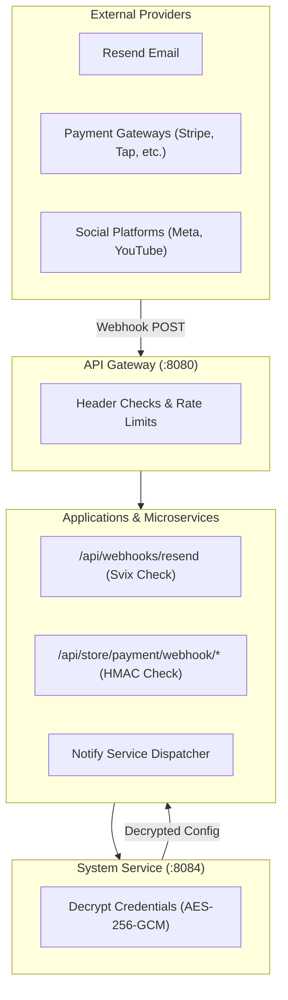

# Third-Party Integrations & External Service Reference

This document provides setup instructions, API specs, security requirements, and verification guidelines for all third-party integrations across the platform.

---

## 1. Integrations Overview & Service Matrix

Integrations are configured via **Settings → Integrations** (Admin App) or the IT Dashboard (`/integrations`). Credentials are encrypted at rest using **AES-256-GCM** via `pkg/secrets` with `ENCRYPTION_KEY`.

| Category | Provider | Purpose | Authentication Method | Webhook / Callback Endpoint |
|---|---|---|---|---|
| **Email** | **Resend** | Transactional & marketing email dispatch. | API Key (`re_...`) | `{admin}/api/webhooks/resend` (Svix signatures) |
| **Messaging** | **WhatsApp Cloud API** | Payslip PDFs, purchase orders, service replies. | Bearer Token & Phone ID | Direct Cloud API HTTPS |
| **OAuth Auth** | **Google Sign-In** | Customer account login on web store. | Client ID & Secret (PKCE) | `{website}/api/account/google/callback` |
| **OAuth Auth** | **Apple ID** | Customer account login on web store. | Service ID & Private Key | `{website}/api/account/apple/callback` |
| **Payment** | **Stripe** | Credit/debit card online checkout. | Secret Key & Webhook Secret | `{website}/api/store/payment/webhook/stripe` |
| **Payment** | **Tap Payments** | GCC cards, MADA, BenefitPay online checkout. | Secret Key & Hash Secret | `{website}/api/store/payment/webhook/tap` |
| **Payment** | **PayPal** | PayPal wallet & international cards. | Client ID & Client Secret | `{website}/api/store/payment/webhook/paypal` |
| **Payment** | **Checkout.com** | International card processing. | Secret Key & Signature Key | `{website}/api/store/payment/webhook/checkout` |
| **Payment** | **PayTabs** | Regional card payment gateway. | Server Key & Profile ID | `{website}/api/store/payment/webhook/paytabs` |
| **Payment** | **Moyasar** | KSA card & MADA checkout. | Secret Key | `{website}/api/store/payment/webhook/moyasar` |
| **Payment** | **HyperPay** | COPYandPAY hosted card frame. | Access Token & Entity ID | `{website}/api/store/payment/webhook/hyperpay` |
| **Logistics** | **Aramex** | Express parcel booking & tracking. | Account Number & Key | Courier API REST Client |
| **Logistics** | **DHL Express** | International parcel shipping. | API Key & Secret | Courier API REST Client |
| **Logistics** | **SMSA Express** | Regional parcel delivery. | PassKey Credential | Courier API REST Client |
| **Social** | **Meta (FB / IG)** | Social metrics & page insights. | Page Access Token & Page ID | Graph API REST Client |
| **Social** | **YouTube** | Public channel stats & owner analytics. | Data API Key & OAuth Token | Data API v3 REST Client |

---

## 2. Integration Webhook Architecture

---

## 3. Detailed Setup Instructions

### 3.1. Resend Email (`resend`)

1. **Verify Domain**: Add and verify your domain DNS records in the Resend dashboard.
2. **Configure API Key**: Copy your Resend API key (`re_...`) and sender email address into **Settings → Integrations**.
3. **Register Webhook**: Add `{admin}/api/webhooks/resend` to Resend Webhooks and copy the signing secret (`whsec_...`).
4. **Verification**: Execute **Test connection** from the IT Dashboard to verify domain status and key permissions.

### 3.2. WhatsApp Cloud API (`whatsapp`)

1. **Prerequisites**: Create a Meta Developer App with WhatsApp Business API enabled.
2. **Configure Credentials**: Copy Phone Number ID, Business Account ID, and Permanent System User Access Token.
3. **Test Dispatch**: Save settings and trigger **Send WhatsApp test message** to an international phone number.

### 3.3. Payment Gateways (Stripe, Tap, PayTabs, HyperPay)

1. **Configure Keys**: Copy Secret Keys, Public Keys, and Merchant IDs into **Settings → Integrations**.
2. **Set Return URL**: Register `{website}/api/store/payment/return` in the gateway merchant dashboard.
3. **Set Webhook URL**: Register `{website}/api/store/payment/webhook/{provider}` in the gateway webhook settings.
4. **Test Connection**: Trigger **Test connection** in the admin panel to verify API key validity.

---

## 4. Security & Encryption Standards

* **AES-256-GCM Key Ring**: Secrets are encrypted at rest with `ENCRYPTION_KEY` using authenticated AES-GCM encryption (`v1.<keyID>.<ciphertext>`).
* **Secret Redaction**: Integration credentials are never returned in full over API endpoints; secrets are returned only as presence flags or 4-character hints.
* **Webhook Deduplication**: Webhooks record delivery IDs in `PaymentWebhookEvent` to ensure atomic, single-execution processing.
