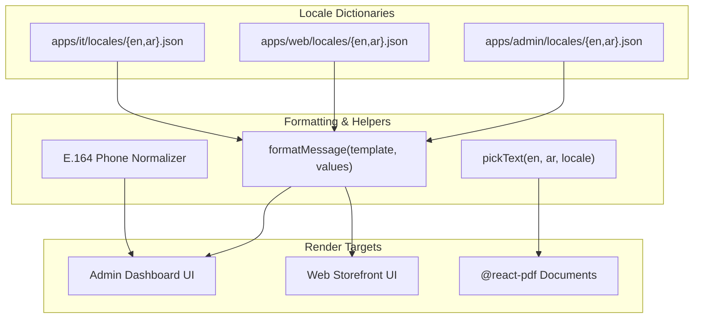

# Localization & Internationalization (i18n)

The platform features full Arabic (`/ar`) and English (`/en`) localization across all three Next.js applications (`apps/admin`, `apps/web`, `apps/it`), PDF document renderers, and email templates.

---

## 1. Localization Architecture

Each application maintains its own isolated dictionary files to prevent cross-app bundle dependencies.



---

## 2. Directory Structure & Key Namespaces

| Application | Locale File Paths | Primary Namespaces |
|---|---|---|
| **Admin App** | `apps/admin/locales/{en,ar}.json` | `admin`, `shared.common`, `shared.ui`, `admin.serverErrors` |
| **Web App** | `apps/web/locales/{en,ar}.json` | `common`, `website-activities`, `shared.common`, `shared.ui` |
| **IT Dashboard** | `apps/it/locales/{en,ar}.json` | `it`, `shared.common`, `shared.ui`, `serverErrors` |

---

## 3. Interface Languages vs. Content Languages

* **Interface Language**: The language of the UI controls, buttons, sidebars, and labels (`en` or `ar`), selectable per user.
* **Content Language**: The language of business content (product names, invoices, client names), configured in **Settings → Company** (`contentLanguages`):
  - **Dual Language**: Forms display separate English and Arabic fields.
  - **Single Language**: Forms display one input field; the system mirrors text to both columns automatically (`mirrorBilingual`).

---

## 4. Internationalization Rules & Guidelines

1. **No Inline Display Strings**: All user-visible text must be defined in locale JSON files under matching key paths for both English and Arabic.
2. **Named Placeholders**: Dynamic sentences use `formatMessage(template, values)` with explicit placeholders (e.g. `{companyName}`, `{number}`, `{date}`). Placeholders must match across both dictionaries.
3. **Western Digits**: Digits remain Western (`0-9`) across all languages, including Arabic PDFs and invoices.
4. **E.164 Phone Format**: Phone numbers are stored and transmitted in standard E.164 format (e.g. `+97336002200`). National inputs strip calling codes automatically.
5. **Brand Neutrality**: Locale files must never hardcode company names, addresses, or commercial registration numbers.

---

## 5. Automated Localization Audits

Run the copy validation suite at any time:

```bash
./run.sh test copy
```

### Audits Performed
* **Key Parity**: Ensures every key in `en.json` exists in `ar.json` and vice versa.
* **Placeholder Parity**: Asserts placeholders in template strings match identically.
* **JSX Hardcoding Audit**: Scans TSX files for un-extracted string literals.
* **Brand Violation Check**: Asserts no hardcoded brand strings appear in locale files.
