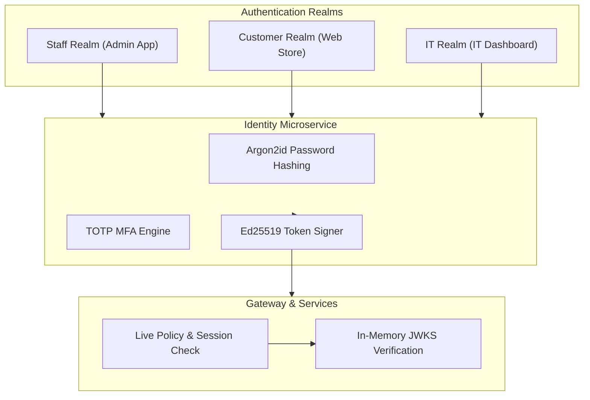
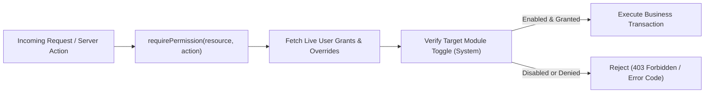

# Platform Security & Data Protection Policies

This document outlines the security architecture, authentication realms, permission enforcement models, encryption standards, and compliance policies of the platform.

---

## 1. Authentication Realms & Token Architecture

The system enforces three distinct authentication realms to ensure total isolation between staff, customers, and IT operators.

### Authentication Realm Matrix

| Realm | User Base | Target Application | Token Audience | MFA Requirement |
|---|---|---|---|---|
| **`staff`** | Company Employees & Managers | `apps/admin` | `platform:staff` | Enrolled per role policy (7-day grace period). |
| **`customer`** | Store Shoppers & Clients | `apps/web` | `platform:customer` | Optional; supports Google/Apple OAuth & 6-digit OTP. |
| **`it`** | IT Administrators & Ops | `apps/it` | `platform:it` | **Mandatory** TOTP MFA; optional IP CIDR allowlist. |

---

## 2. Password Policies & Multi-Factor Authentication (MFA)

### Password Hashing Standards
- **Algorithm**: Argon2id (`memory: 19 MiB`, `iterations: 2`, `parallelism: 1`). Legacy bcrypt hashes are automatically upgraded to Argon2id upon successful sign-in.
- **Complexity**: Staff passwords require a minimum of 12 characters (IT accounts require 14+ characters).

### Multi-Factor Authentication (MFA / TOTP)
- **Setup**: Generates standard `otpauth://` URI, base32 secret, and 10 single-use recovery codes.
- **Enforcement**: Enabling or disabling MFA automatically revokes all existing session families.
- **Recovery Procedure**: Single-use recovery codes permit sign-in if the authenticator device is lost. Admin-assisted recovery requires identity verification and is logged in the audit trail.
- **Key Stability**: `MFA_ENCRYPTION_KEY` must remain stable. Rotating the key invalidates all stored authenticators.

---

## 3. Authorization & Permission Enforcers

Every API route and server action enforces resource-action permission checks (`requirePermission(resource, action)`) before accessing or modifying business data.

### Data Scope Levels

Data scopes dictate record visibility per role and functional area:

| Data Scope | Access Boundary | Example Use Case |
|---|---|---|
| **`own`** | User can only access records created by or assigned to themselves. | Sales reps viewing their own CRM deals. |
| **`department`** | User can access records belonging to their department and child sub-departments. | Department heads managing team expense claims. |
| **`all`** | User can access all records system-wide. | Finance managers viewing all company invoices. |

---

## 4. E-Commerce & Customer Security

### Customer Authentication & OAuth 2.0
* **Google & Apple Sign-In**: Uses OAuth 2.0 Authorization Code flow with PKCE (`S256`) and cryptographically signed state cookies (`CUSTOMER_AUTH_SECRET`).
* **Email Verification Codes**: 6-digit OTP codes stored as SHA-256 hashes, valid for 10 minutes, capped at 5 failed attempts.
* **Account Deletion**: Self-service account deletion anonymizes customer personal details (orders are retained for tax/audit compliance without personal data).

### Online Payment Gateway Security
* **Hosted Payment Integration**: Card details never touch platform servers. Transactions process via hosted checkout pages or tokenized iframe frames (Stripe Checkout, Tap, PayPal, Checkout.com, PayTabs, Moyasar, HyperPay).
* **Webhook Signature Verification**: Inbound payment webhooks undergo cryptographic signature verification:
  - **Stripe**: Timestamped HMAC signature (`v1`).
  - **Tap / Checkout.com / PayTabs**: Body HMAC / hashstring verification.
  - **Moyasar / HyperPay**: Secret header token / AES-GCM decryption.
* **Idempotency**: Webhook deliveries record events in `PaymentWebhookEvent` to guarantee single-execution settlement.

---

## 5. Encryption & Data Protection Standards

### Secrets at Rest
All integration credentials (payment keys, WhatsApp tokens, courier secrets) are encrypted at rest using **AES-256-GCM** via `pkg/secrets` with `ENCRYPTION_KEY`.

### Security Headers & Sanitization
* **HTTP Headers**: All responses return `X-Content-Type-Options: nosniff`, `X-Frame-Options: DENY`, `Referrer-Policy: no-referrer`, and strict Content Security Policy.
* **Rich Text HTML Sanitization**: User-submitted HTML is cleaned via server-side allowlists (`apps/admin/lib/rich-text/render.ts`). Inline scripts and event handlers are stripped.
* **Custom Code Sandboxing**: Customer-facing embedded scripts execute inside sandboxed `srcdoc` iframes without `allow-same-origin`, preventing DOM or cookie access.
