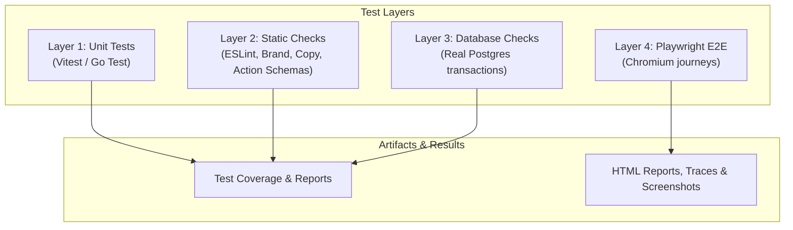
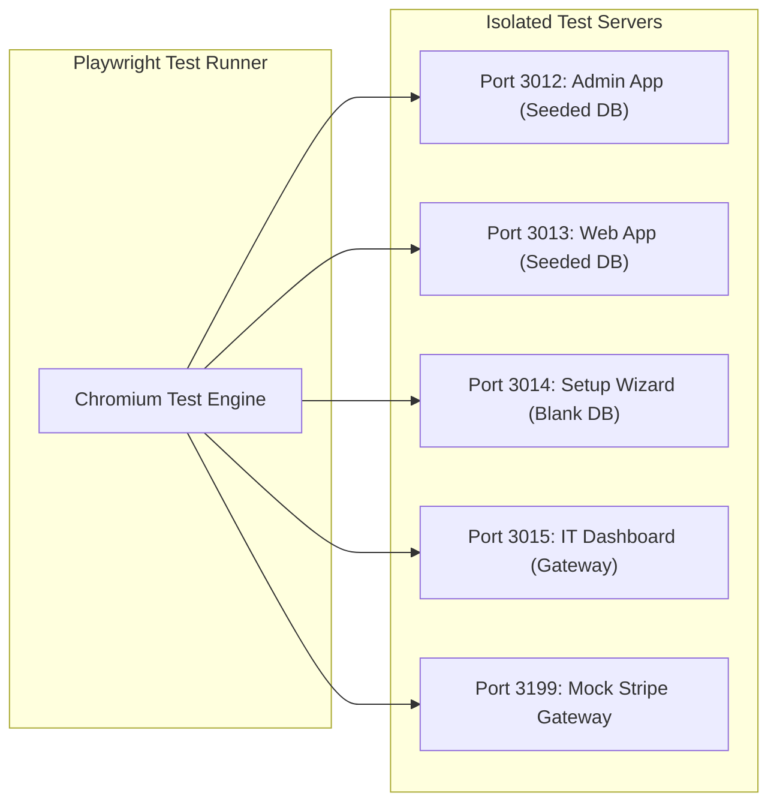

# Platform Testing Strategy & Guide

This guide details the multi-layered testing framework, covering unit tests, static code analysis, database integrity checks, and Playwright End-to-End (E2E) suites.

---

## 1. Testing Framework Overview

The test suite runs automatically in GitHub Actions on every pull request and push to `main`.



### Test Layer Matrix

| Layer | Execution Command | Required Infrastructure | Primary Coverage Scope |
|---|---|---|---|
| **Unit Tests** | `./run.sh test unit` | None | Theme engine, profile presets, CMS block validation, pricing, coupons, delivery slots, GOSI calculators. |
| **Static Checks** | `./run.sh test checks` | None | Brand neutrality, copy parity, permission definitions, upload storage rules, server action schema integrity. |
| **Database Checks** | `./run.sh test db` | 2 `_test` Databases | 35+ business rule suites executing against isolated PostgreSQL transactions (finance, payroll, GOSI, approvals). |
| **End-to-End** | `./run.sh test e2e` | Postgres + Chromium | Complete browser journeys: setup wizard, admin dashboard, order fulfillment, customer checkout, IT desk. |

---

## 2. Database Integrity Checks

Database checks run against isolated disposable PostgreSQL databases (`platform_bare_test` and `platform_seeded_test`). Each suite executes its test cases within explicit database transactions and rolls back changes upon completion.

### Setting Up Disposable Test Databases
```bash
# Prepare bare test database
node apps/admin/tests/e2e/helpers/prepare-db.cjs bare platform_bare_test

# Prepare seeded test database
SEED_VOLUME=on node apps/admin/tests/e2e/helpers/prepare-db.cjs seeded platform_seeded_test

# Execute database check suite
./run.sh test db
```

---

## 3. End-to-End (Playwright) Suite Architecture

`./run.sh test e2e` launches four isolated server instances, each bound to a dedicated test database and Next.js build directory.



### E2E Server Port & Database Allocation

| Port | Target Application | Test Database Name | E2E Playwright Projects |
|---|---|---|---|
| **3012** | Admin App | `platform_e2e_test` | `admin-login`, `admin`, `admin-mobile` |
| **3013** | Web App | `platform_e2e_test` | `web`, `web-mobile` |
| **3014** | Admin Setup | `platform_e2e_blank_test` | `setup-wizard` |
| **3015** | IT Dashboard | `platform_e2e_test` | `it` |
| **3199** | Stripe Stand-in | *(In-Memory Mock)* | Payment gateway test suites |

### Common Playwright Execution Commands

```bash
# Install required Playwright Chromium browser
npx playwright install chromium

# Run all E2E projects
./run.sh test e2e

# Run E2E for a specific application project
npx playwright test --project=web

# Launch Playwright UI mode for visual debugging
npx playwright test --ui
```

---

## 4. Volume & Performance Load Testing

Volume testing verifies query execution speed and UI rendering under heavy dataset conditions (2,000 employees, 50,000 requests/deals/expenses).

```bash
# Rebuild volume test database and execute performance checks
./run.sh test volume
```

* Asserts that list views, organizational charts, and request inboxes respond within a strict **1.5-second time budget**.
* Artifacts and trace logs are saved to `apps/admin/test-results/`.

---

## 5. Diagnostic & Utility Scripts

| Utility Script | Description |
|---|---|
| `node apps/web/scripts/check-website-http.cjs` | Tests HTTP status codes, headers, and preview features on Web. |
| `node scripts/check-admin-followup-http.cjs` | Validates Admin follow-up actions and server action responses. |
| `node scripts/profile-local-http.cjs` | Measures local HTTP response latencies and server action overhead. |
| `node scripts/verify-seed-dates.js` | Asserts transaction date ranges meet financial reporting requirements. |
