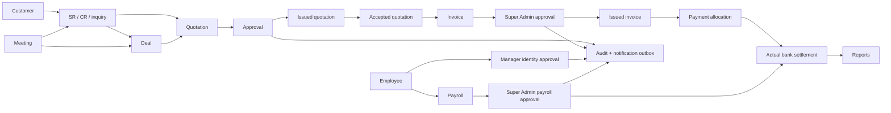

# Admin dashboard audit and implementation plan

Date: 4 October 2026. Scope: admin application, shared database/query layer, role authorization, document flows, locales, and the requested HRMS/finance expansion.

Status: audit and implementation design, with a small dashboard correction implemented during this pass. This is not a claim that the planned modules already exist. Existing unrelated edits and the deletion of the earlier audit directory have been preserved.

## Confirmed product decisions

- HRMS includes employee records, reporting lines, leave, attendance, **payroll and benefits**. Approved employee leave periods must block overlapping assignments/scheduling and work creation by employees during their leave.
- **Super Admin approves quotations, invoices and every discount**. Having a generic approve grant does not make another role an eligible financial approver.
- The **3% FX margin is built into the customer quote total**, not shown as a separate fee. The raw rate and margin remain separate internal fields.
- Name/email changes requested by employees go to their reporting manager, as requested. This is a separate approval policy from financial documents.
- Super Admin retains all permissions; custom user overrides cannot remove them.

Proposed defaults, not additional user decisions: no self-approval for financial documents/payroll; a second active Super Admin handles items created by a Super Admin. Never silently bypass approval when only one approver exists. Show an explicit operational prerequisite. Reference examples use SR-2026-000001 and CR-2026-000001, subject to later branding preferences. Approved historical document numbers remain unchanged.

## Evidence and limits

The static inventory initially scanned 193 admin TS/TSX files, 49 dashboard pages, 16 action modules, and 50 database models. English/Arabic locale files each had 2,026 leaf keys and matching key sets. It identified 292 hardcoded text candidates, 33 files with inline locale conditionals, 29 modal candidates, and 35 database findMany calls without a directly declared take. See [inventory.json](inventory.json).

These are candidate counts: error messages can be internal, some modals are useful confirmations, and role/permission/configuration tables are bounded by design. They are not 292 proven translation failures or 35 measured slow queries. Representative workflows were traced through pages, server actions, query helpers and schema. No production data, live provider delivery, payroll legislation configuration or production performance was certified. Visual consistency findings are source-level observations; full browser screenshots and keyboard/RTL checks remain delivery gates for each redesigned module.

### Confirmed findings

| Priority | Finding | Evidence | Required remedy |
|---|---|---|---|
| P0 | Financial summary computes profit from VAT-inclusive payments and expenses | `packages/database/src/queries/finance.ts`: payment sums become revenue; netProfit = revenue - expenses | Separate gross receipts, allocated output VAT, net receipts, recoverable input VAT and operating costs; label cash versus accrual results correctly |
| P0 | Invoice approval/discount approval is missing | `app/actions/finance.ts`, `queries/invoices.ts`, Invoice model | Approval bound to document revision; block issuing/customer delivery without Super Admin approval |
| P0 | Assign/reassign is authorized by generic requests:write | `app/actions/requests.ts` | Separate assign capability and team/record scope; entry-level write access must not allow assignment or approval |
| P0 | Per-user grants exist in the model but cannot be safely edited through the current user action | User.permissions JSON; `updateUserAction` deliberately excludes permissions | Add a dedicated authorized, validated and audited override action; retain forged-payload protection on general profile edits |
| P1 | Quotations are absent from the application | Quotation/QuotationLineItem schema exists; no quotation pages, action module, query workflow or sidebar link | Build a complete quotation slice; adding a dead sidebar link would not solve this |
| P1 | Two request tabs manage overlapping records | RequestsPage and LeadsInboxPage both query Inquiry; Sidebar shows both | One requests inbox with SR/CR/inquiry/quote-request views and shared policy |
| P1 | Viewer home still displayed analytics UI even when the server supplied zero financial values | dashboard page gates reads; ExecutiveDashboardView rendered all KPI/chart blocks and quick actions | Implemented capability gates; skip pipeline aggregation when finance analytics is unavailable |
| P1 | User lifecycle is partial | user actions support is_active/password/delete; user queries protect final active Super Admin | Add dedicated lifecycle commands, reset invitation, session/challenge revocation, archive policy and consistent UI |
| P1 | Reactivating a suspended user can leave old sessions usable again; admin password updates do not revoke sessions | `queries/users.ts` updates flags/hash without deleting Session | Revoke sessions/challenges atomically on suspension and resets; require a fresh login after reactivation |
| P1 | Self-profile and manager approval pages do not exist | route inventory; reporting manager relation already exists | Self-service profile routes and versioned pending identity changes |
| P1 | FX and actual bank settlement are not modeled | currency strings exist, no rate source/date/snapshot or settlement columns on Payment | Daily rate snapshots, immutable document FX, payment allocation and bank settlement records |
| P1 | VAT input/recovery cannot be separated for expenses | Expense has amount/currency, no explicit input VAT fields | Add net/gross/tax/recoverability fields with an explicit migration policy |
| P1 | Customer selection has a stale-response race | ClientAutocomplete debounce cancels the timer, not an already running request | Ignore stale generations; preserve selected customer; accessible keyboard results and scoped projected query |
| P1 | Notifications exist but are not a unified workflow delivery system | notifications actions restrict owner; NotificationCenter polls every 30 seconds and derives unread count from latest 50 | Event-based outbox, independent unread count, preferences, authorized record links and reliable delivery |
| P1 | Audit log view is latest-100 only | audit page calls getActivityLogs(100), reader includes full User | Server filters/pagination, projected actor data, redaction and immutable event context |
| P2 | Design differs across modules | user/finance views force dark surfaces; dashboard supports light and dark; request view is a large custom drawer/modal | Shared page/table/form/detail patterns using the existing palette and components |
| P2 | Existing invoice/receipt detail routes already exist | `/invoices/[id]`, `/payments/[id]` | Reuse them; migrate remaining payment entry/request details and large edit flows rather than build duplicate pages |
| P2 | Localization is incomplete despite key parity | inline Sidebar labels, request labels/history, role/status codes and direct Error messages | Locale-driven UI/messages/documents with a measurable baseline and CI rule |

## Other modules and duplication findings

| Existing area | Current state and next action |
|---|---|
| Audit status cards | AuditSessionsView hardcodes 8 authorized users, 1 active session and 100% enforcement. Replace with authorized live counts; never show an invented security score. |
| Calendar and meetings | Existing pages and meeting approval/export infrastructure should be reused. Scope calendar entries by assignment/team and normalize meeting/request links; complex calendar entry forms also need a page workflow. |
| Social analytics | Separate from financial analytics. The social action performs one groupBy plus a findFirst for every metric group. Profile this confirmed N+1 pattern and consider a projected latest-per-group query with a stable ID tie-breaker. Its page has English-only labels and different surface tokens. |
| Archive versus company documents | One private storage/attachment policy, with separate views for company compliance documents and entity attachments. Do not introduce another upload store for HR or payroll. |
| Contracts and communications | Database models exist without complete first-class contracts/communications dashboard workflows. Treat these as future integrations into customer/request/document context, not active features just because tables exist. |
| CMS and equipment | Keep working CMS publication, equipment and service catalogue modules. Apply shared UI/locale/permission patterns without rewriting unrelated website publication logic. |
| Preferences and integrations | Keep per-user locale/theme preferences distinct from company-wide configuration and privileged provider credentials. Feature availability is a global operational setting; a permission grant alone must not override an explicitly disabled delivery/provider service. |

## Shared business model: connect the existing modules

Keep existing Customer/CrmContact, User, Role, Inquiry, Deal, Meeting, Invoice, Payment and Quotation identities. An employee is not automatically a customer/contact. Employee.userId is optional and unique: an employee may not have dashboard access. Link records through typed foreign keys, not matching names or embedding copies of complete objects.

Use a shared approval/event infrastructure, but distinct policies for financial documents, profile changes, leave and payroll. Separate notifications (recipient presentation) from audit history (immutable evidence), and approval status from invoice payment status.

## 1. Roles, permissions and record scopes

Extend actions to distinguish read, create, edit, delete/archive, assign, approve, issue/send, export, manage_permissions and reset_credentials. Do not continue using write to authorize every mutation. A compatibility migration maps existing write grants to create/edit only; assign/approve/credential management must be explicitly granted. Introduce quotations, employees, payroll, benefits, reports and profile_changes resources.

Permission resolution: Super Admin invariant; otherwise role grant plus explicit per-user override, then record/team scope and workflow eligibility. Overrides have allow/deny/inherit states; inherit removes the override. A JSON false must never be interpreted as absent. Authorized permission administrators cannot grant powers or scopes beyond their own authority. Disallow editing Super Admin overrides. Validate all keys against the canonical action/resource registry.

Every server action, detail route, export, attachment download, search and aggregate applies the same policy. Filter authorized records in SQL before count, pagination and aggregation. UI checks explain/hide unavailable actions but do not provide security. Build one request-local effective matrix; do not perform one permission query per visible button. Policy changes must apply on the next request; no shared user-independent permission cache.

| Persona | Default work and visibility | Assignment/approval |
|---|---|---|
| Super Admin | Organization access, governance, approvals, authorized financial/HR reports | All capabilities; document approval still follows revision/state rules |
| Admin/HR | Users and employee operations within delegated scope | Explicit delegation only; no financial approval under the chosen policy |
| Finance Manager/Accountant | Prepare documents, reconcile payments, reports as granted | Submit for Super Admin approval; no financial self-approval |
| Sales | Assigned customers, deals, quotations and follow-ups | Submit documents; assignment only if separately delegated |
| Production Manager | Team requests, schedules and delivery tasks | Team assignment if granted; financial approval remains Super Admin |
| Producer/Editor/entry-level | Own assigned work, comments, progress and personal calendar/profile | No assign or approve by default |
| Viewer | Permitted records, own work and read-only navigation | No analytics, mutation, assign or approve by default |

Acceptance: adversarial server-action tests for every action; forged IDs/overrides and cross-team exports denied; Super Admin remains fully granted; entry users cannot assign/approve; role/user grants and UI agree; final active Super Admin cannot be suspended/deleted/demoted.

## 2. Users, HRMS and profile changes

Use dedicated pages `/users/[id]` and `/users/[id]/edit`, with account, permissions, reporting line, security and history sections. Employee profiles live under `/hr/employees/[id]`. Add suspend/reactivate/archive/delete/reset-credentials commands with reasons and audited actor/target identity. Suspend immediately revokes sessions and active challenges; reactivation does not revive them. Reset uses a short-lived single-use invitation/token, never an emailed plaintext password. Separate password reset, MFA reset and session revocation.

Hard-delete only unreferenced mistaken accounts. Archive employees/accounts that have financial, approval, payroll or audit history. Never cascade-delete payroll or audit evidence. Self-suspension/last-admin constraints must be checked inside the same locked transaction as the mutation.

Personal routes: `/profile`, `/profile/edit`, `/profile/security`. Phone and signature can be changed immediately after validation; signature updates use the existing private-upload claim workflow. Name/email changes create a ProfileChangeRequest showing old/proposed values. They do not alter active login identity until the reporting manager approves the current revision; verify the new email before activating it. Resolve uniqueness conflicts and manager absence explicitly. A manager reassignment invalidates stale approval routing; self-approval is forbidden. Employees cannot assign themselves managers, roles or privileges.

HRMS scope: Employee, Department, EmploymentRecord, effective-dated compensation, BenefitPlan/enrollment, LeaveType/balance/request, AttendanceEntry/timesheet, PayrollRun, PayrollItem, payroll adjustments and payslips. Reuse User.managerId through an explicit employee reporting relationship; avoid two contradictory manager sources. Employment and salary access need separate scopes from general users:read.

### Leave periods and employee availability

Leave is an operational availability constraint shared by HRMS, requests, CRM, meetings, calendar, approval routing and financial work creation. Super Admin permissions do not silently bypass an employee's leave status.

- Record employee, leave type, start/end, full/partial-day hours, timezone, approval state, approver, cancellation/early-return history and availability revision. Display the inclusive dates the employee chooses; normalize full-day leave to half-open intervals in Asia/Bahrain internally. Preserve split periods, extensions and partial days rather than a single onLeave boolean.
- Approved leave and explicitly recorded emergency absence block availability. Pending leave displays a scheduling warning and projected conflict without being silently treated as approved. Rejected/cancelled leave does not block work. Availability is evaluated against the actual period, so a missed background job cannot leave somebody available during approved leave or unavailable after it ends.
- Block assigning/reassigning SR/CR, deals, work tasks, production shifts, meetings, calendar events or approval duties when their work period overlaps the employee's approved leave. Assignee pickers show unavailable dates and return date, without exposing private leave reasons. Check every assignee, participant and required approver. Do not choose an unavailable reporting manager or Super Admin as an approval fallback.
- For undated work, check availability now and require a work period when assigning future scheduled work. An employee on approved leave cannot create new operational/financial work or make assignment/approval decisions during that period. Keep self-service leave, early-return requests, payslip/profile access and read access available under their ordinary permissions; leave is not account suspension.
- Creating work on behalf of an absent employee is subject to the same availability rules. Another authorized available employee can create an unassigned draft for later allocation; creator identity must remain the actual actor. Never impersonate the absent employee or silently assign the work to them.
- Leave approval/extension checks existing assignments, meetings, deadlines and approval queues. Flag every conflict and create an explicit handover/reassignment/cancellation decision; do not discard the employee's work or deny all leave merely because old work exists. Approval may mark the employee unavailable immediately while routing conflicts into a tracked manager queue. Resolve affected future scheduling before treating those commitments as staffed.
- Put availability enforcement in the shared server policy and invoke it for UI actions, APIs, imports, recurring jobs and bulk operations. Use one indexed overlap query per candidate employee set, not one query per row. Within mutations, lock affected employee availability records in stable order and recheck approval/work revisions so concurrent leave approval and assignment cannot both commit as conflict-free. Use the same lock protocol for leave changes and work allocation.
- Leave extensions/cancellations and early returns update future availability and notify managers/affected work owners. Do not automatically restore assignments handed to another employee. Any emergency availability override requires a separate explicit policy, authorized actor, period, reason and audit record; it is not enabled by default.

Acceptance: assignments spanning any part of leave are rejected; full-day/partial-day boundaries and timezone cases pass; undated/current work and future work behave consistently; bulk/API/worker paths cannot bypass checks; an absent actor cannot create operational work or approve; an absent employee cannot be assigned as an approver; concurrent leave approval/allocation is safe; leave approval identifies existing conflicts; early return does not duplicate assignments; private leave reasons remain confidential.

Payroll: draft → calculated → submitted → Super Admin approved → paid → closed. Snapshot pay components, attendance/leave inputs, effective compensation and policy versions per run. Include benefits, allowances, authorized deductions, advances, proration and employer costs. Approval locks calculation inputs; any change creates a new revision. Use unique employee/pay-period constraints and idempotent payment posting. Payroll payments create linked finance ledger/settlement entries rather than duplicate expense and payment rows that double-count costs. Private payslips are accessible only to the employee and explicitly authorized HR/payroll roles. Bahrain payroll contribution/benefit/leave rules require effective-dated configured policies checked against applicable employee categories; do not hardcode unverified statutory rates.

Acceptance: suspension/reset destroys old session access; safe reactivation; profile approval race/uniqueness tests; reporting-cycle rejection; payroll reruns cannot double-pay; salary leakage tests; approved run cannot silently recalculate.

## 3. Quotations, invoices, discounts and approval

Build quotation list/new/detail/edit routes, typed query/actions, numbering and locale-aware document templates. The existing schema is a foundation, not an implemented module. Reuse line-item editor, customer picker, calculation service and document page shell. Give quotations their own permission resource, not invoices permissions.

Quotation flow: draft → submitted → Super Admin approved → issued → accepted/declined/expired/cancelled. Acceptance includes dated evidence. Accepted quote converts once to an invoice through a unique/idempotent link; retries must return the existing invoice. Partial billing, deposits and revisions must be explicit, not arbitrary status edits.

Invoice approval status is separate from draft/sent/partially-paid/paid/overdue/void financial state. Every invoice requires Super Admin approval before issue/send. Every nonzero discount is included as an explicit approval reason in the same revision-bound review packet; do not create redundant approvals for the same unchanged document. Show subtotal, discount, tax, FX rate/margin, customer and total in the review diff.

Proposed models: ApprovalRequest, ApprovalDecision and document approvalRevision/contentHash. Foreign keys link supported targets. Snapshot the policy and approver eligibility at submission; recheck approver is active and authorized at decision. Conditional revision writes/row locks prevent approve/edit races. Changing prices, discount, customer, currency, tax or terms invalidates approval and delivery eligibility. Maker/checker default requires a different Super Admin when the creator is a Super Admin.

Delivery: only the approved revision may enter a delivery outbox. Both customer export and send/share require authorization and approval; an internal preview may be watermarked Draft without enabling customer delivery. Do not rely on the toolbar being hidden: exports, mail workers and state transitions must enforce the same revision. Share links are revocable and scoped; log issuance/delivery attempts and provider evidence. Current EmailJob is meeting-specific and must not be stretched into a quotation workflow without redesigning its typed relations.

Acceptance: unapproved issue/export/send denied even by forged calls; nonzero discount always reviewed; edits invalidate approvals; self-approval denied; concurrent decisions produce one outcome; retries do not duplicate invoices or sends.

## 4. One CR/SR workspace

Keep Inquiry as the intake identity while normalizing request type separately from existing intent. Current intent constraints allow inquiry, quote_request, complaint and suggestion; do not reintroduce unsupported service_request values. Map service work to an explicit SR requestType, complaint cases to CR, and preserve intake intent/history.

One `/requests` list supports saved views: All, My work, My team, Awaiting approval, SR, CR, Closed. Redirect the legacy leads URL after permission and record-scope migration. Never simply remove a tab if users would lose access under the other resource. Preserve website feedback and quote requests alongside service work through filters, not a second competing CRUD system.

Routes: `/requests/new`, `/requests/[id]`, `/requests/[id]/edit`. Detail page has Summary, Work, Comments, Related records and History. Support priority, due date/SLA, tags, team, assignee, watcher, service, customer and related quotation/invoice/deal/meeting links. An entry user may comment/update own authorized work, but cannot assign, confirm or approve without explicit capability.

Append-only RequestEvent and RequestAssignment records replace the ever-growing customAssignments JSON array. Preserve legacy events in migration; do not invent authors/timestamps. Comments support visibility (internal/client-visible), attachment claims, edit history and mentions. Client-visible comments require a separate delivery policy; posting an internal comment must not email the customer. Reassignment/return reason required. Super Admin approval eligibility for financial links does not automatically change operational request assignment policies.

References: transactionally allocate SR/CR sequences by type/year, stable after reassignment/type changes; no count+1 numbering. Existing references remain aliases and continue resolving old links. Public reference knowledge must never replace authentication. Add duplicate-intake indicators, parent/child cases, merge-with-audit, reopening and resolution outcomes. SLA reminders/escalation enter the same notification outbox.

Acceptance: simultaneous submissions get unique numbers; history/comment/assignment is atomic with mutation; cross-scope related links do not leak records; legacy URLs resolve; one inbox covers both existing tabs without dropped cases.

## 5. VAT, multi-currency and settlement

Keep BHD as the reporting base; format currency using currency metadata (BHD 3 decimals, USD 2) and use exact Decimal/minor-unit arithmetic. The current calculation helper rounds but uses JavaScript numbers, so precision stress cases still need coverage. Choose and document line versus document rounding; persist the rounding adjustment.

Snapshot VAT eligibility, rate, tax amount and policy/effective date on each issued document. With VAT disabled, calculate zero tax internally and omit customer tax rows/registration claims. Enabling company VAT later changes new eligible documents only; do not recalculate old non-VAT invoices or receipts from current settings. Model disabled/not-registered versus zero-rated/exempt explicitly: a registered zero-rated supply is not the same as an unregistered invoice. Draft policy changes require review; issued changes use credit/debit notes, not rewriting history.

Accounting views must separate receivable/gross cash, net sales, output VAT, input VAT, recoverable input VAT, non-recoverable VAT, payroll/operating costs, bank fees and FX gain/loss. Recoverable VAT is not profit or operating expense; non-recoverable VAT can be a cost according to the configured accounting policy. Receipt-based net inflow is a cash measure, not automatically accounting profit. Add an explicit cash/accrual basis filter and label. Reconcile credit notes, refunds, write-offs and void documents consistently.

FX models: ExchangeRateSnapshot(base, quote, rate, effectiveDate, fetchedAt, provider, source evidence), DocumentFx(baseAmount, targetAmount, rawRate, marginPercent=3, effectiveRate, rateSnapshotId), PaymentAllocation(invoice amount/currency) and BankSettlement(actual amount/currency/date, fees, bank reference, accounting rate).

For a net BHD-priced quote, customer target unit prices incorporate raw target-per-BHD rate × 1.03. Apply discounts and tax under the shared documented order and currency rounding policy; totals must reconcile to displayed lines. The 3% uplift is a pricing policy, not an FX accounting gain or a replacement tax rate. Persist approved values; never refresh the rate when rendering an issued PDF.

Illustration only, not a live exchange quote: BHD 3,000 × a hypothetical 2.66 USD/BHD × 1.03 = USD 8,219.40 before any applicable tax. Record a received USD amount against the USD receivable. Independently record the actual BHD bank credit, fees and resulting FX difference. A short BHD settlement must not incorrectly reopen a fully paid USD invoice; a short USD payment must not be hidden by a favorable bank rate. Support partial payments and multiple allocations without over-allocation.

Daily provider refresh runs server-side once per needed pair/date, coalesces concurrent requests and retains history. Verify response schema, orientation, positive finite rate, effective date and freshness. Weekends/holidays use an explicitly disclosed latest business-day rate under policy. Fail issuance or require a logged Super Admin manual rate when unavailable; never silently assume parity. Public reference data is not a guaranteed executable bank rate.

A candidate is [Frankfurter v2](https://frankfurter.dev/), whose documentation supports daily/historical pairs and provider selection; validate BHD coverage, licensing and rate suitability before adopting it. Tax FX must remain separate from the commercial margin: Bahrain's [official VAT executive regulations, Article 52](https://www.lloc.gov.bh/Legislation/HTM/RFNE1218) require BHD information and the applied exchange rate on applicable tax invoices. Therefore “show USD totals” must preserve the required BHD tax information when VAT applies. This plan does not substitute for confirming current tax treatment before financial release.

Acceptance: VAT-off → VAT-on retains old totals and PDFs; no misleading VAT-zero row for nonregistered documents; exact BHD/USD rounding; discount and VAT reconcile; income excludes output VAT; recoverability is respected; rate snapshots immutable; settlements and allocations balance under partial/refund/FX cases.

## 6. Financial reports and exports

Create `/finance/reports`, with permission-scoped report definitions: sales/invoices, receipts/cashbook, receivables aging, expenses/payables, VAT output/input reconciliation, payroll costs, bank settlements/fees, FX gain/loss and profit/cash operating results. Avoid constructing a second financial truth from a different set of frontend formulas.

Filter by day/week/month/year/custom range, basis, customer, document/status, employee/team, category, service, invoice currency, settlement currency, account, VAT policy and approval state. Use Asia/Bahrain business-day boundaries and half-open UTC intervals internally; stable sort with an ID tie-breaker. Display reporting currency and inclusion rules clearly.

CSV, XLSX and SVG graphs use the same typed filter contract and server calculation query as the screen. CSV/XLSX protect against spreadsheet formula injection; XLSX preserves numeric types, dates, currency and language-specific headings. Include generatedAt, reporting basis, timezone, filters and FX policy in exports. Charts must have accessible text summaries and downloadable standalone SVG. Large exports are queued, streamed/batched and delivered through private expiring links, not full-table JSON in the browser. Recheck permission at download, record export access, and bound retention.

Acceptance: screen/CSV/XLSX/chart totals match; reversed/invalid dates rejected; weekly/year-end timezone cases covered; currency totals are never added without an explicit conversion; no formula execution from customer cells; scoped users cannot export other teams.

## 7. Notifications, history and operational logs

Build one typed event contract and transactionally write mutation + audit event + outbox intent. Approval, assignment, mention, request return/resolution, due/overdue invoice, profile decision and payroll events produce recipient-specific notifications. Unique event/recipient/channel keys prevent duplicates under retries. Do not perform provider calls inside database transactions.

Store message keys/parameters rather than permanently concatenated English UI text. Render in each recipient's locale. Add `/notifications`, unread count across all unread rows, filters and authorized entity deep links. Preferences distinguish mandatory security/approval events from optional digests. Handle read mutation failure by reverting optimistic UI/showing localized error. Poll only when visible with backoff initially; add SSE/realtime only if deployment measurements justify it. Do not subscribe every tab to full-table polling.

Audit events include actor identity snapshot, target, event code, changed allowed fields, previous/current revision, reason, correlation ID and safe provenance. Redact passwords, tokens, bank credentials and private document URLs. Restricted append-only access, retained actor snapshots after account archival, date/actor/entity/action filters, scoped exports and retention rules. Diagnostic logs use structured operation codes and timings; business history should not depend on scraping console.error. Project only actor fields needed by the log view.

Acceptance: retries produce one notification/delivery intent; owner isolation; full unread count beyond 50 items; inaccessible links denied; state and history commit/rollback together; no secrets in logs; worker failure/retry visible without duplicate sends.

## 8. Pages, design and localization

Reuse the existing Next/Tailwind/shared UI stack and brand palette (#014842, #09937F). Define shared page header, breadcrumbs, detail shell, form sections, toolbar, table, filter bar, audit timeline, review diff and empty/loading/error components. Consistent spacing/type/radius/border tokens, keyboard focus and light/dark surfaces. Do not add an unrelated visual system or redesign marketing pages during this work.

Move complex request, invoice/payment entry, user/profile and approval workflows to pages with stable URLs, back navigation, unsaved-change protection and permission-scoped context. Existing invoice and receipt detail routes are canonical. Keep short destructive confirmations as dialogs; the request to remove popup-based workflows does not require eliminating confirmation dialogs. Payment recording moves to `/payments/new?invoiceId=...`; CR/SR uses the dossier routes above. Approval pages show contextual links and diffs, not isolated generic forms.

Customer picker: shared compact customer summary, company/contact distinction, email/phone/tax/address and matching indicators. Search by normalized email/phone/name/company, scoped and limited results. Ignore stale responses, use Arabic/English collation deliberately, keyboard navigation/aria-combobox and RTL logical placement. Load selected customer by ID independently of the first search page. Support inline “create customer” navigation with return context rather than an unbounded full-contact fetch.

Every list uses one URL-backed typed contract: search, allowed sort, direction, page/cursor, bounded pageSize, date range, status/type/assignee/team/currency as relevant. Validate sort through an allowlist, preserve filters on navigation, reset page on filter changes, include counts only within scope. Do not filter a single server page client-side and imply the entire dataset was searched. Shared primitives should allow module-specific filters without one enormous component of conditional branches.

Localization: all user-facing labels, statuses, validation/success/errors, empty/loading text, notifications and document/email copy come from Arabic/English locale keys. Identifiers, routes, machine event codes, stored customer names and user comments are data, not translation keys. Server returns semantic error codes/parameters; the client maps them to locale text. Remove isRTL ? Arabic : English copy branches from TS/TSX; use isRTL only for layout/direction. Keep one selected language per document, with bilingual documents an explicit option. Format dates/numbers/currencies using the selected locale; isolate email/reference/phone direction. Do not automatically translate customer legal names or historical user comments.

Maintain an AST candidate baseline, manually classify existing entries, and fail CI on new unapproved user-facing literals. Enforce locale key/type parity, placeholder parity and missing-key checks. Remove raw enum/status fallbacks and English-only role labels. RTL/LTR screenshot, keyboard and accessibility checks for each shared pattern and migrated route are required, not inferred from string replacement.

## 9. Query and performance strategy

Retain existing SQL aggregation, bounded list readers, request-local operation context and short transactions. Avoid loading full employee/user relations (including password hashes) for pickers or audit logs. Do not add Redis or broad cross-user caching before measurements justify it. Never share-cache payroll, private profile, permission matrices or scoped counts without complete authorization keys and invalidation.

Audit the 35 findMany candidates by call-site: constants/role metadata may be bounded; employees, history and customers need pagination/projection. Use SQL aggregate/count/groupBy for summaries, not full histories and repeated JavaScript reductions. One dashboard query bundle per persona, one lookup projection per search, lazy detail tabs, paginated comments/history, and asynchronous report export. Cancellation/generation control avoids stale client results; bounded retries/timeouts avoid retry storms.

Before accepting optimizations: record representative dataset size, query count, duration, returned row/byte count and EXPLAIN ANALYZE plan in a disposable database. Test 10k customers, 100k requests, realistic payroll history and concurrent list/export workloads. Add indexes only after actual predicates/plans justify them. Proposed initial budgets: fixed list query counts independent of rows, bounded 25–50-row pages/12-result lookups, p95 list/lookup under 300 ms in the deployment-region test, and no large exports in request memory. These are proposed targets, not measured production results.

## Delivery sequence and gates

| Slice | Work | Dependencies and completion gate |
|---|---|---|
| 0: immediate corrections | Dashboard capability gates, localization of touched UI, documented findings | Implemented here; role rendering/query omission tests, types/lint/security regression checks |
| 1: authorization and identity | Canonical action registry, record scopes, user overrides, lifecycle/session resets, self-profile and manager approvals | No feature delivery until adversarial authorization tests pass |
| 2: shared workflow/events | Revision-bound approvals, notification outbox, immutable audit, sequence allocation; shared employee availability/leave checks | Concurrent/race/rollback/idempotency tests, unavailable-assignee/approver checks and localized outcome messages |
| 3: quotations and invoice approval | Complete quotation pages/actions/templates; Super Admin review; discount reasons; quote-to-invoice; delivery gating | Shared workflow, permissions and numbering; unapproved delivery impossible |
| 4: CR/SR consolidation | One inbox, dossier pages, assignment/comments/history/links, new references and legacy redirects | Record scopes, event/history model; no dropped cases or links |
| 5: VAT/FX/settlements | Tax snapshots, expense VAT/recoverability, daily FX+3%, bank settlements, credits/refunds | Approved finance specification; reconciliation/rounding/migration fixtures |
| 6: financial reports | Shared report queries and filters, CSV/XLSX/SVG, async exports | VAT/FX/settlement data; screen/export parity and large-data tests |
| 7: HRMS and payroll | Employees, leave periods/availability/handover, attendance, benefits, compensation and payroll approval/payment/payslips | Identity/reporting scopes + shared workflow + finance posting; leave overlap/concurrency gates; statutory policy configuration |
| 8: dashboard/design completion | Role-specific queues/work widgets, remaining page migrations, localization cleanup, design consistency | All modules supply correctly scoped data; RTL/LTR browser acceptance and performance measurements |

Build each slice as small full-stack changes: schema migration/backfill, typed queries/actions, UI, locale keys and meaningful tests. This sequence is not an instruction to deploy unfinished slices or to replace live financial history. Features stay hidden until their routes, policies, server workflows and tests are complete.

### Migration safeguards

Use additive schema changes first. Backfill tax/FX/approval values only from defensible historical evidence; classify unknown values for review instead of guessing. Existing issued documents are marked legacy/unverified under an explicit policy, not silently treated as approved by an invented actor. Preserve old request references and immutable document PDFs. Replay events into normalized history with provenance and dedupe keys. Reconcile pre/post totals and ownership on a disposable restored copy before production migration; verify rollback/restore. Account archival must preserve references and audit identity.

### Release acceptance

A feature is complete only when routes, sidebar visibility, buttons, server mutations, detail reads, linked files and exports agree on policy; both locales are complete; financial transitions and races are covered; list/query behavior is bounded; loading/empty/error/RTL states are verified; migrations preserve historical meaning; and notifications/history are atomic and deduplicated. A green type check alone is insufficient.

## Implemented in this audit pass

- Dashboard cards, analytics and quick actions now receive server-resolved capabilities. Viewers without financial analytics do not see financial KPI/charts, and users without invoice creation/customer-read grants do not see the create-invoice action.
- The dashboard's pipeline aggregation is omitted when finance analytics is unavailable; recent permitted deals still use the existing bounded query. The local diagnostic recorded two Prisma read operations with analytics and one without it; this omits the unnecessary aggregation. These are middleware operation counts, not all underlying SQL statements. No production latency improvement is claimed. See [dashboard-query-check.json](dashboard-query-check.json).
- Recent-deals/workspace text and Super Admin permission notice/export heading were moved to both locale files.
- The wider authorization, approvals, quotation, HRMS, VAT/FX, reporting and UI migrations above remain planned work. No payroll, live tax-policy change or third-party provider integration was rolled out by this audit.

## Verification completed for this pass

- Fresh type checking passed in all seven workspaces, including the standalone database seed configuration.
- ESLint passed with zero errors/warnings; Knip reported no unused issues (its existing Prisma-extension hint remains).
- `pnpm test:dashboard`, `pnpm test:platform` and `pnpm test:audit-security` passed. Dashboard tests render both locales with real React, verify capability gating, and verify analytics query omission.
- Two deliberate mutations (removing a financial UI guard and forcing pipeline aggregation) made the regression test fail; source was restored and the tests passed afterward.
- Current English/Arabic key parity passed at 2,030 keys per language. Parity does not prove all user-facing text has been localized.
- The local query diagnostic recorded two Prisma operations with analytics versus one without; it is not a production latency benchmark.
- The installed dependency tree was repaired using the existing frozen lockfile after ESLint encountered a missing transitive package; no dependency version changes were requested.
- No production migration, customer delivery, payroll run, or bulk account/data cleanup was performed. Full redesigned-browser acceptance and new financial/HRMS workflows remain the gates described above.
