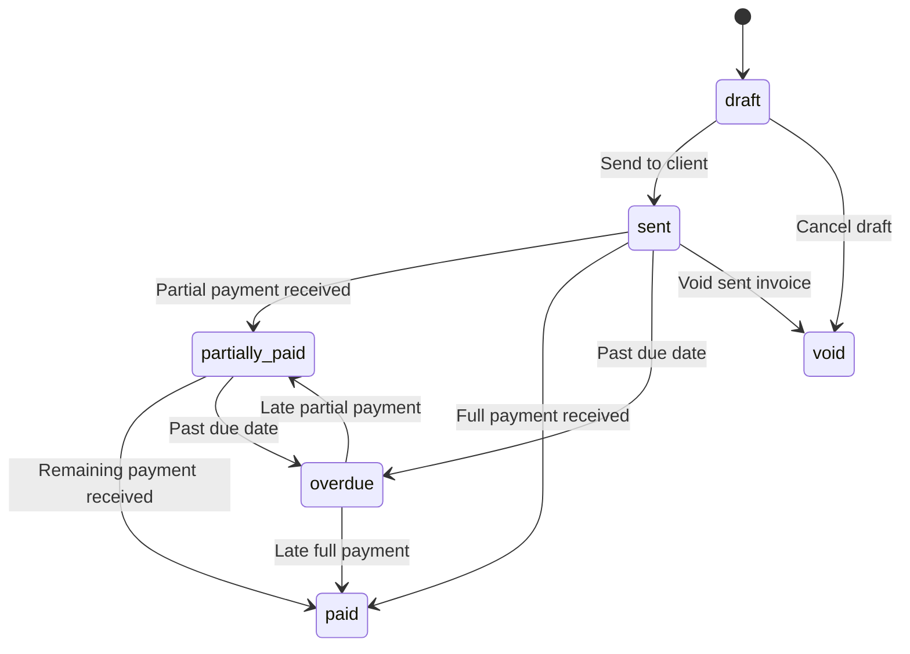

# ishoot Admin Portal — Rules & Specifications

> Authoritative reference for the admin portal at `admin.ishoot.bh`

---

## 1. Authentication & Role-Based Access Control (RBAC)

### 1.1 Authentication Flow

| Step | Action                                           |
| ---- | ------------------------------------------------ |
| 1    | Admin navigates to `admin.ishoot.bh/login`       |
| 2    | Enters email + password via Supabase Auth        |
| 3    | Middleware validates session via `@supabase/ssr` |
| 4    | On success, checks `public.profiles` for role    |
| 5    | Redirects to `/dashboard`                        |
| 6    | No session → redirect to `/login`                |

### 1.2 Role Definitions

| Role          | Scope          | Permissions                                            |
| ------------- | -------------- | ------------------------------------------------------ |
| `super_admin` | Full system    | All CMS, CRM, finance, invoicing + user management     |
| `producer`    | Production ops | All CMS, CRM, finance, invoicing (cannot manage users) |
| `editor`      | Content only   | CMS read/write only (no CRM, no finance)               |

### 1.3 Permission Matrix

| Feature                        | `super_admin` | `producer` | `editor` |
| ------------------------------ | :-----------: | :--------: | :------: |
| Hero Banner CRUD               |      ✅       |     ✅     |    ✅    |
| Portfolio CRUD                 |      ✅       |     ✅     |    ✅    |
| Client Logo CRUD               |      ✅       |     ✅     |    ✅    |
| Equipment CRUD                 |      ✅       |     ✅     |    ✅    |
| View Inquiries                 |      ✅       |     ✅     |    ❌    |
| Manage CRM Contacts            |      ✅       |     ✅     |    ❌    |
| Manage CRM Deals               |      ✅       |     ✅     |    ❌    |
| Create Invoices                |      ✅       |     ✅     |    ❌    |
| Send Invoices (Email/WhatsApp) |      ✅       |     ✅     |    ❌    |
| Record Payments                |      ✅       |     ✅     |    ❌    |
| Send Payment Receipts          |      ✅       |     ✅     |    ❌    |
| Manage Expenses                |      ✅       |     ✅     |    ❌    |
| View Financial Dashboard       |      ✅       |     ✅     |    ❌    |
| Export Financial Reports       |      ✅       |     ❌     |    ❌    |
| Company Settings (VAT, Bank)   |      ✅       |     ❌     |    ❌    |
| Manage User Accounts           |      ✅       |     ❌     |    ❌    |

---

## 2. Admin UI Design Rules (Twenty CRM-Inspired)

### 2.1 Layout Architecture

```
┌──────────────────────────────────────────────────────────┐
│ SIDEBAR (240px, collapsible)  │  WORKSPACE MAIN AREA     │
│                               │                          │
│ [ishoot logo + name]          │  Breadcrumbs              │
│ 🔍 Search (Cmd+K)             │  Page Title               │
│                               │  View tabs + toolbar      │
│ ── CONTENT ──                 │                          │
│ 📷 Banners                    │  ┌──────────────────────┐ │
│ 🎬 Portfolio                  │  │                      │ │
│ 🏢 Clients                    │  │  DATA TABLE          │ │
│ 🔧 Equipment                  │  │  or KANBAN BOARD     │ │
│                               │  │  or FORM             │ │
│ ── CRM ──                     │  │  or DASHBOARD        │ │
│ 📥 Leads / Inquiries          │  │                      │ │
│ 💼 Deals                      │  └──────────────────────┘ │
│ 👥 Contacts                   │                          │
│                               │                          │
│ ── FINANCE ──                 │                          │
│ 📄 Invoices                   │                          │
│ 💳 Payments                   │                          │
│ 📊 Expenses                   │                          │
│ 📈 Financial Dashboard        │                          │
│                               │                          │
│ ── SETTINGS ──                │                          │
│ 🏗️ Company Settings            │                          │
│ ⚙️ Settings                    │                          │
│ 👤 [User avatar + name]       │                          │
└──────────────────────────────────────────────────────────┘
```

### 2.2 Color System (Dark Mode Default)

| Token            | Value                    | Usage                            |
| ---------------- | ------------------------ | -------------------------------- |
| `bg-base`        | `#050807`                | Main workspace background        |
| `bg-surface`     | `#0B1210`                | Sidebar, card backgrounds        |
| `bg-elevated`    | `#111C19`                | Dropdowns, popovers, active rows |
| `border-subtle`  | `rgba(255,255,255,0.08)` | Table borders, dividers          |
| `border-emerald` | `rgba(9,147,127,0.2)`    | Active card borders, focus rings |
| `text-primary`   | `#F2F6F5`                | Headings, primary text           |
| `text-secondary` | `#9EADA9`                | Labels, column headers           |

### 2.3 Semantic Status Colors

| Status          | Background               | Text      | Border                  | Used For                 |
| --------------- | ------------------------ | --------- | ----------------------- | ------------------------ |
| New / Lead      | `rgba(59,130,246,0.12)`  | `#3B82F6` | `rgba(59,130,246,0.2)`  | New inquiries, new deals |
| Proposal Sent   | `rgba(245,158,11,0.12)`  | `#F59E0B` | `rgba(245,158,11,0.2)`  | Proposals, pending       |
| Contract Signed | `rgba(99,102,241,0.12)`  | `#6366F1` | `rgba(99,102,241,0.2)`  | Contracts                |
| Production      | `rgba(9,147,127,0.12)`   | `#09937F` | `rgba(9,147,127,0.2)`   | Active production        |
| Post-Production | `rgba(168,85,247,0.12)`  | `#A855F7` | `rgba(168,85,247,0.2)`  | Editing, grading         |
| Delivered       | `rgba(34,197,94,0.12)`   | `#22C55E` | `rgba(34,197,94,0.2)`   | Completed delivery       |
| Paid            | `rgba(16,185,129,0.12)`  | `#10B981` | `rgba(16,185,129,0.2)`  | Paid invoices            |
| Partially Paid  | `rgba(14,165,233,0.12)`  | `#0EA5E9` | `rgba(14,165,233,0.2)`  | Partial payments         |
| Overdue         | `rgba(239,68,68,0.12)`   | `#EF4444` | `rgba(239,68,68,0.2)`   | Overdue invoices         |
| Draft           | `rgba(156,163,175,0.12)` | `#9CA3AF` | `rgba(156,163,175,0.2)` | Draft invoices           |
| Void            | `rgba(244,63,94,0.12)`   | `#F43F5E` | `rgba(244,63,94,0.2)`   | Voided, lost deals       |

---

## 3. CMS Content Management Rules

### 3.1 Hero Banner Manager

| Rule                 | Description                                                           |
| -------------------- | --------------------------------------------------------------------- |
| **Bilingual Fields** | Every banner has `title_en`, `title_ar`, `subtitle_en`, `subtitle_ar` |
| **Media Types**      | `video` (MP4, max 50MB) or `image` (JPG/PNG/WebP, max 10MB)           |
| **Poster Required**  | Videos MUST have a `poster_url` for loading state                     |
| **Ordering**         | Drag-and-drop reordering updates `display_order`                      |
| **Toggle Live**      | `is_active` switch controls visibility on public site                 |
| **Max Active**       | Recommend ≤5 active banners for performance                           |

### 3.2 Portfolio Item Manager

| Rule                | Description                                                                   |
| ------------------- | ----------------------------------------------------------------------------- |
| **Required Fields** | `title_en`, `title_ar`, `client_name`, `year`, `category_id`, `thumbnail_url` |
| **Aspect Ratios**   | Must specify: `16:9`, `2.39:1`, `9:16`, `1:1`, `4:5`                          |
| **Preview Video**   | Ultra-compressed 4-second H.264 loop (max 2MB, silent)                        |
| **Featured Flag**   | `is_featured = true` items appear on home page                                |
| **Credits (JSON)**  | `{ director, dop, colorist, gaffer, editor, sound }`                          |

### 3.3 Client Logo Manager

| Rule              | Description                                   |
| ----------------- | --------------------------------------------- |
| **SVG Preferred** | Upload monochrome SVG logos for the marquee   |
| **Display**       | `opacity-60 hover:opacity-100` white-filtered |

### 3.4 Equipment Manager

| Rule           | Description                                                |
| -------------- | ---------------------------------------------------------- |
| **Categories** | `cameras`, `lenses`, `lighting`, `audio_grading`, `stages` |
| **Fields**     | `model_name` + `specification`                             |

---

## 4. CRM Pipeline Rules

### 4.1 Lead / Inquiry Management

| Rule               | Description                                                        |
| ------------------ | ------------------------------------------------------------------ |
| **Source**         | Contact form on public site → `inquiries` table                    |
| **Initial Status** | `status = 'new'`                                                   |
| **Status Flow**    | `new` → `contacted` → `qualified` → `archived`                     |
| **Conversion**     | Qualified → create `crm_contact` + `crm_deal`                      |
| **Email Tracking** | Each inquiry shows if confirmation + notification emails were sent |
| **No Deletion**    | Archive, never delete                                              |

### 4.2 Deal Pipeline Kanban

| Rule                   | Description                                                                                                                               |
| ---------------------- | ----------------------------------------------------------------------------------------------------------------------------------------- |
| **Stage Flow**         | `lead` → `proposal_sent` → `contract_signed` → `production` → `post_production` → `delivered` → `invoiced` → `closed_won` / `closed_lost` |
| **Drag-and-Drop**      | Cards draggable between stage columns                                                                                                     |
| **Value Display**      | BHD with 3 decimal places                                                                                                                 |
| **Column Aggregation** | Header shows total deal value sum                                                                                                         |
| **Lost Reason**        | Required when moving to `closed_lost`                                                                                                     |
| **Financial Link**     | Deals link to invoices, payments, and expenses                                                                                            |

### 4.3 Contact Directory

| Rule                   | Description                                        |
| ---------------------- | -------------------------------------------------- |
| **Search**             | Full-text: name, email, company, phone             |
| **Linked Data**        | Associated deals, invoices, payments               |
| **Quick Actions**      | Call, email, WhatsApp, create deal                 |
| **No Orphan Deletion** | Cannot delete with active deals or unpaid invoices |

---

## 5. Company Settings & VAT Configuration

### 5.1 Company Settings Page

> [!IMPORTANT]
> Company Settings is a **single-row configuration** table. Only `super_admin` can modify it.

| Section               | Fields                                                                                                                      |
| --------------------- | --------------------------------------------------------------------------------------------------------------------------- |
| **Company Identity**  | `company_name_en`, `company_name_ar`, `cr_number`, `address_en`, `address_ar`, `phone`, `email`, `website`, `logo_url`      |
| **VAT Configuration** | `vat_enabled` (toggle), `vat_id` (registration number), `vat_percentage` (default 10%)                                      |
| **Bank Details**      | `bank_name`, `bank_iban`, `bank_account_number`, `bank_swift`                                                               |
| **Invoice Settings**  | `invoice_prefix` (ISH), `invoice_next_number`, `payment_terms_days` (30), `default_currency` (BHD), `currency_decimals` (3) |
| **Receipt Settings**  | `receipt_prefix` (RCT), `receipt_next_number`                                                                               |

### 5.2 VAT Toggle Rules

```
┌─────────────────────────────────────────────────────────┐
│  WHEN vat_enabled = FALSE (current state):              │
│  • Invoices show "VAT: Not Applicable"                  │
│  • Invoice total = subtotal - discount                  │
│  • No VAT line on PDF                                   │
│  • Financial dashboard shows "VAT Collected: 0.000 BHD" │
│  • Subtle hint: "Enable VAT in Company Settings"        │
│                                                          │
│  WHEN vat_enabled = TRUE (future):                      │
│  • All NEW invoices auto-apply vat_percentage (10%)     │
│  • Existing invoices are NOT retroactively changed      │
│  • Invoice stores vat_enabled + vat_percentage snapshot │
│  • VAT line appears on PDF                              │
│  • Financial dashboard shows VAT collected              │
│  • vat_id is displayed on invoices                      │
└─────────────────────────────────────────────────────────┘
```

---

## 6. Invoice Studio Rules

### 6.1 Bahrain Financial Rules

> [!IMPORTANT]
> These are non-negotiable requirements.

| Rule                          | Value                                                      |
| ----------------------------- | ---------------------------------------------------------- |
| **Currency**                  | BHD (Bahraini Dinar) — default                             |
| **Decimal Places**            | 3 (e.g., `1,500.000 BHD`)                                  |
| **VAT Rate**                  | 0% (currently, `vat_enabled = false`) — 10% when activated |
| **Invoice Number**            | Sequential: `ISH-YYYY-NNN` (e.g., `ISH-2026-001`)          |
| **Receipt Number**            | Sequential: `RCT-YYYY-NNN` (e.g., `RCT-2026-001`)          |
| **Required on Invoice**       | Company name, CR number, address                           |
| **Required when VAT enabled** | + VAT ID on all invoices                                   |
| **Payment Terms**             | Net 30 (configurable in Company Settings)                  |

### 6.2 Invoice Calculation Rules

```
subtotal          = SUM(line_items.quantity × line_items.unit_price)

discount_amount   = CASE discount_type
                      WHEN 'percentage': subtotal × (discount_value / 100)
                      WHEN 'fixed':      discount_value
                      WHEN 'none':       0
                    END

after_discount    = subtotal - discount_amount

vat_amount        = CASE vat_enabled
                      WHEN true:  after_discount × (vat_percentage / 100)
                      WHEN false: 0
                    END

total_amount      = after_discount + vat_amount
amount_due        = total_amount - amount_paid
```

### 6.3 Invoice Statuses & Transitions



| Status           | Color | Editable | Can Send                        | Can Record Payment |
| ---------------- | ----- | -------- | ------------------------------- | ------------------ |
| `draft`          | Grey  | ✅ Yes   | ✅ Yes (sends & changes status) | ❌ No              |
| `sent`           | Blue  | ❌ No    | ✅ Re-send                      | ✅ Yes             |
| `partially_paid` | Cyan  | ❌ No    | ✅ Re-send                      | ✅ Yes             |
| `paid`           | Green | ❌ No    | ❌ No                           | ❌ No              |
| `overdue`        | Red   | ❌ No    | ✅ Re-send reminder             | ✅ Yes             |
| `void`           | Rose  | ❌ No    | ❌ No                           | ❌ No              |

### 6.4 Invoice Delivery Channels

| Channel         | Action                                                                                                | Details                                    |
| --------------- | ----------------------------------------------------------------------------------------------------- | ------------------------------------------ |
| **📧 Email**    | Generates PDF → attaches to branded email → sends to client email                                     | Updates `delivery_channel`, `delivered_at` |
| **📱 WhatsApp** | Generates PDF → uploads to storage → generates signed URL → opens `wa.me/{phone}` with message + link | Pre-filled message with invoice details    |
| **🖨️ Print**    | Opens print dialog with print-optimized CSS (hides nav, adjusts margins)                              | No tracking update                         |
| **📥 Download** | Direct PDF download to browser                                                                        | No tracking update                         |

### 6.5 Invoice PDF Design Rules

| Element        | English                                              | Arabic               |
| -------------- | ---------------------------------------------------- | -------------------- |
| **Direction**  | LTR                                                  | RTL                  |
| **Font**       | Inter                                                | IBM Plex Sans Arabic |
| **Header Bar** | Solid `#014842` + white logo + company details       | Same                 |
| **VAT Line**   | Shows if `vat_enabled = true` on this invoice        | Same                 |
| **"VAT N/A"**  | Shows "VAT: Not Applicable" if `vat_enabled = false` | "ض.ق.م: غير مطبقة"   |
| **Discount**   | Shows discount line only if `discount_amount > 0`    | Same                 |
| **Footer**     | Bank IBAN + payment terms + notes                    | Same in Arabic       |

---

## 7. Payment Tracking Rules

### 7.1 Payment Recording

| Rule                   | Description                                       |
| ---------------------- | ------------------------------------------------- |
| **Linked to Invoice**  | Every payment references an `invoice_id`          |
| **Partial Payments**   | Supported — multiple payments per invoice         |
| **Amount Validation**  | Payment amount cannot exceed `invoice.amount_due` |
| **Auto-Status Update** | Recording payment auto-updates invoice status     |
| **Receipt Generation** | Every payment generates a unique receipt number   |
| **Receipt PDF**        | Branded PDF matching invoice template style       |

### 7.2 Payment Methods

| Method         | Slug            | Icon |
| -------------- | --------------- | ---- |
| Bank Transfer  | `bank_transfer` | 🏦   |
| Cash           | `cash`          | 💵   |
| Cheque         | `cheque`        | 📝   |
| Card Payment   | `card`          | 💳   |
| Online Payment | `online`        | 🌐   |

### 7.3 Payment Receipt Delivery

Same 4-channel delivery system as invoices:

| Channel         | Details                                                                                              |
| --------------- | ---------------------------------------------------------------------------------------------------- |
| **📧 Email**    | Branded receipt email with PDF attached, showing amount received, remaining balance                  |
| **📱 WhatsApp** | Signed URL with pre-filled message: "Your payment of [amount] BHD has been received for invoice [#]" |
| **🖨️ Print**    | Print-optimized receipt view                                                                         |
| **📥 Download** | Direct PDF download                                                                                  |

### 7.4 Receipt PDF Design

- Same brand template as invoice
- Header text: "PAYMENT RECEIPT" / "إيصال استلام دفعة"
- Accent bar: Green `#10B981` (instead of teal, to differentiate)
- Content: Payment details, method, reference, linked invoice summary
- If partial: Shows "PARTIAL PAYMENT" watermark + remaining balance
- If full: Shows "PAID IN FULL" watermark

---

## 8. Expense Management Rules

### 8.1 Expense Categories (Default)

| Slug                     | English                  | Arabic          | Color     |
| ------------------------ | ------------------------ | --------------- | --------- |
| `equipment_rental`       | Equipment Rental         | إيجار معدات     | `#3B82F6` |
| `crew_labor`             | Crew & Labor             | طاقم العمل      | `#8B5CF6` |
| `travel_transport`       | Travel & Transport       | سفر ونقل        | `#F59E0B` |
| `software_subscriptions` | Software & Subscriptions | برامج واشتراكات | `#EC4899` |
| `studio_rent`            | Studio Rent              | إيجار الاستوديو | `#06B6D4` |
| `marketing`              | Marketing                | تسويق           | `#10B981` |
| `insurance`              | Insurance                | تأمين           | `#6366F1` |
| `utilities`              | Utilities                | خدمات           | `#78716C` |
| `meals_catering`         | Meals & Catering         | وجبات وضيافة    | `#F97316` |
| `misc`                   | Miscellaneous            | متفرقات         | `#9CA3AF` |

### 8.2 Expense Rules

| Rule                | Description                                                   |
| ------------------- | ------------------------------------------------------------- |
| **Required Fields** | Category, description, amount, date                           |
| **Project Linking** | Optional link to a `crm_deal` for project-level cost tracking |
| **Receipt Upload**  | Upload expense receipt image/PDF to storage                   |
| **Recurring**       | Mark as recurring (monthly/quarterly/yearly) for projections  |
| **Categories**      | Admin can add/edit categories in Company Settings             |

---

## 9. Financial Dashboard Rules

### 9.1 KPI Cards (Top Row)

| Metric       | Calculation                        | Trend                  |
| ------------ | ---------------------------------- | ---------------------- |
| **Revenue**  | SUM of `payments.amount` in period | vs. previous period %  |
| **Expenses** | SUM of `expenses.amount` in period | vs. previous period %  |
| **Profit**   | Revenue - Expenses                 | vs. previous period %  |
| **Margin**   | (Profit / Revenue) × 100           | vs. previous period pp |

### 9.2 Date Range Filters

| Option       | Range                       |
| ------------ | --------------------------- |
| This Month   | Current calendar month      |
| Last Month   | Previous calendar month     |
| This Quarter | Current Q1/Q2/Q3/Q4         |
| This Year    | Jan 1 — Dec 31 current year |
| Custom Range | Date picker start → end     |

### 9.3 Dashboard Widgets

| Widget                        | Content                                                                                                                |
| ----------------------------- | ---------------------------------------------------------------------------------------------------------------------- |
| **Revenue vs Expenses Chart** | Line chart over time (monthly/weekly)                                                                                  |
| **Outstanding Invoices**      | Breakdown: Overdue / Due <30d / Due >30d / Total                                                                       |
| **Expenses by Category**      | Donut chart with category breakdown                                                                                    |
| **Recent Transactions**       | Timeline of payments received + expenses logged                                                                        |
| **Profit & Loss Summary**     | Full P&L table: Revenue (paid + outstanding), Expenses by category, Net Profit, Margin, Discounts Given, VAT Collected |

### 9.4 P&L Calculation Rules

```
INCOME
  Paid Revenue:          SUM(payments.amount) in period
  Outstanding Revenue:   SUM(invoices.amount_due) WHERE status IN ('sent','partially_paid','overdue')
  Total Revenue:         Paid + Outstanding

DISCOUNTS
  Discounts Given:       SUM(invoices.discount_amount) in period

COSTS & EXPENSES
  [Per Category]:        SUM(expenses.amount) WHERE category = X in period
  Total Expenses:        SUM(expenses.amount) in period

TAX
  VAT Collected:         SUM(invoices.vat_amount) WHERE vat_enabled = true in period

NET PROFIT:              Paid Revenue - Total Expenses
PROFIT MARGIN:           (Net Profit / Paid Revenue) × 100
```

---

## 10. Email Notification System

### 10.1 Email Service Configuration

| Setting             | Value                                                   |
| ------------------- | ------------------------------------------------------- |
| **Provider**        | Resend (recommended)                                    |
| **From (general)**  | `hello@ishoot.bh`                                       |
| **From (invoices)** | `invoices@ishoot.bh`                                    |
| **Reply-To**        | `hello@ishoot.bh`                                       |
| **Brand Template**  | `#014842` header bar + white logo + footer with address |

### 10.2 Email Trigger Matrix

| Trigger                  | Recipient | Subject (EN)                      | Subject (AR)                | Attachment  |
| ------------------------ | --------- | --------------------------------- | --------------------------- | ----------- |
| Contact form submitted   | Client    | "Thank you for contacting ishoot" | "شكراً لتواصلك مع آي شوت"   | None        |
| Contact form submitted   | Team      | "🔔 New Inquiry: [Name]"          | Same                        | None        |
| Invoice sent             | Client    | "Invoice [#] from ishoot"         | "فاتورة [#] من آي شوت"      | Invoice PDF |
| Payment received         | Client    | "Payment Received — Receipt [#]"  | "إيصال استلام دفعة [#]"     | Receipt PDF |
| Invoice overdue (future) | Client    | "Payment Reminder — Invoice [#]"  | "تذكير بالدفع — فاتورة [#]" | Invoice PDF |

### 10.3 Email Language Rules

| Scenario                   | Language                                        |
| -------------------------- | ----------------------------------------------- |
| Contact form email         | Match the locale the client used (`en` or `ar`) |
| Invoice email              | Match the `invoice.language` setting            |
| Payment receipt email      | Match the linked invoice's language             |
| Internal team notification | Always English                                  |

---

## 11. File Upload & Storage Rules

### 11.1 Storage Buckets

| Bucket             | Public | Purpose                                     |
| ------------------ | ------ | ------------------------------------------- |
| `hero-media`       | ✅     | Hero banner videos + posters                |
| `portfolio-media`  | ✅     | Portfolio thumbnails, videos, galleries     |
| `client-logos`     | ✅     | Client logo SVGs/PNGs                       |
| `about-assets`     | ✅     | CEO portrait, studio photos                 |
| `invoices-pdf`     | ❌     | Generated invoice PDFs (auth + signed URLs) |
| `receipts-pdf`     | ❌     | Generated receipt PDFs (auth + signed URLs) |
| `expense-receipts` | ❌     | Uploaded expense receipt images/PDFs        |

---

## 12. Security & Access Rules

| Rule                                                         | Implementation             |
| ------------------------------------------------------------ | -------------------------- |
| All dashboard routes require active Supabase session         | Middleware check           |
| RLS enforced on all tables                                   | Supabase policies          |
| Invoice/Receipt PDFs accessible via signed URLs only         | Private buckets            |
| Financial data (expenses, payments) restricted to producers+ | RLS + RBAC                 |
| Company Settings editable by super_admin only                | RLS policy                 |
| CSRF protection                                              | Next.js built-in           |
| Rate limiting on inquiry form                                | Edge function / middleware |
| Session timeout                                              | 24 hours                   |
