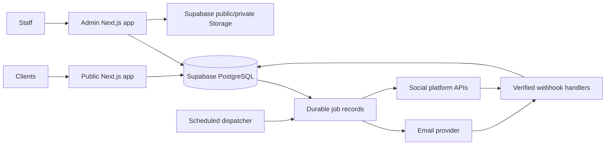

# Implementation Plan and Architecture

The plan below covers the remaining audit limitations and new requirements.

The recommended architecture is two separate Next.js deployments from the existing monorepo, Supabase PostgreSQL and Storage, Resend for email, and a shared integration layer managed through the admin dashboard.

One hosting constraint needs resolving before deployment: Vercel Hobby is restricted to non-commercial personal use, so it is unsuitable for the studio’s live business website and CRM. We can prepare both apps for Vercel, but commercial deployment needs an eligible plan. If zero hosting cost is essential, Cloudflare Workers/OpenNext is an alternative to evaluate through compatibility tests for Prisma, PDFs and caching. [Vercel terms](https://vercel.com/docs/plans/hobby), [Cloudflare Next.js support](https://developers.cloudflare.com/workers/framework-guides/web-apps/nextjs/).

## Provider choices

| Service | Recommendation | Important limitation |
| :--- | :--- | :--- |
| Database | Supabase PostgreSQL; keep Prisma and existing CRM authorization | Free includes 500 MB database storage and projects can pause after inactivity |
| Files | Supabase Storage with separate public and private buckets | Free includes 1 GB storage; PDFs, attachments and media require quota monitoring |
| Email | Resend initially; provider interface supporting alternatives | Free currently lists 3,000 emails/month and 100/day |
| Alternative hosted email | Brevo | Free currently includes 300 sends/day; receiving capabilities need separate assessment |
| Open-source email | Postal, as an optional future adapter | Requires its own server, DNS maintenance and deliverability operations |

These quotas come from [Supabase](https://supabase.com/pricing), [Resend](https://resend.com/pricing) and [Brevo](https://help.brevo.com/hc/en-us/articles/208580669-FAQs-What-are-the-limits-of-the-Free-plan). Resend is a hosted service; its free plan is different from operating an open-source mail server. [Postal’s requirements](https://docs.postalserver.io/getting-started/prerequisites/) make it a poor fit for the initial Vercel/Supabase setup.

## Proposed implementation sequence

| Phase | Planned work | Completion criteria |
| :--- | :--- | :--- |
| 1. Finish audit limitations | Remaining pagination, customer dossier exports, linked-field authorization, duplicate review, configuration completeness and feature-switch policy | Every growing list remains searchable/exportable; denied direct actions fail; no silent data truncation |
| 2. Prepare cloud architecture | Supabase connection pooling, object-storage adapter, finite background jobs, deployment configuration and domain-independent URLs | Both apps build without persistent local disk or continuously running worker processes |
| 3. Build integration settings | Replace demo integrations with persisted configuration, encrypted credentials, OAuth connections, permissions and truthful health checks | Reload preserves settings; connection status reflects actual evidence |
| 4. Complete admin authentication email | Invitations, OTP challenges, forgot/change password, security notifications and recovery policy | Expired/replayed challenges fail; password reset revokes sessions; existing MFA cannot be bypassed |
| 5. Build quotations | Quotation lifecycle, versioning, PDFs, approvals, acceptance and invoice conversion | Quotations have no accounting effect until conversion; concurrent conversion cannot duplicate invoices |
| 6. Build communications | Inquiry/complaint inbox, inbound email, replies, invoice/receipt/quotation/MOM sending and delivery events | Messages attach to the correct CRM record; retries do not duplicate sends |
| 7. Build social analytics | Facebook/Instagram and YouTube first; WhatsApp messaging metrics; additional approved connectors | Dashboard reads stored metrics, shows freshness and handles unavailable data truthfully |
| 8. Verify readiness | Browser/accessibility journeys, concurrency, quotas, backup restore, security tests and representative load | Documented evidence against agreed performance and reliability targets |

External connections and deployment would remain disabled until the later activation stage.

## 1. Close every remaining audit limitation

The selected [checklist](docs/audit-2026-10-04/FOLLOWUP.md) would become a tracked acceptance matrix:

*   Paginate calendar, meeting, company-document and other growing collections; finish scoped exports for every customer dossier domain.
*   Add relationship-level authorization for contact/deal/calendar/MOM references, signatures, attachments and reassignment. Runtime schemas alone do not establish authorization.
*   Create a duplicate-review workflow with merge preview, explicit approval, relationship reassignment and audit history. Shared email/phone should remain allowed until the business policy is agreed.
*   Add setup completeness checks for company identity, tax configuration, branding and publication.
*   Give feature switches clear semantics: navigation visibility, module availability and public submission availability.
*   Define mandatory MFA and lost-all-codes recovery policies, including stronger protection for privileged accounts.
*   Profile remaining public bundles, queries and payloads; complete Arabic/English, mobile, keyboard and screen-reader journeys.
*   Define retention for sessions, uploads, email evidence, analytics and audit records.

## 2. Make the apps ready for Vercel and Supabase

The current local-disk upload and permanent-worker design must change before cloud deployment.

Planned architecture:

Specific preparation:

*   Separate Vercel projects for apps/web and apps/admin, sharing workspace packages.
*   Pooled runtime database connections and a separate migration connection. Test the existing Prisma version against Supabase’s transaction pooler rather than copying newer Prisma configuration blindly. [Supabase Prisma guidance](https://supabase.com/docs/guides/database/prisma).
*   Separate migration and runtime database privileges; prevent unintended public Data API access to CRM tables.
*   Upload directly to Storage through short-lived authorized upload credentials. Finalization verifies owner, size, content and single claim before attaching the object.
*   Keep uploaded files private until validation completes. Public buckets contain only intentionally published assets.
*   Replace filesystem-dependent PDF assets with authorized object retrieval and bundled fonts.
*   Generate large exports into private Storage and provide authorized downloads.
*   Replace infinite worker loops with bounded job-processing functions preserving leases, retries and idempotency.
*   Use scheduled dispatch, with a fast path for authentication email. Supabase supports scheduled HTTP/function invocation through pg_cron and pg_net; scheduler credentials belong in Vault. [Scheduling documentation](https://supabase.com/docs/guides/functions/schedule-functions).

Direct uploads matter because Vercel functions have a 4.5 MB request payload limit, below the app’s current 10 MB file allowance. Hobby cron also runs at most daily, which cannot support timely OTP delivery. [Function limits](https://vercel.com/docs/functions/limitations), [cron limits](https://vercel.com/docs/cron-jobs/usage-and-pricing).

## 3. Email: authentication and client communications

Recommend Resend first, retaining a provider interface for Brevo, SMTP or Postal later.

The email system should support:

*   Admin invitations and account verification.
*   Email OTP challenges where required by policy.
*   Forgot-password links/codes, password-change confirmation and security notifications.
*   Website inquiry/complaint notifications and optional acknowledgments.
*   Receiving client messages and replies.
*   Sending quotations, invoices, payment receipts and approved meeting documents.

For authentication, challenges would be short-lived, purpose-bound, attempt-limited and single-use. Resetting a password would revoke sessions. Email OTP would not silently replace or bypass existing TOTP MFA. Authentication messages receive priority and reserved capacity so client notifications cannot exhaust their quota.

For client communications:

*   Persist the inquiry/complaint before sending notifications.
*   Add a shared inbox with assignment, status, conversation history and attachments.
*   Verify inbound webhooks; deduplicate provider events.
*   Thread replies using message identifiers and references, with manual resolution for ambiguous identities.
*   Sanitize email HTML and quarantine untrusted attachments.
*   Prevent automatic acknowledgment loops.
*   Store document version, recipient, actor and delivery evidence.
*   Display separate states for queued, provider accepted, delivered, bounced and failed. Opens are optional signals, not proof that someone read a document.

Resend supports inbound email and webhook processing. Start with its supplied receiving domain for testing, then configure a dedicated receiving subdomain when your custom domain is ready. This also avoids accidentally replacing an existing company mailbox’s MX records. [Resend receiving documentation](https://resend.com/docs/dashboard/receiving/introduction).

## 4. Quotations as a proper CRM feature

Add quotations as their own document type:

*   Unique numbering, customer/deal/inquiry links, currency, line items, discounts, tax, validity date and bilingual terms.
*   Lifecycle: draft → review → approved → issued → accepted/declined/expired/cancelled.
*   Immutable issued versions; amendments create a new revision.
*   Arabic/English PDF, email delivery and delivery history.
*   Acceptance evidence through a secure, expiring link or audited staff-recorded acceptance.
*   Transactional, idempotent conversion into an invoice.
*   Preserve the quoted commercial snapshot; flag pricing/tax changes during conversion.
*   Keep quotations out of revenue, receivables and payment totals.
*   Dashboard metrics for value issued, acceptance rate, expirations and conversions.

Initially, use one full-invoice conversion per accepted quotation. Deposit and milestone invoicing can be added with explicit rules rather than risking duplicate or inconsistent billing.

## 5. Admin configuration and integration management

The existing Meta integrations screen currently contains hardcoded “connected” state and simulated save/test messages. Replace it with real configuration pages:

| Admin area | Configuration and visibility |
| :--- | :--- |
| Email | Provider, sender/reply-to addresses, recipients, templates, routing, quotas and delivery failures |
| Inbox | Channels, assignment rules, acknowledgments, spam controls and retention |
| Authentication | OTP expiry/attempt policy, invitations, MFA requirements and recovery settings |
| Quotations | Numbering, terms, approval rules, validity and conversion policy |
| Social accounts | Connect/disconnect, account selection, granted scopes, expiry and reconnect status |
| WhatsApp | Business/phone identifiers, approved templates, consent, routing and document-send rules |
| Operations | Queue health, last successful runs, storage usage, failures and configuration readiness |

Use separate permissions for reading settings, changing settings, managing secrets, sending messages and viewing analytics. Sensitive changes require reauthentication and audit records.

Infrastructure secrets stay in deployment secret storage. Dashboard-managed credentials and OAuth tokens are encrypted in the database. The UI shows masked values and replacement controls; it never returns stored secret plaintext.

## 6. Social analytics dashboard

Build a connector framework that supports multiple accounts and platform-specific capabilities.

| Platform | Planned scope | Access boundary |
| :--- | :--- | :--- |
| Facebook/Instagram | Account/media performance, engagement and supported audience metrics; lead intake where authorized | Account ownership, account type, permissions and applicable Meta review |
| YouTube | Views, watch time, subscribers, video performance and available audience reports | Owner-authorized OAuth; monetary reports need additional scope |
| WhatsApp | Incoming/outgoing messages, delivery failures, response time and supported usage metrics | Official business access, approved messaging rules and current pricing |
| LinkedIn | Company-page activity and supported follower/post analytics | Community Management API access |
| TikTok | Authorized profile/video statistics first | Display API capabilities; richer business analytics require separate evaluation |
| X | Optional connector with budget controls | API currently uses paid usage credits |
| Other platforms | Capability assessment and clearly labelled CSV/manual imports | No promise of unrestricted analytics access |

YouTube’s analytics API requires OAuth authorization. LinkedIn’s Community Management API provides company-page analytics, and TikTok exposes supported video statistics. [YouTube](https://developers.google.com/youtube/analytics/reference/reports/query), [LinkedIn](https://learnmicrosoft.com/en-us/linkedin/marketing/community-management/community-management-overview), [TikTok](https://developers.tiktok.com/docs/en/tiktok-api-v2-video-object), [X pricing](https://docs.x.com/x-api/getting-started/pricing).

Meta’s direct documentation was partially inaccessible during this review, so exact permissions, metric availability and WhatsApp pricing must be reconfirmed during connector activation.

Dashboard design:

*   Overview plus per-platform/account/post views.
*   Date comparisons, top content, audience trends and source attribution.
*   Separate organic and paid metrics.
*   Stored daily snapshots and background incremental synchronization.
*   Last-sync timestamps, stale-data warnings and quota/error status.
*   Preserve platform metric definitions; do not present combined reach as unique people.

Add optional GA4 website analytics and UTM-based CRM conversion reporting. Attribution should be labelled as observed evidence, not guaranteed causation. [GA4 Data API](https://developers.google.com/analytics/devguides/reporting/data/v1).

## 7. Proposed environment-variable contract

These are planned variables, not changes to the existing .env. Some require new implementation.

| Group | Variables |
| :--- | :--- |
| Database | DATABASE_URL, DIRECT_URL |
| Application URLs | WEB_URL, ADMIN_URL, NEXT_PUBLIC_WEB_URL, NEXT_PUBLIC_ADMIN_URL, NEXT_PUBLIC_DEFAULT_LOCALE |
| Security | JWT_SECRET, MFA_ENCRYPTION_KEY, INTEGRATIONS_ENCRYPTION_KEY, AUTH_CHALLENGE_SECRET, REVALIDATION_SECRET, CRON_SECRET |
| Storage | STORAGE_PROVIDER, SUPABASE_URL, SUPABASE_SECRET_KEY, SUPABASE_PUBLIC_BUCKET, SUPABASE_PRIVATE_BUCKET |
| Email | EMAIL_PROVIDER, EMAIL_OUTBOUND_ENABLED, EMAIL_INBOUND_ENABLED, RESEND_API_KEY, RESEND_WEBHOOK_SECRET, FROM_EMAIL, AUTH_FROM_EMAIL, REPLY_TO_EMAIL, NOTIFICATION_EMAIL, EMAIL_RECEIVING_DOMAIN |
| Alternative email | BREVO_API_KEY or SMTP_HOST, SMTP_PORT, SMTP_SECURE, SMTP_USER, SMTP_PASSWORD |
| Google/YouTube | GOOGLE_CLIENT_ID, GOOGLE_CLIENT_SECRET, GOOGLE_OAUTH_REDIRECT_URI |
| Meta/WhatsApp | META_APP_ID, META_APP_SECRET, META_GRAPH_API_VERSION, META_OAUTH_REDIRECT_URI, META_WEBHOOK_VERIFY_TOKEN |
| Optional connectors | Provider client IDs/secrets and redirect URIs for LinkedIn, TikTok and X |
| Website analytics | NEXT_PUBLIC_GA_MEASUREMENT_ID, NEXT_PUBLIC_META_PIXEL_ID when tracking is enabled |
| Operations | OBSERVABILITY_ENABLED, WORKER_ALERT_AFTER_SECONDS, TRUSTED_CLIENT_IP_HEADER after ingress verification |
| Initial setup | COMPANY_CONFIG_FILE and one-time bootstrap credentials |

Account IDs, sender preferences, templates, synchronization intervals and automation rules should primarily live in dashboard-managed database settings. OAuth access/refresh tokens belong in encrypted credential records.

Only intentionally public values receive NEXT_PUBLIC_. Development, preview and production need separate settings; outbound messaging and automatic sends start disabled.

## 8. Custom-domain readiness and activation later

Prepare configurable website, admin, sending and receiving domains without hardcoding the eventual hostname.

Later activation would cover DNS/TLS, canonical redirects, OAuth callbacks, webhook URLs, SPF/DKIM/DMARC, receiving MX records, cookie boundaries and preview isolation. Custom-domain changes should not require rewriting CRM business logic.

The implementation order should remain: audit gaps → cloud/storage readiness → real configuration → authentication email → quotations → communications → social analytics → final verification. Deployment, DNS changes, provider connections and real message sending stay in the later activation stage.
