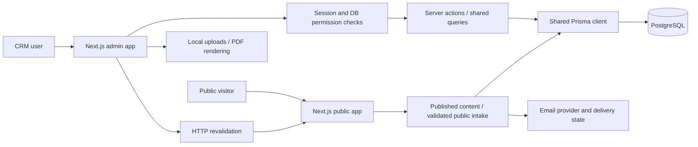
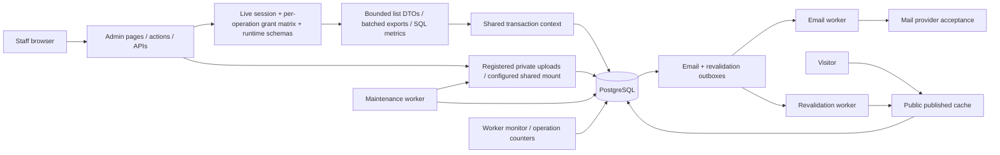

# System design and remaining optimization plan

## Current architecture

Server-side reads in both apps use the shared database package directly. The admin-to-public HTTP link is cache invalidation, not the main data transport. Do not add an HTTP hop between the apps and the database merely to unify the monorepo. API handlers are appropriate for external/public clients and integration boundaries; server actions remain authorized mutation boundaries.

The implemented pass centralizes effective grants, deduplicates request reads and replaces full-ledger financial reductions with SQL aggregates. The next structural change should address growing lists and state integrity before introducing services or broad caches.

## Requirements and unknowns

Preserve complete CRM and financial data; make deny/revocation effective on direct requests; prevent duplicate conversions and lost workflow updates; separate missing configuration from false business identity; expose truthful delivery/approval states; reduce payload and query growth as data volume increases. Keep draft content and private user data out of shared public caches.

Traffic volume, peak concurrent staff, record growth, deployment region, DB pool limits, email throughput and availability targets are unknown. Use measured staging/production-shaped load before setting capacity or claiming a latency SLA. Proposed gates: bounded page size and field selection, no unauthorized-domain reads, identical ledger totals, no duplicate financial effect under retries, and documented p95/error thresholds for the actual hosting environment.

## Data contracts and pagination

Create dedicated list DTOs rather than sending Prisma aggregates to client components:

| Domain              | List projection                                                                       | Detail / separate query                                               |
| ------------------- | ------------------------------------------------------------------------------------- | --------------------------------------------------------------------- |
| Invoice             | ID, number, customer display name, status, currency, total, due date, amount paid/due | Line items, full addresses, banking/snapshot data, audit history, PDF |
| Customer            | ID, display name, company, normalized contact, status, updated time                   | Permitted dossier domains and per-currency metrics                    |
| Request             | ID, reference, intent, status, assignee/team, received time                           | Message, assignment history, attachments and transitions              |
| Payment             | ID, receipt reference, invoice number, amount, currency, date/method                  | Invoice detail and receipt                                            |
| Executive dashboard | Counts, grouped pipeline totals and top five deals / next three events                | Paginated domain pages                                                |

Use an indexed stable sort such as `(createdAt, id)` and an opaque cursor; filter in the database and cap page size. Return `items`, `nextCursor`, `hasMore`, with counts as a separately cached/aggregate query when needed. UI must expose navigation and search across the full dataset. Exports need explicit export grants and a streaming/batched full-data path. Replacing `findMany` with an arbitrary `take` without UI navigation would conceal data and is not acceptable.

Introduce changes one list at a time: invoice/payment -> request/customer -> archive -> executive dashboard. Compare payload bytes, SQL statement counts and p95 under synthetic 1k/10k/100k datasets; validate filters and last-page behavior. Preserve detail behavior and enforce permissions before data reads.

## Workflow and ledger integrity

Model request transitions explicitly. Proposed vocabulary needs product confirmation: received -> assigned -> in progress -> pending approval -> approved -> confirmed -> resolved, with return/reassignment rules. Current `approveRequest` writing `pending_approval` demonstrates the need to reconcile terminology before migrating historical states.

Use a transaction with row locking or conditional version update, verify expected state and actor, then append immutable history. Return a conflict with the new state when another actor wins. Store assignee/approver IDs as relations and timestamps as structured fields; use separate history rows rather than read-modify-write JSON arrays. Audit records should commit with mutations.

Keep invoice VAT/currency/pricing snapshots immutable after issue; define allowed draft edits, void behavior and receipt corrections. Use the same invoice lock order for payment create/edit/delete; reconcile from persisted payments in one transaction. Express money with database decimals; serialize consistently for UI. Any reporting conversion requires persisted FX policy and rates, not summing unlike currencies.

Add explicit inquiry conversion identity keyed by inquiry and conversion type. An activity log is evidence, not a uniqueness constraint. Customer identifiers require historical duplicate reconciliation before unique indexes; define normalization and whether organizations may legitimately share email/phone.

## Published website and cross-app reliability

Keep authenticated preview dynamically loaded and no-store. For normal visitors, cache the versioned published snapshot and public-company DTO with tags. Publish should commit a new version plus outbox event, then a worker calls the public app's authenticated invalidation endpoint with retries and delivery evidence. The editor should show draft version, live version, published timestamp and pending/failed delivery.

Request-local React caching is already implemented. A shared tagged cache is the next option; it requires reliable invalidation first. TTL-only caching is simpler but knowingly serves stale edits. No-cache avoids invalidation complexity but increases DB/network reads per public request. Prefer tagged published caching once outbox delivery exists; keep a fallback TTL as recovery, with explicit observable freshness.

Do not cache session/user/grant decisions in a public cache. Build narrow public settings/content DTOs and validate stored snapshot versions. Convert admin-local asset paths to deployed public asset origins or durable object URLs through one asset abstraction. Validate remote media at ingestion rather than letting PDF generation fetch arbitrary URLs.

## Authorization and configuration

Treat middleware as JWT routing optimization; final authorization belongs at pages/actions/API handlers against the live user and DB grants. Default deny missing permissions. Roles/settings changes are atomic and privileged, with no special hardcoded browser grant table. Add runtime schemas for every mutating action and test allowed/denied fields, object ownership, export and direct access.

Decide whether feature flags mean navigation visibility or actual availability, then implement that policy consistently. Bootstrap is separate from runtime reads; development sample business records must never appear in production. Validation should require identity/tax/bank fields only when the corresponding feature needs them and report explicit setup errors. Code constants for locale labels, colors and protocol rules need not become DB rows.

Enforce trusted proxy/IP handling and shared login/public-intake limits at ingress. Require invitation/explicit account passwords, remove the remaining shared default password path, hash session tokens at rest, and plan recovery/MFA. Move private uploads to durable storage with ownership metadata, safe size/content validation and authorized downloads.

## Observability and delivery

Record request/action duration, DB duration/count, rows, response bytes, error category and correlation ID without logging secrets or full customer payloads. Track p50/p95/p99, pool wait, slow queries, email/outbox retries and publish freshness. Keep deployments near the database and calculate total pool connections across app instances before scaling.

Add noninteractive lint/CI and disposable-DB migrations/parity checks. Stage role matrices, browser journeys and concurrency tests before canary rollout. Tune indexes from real query plans rather than adding every plausible index: each extra index costs write/storage time. Already added indexes target line-item ordering, expense/date/currency, event dates, notifications and attachment access; validate benefits against actual production selectivity.

Keep the present modular monorepo while strengthening DTOs and transaction boundaries. Splitting services now would add network latency, deployment and distributed transaction failure modes without evidence that independent scaling is needed. Reconsider a separate worker for email/invalidation/PDF queues when measured throughput justifies it.

See [REPORT.md](REPORT.md) for implemented changes, measurements, remaining findings, test evidence and migration rollout constraints.

## Implemented continuation architecture

This section supersedes the proposed next steps above where they overlap. Source is authoritative; the existing graphify graph was used for navigation and has not been rebuilt for these uncommitted changes.

Admin list navigation uses stable `(createdAt,id)` ordering with page numbers and database counts; exports use ID keysets so deleting a boundary record does not stop the export. This keeps familiar page navigation and complete data access. Deep offset pages still cost more; adopt opaque cursors if representative datasets demonstrate a bottleneck. Search/count work is deliberate, not a hidden full-object download. Export consistency is per batch, not one transaction held open for the entire download.

Transactions use an async operation context so shared query helpers and audit writes commit together. The permission matrix is memoized only within the request/operation, never globally. Feature switches mask permissions on direct server paths. MFA secrets use a separate encryption key; shared abuse windows use database time and atomic increments. These add database writes intentionally to enforce cross-instance correctness; validate pool capacity under real concurrency.

Workers are separate processes in the existing monorepo. Email queue state distinguishes pending/processing/accepted/failed; provider acceptance is not proof of inbox delivery. Lease/attempt fencing prevents stale workers changing current state, but external side effects require provider idempotency and an operator policy after its retention window. Revalidation remains app-local unless the deployment provides shared cache invalidation.

Storage metadata and claims are transactional; physical file writes/deletes cannot roll back with PostgreSQL. Failed new writes are cleaned up, expired pending files are collected and missing-file cleanup can retry. UPLOAD_ROOT is an absolute production shared mount requirement. S3 environment names are reserved and do not implement an adapter. Select private object storage or a durable mount based on the real host topology; do not deploy ephemeral local disk and call it durable.

Use [FOLLOWUP.md](FOLLOWUP.md) as the current implementation/verification/remaining-work register. [LOCAL-HTTP-PROFILE.json](LOCAL-HTTP-PROFILE.json) is a mostly-empty local baseline only. Representative production data, regions, replicas, pool budget, backup recovery and accessibility journeys are still required before availability/latency targets can be signed off.
