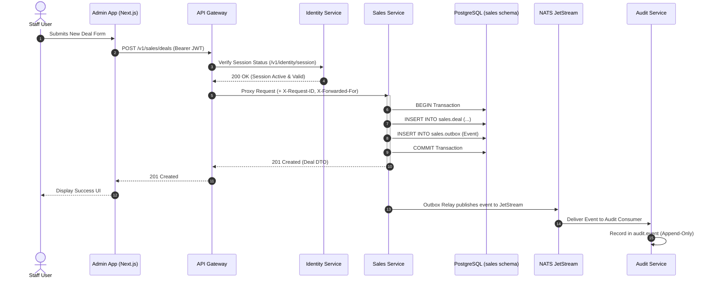

# Backend Architecture & System Principles

```
Browser ─▶ apps/web · apps/admin · apps/it   (Next.js 16: App Router, Server Actions, API Client)
                │ Server-Side Proxy: Ed25519 JWT + X-Request-ID
                ▼
            gateway ── Routing · JWKS Token Validation · Rate Limiting (Valkey) · Tracing
                ▼
  identity · system · files · notify · realtime · audit · workflow · cms · sales · finance · hr · inventory · commerce · delivery · itsm
        │ pgx + sqlc                     │ outbox → NATS JetStream          │ River Queue Jobs
        ▼                                ▼                                   ▼
  PostgreSQL 17 (Schema per Service)      Valkey    SeaweedFS / S3 Storage    OpenTelemetry → Prometheus · Loki · Tempo · Grafana
```

---

## 1. Architectural Core Principles

The backend platform is built upon four fundamental architectural principles:

1. **Strict Data Isolation (Schema-per-Service)**: Each business domain is owned by a single microservice. Microservices connect using dedicated PostgreSQL logins (`svc_<service>`) with permissions restricted strictly to their schema. Direct cross-service database queries or JOINs are prohibited.
2. **Synchronous Reads vs. Asynchronous Events**:
   * **Reads**: Microservices expose synchronous REST APIs described by OpenAPI 3.1 specifications.
   * **Writes & Reactivity**: State changes emit domain events written to a PostgreSQL `outbox` table within the same ACID transaction, then published to NATS JetStream.
3. **Defense-in-Depth Token Security**: The API Gateway verifies Ed25519 access tokens against JWKS before routing. Downstream microservices re-verify tokens independently.
4. **Configuration via Code**: All environment parameters are typed in Go structs (`Config`), validated on startup, and generated into documentation (`docs/backend/CONFIG.md`).

---

## 2. Microservice Boundaries & Domain Mapping

| Service | Primary Business Boundary | Owned Database Schema | Outbox Event Stream |
|---|---|---|---|
| **gateway** | Routing, token checks, rate limits, session probes | *(None)* | — |
| **identity** | Staff, Customer, IT accounts, authentication, MFA | `identity` | `identity.user.*`, `identity.session.*` |
| **system** | Settings, feature toggles, integrations, site code | `system` | `system.settings.*`, `system.module.*` |
| **files** | File metadata, upload verification, S3 storage | `files` | `files.object.*` |
| **notify** | Email, SMS, WhatsApp dispatch, user inboxes | `notify` | `notify.message.*` |
| **realtime** | SSE streaming, user presence, connection state | `realtime` | `realtime.presence.*` |
| **audit** | Append-only security audit trail for all events | `audit` | — |
| **itsm** | Support tickets, SLA tracking, IT comments | `itsm` | `itsm.ticket.*` |
| **cms** | Block pages, articles, reviews, FAQs, snapshots | `cms` | `cms.page.*`, `cms.article.*` |
| **sales** | CRM contacts, deals, quotations, campaigns | `sales` | `sales.deal.*`, `sales.quotation.*` |
| **finance** | Invoices, payments, expenses, bank settlements | `finance` | `finance.invoice.*`, `finance.payment.*` |
| **workflow** | Approvals, digital signatures, letters, tasks | `workflow` | `workflow.approval.*`, `workflow.document.*` |
| **hr** | Departments, employees, leave, attendance, payroll | `hr` | `hr.payroll.*`, `hr.leave.*` |
| **inventory** | Warehouses, products, variants, stock ledger | `inventory` | `inventory.stock.*` |
| **commerce** | Customers, store orders, POS registers, shifts | `commerce` | `commerce.order.*` |
| **delivery** | Zones, slots, fleet vehicles, route sheets, shipments | `delivery` | `delivery.shipment.*` |

---

## 3. End-to-End Request & Event Lifecycle



---

## 4. High-Availability & Scalability Architecture

* **Stateless Gateway & Services**: Microservices maintain no in-memory session state; scaling replicas horizontally requires no session affinity or sticky sessions.
* **Shared Cache (Valkey)**: Gateway rate-limiting counters and real-time presence states reside in Valkey.
* **Durable Event Storage (NATS JetStream)**: Outbox events persist in JetStream streams (`EVENTS`) with configurable message retention and deduplication windows.
* **Background Queue Execution (River)**: Periodic tasks (SLA breach checks, notification retry queues, expired upload sweeps) process via PostgreSQL-backed River workers using `FOR UPDATE SKIP LOCKED`.
