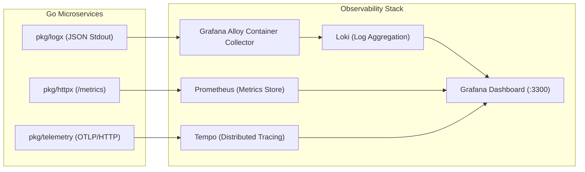

# Observability, Metrics & Telemetry Guide

This document covers backend logging, Prometheus metrics, OpenTelemetry distributed tracing, and diagnostic profiling.

---

## 1. Observability Architecture Overview

The backend implements the three pillars of observability (Logs, Metrics, Traces) across all 16 microservices.



---

## 2. Telemetry Signal Matrix

| Signal | Package | Storage Engine | Collection Mechanism | Grafana Query / View |
|---|---|---|---|---|
| **Logs** | `pkg/logx` | **Grafana Loki** | Container `stdout` captured by Grafana Alloy. | LogQL queries filtered by `service`, `level`, `trace_id`. |
| **Metrics** | `pkg/httpx` | **Prometheus** | Scraped from `:9090/metrics` via ServiceMonitor. | PromQL dashboards for HTTP rates, latencies, Go runtime. |
| **Traces** | `pkg/telemetry` | **Grafana Tempo** | Exported via OpenTelemetry OTLP/HTTP. | Trace timeline views correlated by W3C `traceparent`. |

---

## 3. Log Anatomy & Correlation

All log output is structured JSON containing standard correlation fields:

```json
{
  "time": "2026-11-02T14:32:01.124Z",
  "level": "info",
  "msg": "HTTP request completed",
  "service": "finance",
  "version": "1.4.0",
  "env": "production",
  "request_id": "req-98f2a17b-4c12",
  "trace_id": "4bf92f3577b34da6a3ce929d0e0e4736",
  "user_id": "usr-8812",
  "realm": "staff",
  "method": "POST",
  "route": "/v1/finance/invoices",
  "path": "/v1/finance/invoices",
  "status": 201,
  "duration_ms": 14.2,
  "client_ip": "10.244.0.15"
}
```

* **Correlation**: Searching Loki for a `request_id` aggregates all log lines produced by that request across microservices. The `trace_id` links directly to the Tempo trace timeline.

---

## 4. Primary Prometheus Metrics

| Metric Name | Type | Description & Labels |
|---|---|---|
| `http_requests_total` | Counter | Total HTTP requests served (`service`, `method`, `route`, `status`). |
| `http_request_duration_seconds` | Histogram | Request latency distribution (`service`, `method`, `route`). |
| `http_requests_in_flight` | Gauge | Currently active HTTP requests (`service`). |
| `outbox_pending_events` | Gauge | Pending events waiting in outbox relay queue (`service`). |
| `outbox_publish_failures_total` | Counter | Failed event publication attempts to NATS (`service`). |

---

## 5. Local Telemetry Stack Execution

To launch the local Grafana/Prometheus/Loki/Tempo stack:

```bash
# Launch telemetry containers
docker compose --profile observability up -d

# Open Grafana dashboard in browser
open http://localhost:3300
```
* **Default Credentials**: Username `admin`, Password `GRAFANA_ADMIN_PASSWORD` (configured in `.env`).
