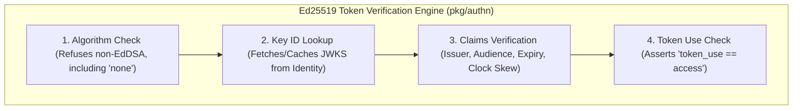

# Backend Security Architecture & Standards

This document covers backend token verification, authentication realms, encryption at rest, HTTP security headers, database privilege isolation, and container supply-chain security.

---

## 1. Authentication Realms & Token Architecture

The backend supports four distinct token realms:

| Realm | User / Caller | Target Audience | Key Characteristics |
|---|---|---|---|
| **`staff`** | Admin Staff | `platform:staff` | Short-lived JWTs; Argon2id passwords; optional TOTP MFA. |
| **`customer`** | Web Shoppers | `platform:customer` | 30-day session tokens; supports Google/Apple OAuth & 6-digit OTP. |
| **`it`** | IT Operators | `platform:it` | Short-lived JWTs; **mandatory** TOTP MFA; optional CIDR allowlist. |
| **`service`** | Backend Apps | `platform:service` | Short-lived inter-service JWTs signed by application service keys. |

---

## 2. Encryption at Rest (`pkg/secrets`)

Sensitive credentials (payment gateway secrets, WhatsApp tokens, courier credentials) are encrypted at rest using **AES-256-GCM**.

* **Key Ring Support**: Supports multiple active keys. Primary keys encrypt new data (`v1.<keyID>.<ciphertext>`), while secondary keys allow seamless key rotation.
* **Context Binding**: Ciphertexts are bound to their specific functional context (e.g. `integration:stripe`), preventing ciphertexts from being reused across different fields.
* **Redaction**: Loggers (`pkg/logx`) automatically redact values matching secret patterns.

---

## 3. Database Privilege Isolation

To prevent SQL injection vulnerabilities from compromising unrelated domain tables:

* **Role Isolation**: Each microservice connects as `svc_<service>`, which owns its schema (`identity`, `finance`, `hr`, etc.) and possesses zero privileges over other service schemas.
* **Superuser Prohibition**: Microservices never connect as PostgreSQL superusers (`postgres`). Schema creation (`CREATE SCHEMA`) is forbidden at runtime.
* **Timeouts**: Every database role enforces `statement_timeout = 15s` and `idle_in_transaction_session_timeout = 30s`.

---

## 4. HTTP & Container Hardening

### HTTP Response Headers (`pkg/httpx`)
- `X-Content-Type-Options: nosniff`
- `X-Frame-Options: DENY`
- `Referrer-Policy: no-referrer`
- Strict Content Security Policy (CSP) & HSTS enabled in non-development modes.

### Container & Kubernetes Security Context
- **Distroless Non-Root**: Containers run as non-root user `65532:65532` (`gcr.io/distroless/static-debian12`).
- **Read-Only Root Filesystem**: Container root filesystem is mounted read-only.
- **Capabilities**: All Linux capabilities dropped (`drop: ["ALL"]`).
- **Seccomp**: Enforces `RuntimeDefault` seccomp profile.
