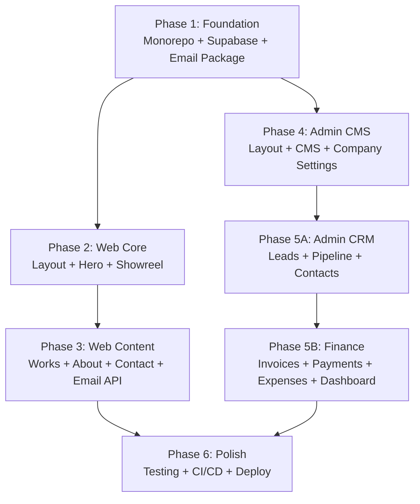

# Implementation Plan — ishoot Dual-Frontend Web Ecosystem

---

## Goal

Build the complete, production-ready **ishoot** web ecosystem: a Turborepo monorepo with two Next.js 15 applications (public client-facing site at `ishoot.bh` and admin CMS/CRM portal at `admin.ishoot.bh`), backed by a shared Supabase instance, with full English/Arabic bilingual support, comprehensive financial management (invoicing, payments, expenses, profit tracking), and a cinematic dark emerald design system derived from the official brand guidelines.

---

## Approved User Decisions & Implementation Directives

> [!NOTE]
> **1. Local-First Development**: All components, database mocks/schema, seed data, and email/PDF utilities will run seamlessly locally with fallback providers. External cloud setup (live Supabase credentials, Vercel deployments, live Resend keys) will be configured subsequently.
> 
> **2. Multi-Currency Support (GCC + USD)**:
> - **Default**: `BHD` (Bahraini Dinar — 3 decimal places)
> - **GCC & International Supported**:
>   - `SAR` (Saudi Riyal — 2 decimals)
>   - `AED` (UAE Dirham — 2 decimals)
>   - `KWD` (Kuwaiti Dinar — 3 decimals)
>   - `OMR` (Omani Rial — 3 decimals)
>   - `QAR` (Qatari Riyal — 2 decimals)
>   - `USD` (US Dollar — 2 decimals)
> - Dynamic currency selection with precision-aware calculation engine.
>
> **3. Exact Brand Invoice Templates (English & Arabic)**:
> - Derived directly from the brand's AI invoice assets (`ishoot/2 invoice files/`).
> - Dedicated **English** and **Arabic** PDF templates using exact brand colors (`#014842` header bar, `#09937F` accent).
> - Dynamic VAT handling: If `vat_enabled = false`, displays "VAT: Not Applicable" / "ض.ق.م: غير مطبقة" with zero tax; if toggled on, renders VAT registration ID and calculates tax.
> - Multi-page A4 print protection: Automatically wraps tables across multiple pages while preserving the header banner and footer letterhead without graphical clipping.
>
> **4. WhatsApp Dispatch**: Generates instant `wa.me` links with encoded message & PDF document links, architected behind an extensible provider interface ready for Meta Cloud API integration in the future.
>
> **5. Transactional Email**: Built with Resend (free tier) + local preview logger when running in local dev mode without API keys.
>
> **6. Expanded Expense Categories**:
> - `equipment_rental` (Equipment & Gear Rental)
> - `crew_labor` (Crew & Freelance Labor)
> - `location_permits` (Location Permits & Scouting)
> - `travel_logistics` (Travel, Fuel & Transport)
> - `props_wardrobe` (Props, Styling & Wardrobe)
> - `catering_hospitality` (Craft Services & Hospitality)
> - `post_production` (External Color Grading & VFX)
> - `sound_music` (Sound Design, Foley & Music Licensing)
> - `studio_rent` (Studio Space & Facility Lease)
> - `utilities` (Studio Power & Utilities)
> - `software_subscriptions` (Adobe CC, DaVinci, Frame.io, Storage)
> - `marketing_ads` (Marketing, PR & Advertising)
> - `insurance` (Production & Equipment Insurance)
> - `maintenance_repairs` (Camera & Drone Maintenance)
> - `office_admin` (Office Supplies & Legal)
> - `other` (Custom Specification)

---

## Companion Documents

These documents provide persistent context and are referenced throughout. All documents are saved to the repo at `/docs/`:

| Document | Artifact | Repo Copy | Purpose |
|----------|----------|-----------|---------|
| **Design System** | [design.md](file:///Users/sayed/.gemini/antigravity/brain/6c514a07-0e62-402f-b130-0666dc778cfd/design.md) | `docs/design.md` | Color tokens, typography, motion, components |
| **Architecture** | [structure.md](file:///Users/sayed/.gemini/antigravity/brain/6c514a07-0e62-402f-b130-0666dc778cfd/structure.md) | `docs/structure.md` | Monorepo, Supabase, i18n, data flows |
| **File Tree** | [tree.md](file:///Users/sayed/.gemini/antigravity/brain/6c514a07-0e62-402f-b130-0666dc778cfd/tree.md) | `docs/tree.md` | Every file that needs to be created |
| **Admin Rules** | [admin-rules.md](file:///Users/sayed/.gemini/antigravity/brain/6c514a07-0e62-402f-b130-0666dc778cfd/admin-rules.md) | `docs/admin-rules.md` | RBAC, CMS, CRM, invoicing, financials |
| **Agent Skill** | [SKILL.md](file:///Users/sayed/.gemini/antigravity/brain/6c514a07-0e62-402f-b130-0666dc778cfd/SKILL.md) | `docs/SKILL.md` | Agent context retention |

---

## Proposed Changes

### Phase 1 — Foundation (Monorepo + Supabase + Shared Packages)

Sets up the entire project infrastructure that all subsequent phases depend on.

#### [NEW] Root Configuration Files

| File | Purpose |
|------|---------|
| `package.json` | Root workspace with pnpm + turbo scripts |
| `pnpm-workspace.yaml` | Workspace globs: `apps/*`, `packages/*` |
| `turbo.json` | Pipeline: build, lint, dev, type-check |
| `.gitignore` | Node, Next.js, environment files |
| `.npmrc` | pnpm settings |

#### [NEW] `packages/config/`
- `tailwind.config.ts` — Shared Tailwind v4 config with ishoot color tokens, font definitions, animation utilities
- `tsconfig.base.json` — Base TypeScript configuration
- `eslint.config.mjs` — Shared ESLint rules

#### [NEW] `packages/locales/`
- `src/en.json` — Complete English translations (nav, hero, services, portfolio, about, contact, footer, meta, admin, financials, emails)
- `src/ar.json` — Complete Arabic translations (matching all EN keys)
- `src/index.ts` — Type-safe translation loader with `Locale`, `TranslationKeys`, `getTranslations()`

#### [NEW] `packages/database/`
- `src/schema.sql` — Full migration (see updated schema below):
  - **Core**: `profiles`, `company_settings`
  - **CMS**: `hero_banners`, `portfolio_categories`, `portfolio_items`, `client_logos`, `studio_equipment`
  - **CRM**: `inquiries`, `crm_contacts`, `crm_deals`
  - **Financials**: `invoices`, `invoice_line_items`, `payments`, `expenses`, `expense_categories`
  - **RLS policies** + **storage buckets** + **triggers**
- `src/client.ts` — Supabase client factory (browser + server + middleware)
- `src/types.ts` — Generated TypeScript types from schema
- `src/queries/*.ts` — Typed query functions for each table (including `payments.ts`, `expenses.ts`, `company-settings.ts`)

#### [NEW] `packages/ui/`
- Atomic components: Button, Input, Textarea, Select, Badge, Modal, Dialog, DropdownMenu, Tabs, Toggle, Separator, Skeleton, Toast, Tooltip, Avatar, Card, Label, ScrollArea

#### [NEW] `packages/email/`
- `src/index.ts` — Email service abstraction (Resend client)
- `src/templates/inquiry-confirmation.tsx` — "Thank you for contacting us" (EN/AR)
- `src/templates/inquiry-notification.tsx` — Internal "[Name] is requesting to contact you"
- `src/templates/invoice-delivery.tsx` — Invoice email with PDF attachment
- `src/templates/payment-receipt.tsx` — Payment received confirmation with receipt PDF
- `src/templates/layout.tsx` — Shared brand email layout (emerald header, logo, footer)

##### New Database Tables (Phase 1 Schema)

**`company_settings`** (single-row config)
```sql
CREATE TABLE company_settings (
  id UUID PRIMARY KEY DEFAULT gen_random_uuid(),
  company_name_en TEXT NOT NULL DEFAULT 'ishoot',
  company_name_ar TEXT NOT NULL DEFAULT 'آي شوت',
  cr_number TEXT,                           -- Commercial Registration
  vat_id TEXT,                              -- VAT registration number (null if not registered)
  vat_enabled BOOLEAN NOT NULL DEFAULT false, -- ← Currently FALSE
  vat_percentage NUMERIC(5,2) NOT NULL DEFAULT 10.00, -- Ready for 10% when activated
  default_currency TEXT NOT NULL DEFAULT 'BHD',
  currency_decimals INT NOT NULL DEFAULT 3,
  address_en TEXT,
  address_ar TEXT,
  phone TEXT,
  email TEXT,
  website TEXT DEFAULT 'https://ishoot.bh',
  bank_name TEXT,
  bank_iban TEXT,
  bank_account_number TEXT,
  bank_swift TEXT,
  logo_url TEXT,
  payment_terms_days INT NOT NULL DEFAULT 30,
  invoice_prefix TEXT NOT NULL DEFAULT 'ISH',
  invoice_next_number INT NOT NULL DEFAULT 1,
  receipt_prefix TEXT NOT NULL DEFAULT 'RCT',
  receipt_next_number INT NOT NULL DEFAULT 1,
  updated_at TIMESTAMPTZ DEFAULT now()
);
```

**`payments`** (tracks every payment against an invoice)
```sql
CREATE TABLE payments (
  id UUID PRIMARY KEY DEFAULT gen_random_uuid(),
  invoice_id UUID NOT NULL REFERENCES invoices(id),
  payment_date DATE NOT NULL DEFAULT CURRENT_DATE,
  amount NUMERIC(12,3) NOT NULL,            -- BHD 3 decimals
  payment_method TEXT NOT NULL DEFAULT 'bank_transfer',
    -- 'bank_transfer', 'cash', 'cheque', 'card', 'online'
  reference_number TEXT,                    -- Bank ref / cheque number
  notes TEXT,
  receipt_number TEXT UNIQUE,               -- RCT-2026-001
  receipt_pdf_path TEXT,                    -- Supabase storage path
  notification_sent BOOLEAN DEFAULT false,  -- Email/WhatsApp sent?
  notification_channel TEXT,                -- 'email', 'whatsapp', 'print', null
  created_by UUID REFERENCES profiles(id),
  created_at TIMESTAMPTZ DEFAULT now()
);
```

**`expense_categories`**
```sql
CREATE TABLE expense_categories (
  id UUID PRIMARY KEY DEFAULT gen_random_uuid(),
  slug TEXT UNIQUE NOT NULL,
  name_en TEXT NOT NULL,
  name_ar TEXT NOT NULL,
  color TEXT DEFAULT '#9EADA9',
  display_order INT DEFAULT 0
);
```

**`expenses`**
```sql
CREATE TABLE expenses (
  id UUID PRIMARY KEY DEFAULT gen_random_uuid(),
  category_id UUID REFERENCES expense_categories(id),
  deal_id UUID REFERENCES crm_deals(id),     -- Optional link to a project
  description_en TEXT NOT NULL,
  description_ar TEXT,
  amount NUMERIC(12,3) NOT NULL,
  expense_date DATE NOT NULL DEFAULT CURRENT_DATE,
  vendor_name TEXT,
  receipt_url TEXT,                           -- Upload expense receipt
  is_recurring BOOLEAN DEFAULT false,
  recurrence_interval TEXT,                  -- 'monthly', 'quarterly', 'yearly'
  notes TEXT,
  created_by UUID REFERENCES profiles(id),
  created_at TIMESTAMPTZ DEFAULT now()
);
```

**Updated `invoices`** (new fields)
```sql
-- Additional columns added to invoices table:
  discount_type TEXT DEFAULT 'none',         -- 'none', 'percentage', 'fixed'
  discount_value NUMERIC(12,3) DEFAULT 0,
  discount_amount NUMERIC(12,3) DEFAULT 0,  -- Computed
  subtotal NUMERIC(12,3) NOT NULL DEFAULT 0,
  vat_enabled BOOLEAN NOT NULL DEFAULT false,-- Snapshot from company_settings at creation
  vat_percentage NUMERIC(5,2) DEFAULT 0,
  vat_amount NUMERIC(12,3) DEFAULT 0,
  total_amount NUMERIC(12,3) NOT NULL DEFAULT 0,
  amount_paid NUMERIC(12,3) DEFAULT 0,       -- Sum of linked payments
  amount_due NUMERIC(12,3) DEFAULT 0,        -- total_amount - amount_paid
  currency TEXT NOT NULL DEFAULT 'BHD',
  language TEXT NOT NULL DEFAULT 'en',        -- 'en' or 'ar' for PDF rendering
  delivery_channel TEXT,                      -- 'email', 'whatsapp', 'print'
  delivered_at TIMESTAMPTZ,
  payment_terms_days INT DEFAULT 30,
  notes_en TEXT,
  notes_ar TEXT,
```

---

### Phase 2 — Public Frontend: Core Layout & Hero

Builds the visual foundation of `apps/web` with the cinematic experience.

#### [NEW] `apps/web/` base files
- `package.json`, `next.config.mjs`, `tailwind.config.ts`, `postcss.config.mjs`, `tsconfig.json`
- `middleware.ts` — i18n locale detection and redirect
- `app/globals.css` — CSS custom properties + Tailwind imports + font-face declarations
- `app/layout.tsx` — Root layout with font loading + metadata
- `public/fonts/` — Virtual.otf + IBM Plex Sans Arabic weights

#### [NEW] Locale Layout & Navigation
- `app/[locale]/layout.tsx` — Sets dir, lang, font class, wraps with Lenis + Navbar + Footer
- `components/layout/Navbar.tsx` — Glassmorphic floating nav
- `components/layout/Footer.tsx` — Cinematic footer
- `components/layout/LanguageSwitcher.tsx` — EN/AR toggle
- `components/layout/MobileMenu.tsx` — Full-screen slide-out
- `components/layout/SmoothScroll.tsx` — Lenis provider

#### [NEW] Hero + Showreel Components
- `components/hero/HeroBanner.tsx`, `HeroSlide.tsx`, `AudioToggle.tsx`, `VideoProgress.tsx`
- `components/showreel/ShowreelReveal.tsx`, `CinemaOverlay.tsx`

#### [NEW] Shared, Hooks, Lib
- `components/shared/` — SectionBadge, AnimatedText, VideoPlayer, ScrollReveal
- `hooks/` — useTranslation, useLocale, useMediaQuery, useScrollProgress
- `lib/` — supabase-client, supabase-server, i18n, utils

---

### Phase 3 — Public Frontend: Content Pages + Contact Email Flow

Builds all public pages with Supabase data fetching + the contact form email system.

#### [NEW] Home Page
- `app/[locale]/page.tsx` — Server-fetches banners, featured portfolio, client logos
- `components/services/ServicesBento.tsx` + `ServiceCard.tsx`
- `components/clients/LogoMarquee.tsx`

#### [NEW] Works Page
- `app/[locale]/works/page.tsx`, `works/[slug]/page.tsx`
- `components/portfolio/` — PortfolioGrid, PortfolioCard, CategoryTabs, CinemaLightbox

#### [NEW] About Page
- `app/[locale]/about/page.tsx`
- `components/about/` — CEOHero, StorySection, EquipmentGrid, StatsCounter

#### [NEW] Contact Page + Email API
- `app/[locale]/contact/page.tsx`
- `components/contact/` — ContactForm, ServicePills, BudgetSelector
- `app/api/inquiry/route.ts` — API endpoint that:
  1. Validates & inserts into `inquiries` table
  2. Sends **confirmation email to the client**: "Thank you for contacting ishoot. We received your request for [services]. Our team will reach out within 24 hours."
  3. Sends **notification email to ishoot team**: "[Client Name] is requesting to contact you regarding [services]. Budget: [range]. Email: [email]. Phone: [phone]."
  4. Returns success response

##### Contact Form Email Templates

**Email to Client (Thank You)**:
```
Subject: Thank you for contacting ishoot | شكراً لتواصلك مع آي شوت
From: hello@ishoot.bh
─────────────────────────────────────
[ishoot logo on #014842 header]

Hi [Name],

Thank you for reaching out to ishoot!

We've received your inquiry about:
• [Service 1]
• [Service 2]

Budget range: [Selected range]

Our production team will review your request and
get back to you within 24 hours.

Best regards,
The ishoot Team
─────────────────────────────────────
[Footer: address, phone, social links]
```

**Email to ishoot Team (Notification)**:
```
Subject: 🔔 New Inquiry: [Client Name] — [Primary Service]
To: hello@ishoot.bh (or configured team email)
─────────────────────────────────────
[ishoot logo on #014842 header]

New project inquiry received!

Client: [Full Name]
Email: [Email] (clickable)
Phone: [Phone] (clickable)
Company: [Company or "Individual"]

Services Requested:
• [Service 1]
• [Service 2]

Budget Range: [Selected range]
Preferred Timeline: [Timeline]

Message:
"[Full message text]"

[View in Admin →] link to admin.ishoot.bh/dashboard/crm/leads
─────────────────────────────────────
```

---

### Phase 4 — Admin Portal: Layout + CMS

Builds the admin portal with Twenty-inspired UI and full content management.

#### [NEW] `apps/admin/` base files
- `package.json`, `next.config.mjs`, `tailwind.config.ts`, `tsconfig.json`
- `middleware.ts` — Auth guard

#### [NEW] Login & Dashboard Shell
- `app/login/page.tsx` — Supabase email/password auth
- `app/dashboard/layout.tsx` — Sidebar + topbar shell (updated sidebar with Finance section)
- `components/layout/` — Sidebar, Topbar, SidebarNav, BreadcrumbTrail

#### Updated Sidebar Navigation
```
── CONTENT ──
📷 Banners
🎬 Portfolio
🏢 Clients
🔧 Equipment

── CRM ──
📥 Leads / Inquiries
💼 Deals
👥 Contacts

── FINANCE ──          ← NEW SECTION
📄 Invoices
💳 Payments
📊 Expenses
📈 Financial Dashboard

── SETTINGS ──
🏗️ Company Settings    ← NEW (VAT, bank details, etc.)
⚙️ Settings
👤 [User avatar + name]
```

#### [NEW] CMS Pages (same as before)
- Banner Manager, Portfolio Manager, Client Logos, Equipment

#### [NEW] Company Settings Page
- `app/dashboard/settings/company/page.tsx` — Company configuration form
- Fields: Company name (EN/AR), CR number, VAT toggle + percentage, bank details, default currency, invoice prefix, payment terms, logo
- **VAT Toggle**: Switch `vat_enabled` on/off — all new invoices inherit this setting

---

### Phase 5A — Admin Portal: CRM + Lead Management

#### [NEW] CRM: Lead Inbox
- `app/dashboard/crm/leads/page.tsx`
- `components/crm/LeadInbox.tsx` — Inquiry management with status transitions
- Shows both email notification status (sent ✅ / failed ❌)

#### [NEW] CRM: Deal Pipeline (Kanban)
- `app/dashboard/crm/deals/page.tsx`, `deals/[id]/page.tsx`
- `components/crm/` — KanbanBoard, KanbanColumn, DealCard, DealDetail

#### [NEW] CRM: Contact Directory
- `app/dashboard/crm/contacts/page.tsx`, `contacts/[id]/page.tsx`
- `components/crm/` — ContactList, ContactCard

---

### Phase 5B — Finance: Invoices, Payments, Expenses & Dashboard *(NEW PHASE)*

This is the major new phase covering the complete financial workflow.

#### [NEW] Invoice Studio (Enhanced)

##### `app/dashboard/invoices/page.tsx` — Invoice List
- Table with columns: Invoice #, Client, Amount, VAT, Total, Status, Paid, Due, Date
- Filter by status: `draft`, `sent`, `partially_paid`, `paid`, `overdue`, `void`
- Quick stats row: Total Outstanding, Total Overdue, Total Paid This Month

##### `app/dashboard/invoices/new/page.tsx` — Invoice Creator
- **Client selector**: Autocomplete from `crm_contacts`
- **Language toggle**: EN/AR (determines PDF layout direction)
- **Line items repeater**: Description (EN + AR), Quantity, Unit Price, Line Total
- **Discount system**:
  - Toggle: None / Percentage / Fixed Amount
  - If percentage: enter % → computes discount amount
  - If fixed: enter BHD amount directly
- **VAT section** (dynamic based on `company_settings.vat_enabled`):
  - If VAT disabled: Shows "VAT: Not Applicable" with subtle note "VAT can be enabled in Company Settings"
  - If VAT enabled: Shows computed VAT at `company_settings.vat_percentage` %
- **Live calculation panel**:
  ```
  Subtotal:      1,500.000 BHD
  Discount (10%): -150.000 BHD
  After Discount: 1,350.000 BHD
  VAT (0%):          0.000 BHD  ← or 10% when enabled
  ─────────────────────────────
  TOTAL:          1,350.000 BHD
  ```
- **Notes field**: Bilingual freeform notes for the invoice
- **Preview button**: Opens pixel-perfect brand preview

##### `app/dashboard/invoices/[id]/page.tsx` — Invoice Detail
- Full invoice view with live preview
- **Delivery actions toolbar**:
  ```
  ┌──────────────────────────────────────────┐
  │  📧 Send via Email  │  📱 Send via WhatsApp  │  🖨️ Print  │  📥 Download PDF  │
  └──────────────────────────────────────────┘
  ```
  - **Send via Email**: Generates PDF → uploads to storage → sends branded email to client's email with PDF attached → marks `delivery_channel = 'email'`, `delivered_at = now()`
  - **Send via WhatsApp**: Generates PDF → uploads to storage → generates signed URL → opens `wa.me/{phone}?text=...` with message + PDF link
  - **Print**: Opens browser print dialog with print-optimized CSS
  - **Download PDF**: Direct PDF download
- **Payment tracking section**: Shows all linked payments, amount paid, amount due
- **Record Payment button**: Opens payment recording modal

##### Invoice Delivery Email Template
```
Subject: Invoice ISH-2026-001 from ishoot | فاتورة من آي شوت
From: invoices@ishoot.bh
─────────────────────────────────────
[ishoot logo on #014842 header]

Dear [Client Name],

Please find attached your invoice:

Invoice #: ISH-2026-001
Date: 26 Sep 2026
Due Date: 26 Oct 2026

Amount Due: 1,350.000 BHD

Payment Details:
Bank: [Bank Name]
IBAN: [IBAN]
Account: [Account Number]

[View Invoice →] link

Thank you for choosing ishoot.
─────────────────────────────────────
[Attachment: ISH-2026-001.pdf]
```

---

#### [NEW] Payment Tracking System

##### `app/dashboard/payments/page.tsx` — Payment List
- Table: Receipt #, Invoice #, Client, Amount, Method, Date, Status
- Filter by method: `bank_transfer`, `cash`, `cheque`, `card`, `online`
- Filter by date range
- Summary cards: Total Received This Month, Total This Quarter, Total This Year

##### Payment Recording Flow
1. Admin clicks "Record Payment" on an invoice
2. Modal opens with fields:
   - Amount (pre-filled with `amount_due`, adjustable for partial payments)
   - Payment Date (default: today)
   - Payment Method (dropdown: Bank Transfer, Cash, Cheque, Card, Online)
   - Reference Number (optional: bank ref, cheque #)
   - Notes (optional)
3. On save:
   - INSERT into `payments` table
   - UPDATE `invoices.amount_paid` = SUM of all linked payments
   - UPDATE `invoices.amount_due` = `total_amount - amount_paid`
   - UPDATE `invoices.status`:
     - If `amount_due == 0` → `paid`
     - If `amount_due > 0 && amount_paid > 0` → `partially_paid`
   - Generate receipt number: `RCT-YYYY-NNN`
4. **Delivery action toolbar** (same pattern as invoices):
   ```
   ┌──────────────────────────────────────────┐
   │  📧 Send Receipt via Email  │  📱 WhatsApp  │  🖨️ Print  │  📥 Download  │
   └──────────────────────────────────────────┘
   ```

##### Payment Receipt Email Template
```
Subject: Payment Received — Receipt RCT-2026-001 | إيصال استلام دفعة
From: invoices@ishoot.bh
─────────────────────────────────────
[ishoot logo on #014842 header]

Dear [Client Name],

We confirm receipt of your payment:

Receipt #: RCT-2026-001
Invoice #: ISH-2026-001
Payment Date: 26 Sep 2026
Amount Received: 500.000 BHD
Payment Method: Bank Transfer
Reference: [Bank Ref]

Invoice Summary:
  Total Invoice:  1,350.000 BHD
  Total Paid:     500.000 BHD
  Remaining Due:  850.000 BHD

[View Receipt →] link

Thank you for your payment.
─────────────────────────────────────
[Attachment: RCT-2026-001.pdf]
```

##### Receipt PDF Design
Same brand template as invoice but with:
- Header: "PAYMENT RECEIPT" / "إيصال دفعة"
- Green `#10B981` accent bar instead of teal (to differentiate from invoice)
- Payment details section (method, reference, date)
- "PAID" or "PARTIAL PAYMENT" watermark

---

#### [NEW] Expense Tracking System

##### `app/dashboard/expenses/page.tsx` — Expense List
- Table: Date, Category, Description, Vendor, Amount, Project (deal link)
- Filter by category, date range, project
- **Add Expense** button → modal/form:
  - Category (dropdown from `expense_categories`)
  - Description (EN/AR)
  - Amount (BHD)
  - Date
  - Vendor name
  - Link to project/deal (optional)
  - Upload receipt image/PDF
  - Recurring toggle (monthly/quarterly/yearly)
- Summary cards: Total This Month, By Category breakdown

##### `components/expenses/ExpenseForm.tsx`
##### `components/expenses/ExpenseTable.tsx`
##### `components/expenses/CategoryChart.tsx` — Pie/donut chart of expenses by category

---

#### [NEW] Financial Dashboard

##### `app/dashboard/finance/page.tsx` — Financial Overview

```
┌──────────────────────────────────────────────────────────────────────┐
│  FINANCIAL DASHBOARD                              [This Month ▼]    │
│                                                   [Q3 2026  ▼]     │
│                                                   [Custom Range]    │
├──────────────────────────────────────────────────────────────────────┤
│                                                                      │
│  ┌──────────┐  ┌──────────┐  ┌──────────┐  ┌──────────┐            │
│  │ REVENUE  │  │ EXPENSES │  │  PROFIT  │  │  MARGIN  │            │
│  │ 4,500    │  │ 1,200    │  │ 3,300    │  │  73.3%   │            │
│  │ BHD      │  │ BHD      │  │ BHD      │  │          │            │
│  │ ↑ 12.5%  │  │ ↓ 3.2%   │  │ ↑ 18.7%  │  │ ↑ 5.1%   │            │
│  └──────────┘  └──────────┘  └──────────┘  └──────────┘            │
│                                                                      │
│  ┌─── Revenue vs Expenses (Line Chart) ────────────────────────┐    │
│  │   $                                                         │    │
│  │   |     /\    Revenue                                       │    │
│  │   |    /  \     /\                                          │    │
│  │   |   /    \   /  \                                         │    │
│  │   |  / Expenses    \                                        │    │
│  │   | /                \                                      │    │
│  │   └──────────────────────────────────────────────────────   │    │
│  │     Jan  Feb  Mar  Apr  May  Jun  Jul  Aug  Sep             │    │
│  └─────────────────────────────────────────────────────────────┘    │
│                                                                      │
│  ┌── Outstanding Invoices ──┐  ┌── Expenses by Category ─────────┐  │
│  │                          │  │                                  │  │
│  │  Overdue:    2,100 BHD   │  │   [Equipment]  ████████ 45%     │  │
│  │  Due <30d:   3,800 BHD   │  │   [Labor]      █████   28%     │  │
│  │  Due >30d:   1,200 BHD   │  │   [Travel]     ███     15%     │  │
│  │  ─────────────────────── │  │   [Software]   ██      8%      │  │
│  │  Total Due:  7,100 BHD   │  │   [Other]      █       4%      │  │
│  │                          │  │                                  │  │
│  └──────────────────────────┘  └──────────────────────────────────┘  │
│                                                                      │
│  ┌── Recent Transactions ──────────────────────────────────────────┐ │
│  │  Date       │ Type     │ Description         │ Amount    │ +/-  │ │
│  │  26 Sep     │ Payment  │ Four Seasons deposit │ +2,000    │ ↑   │ │
│  │  25 Sep     │ Expense  │ Lens rental          │ -350      │ ↓   │ │
│  │  24 Sep     │ Invoice  │ ISH-2026-015 sent    │ 1,500     │ →   │ │
│  │  23 Sep     │ Payment  │ Batelco final        │ +3,800    │ ↑   │ │
│  └──────────────────────────────────────────────────────────────────┘ │
│                                                                      │
│  ┌── Profit & Loss Summary ────────────────────────────────────────┐ │
│  │                                                                  │ │
│  │  INCOME                                                          │ │
│  │    Invoiced Revenue (paid):          12,450.000 BHD              │ │
│  │    Invoiced Revenue (outstanding):    7,100.000 BHD              │ │
│  │                                      ──────────────              │ │
│  │    Total Revenue:                    19,550.000 BHD              │ │
│  │                                                                  │ │
│  │  COSTS & EXPENSES                                                │ │
│  │    Equipment Rental:                  2,400.000 BHD              │ │
│  │    Crew / Labor:                      1,800.000 BHD              │ │
│  │    Travel & Transport:                  650.000 BHD              │ │
│  │    Software & Subscriptions:            320.000 BHD              │ │
│  │    Studio Rent:                         800.000 BHD              │ │
│  │    Other:                               180.000 BHD              │ │
│  │                                      ──────────────              │ │
│  │    Total Expenses:                    6,150.000 BHD              │ │
│  │                                                                  │ │
│  │  ─────────────────────────────────────────────                   │ │
│  │  NET PROFIT:                         13,400.000 BHD              │ │
│  │  PROFIT MARGIN:                           68.5%                  │ │
│  │                                                                  │ │
│  │  Discounts Given:                       450.000 BHD              │ │
│  │  VAT Collected:                           0.000 BHD  (VAT off)  │ │
│  └──────────────────────────────────────────────────────────────────┘ │
└──────────────────────────────────────────────────────────────────────┘
```

##### Financial Dashboard Components
- `components/finance/KPICards.tsx` — Revenue, Expenses, Profit, Margin cards with trend arrows
- `components/finance/RevenueChart.tsx` — Line chart: revenue vs expenses over time
- `components/finance/OutstandingWidget.tsx` — Overdue/due invoice breakdown
- `components/finance/ExpensePieChart.tsx` — Expenses by category donut chart
- `components/finance/TransactionFeed.tsx` — Recent payments + expenses timeline
- `components/finance/ProfitLossReport.tsx` — P&L summary table
- `components/finance/DateRangeSelector.tsx` — Period selector (this month, quarter, year, custom)
- `lib/finance-calculations.ts` — Server-side aggregation queries

---

### Phase 6 — Polish, Testing & Deployment

#### [MODIFY] All components
- Responsive testing: 4K → Desktop → Tablet → Mobile
- Cross-browser: Chrome, Safari, Firefox, Edge
- Performance: Lighthouse ≥90
- Accessibility: ARIA labels, keyboard nav, focus management

#### [NEW] CI/CD
- `.github/workflows/ci.yml` — Lint + type-check + build
- `.github/workflows/deploy.yml` — Vercel deployment

#### [NEW] Repo Documentation
- Copy all planning docs to `docs/` directory in the repo

---

## Email System Summary

| Trigger | To | Subject | Attachments | Channels |
|---------|----|---------|----|------|
| Contact form submitted | Client (submitter) | "Thank you for contacting ishoot" | None | Email only |
| Contact form submitted | ishoot team | "🔔 New Inquiry: [Name]" | None | Email only |
| Invoice sent | Client | "Invoice [#] from ishoot" | Invoice PDF | Email, WhatsApp, Print |
| Payment recorded | Client | "Payment Received — Receipt [#]" | Receipt PDF | Email, WhatsApp, Print |

---

## Invoice Calculation Logic

```typescript
// Calculation engine (used in both preview and PDF generation)
function calculateInvoice(lineItems, discountType, discountValue, vatEnabled, vatPercentage) {
  const subtotal = lineItems.reduce((sum, item) => sum + (item.quantity * item.unit_price), 0);

  let discountAmount = 0;
  if (discountType === 'percentage') {
    discountAmount = subtotal * (discountValue / 100);
  } else if (discountType === 'fixed') {
    discountAmount = discountValue;
  }

  const afterDiscount = subtotal - discountAmount;

  let vatAmount = 0;
  if (vatEnabled) {
    vatAmount = afterDiscount * (vatPercentage / 100);
  }

  const totalAmount = afterDiscount + vatAmount;

  return { subtotal, discountAmount, afterDiscount, vatAmount, totalAmount };
}
```

---

## Verification Plan

### Automated Tests
```bash
pnpm turbo type-check
pnpm turbo lint
pnpm turbo build
# Hardcoded string check
grep -rn "\"Welcome\|\"Home\|\"Contact\|\"About" apps/web/components/ --include="*.tsx"
```

### Manual Verification
1. **Contact form → email flow**: Submit form → verify 2 emails sent (client + team)
2. **VAT toggle**: Go to Company Settings → toggle VAT on → create invoice → verify 10% applied → toggle off → create new invoice → verify 0% VAT
3. **Invoice creation**: Create invoice with line items + discount → verify calculations → send via email → verify client receives PDF
4. **Partial payment**: Record partial payment on invoice → verify status = `partially_paid` → record remaining → verify status = `paid`
5. **Payment receipt**: After recording payment → send receipt via email → verify client receives receipt PDF with correct amounts
6. **WhatsApp delivery**: Send invoice via WhatsApp → verify wa.me link opens with message + PDF URL
7. **Expense tracking**: Add expenses across categories → verify they appear in financial dashboard
8. **Financial dashboard**: Verify P&L calculations, revenue chart, outstanding invoices widget, expense breakdown
9. **BHD formatting**: Verify all currency values show 3 decimal places everywhere
10. **All previous verification items** (locale, hero, showreel, portfolio, CMS, kanban, etc.)

---

## Execution Order Dependency Graph



> [!TIP]
> Phases 2-3 (public web) and Phases 4-5A-5B (admin) can be built in parallel after Phase 1. Phase 5B depends on 5A because invoices link to CRM deals and contacts.
