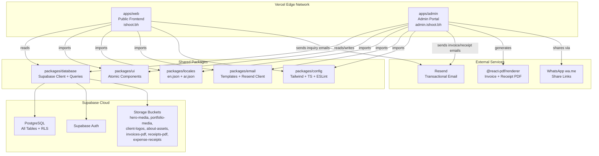
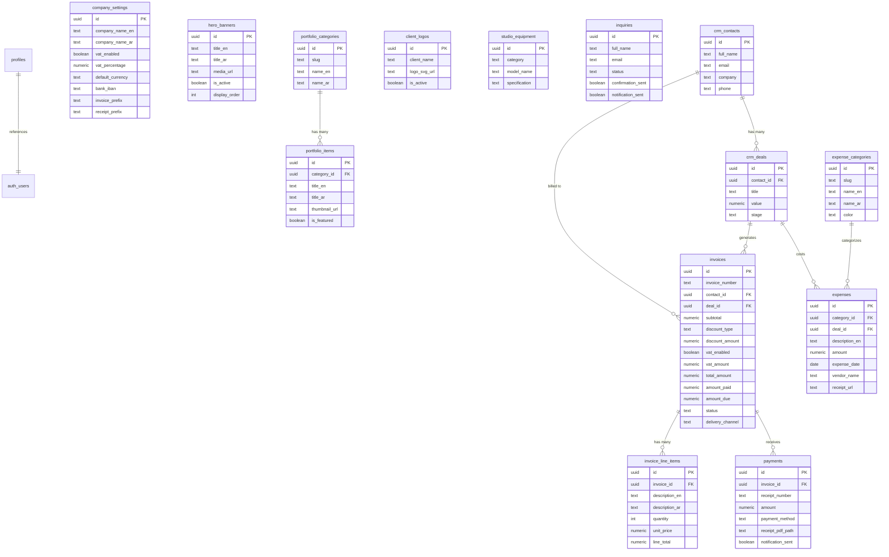
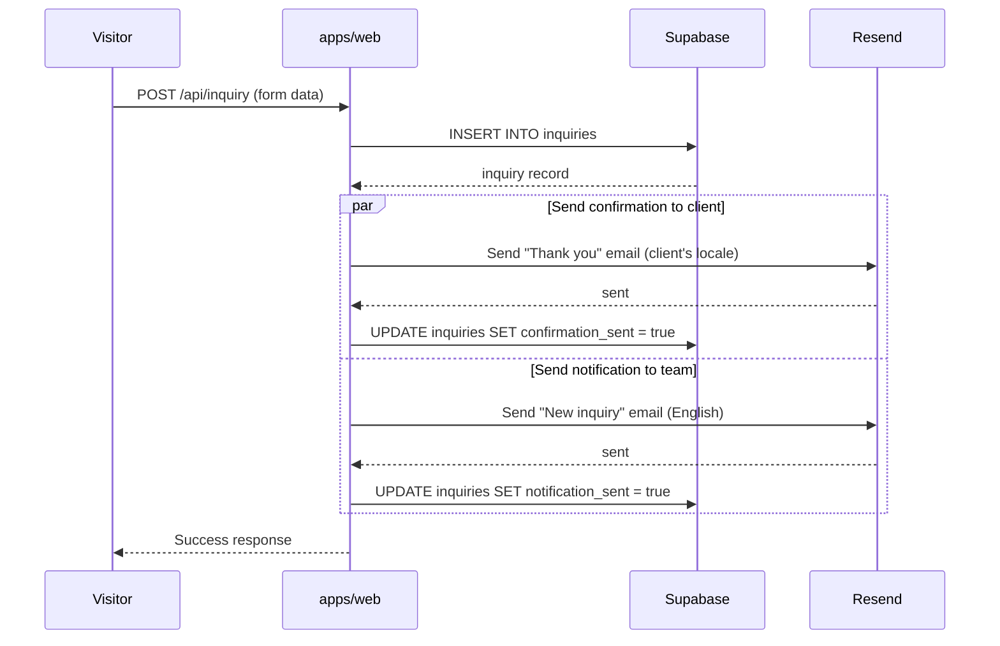
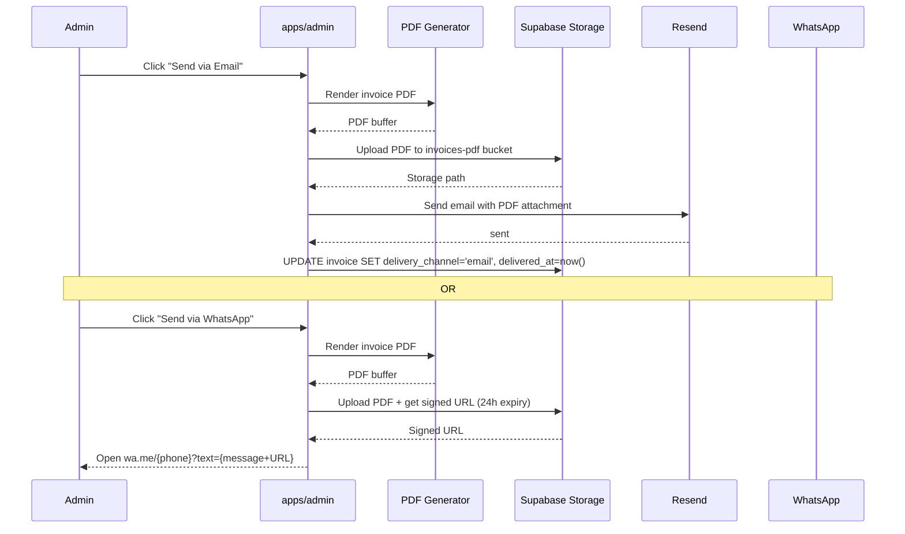
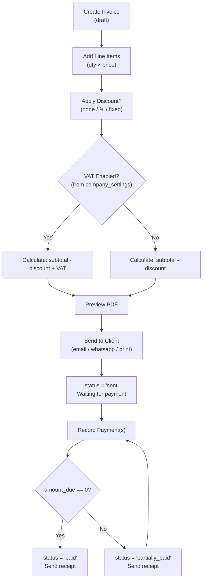

# ishoot Ecosystem — Architecture & Technical Specification

---

## 1. System Architecture Overview



---

## 2. Turborepo Configuration

### 2.1 Monorepo Structure

```
ishoot.bh/           ← Git root & Turborepo root
├── apps/web/         ← Next.js 15 (App Router) — Public site
├── apps/admin/       ← Next.js 15 (App Router) — Admin CMS + CRM + Finance
├── packages/database/ ← Supabase client, typed queries, migrations
├── packages/ui/       ← Shared React components
├── packages/locales/  ← Translation JSON files + loader
├── packages/email/    ← Email templates + Resend client
└── packages/config/   ← Shared Tailwind, TypeScript, ESLint configs
```

### 2.2 turbo.json Pipeline

```json
{
  "$schema": "https://turbo.build/schema.json",
  "globalDependencies": ["**/.env.*local"],
  "pipeline": {
    "build": {
      "dependsOn": ["^build"],
      "outputs": [".next/**", "!.next/cache/**"]
    },
    "lint": { "dependsOn": ["^build"] },
    "dev": { "cache": false, "persistent": true },
    "type-check": { "dependsOn": ["^build"] }
  }
}
```

### 2.3 pnpm-workspace.yaml

```yaml
packages:
  - "apps/*"
  - "packages/*"
```

---

## 3. Next.js 15 Configuration

### 3.1 Common Patterns (Both Apps)

- **Runtime**: Node.js (server components by default)
- **App Router**: File-based routing with layouts
- **Tailwind CSS v4**: Via shared `packages/config` preset
- **Environment Variables**:
  - `NEXT_PUBLIC_SUPABASE_URL`
  - `NEXT_PUBLIC_SUPABASE_ANON_KEY`
  - `SUPABASE_SERVICE_ROLE_KEY` (server-only)
  - `RESEND_API_KEY` (server-only)

### 3.2 apps/web — Internationalized Routing

```
apps/web/app/
├── layout.tsx              ← Root: fonts, metadata, viewport
├── api/inquiry/route.ts    ← Contact form API (insert + send emails)
└── [locale]/               ← Dynamic locale segment
    ├── layout.tsx           ← Sets dir, lang, font-class
    ├── page.tsx             ← Home
    ├── works/page.tsx       ← Portfolio
    ├── about/page.tsx       ← About
    └── contact/page.tsx     ← Contact form
```

### 3.3 apps/admin — Auth-Protected Routes

```
apps/admin/app/
├── layout.tsx
├── login/page.tsx
└── dashboard/
    ├── layout.tsx          ← Sidebar + topbar shell
    ├── page.tsx            ← Overview
    ├── cms/                ← Content management
    ├── crm/                ← Deal pipeline + contacts
    ├── invoices/           ← Invoice studio
    ├── payments/           ← Payment tracking
    ├── expenses/           ← Expense management
    ├── finance/            ← Financial dashboard
    └── settings/
        └── company/        ← Company settings (VAT, bank, etc.)
```

---

## 4. Supabase Architecture

### 4.1 Database Schema Relationships



### 4.2 Row Level Security Strategy

| Table                  | Public (anon)                | Authenticated (editor) | Authenticated (producer+) |
| ---------------------- | ---------------------------- | ---------------------- | ------------------------- |
| `company_settings`     | SELECT (for invoice display) | SELECT                 | super_admin: ALL          |
| `hero_banners`         | SELECT where `is_active`     | ALL                    | ALL                       |
| `portfolio_items`      | SELECT all                   | ALL                    | ALL                       |
| `portfolio_categories` | SELECT all                   | ALL                    | ALL                       |
| `client_logos`         | SELECT where `is_active`     | ALL                    | ALL                       |
| `studio_equipment`     | SELECT all                   | ALL                    | ALL                       |
| `inquiries`            | INSERT only                  | None                   | ALL                       |
| `crm_contacts`         | None                         | None                   | ALL                       |
| `crm_deals`            | None                         | None                   | ALL                       |
| `invoices`             | None                         | None                   | ALL                       |
| `invoice_line_items`   | None                         | None                   | ALL                       |
| `payments`             | None                         | None                   | ALL                       |
| `expense_categories`   | None                         | None                   | ALL                       |
| `expenses`             | None                         | None                   | ALL                       |

### 4.3 Storage Buckets

| Bucket             | Public | Purpose                                      |
| ------------------ | ------ | -------------------------------------------- |
| `hero-media`       | ✅     | Hero banner videos + poster images           |
| `portfolio-media`  | ✅     | Portfolio thumbnails, videos, galleries      |
| `client-logos`     | ✅     | Client logo SVGs/PNGs                        |
| `about-assets`     | ✅     | CEO portrait, studio photos                  |
| `invoices-pdf`     | ❌     | Generated invoice PDFs (signed URLs)         |
| `receipts-pdf`     | ❌     | Generated payment receipt PDFs (signed URLs) |
| `expense-receipts` | ❌     | Uploaded expense receipt images/PDFs         |

---

## 5. Email Architecture

### 5.1 Email Service (Resend)

```typescript
// packages/email/src/index.ts
import { Resend } from "resend";

const resend = new Resend(process.env.RESEND_API_KEY);

export async function sendEmail({
  to,
  subject,
  react,
  attachments,
}: EmailOptions) {
  return resend.emails.send({
    from: "ishoot <hello@ishoot.bh>",
    to,
    subject,
    react,
    attachments,
  });
}
```

### 5.2 Email Templates (React Email)

```
packages/email/src/
├── index.ts                           ← Resend client + sendEmail()
├── templates/
│   ├── layout.tsx                     ← Shared brand layout (header, footer)
│   ├── inquiry-confirmation.tsx       ← "Thank you for contacting ishoot"
│   ├── inquiry-notification.tsx       ← "[Name] is requesting to contact you"
│   ├── invoice-delivery.tsx           ← Invoice email with PDF attachment
│   ├── payment-receipt.tsx            ← Payment received + receipt PDF
│   └── invoice-reminder.tsx           ← Payment reminder (future)
```

### 5.3 Contact Form Email Flow



### 5.4 Invoice/Payment Delivery Flow



---

## 6. Financial Data Flows

### 6.1 Invoice Lifecycle



### 6.2 Financial Dashboard Aggregation

```sql
-- Revenue (paid) for a period
SELECT SUM(p.amount) as paid_revenue
FROM payments p
WHERE p.payment_date BETWEEN :start AND :end;

-- Revenue (outstanding)
SELECT SUM(i.amount_due) as outstanding
FROM invoices i
WHERE i.status IN ('sent', 'partially_paid', 'overdue');

-- Expenses by category for a period
SELECT ec.name_en, ec.color, SUM(e.amount) as total
FROM expenses e
JOIN expense_categories ec ON e.category_id = ec.id
WHERE e.expense_date BETWEEN :start AND :end
GROUP BY ec.id ORDER BY total DESC;

-- Profit
SELECT
  (SELECT SUM(amount) FROM payments WHERE payment_date BETWEEN :start AND :end) as revenue,
  (SELECT SUM(amount) FROM expenses WHERE expense_date BETWEEN :start AND :end) as expenses,
  revenue - expenses as profit;

-- Discounts given
SELECT SUM(discount_amount) FROM invoices
WHERE created_at BETWEEN :start AND :end AND discount_amount > 0;

-- VAT collected
SELECT SUM(vat_amount) FROM invoices
WHERE vat_enabled = true AND created_at BETWEEN :start AND :end;
```

---

## 7. Internationalization (i18n) Architecture

### 7.1 Translation Loading

```typescript
// packages/locales/src/index.ts
import en from "./en.json";
import ar from "./ar.json";

export type Locale = "en" | "ar";
export type TranslationKeys = typeof en;

const translations: Record<Locale, TranslationKeys> = { en, ar };

export function getTranslations(locale: Locale): TranslationKeys {
  return translations[locale];
}
```

### 7.2 Locale Layout

```typescript
// apps/web/app/[locale]/layout.tsx
export default function LocaleLayout({ children, params: { locale } }) {
  const isArabic = locale === 'ar';
  return (
    <html dir={isArabic ? 'rtl' : 'ltr'} lang={locale}>
      <body className={isArabic ? 'font-arabic' : 'font-english'}>
        {children}
      </body>
    </html>
  );
}
```

---

## 8. Deployment Strategy

### 8.1 Vercel Configuration

| App          | Domain            | Build Command                |
| ------------ | ----------------- | ---------------------------- |
| `apps/web`   | `ishoot.bh`       | `turbo build --filter=web`   |
| `apps/admin` | `admin.ishoot.bh` | `turbo build --filter=admin` |

### 8.2 Environment Variables

```
# Shared
NEXT_PUBLIC_SUPABASE_URL=https://xxxxx.supabase.co
NEXT_PUBLIC_SUPABASE_ANON_KEY=eyJhbGci...

# Server-only
SUPABASE_SERVICE_ROLE_KEY=eyJhbGci...
RESEND_API_KEY=re_xxxx

# Web only
NEXT_PUBLIC_SITE_URL=https://ishoot.bh

# Admin only
NEXT_PUBLIC_ADMIN_URL=https://admin.ishoot.bh
```

---

## 9. Key Technical Dependencies

| Package                   | Version   | Purpose                          |
| ------------------------- | --------- | -------------------------------- |
| `next`                    | `^15.0`   | Framework (App Router)           |
| `react`                   | `^19.0`   | UI library                       |
| `tailwindcss`             | `^4.0`    | Utility CSS                      |
| `@supabase/supabase-js`   | `^2.45`   | Database client                  |
| `@supabase/ssr`           | `^0.5`    | Server-side auth                 |
| `framer-motion`           | `^11.0`   | Scroll animations                |
| `lenis`                   | `^1.1`    | Smooth scroll                    |
| `@react-pdf/renderer`     | `^4.0`    | Invoice + Receipt PDF generation |
| `lucide-react`            | `^0.400`  | Icons                            |
| `resend`                  | `^4.0`    | Transactional email              |
| `@react-email/components` | `^0.0.25` | Email templates                  |
| `@dnd-kit/core`           | `^6.0`    | Drag-and-drop (Kanban)           |
| `@dnd-kit/sortable`       | `^8.0`    | Sortable lists                   |
| `recharts`                | `^2.12`   | Financial dashboard charts       |
| `date-fns`                | `^3.0`    | Date formatting & manipulation   |
| `turbo`                   | `^2.0`    | Build orchestration              |
